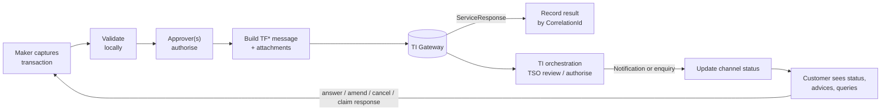
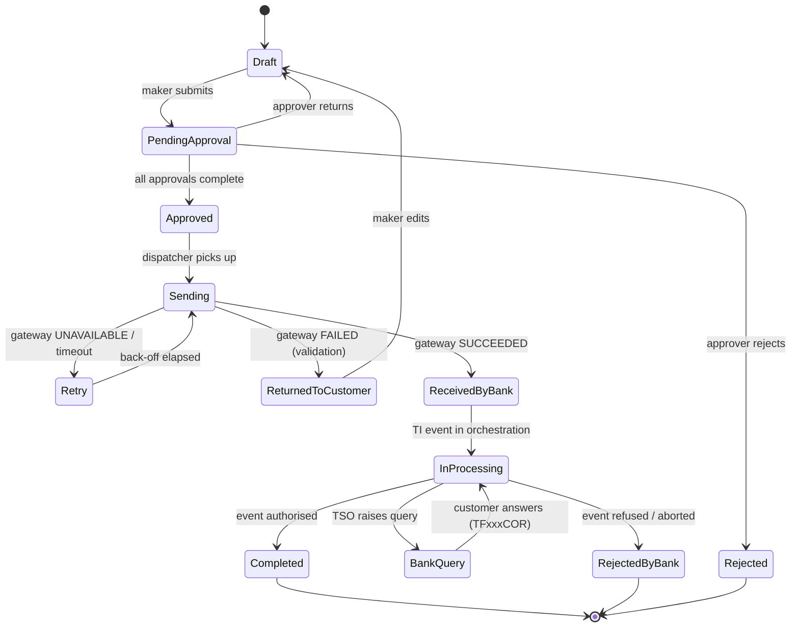

# 02 – Trade Corporate Channel: Functional Specification

> Part of the Trade Corporate Channel design set. Companion documents:
> [01 – Interface Catalogue](01-interface-catalogue.md) ·
> [03 – Import LC Issuance Flow](03-import-lc-issuance.md)

| | |
|---|---|
| Status | Draft for review |
| Core system | Finastra Fusion Trade Innovation (TI Plus), FTI Gateway 2.11.5.2.J |
| Basis | Interface documentation in this repository. Business rules not visible in the interface documents are marked **[Assumption]** or listed in section 11. |

## 1. Purpose and scope

The channel replaces the current application in which corporate customers key in their own trade transactions. Today those transactions are later processed in the core trade finance system by our **trade service officers (TSOs)**. The new channel must:

1. let a corporate customer capture, approve and submit trade instructions;
2. deliver each instruction to TI as the correct **event** on the correct **master**;
3. show the customer where each transaction stands and what happened to it;
4. give the bank's TSOs a clean, complete instruction so that manual re-keying in TI is minimal.

**In scope:** customer-facing channel (web), its back end, and the integration to TI through the FTI Gateway.

**Out of scope:** TI configuration, TSO processing screens, SWIFT connectivity, core banking and limit systems, and migration of historic transactions (`*DTO` messages).

## 2. Actors

| Actor | Description |
|---|---|
| **Corporate maker** | Customer employee who prepares and saves a transaction. |
| **Corporate approver** | Customer employee who authorises it. The number of approvers and approval limits are customer-configurable. |
| **Corporate admin** | Manages the customer's users, roles, account/product entitlements and beneficiary address book. |
| **Bank channel admin** | Bank staff who onboard customers, set entitlements and manage reference data and templates. |
| **TSO** | Works in TI. Not a channel user, but their actions (repair, query, reject, authorise) must be reflected in the channel. |
| **TI Gateway** | System actor. Receives instructions and returns responses and notifications. |

## 3. Overall flow



Key principles:

* **TI is the book of record** for the transaction. The channel is the book of record for *customer intent*: drafts, approvals, audit trail and the exact message sent.
* The channel never decides credit, limit, sanction or pricing outcomes. TI and the bank's host systems do.
* Every outbound message carries the channel's own references (`eBankMasterRef`, `eBankEventRef`) and a unique `CorrelationId`.

## 4. Functional requirements

Priority uses MoSCoW: **M**ust, **S**hould, **C**ould. "Msg" lists the interface messages involved (see document 01).

### 4.1 Access and entitlement

| ID | Requirement | Pri | Msg |
|---|---|---|---|
| FR-01 | Authenticate corporate users with the bank's standard strong authentication. | M | – |
| FR-02 | Each user belongs to one or more corporate customers (TI customer mnemonic). Every request to TI uses the customer mnemonic of the selected corporate. | M | `Context.Customer` |
| FR-03 | Role-based entitlements per user: product (ILC, ELC, ...), action (create, approve, view), and amount limit per currency. | M | – |
| FR-04 | Maker-checker: a maker cannot approve their own transaction. Approval workflow supports 1 to n approvers and "any/all" rules. | M | – |
| FR-05 | Full audit trail of who did what and when, including the exact message sent to TI. | M | – |

### 4.2 Transaction capture

| ID | Requirement | Pri | Msg |
|---|---|---|---|
| FR-10 | Provide capture forms for each supported instruction type. Form fields, lengths and allowed values derive from the interface schema (see 6). | M | `TF*` |
| FR-11 | Save as draft, resume later, copy from an earlier transaction, and create from a saved template. | M | `Context.TemplateIdentifier` |
| FR-12 | Field-level validation in the browser **and** in the back end: data type, length, enumeration, date logic (for example expiry not before issue), amount precision. | M | – |
| FR-13 | Party capture: pick from the customer's address book or enter free text. Support the structured address (`MXAddress`) and the 4-line SWIFT trade address (`SwiftTradeAddress`) as defined by the schema. | M | party blocks |
| FR-14 | Text fields that TI maps to SWIFT must enforce the SWIFT character set and line lengths. **[Assumption: confirm exact set with the bank's SWIFT team.]** | M | – |
| FR-15 | Show the user the *meaning* of coded values (for example `Revocable`, `Confirmation`, `TermsOfPayment.AvailableBy`) and never the raw code. | M | enumerations |
| FR-16 | Attach supporting documents (PDF, images, Office files) with a document type from the bank's list. Enforce size and type limits. | M | `EmbeddedItems` |
| FR-17 | Currency/amount helper: amount precision per currency; optional FX indication for display. **[Assumption: from the bank's rate source, not from TI.]** | S | – |
| FR-18 | Pre-submission "preview" that renders the instruction as a printable instruction letter. | S | – |
| FR-19 | Bulk upload of simple instructions (for example repayments) from a file. | C | `TFFxxRPY` |

### 4.3 Submission and integration

| ID | Requirement | Pri | Msg |
|---|---|---|---|
| FR-20 | After final approval, build the correct `TF*` message, call the gateway and store the full request, response and timing. | M | `TF*` |
| FR-21 | Generate a unique `CorrelationId` per attempt and unique `eBankMasterRef` / `eBankEventRef` per transaction/event. | M | headers, `eBank*Ref` |
| FR-22 | Idempotent submission: a retry after timeout or `UNAVAILABLE` must not create a second event in TI. Use the same `eBankEventRef`; confirm the outcome by enquiry before any re-send. **[Assumption: TI does not reject duplicates by itself – test.]** | M | `SearchMasters`, `RetrieveMasterDetail` |
| FR-23 | Interpret `ResponseHeader.Status`: `SUCCEEDED` → *Received by bank*; `FAILED` → show `Details.Error` text in business language and return the draft to the maker; `UNAVAILABLE` → queue and retry with back-off. | M | `ServiceResponse` |
| FR-24 | Store the master reference TI allocates (`OurReference` / `MasterRef`) against the channel transaction as soon as it is known. | M | response, `SearchMasters` |
| FR-25 | Send attachments either inline (`EmbeddedItems`) or by prior upload (`DocumentAttachment` then `DocumentsReceived`). Choose one approach (see 11, Q8). | M | `DocumentAttachment` |
| FR-26 | Operations console for the bank: list of failed/stuck submissions with the raw message, manual retry, and export. | S | – |

### 4.4 Status tracking and enquiry

| ID | Requirement | Pri | Msg |
|---|---|---|---|
| FR-30 | Transaction list for the customer with search by reference, product, currency, date, status, counterparty. | M | `SearchMasters` |
| FR-31 | Transaction detail: master data, event history, outstanding claims, amounts, expiry. | M | `RetrieveMasterDetail`, `RetrieveMasterSummaries` |
| FR-32 | Channel status for each submitted item follows the lifecycle in section 5, driven by gateway response, TI notifications and periodic enquiry. | M | `Notifications.All`, enquiries |
| FR-33 | Receive TI notifications (push), map `Category`/`Subcategory`/`Type` to channel events, and de-duplicate. **[Assumption: the bank will configure TI to send these to the channel – see Q4.]** | S | `Notifications.All` |
| FR-34 | Fallback polling of open transactions at a configurable interval when notifications are unavailable. | M | enquiries |
| FR-35 | Expiring-soon and outstanding-claim alerts. | S | `SearchMasters` (expiry range) |
| FR-36 | Export lists and details to PDF/CSV. | S | – |

### 4.5 Post-issuance servicing

| ID | Requirement | Pri | Msg |
|---|---|---|---|
| FR-40 | Amend an existing transaction (customer-initiated). Form is pre-filled from the current master. | M | `TFILCAMN`, `TFISBAMN`, `TFIGTAMN`, `TFUTIAMN`, `TFELCAMD`, ... |
| FR-41 | Request cancellation. | M | `TFILCCAN`, `TFISBCAN`, `TFIGTCAN`, `TFUTICAN` |
| FR-42 | Respond to claims / presentations: approve or refuse, with narrative. | M | `TFILCPYR`, `TFISBPYR`, `TFIGTPYR`, `TFUTIPYR` |
| FR-43 | Correspondence: send a free-text message or answer a bank query, referencing a master. Show the thread. | M | `TFxxxCOR` |
| FR-44 | Respond to beneficiary-response events (accept or reject amendment/cancellation). | S | `TFxxxBMR`, `TFxxxBCR` |
| FR-45 | Request a shipping guarantee against an import LC or collection. | S | `TFSHGAPP` |
| FR-46 | Provide settlement or repayment instruction for financing. | S | `TFFxxRPY` |

### 4.6 Reference data and administration

| ID | Requirement | Pri | Msg |
|---|---|---|---|
| FR-50 | Maintain channel reference data: countries, currencies, Incoterms, goods codes, document types, charge-bearer codes, list values and bank branches. Source and refresh method per Q5. | M | static-data entities |
| FR-51 | Beneficiary and counterparty address book with approval workflow for changes. | M | party blocks |
| FR-52 | Template management (customer-owned and bank-published). | S | `TemplateIdentifier` |
| FR-53 | Bank admin console for customer onboarding, entitlements, product enablement and message-mapping configuration. | M | – |
| FR-54 | Message-mapping configuration is versioned so that a gateway upgrade can be introduced without code change where possible. | S | – |

### 4.7 Non-functional requirements

| ID | Requirement |
|---|---|
| NFR-01 | **Security:** TLS everywhere; gateway credentials held in a secrets store; request signing if the gateway uses `Certificate`/`Digest`; no gateway credentials in logs. Personal and commercial data encrypted at rest. |
| NFR-02 | **Availability:** channel stays usable (drafts, approvals, read-only views from last known state) when the gateway is down. Submissions queue and drain on recovery. |
| NFR-03 | **Performance:** list/detail pages under 2 s at p95 from the channel's own store. Gateway round-trips excluded. |
| NFR-04 | **Traceability:** every channel transaction links to its `CorrelationId`s, TI master reference and event reference. |
| NFR-05 | **Retention:** keep submitted messages and attachments for the bank's regulatory retention period. **[Assumption: value to be supplied.]** |
| NFR-06 | **Localisation:** English plus bank-specified languages. Party language codes in the schema are 2-character. |
| NFR-07 | **Accessibility:** WCAG 2.1 AA. |

## 5. Transaction lifecycle (channel view)



**Mapping to TI.** `ReceivedByBank` is set on `SUCCEEDED`. States after that (`InProcessing`, `BankQuery`, `Completed`, `RejectedByBank`) are **inferred** from notifications and from `RetrieveMasterDetail` / `SearchMasters` results. The exact TI status values exposed by the enquiry definitions are not documented in this repository, so they are configured through `DefinitionID` (see Q3).

## 6. Schema-driven forms

The 181 `TF*` messages share a common skeleton (document 01, section 4) and differ in the product block. Writing 181 forms by hand is not practical, so:

* Generate a **machine-readable schema catalogue** from `sources/xsd_element_docs/*.xsd.txt` (element path, type, min/max length, nillable, repeating, enumeration, description).
* Layer a **form definition** on top: grouping, labels, help text, order, visibility rules, and which elements to hide or default. Fields that a corporate must never set (for example `Team`, `Step`, `ExchangeNonAutoComplete`, `ExternalReview`, `BankCodes`, `ProvisionalFlags`) are hidden or fixed by the bank.
* Generate request builders and validators from the same catalogue, so form, validator and message cannot drift apart.

Rules the schema documentation supports directly:

| Rule | Example |
|---|---|
| Length limits | `Goods` ≤ 53,600; `NameAddress` ≤ 1,024; `Branch` 1–8; SWIFT trade address lines ≤ 35. |
| Enumerations | `Confirmation` ∈ {C, M, W}; `IssueBy` ∈ {e, o, 5, a, i, 1, 6, 4, 2, 3}; `ApplcableRules` ∈ {E, P, I, O, U, C}. |
| Boolean as Y/N | `Revocable`, `Transferable`, `StandBy`. |
| Decimal precision | `InvoicePct` is decimal(17,2) in the range 0–100. |
| Conditional fields | `ApplcableRulesNarrative` only when `ApplcableRules` = `O` (OTHR); `DraftsDrawnOnBank` only when `DraftsDrawnOn` = `O`. |

## 7. Integration architecture

```mermaid
flowchart TB
    subgraph Customer
      UI[Web / mobile UI]
    end
    subgraph Channel
      API[Channel API]
      WF[Workflow and<br/>approval engine]
      MAP[Message builder<br/>and validator]
      Q[(Outbox queue)]
      DISP[Dispatcher]
      NOT[Notification<br/>receiver]
      POLL[Status poller]
      DB[(Channel DB)]
      DOC[(Document store)]
      REF[(Reference data)]
    end
    subgraph Bank
      GW[FTI Gateway]
      TI[TI Plus core]
      HOST[Core banking / limits / FX]
    end
    UI --> API --> WF --> MAP --> Q --> DISP --> GW --> TI --> HOST
    GW -. ServiceResponse .-> DISP --> DB
    TI -. Notifications.All .-> NOT --> DB
    POLL --> GW
    API --> DB
    API --> DOC
    MAP --> REF
```

Design rules:

1. **Transactional outbox.** Approval writes the finalised XML to the outbox in the same database transaction. The dispatcher sends from the outbox. No message is lost when the process stops between "approved" and "sent".
2. **Single-flight per transaction.** At most one in-flight message per master, so events reach TI in order (for example an amendment cannot overtake the issuance).
3. **Correlation.** The gateway response is matched by `CorrelationId`. Notifications and enquiry results are matched by `eBankMasterRef` / `eBankEventRef` or the TI master reference.
4. **Timeouts are not failures.** A timeout moves the item to `Retry` only after an enquiry shows that TI has no matching event.
5. **Gateway adapter isolation.** All XML, namespace and header details live in one adapter module. The rest of the system uses a neutral internal model.
6. **Replay and audit.** Store raw requests and responses, with credentials removed.

### Conceptual data model

| Entity | Key attributes |
|---|---|
| `Corporate` | TI customer mnemonic, name, status, enabled products, branch. |
| `User`, `Role`, `Entitlement` | Product, action, amount limit per currency. |
| `Transaction` | Channel id, product, TI master ref, `eBankMasterRef`, status, owner corporate. |
| `Instruction` | Event type, message name (`TFILCAPP` ...), payload (JSON), version of form and mapping, state. |
| `Approval` | Instruction, approver, decision, timestamp, comment. |
| `Submission` | Instruction, `CorrelationId`, attempt number, request XML, response XML, `Status`, timestamps. |
| `Attachment` | Instruction, file, mime type, TI `DocType`, DMS ids once uploaded. |
| `Party` | Address-book entry in structured and SWIFT 4-line form. |
| `TemplateDef` | Owner, product, payload. |
| `NotificationLog` | Raw TI notification, matched transaction, processed flag. |

## 8. Product coverage

The table groups the 181 messages. Detail per product is in document 01, section 5.

| Priority | Scope | Instruction types the customer can start |
|---|---|---|
| **P1** | Import LC (`ILC`) | Issue (`TFILCAPP`), back-to-back issue (`TFILCBTB`), amend (`TFILCAMN`), cancel (`TFILCCAN`), approve/refuse claim (`TFILCPYR`), correspondence (`TFILCCOR`). |
| | Import standby (`ISB`) | Issue, amend, cancel, claim response, correspondence. |
| | Guarantee issued (`IGT`) and undertaking issued (`UTI`) | Issue, amend, cancel, claim response, correspondence. |
| | Shipping guarantee (`SHG`) | Request, correspondence. |
| | Inward collection | Accept / pay / refuse (`TFCOLACP`, `TFCOLPAY`, `TFCOLCON`, `TFCOLNACP`), correspondence. |
| | Generic | `TFRCVDOC` (documents with a new or existing master), `TFATTDOC`. |
| **P2** | Export LC / standby / guarantee / undertaking received | Amendment responses, document presentation, assignment of proceeds, transfer, correspondence. |
| | Outward collection | Create (`TFCOLNEW`, `TFODCCRE`), discount, advance, correspondence. |
| **P3** | Financing and repayment | Request finance (`TFFINNEW`, `TFFSCNEW`, `TFFECNEW`), repay (`TFFxxRPY`), drawdown. |
| | Open account, invoice, SCF | `TFIOA*`, `TFEOA*`, `TFINV*`, `TFCRN*`, `TFBUY*`, `TFSEL*`. |
| **P4** | Payments | Customer payment, cheque, standing order. |

**Rationale.** P1 is the import side in which the customer is the applicant: highest volume of customer-keyed data, the heaviest TSO re-keying, and the product with the richest schema, so it validates the generic form engine. Export messages are mostly responses to bank advices and need the advising flow built first. Financing and open account depend on programme and limit set-up that must be confirmed with the business.

## 9. Delivery phasing

| Phase | Outcome |
|---|---|
| **0 – Foundations** | Gateway adapter, schema catalogue generator, outbox/dispatcher, reference-data loader, test harness against the TI test environment. Close open questions Q1–Q5. |
| **1 – Import LC issuance** (document 03) | Draft, approve, submit `TFILCAPP`; status by enquiry; attachments. First production release for a pilot corporate. |
| **2 – Import servicing** | Amend, cancel, claim response, correspondence for ILC; extend to ISB, IGT, UTI. Notifications. |
| **3 – Collections, shipping guarantee, documents** | Inward collection responses, `TFSHGAPP`, `TFRCVDOC`. |
| **4 – Export side** | ELC/ESB/EGT/UTR responses; outward collections. |
| **5 – Financing, open account, payments** | As prioritised by the business. |

## 10. Testing approach

* **Contract tests** per message: build from a fixture, validate against the schema rules in section 6, and compare with the golden XML.
* **Gateway sandbox tests** against a TI test instance for every message type in the release: `SUCCEEDED`, a `FAILED` with a known validation error, `UNAVAILABLE` (simulated), duplicate submission.
* **End-to-end** with a TSO: submit from the channel, process in TI, check the status coming back.
* **Negative tests:** over-length text, invalid enumeration, past dates, missing party, oversized attachment, SWIFT-invalid characters.
* **Reconciliation test:** every channel transaction has a TI master; every TI master created by the channel has a channel transaction.

## 11. Open questions

| # | Question | Why it matters | Owner |
|---|---|---|---|
| Q1 | Which party calls which service? Confirm that `Customer`, `Account`, `Limit`, `BusinessSupport`, `StandingSettlements` are TI → host and not available to the channel. | Decides how the channel validates accounts, customers and limits. | TI team |
| Q2 | What do `NoRepair`, `NoOverride`, `TransactionControl`, `GroupingId`, `ReplyFormat`, `ReplyTarget` do, and which values should the channel send? | Needed to build the request header correctly. | TI team |
| Q3 | Which `DefinitionID` values exist for `SearchMasters` and `RetrieveMasterDetail`, and what status fields do they return? | Defines the status information available to the channel. | TI team |
| Q4 | Will TI send `Notifications.All` to the channel? Which categories? Over what transport? | Push vs. polling design. | TI team, infrastructure |
| Q5 | How will the channel get reference data (code lists, branches, charge codes, document types)? The repository contains only maintenance messages, no retrieval. | Dropdowns and validation. | TI team |
| Q6 | What is mandatory for each event in our TI configuration? Which fields do TSOs currently correct most often? | Drives form validation and reduces TSO rework. | Trade operations |
| Q7 | Does TI reject a duplicate `eBankEventRef`? How does it present duplicates? | Idempotency design (FR-22). | TI team |
| Q8 | Inline attachments (`EmbeddedItems`) or upload first (`DocumentAttachment`)? Size limits? | Message size and reliability. | TI team, architecture |
| Q9 | Which approval model do corporates need: per amount band, per product, per account? | Workflow engine scope. | Business |
| Q10 | Is the channel authorised to set `Team`, `Step`, `Product`/`Event` codes, or does TI derive them from the message name and customer? | Security: stops customers routing work. | TI team |
| Q11 | Legacy channel: which features, templates and data must move? Is there an existing customer address book? | Migration scope. | Business |
| Q12 | Regulatory requirements: retention, sanction screening before submission, e-signature, data residency. | NFR-05 and compliance design. | Compliance |

## 12. Traceability

Every functional requirement above names the messages it relies on. The complete message list with kinds and descriptions is in [01 – Interface Catalogue](01-interface-catalogue.md#5-business-message-catalogue-tf), and the first end-to-end flow is specified in [03 – Import LC Issuance Flow](03-import-lc-issuance.md).
