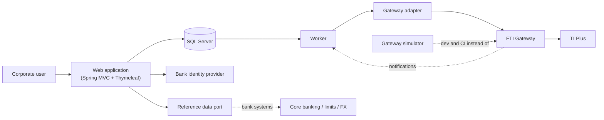

# Architecture

> Part of the Trade Corporate Channel design set. Functional specification: [02](../02-functional-specification.md) · Product specifications: [products](../products/README.md) · Agent guide: [AGENTS.md](../../AGENTS.md).

**Status: Proposed.** Java 21 and Thymeleaf were chosen by the project owner on 2026-10-19. SQL Server (preferred) as the database and Liquibase for migrations were stated on the same date. The rest (Spring Boot, Maven, htmx, test tools) are proposals for the bank's architects to confirm or change. Each decision is a short record with its alternatives and what it costs to reverse, so a change is a documented edit, not a surprise.

## Decisions

| # | Decision | Status |
|---|---|---|
| [0001](decisions/0001-language-and-monorepo.md) | Java 21, Spring Boot, Maven multi-module | Proposed (Java chosen) |
| [0002](decisions/0002-modular-monolith.md) | Modular monolith: web application, worker, gateway simulator | Proposed |
| [0003](decisions/0003-database-and-outbox.md) | SQL Server; Liquibase; transactional outbox for every submission to TI; Oracle kept possible | Proposed (SQL Server, Liquibase chosen) |
| [0004](decisions/0004-schema-catalogue.md) | One generated schema catalogue drives validators, builders and forms | Proposed |
| [0005](decisions/0005-gateway-adapter.md) | All XML and header details live in one gateway adapter module | Proposed |
| [0006](decisions/0006-frontend.md) | Server-rendered Thymeleaf with schema-driven forms | Proposed (Thymeleaf chosen) |
| [0007](decisions/0007-identity-and-entitlements.md) | OIDC login; entitlements and maker-checker enforced on the server | Proposed |
| [0008](decisions/0008-status-tracking.md) | Status from gateway response, polling and notifications, behind one port | Proposed |
| [0009](decisions/0009-testing-and-simulator.md) | Layered tests, ArchUnit, gateway simulator, Playwright | Proposed |
| [0010](decisions/0010-security-audit-observability.md) | Secrets, logging, audit and observability rules | Proposed |

## System context



## Repository layout

Three kinds of content, kept apart: **the application** (`app/`), **the documents** (`docs/`) and **the bank's material** (`sources/`). Everything else supports one of them. The build entry points (`pom.xml`, `mvnw`) stay at the root so `./mvnw verify` works from there.

```
/
├─ README.md, AGENTS.md, CLAUDE.md   start here: project map; agent guide (CLAUDE.md imports it)
├─ pom.xml, mvnw, .mvn/              Maven build entry: parent POM (Java 21, plugins) and wrapper
│
├─ app/                              THE APPLICATION – every Maven module
│  ├─ catalogue/                     generator, loader, validator, path constants      (0004)
│  ├─ domain/                        transactions, instructions, state machine, approvals, rules, ports
│  ├─ gateway-adapter/               XML, envelope and IBM MQ transport, GatewayClient (0005)
│  ├─ persistence/                   JDBC repositories, SqlDialect, Liquibase changelogs (db/changelog), outbox SQL  (0003)
│  ├─ web/                           Spring Boot app: controllers, Thymeleaf, security (0006, 0007)
│  ├─ worker/                        Spring Boot app: outbox dispatcher, TI replies and outward messages, status (0003, 0008)
│  ├─ gateway-simulator/             fake TI for dev and CI                            (0009)
│  ├─ testkit/                       fixtures, builders, golden XML, sample payloads
│  ├─ architecture-tests/            ArchUnit boundary rules and the vendor-SQL check over all modules (0009)
│  └─ e2e/                           Playwright for Java tests (profile e2e)
│
├─ docs/                             THE DOCUMENTS – design, specs, agent guide material (index: docs/README.md)
├─ sources/                          THE BANK'S MATERIAL – gateway docs, XSD jars, TI mappings, guides (read-only)
├─ tools/                            Python generators that build parts of docs/ from sources/
├─ infra/                            compose file for local development
├─ poc/                              throw-away IBM MQ proof of concept (not part of the app)
└─ .github/workflows/                CI
```

Maven commands address a module by its folder: `./mvnw -pl app/web spring-boot:run`.

Java base package: `com.bank.tradechannel` (placeholder, open question Q19), with one sub-package per module (`...catalogue`, `...gateway`, `...domain`, `...persistence`, `...web`, `...worker`, `...simulator`).

### Dependency rule

```
web, worker  →  domain, persistence, gateway-adapter, catalogue
persistence  →  domain, catalogue
gateway-adapter → catalogue
domain       →  catalogue          (ports: repositories, GatewayClient, ReferenceDataPort, DocumentStore, Clock)
catalogue    →  nothing
```

**Nothing except `gateway-adapter` knows XML, namespaces or header elements.** ArchUnit tests enforce the rule on every build (see 0009). `domain` defines the interfaces it needs (ports); `persistence`, `gateway-adapter` and the web/worker wiring implement them.

## Module responsibilities

| Module | Owns | Must not |
|---|---|---|
| `catalogue` | Machine-readable description of every message: paths, types, lengths, enumerations, repeating flags, prefix, order; validator; path constants; overlays | Contain business rules |
| `gateway-adapter` | Request/response XML, `RequestHeader`, namespaces, credentials, error mapping, timeouts, the `GatewayClient` implementation | Know about screens, users or approvals |
| `domain` | Transaction and instruction model, state machine, approval rules, business validations (V-rules in the specs), neutral `Payload`, ports | Do I/O or use Spring MVC/XML/JDBC APIs |
| `persistence` | SQL, Liquibase changelogs, repositories, the `SqlDialect` interface and `SqlServerDialect`, outbox claiming, audit writes | Decide business rules; use vendor SQL outside `SqlDialect` |
| `web` | Controllers, Thymeleaf templates and fragments, form definitions, security configuration, entitlement checks | Call the gateway; hold business rules that `domain` doesn't also own |
| `worker` | Outbox dispatch, retries, status polling, notification intake | Serve pages |
| `gateway-simulator` | Scripted gateway behaviour for tests | Be deployed to production |
| `testkit` | Shared test fixtures and builders | Be depended on by production code |

## Not decided here

Database version and DBA arrangements (Q20), cloud or on-premises, orchestrator, CI vendor, the bank's identity provider product, the document store, and the Java base package. They are recorded in [open questions](../agents/open-questions.md).
