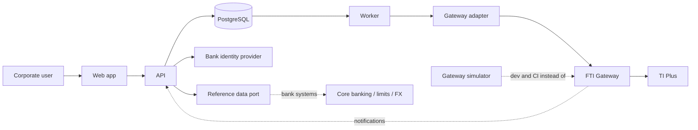

# Architecture

> Part of the Trade Corporate Channel design set. Functional specification: [02](../02-functional-specification.md) · Product specifications: [products](../products/README.md) · Agent guide: [AGENTS.md](../../AGENTS.md).

**Status: Proposed.** The stack and structure below are my proposal. The interface documents say nothing about our technology, so every decision here is open for the bank's architects to confirm or change. Each decision is a short record with its alternatives and what it costs to reverse, so a change is a documented edit, not a surprise.

## Decisions

| # | Decision | Status |
|---|---|---|
| [0001](decisions/0001-language-and-monorepo.md) | TypeScript monorepo (pnpm), Node.js LTS | Proposed |
| [0002](decisions/0002-modular-monolith.md) | Modular monolith with a separate worker and a gateway simulator | Proposed |
| [0003](decisions/0003-postgres-and-outbox.md) | PostgreSQL; transactional outbox for every submission to TI | Proposed |
| [0004](decisions/0004-schema-catalogue.md) | One generated schema catalogue drives validators, builders and forms | Proposed |
| [0005](decisions/0005-gateway-adapter.md) | All XML and header details live in one gateway adapter | Proposed |
| [0006](decisions/0006-frontend.md) | React single-page app with schema-driven forms | Proposed |
| [0007](decisions/0007-identity-and-entitlements.md) | OIDC login; entitlements and maker-checker enforced on the server | Proposed |
| [0008](decisions/0008-status-tracking.md) | Status from gateway response, polling and notifications, behind one port | Proposed |
| [0009](decisions/0009-testing-and-simulator.md) | Contract tests, gateway simulator, end-to-end tests | Proposed |
| [0010](decisions/0010-security-audit-observability.md) | Secrets, logging, audit and observability rules | Proposed |

## System context



## Target repository layout

Today the repository holds documentation and the specification generator. The code layout below is the target that the first scaffolding task creates (see [task T0](../agents/task-backlog.md)).

```
/
├─ AGENTS.md                      agent guide (CLAUDE.md imports it)
├─ docs/                          design documents (this folder, specs, agents)
├─ sources/                       FTI Gateway interface files (read-only input)
├─ tools/specgen/                 existing: generates docs/products from sources/
├─ packages/
│  ├─ schema-catalogue/           generated JSON catalogue + loader        (0004)
│  ├─ gateway-adapter/            builds and parses XML, headers, errors   (0005)
│  ├─ domain/                     transactions, instructions, state machine, approvals
│  ├─ api/                        HTTP API, auth, entitlements             (0007)
│  ├─ worker/                     outbox dispatcher, status poller         (0003, 0008)
│  ├─ web/                        React app                                (0006)
│  ├─ gateway-simulator/          fake FTI Gateway for dev and CI          (0009)
│  └─ testkit/                    fixtures, builders, golden files
├─ db/migrations/                 SQL migrations
├─ infra/                         container and deployment files
└─ .github/workflows/             CI
```

Dependency rule: `web` → `api` only over HTTP; `api` and `worker` → `domain`, `gateway-adapter`, `schema-catalogue`; `domain` depends on nothing but `schema-catalogue`; **nothing except `gateway-adapter` knows XML, namespaces or header elements.** CI enforces this with an import-boundary check.

## Module responsibilities

| Package | Owns | Must not |
|---|---|---|
| `schema-catalogue` | Machine-readable description of every message: element paths, types, lengths, enumerations, repeating flags, namespace prefix, order | Contain business rules |
| `gateway-adapter` | Request/response XML, `RequestHeader`, namespaces, credentials, error mapping, timeouts, the `GatewayClient` interface | Know about screens, users or approvals |
| `domain` | Transaction and instruction model, state machine, approval rules, business validations (V-rules in the specs), neutral JSON payloads per message | Do I/O |
| `api` | HTTP endpoints, sessions, entitlement checks, transaction CRUD, enquiry, documents | Call the gateway directly |
| `worker` | Outbox dispatch, retries, status polling, notification intake | Serve HTTP |
| `web` | Screens, client-side validation from the catalogue | Contain business rules that the server doesn't also enforce |
| `gateway-simulator` | Scripted gateway behaviour for tests | Be used in production |

## Not decided here

Cloud or on-premises, orchestrator, CI vendor, the bank's identity provider product, and the document store. They are recorded as open items in [open questions](../agents/open-questions.md) and [0010](decisions/0010-security-audit-observability.md).
