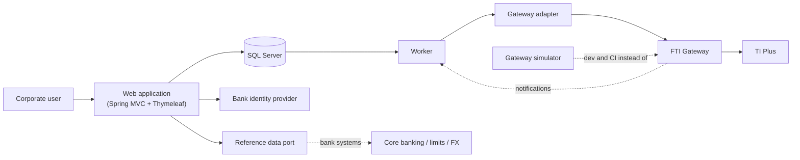

# Architecture

> Part of the Trade Corporate Channel design set. Functional specification: [02](../02-functional-specification.md) · Product specifications: [products](../products/README.md) · Agent guide: [AGENTS.md](../../AGENTS.md).

**Status: Proposed.** Java 21 and Thymeleaf were chosen by the project owner on 2026-10-19. SQL Server (preferred) as the database and Liquibase for migrations were stated on the same date. The rest (Spring Boot, Maven, htmx, test tools) are proposals for the bank's architects to confirm or change. Each decision is a short record with its alternatives and what it costs to reverse, so a change is a documented edit, not a surprise.

## Decisions

| # | Decision | Status |
|---|---|---|
| [0001](decisions/0001-language-and-monorepo.md) | Java 21, Spring Boot, Maven | Proposed (Java chosen) |
| [0002](decisions/0002-modular-monolith.md) | **One application** for the proof of concept; packages keep the module boundaries | Decided (2026-10-26) |
| [0003](decisions/0003-database-and-outbox.md) | SQL Server; Liquibase; transactional outbox for every submission to TI; Oracle kept possible | Proposed (SQL Server, Liquibase chosen) |
| [0004](decisions/0004-schema-catalogue.md) | One generated schema catalogue drives validators, builders and forms | Proposed |
| [0005](decisions/0005-gateway-adapter.md) | All XML and header details live in one gateway package | Proposed |
| [0006](decisions/0006-frontend.md) | Server-rendered Thymeleaf with schema-driven forms | Proposed (Thymeleaf chosen) |
| [0007](decisions/0007-identity-and-entitlements.md) | OIDC login; entitlements and maker-checker enforced on the server | Proposed |
| [0008](decisions/0008-status-tracking.md) | Status from gateway response, polling and notifications, behind one port | Proposed |
| [0009](decisions/0009-testing-and-simulator.md) | Layered tests, ArchUnit, gateway simulator, Playwright | Proposed |
| [0010](decisions/0010-security-audit-observability.md) | Secrets, logging, audit and observability rules | Proposed |

## System context



## Repository layout

Three kinds of content, kept apart: **the application** (`app/`), **the documents** (`docs/`) and **the bank's material** (`sources/`). Everything else supports one of them.

```
/
├─ README.md, AGENTS.md, CLAUDE.md   start here: project map; agent guide (CLAUDE.md imports it)
│
├─ app/                              THE APPLICATION – one Spring Boot app, one Maven project (0002)
│  ├─ pom.xml, mvnw, .mvn/           build: Java 21, Spotless, Error Prone, tests
│  └─ src/
│     ├─ main/java/com/bank/tradechannel/
│     │  ├─ TradeChannelApplication  the single entry point
│     │  ├─ catalogue/               message definitions, validator, path constants      (0004)
│     │  ├─ domain/                  transactions, instructions, state machine, approvals, rules, ports
│     │  ├─ gateway/                 XML, envelope and IBM MQ transport to TI            (0005)
│     │  ├─ persistence/             JDBC repositories, SqlDialect, outbox SQL           (0003)
│     │  ├─ web/                     controllers, security                               (0006, 0007)
│     │  └─ jobs/                    outbox dispatcher, TI reply and outward-message listeners, status polling (0003, 0008)
│     ├─ main/resources/             application.yml, templates/, static/, messages.properties, db/changelog/
│     └─ test/                       unit, web, architecture and *IT tests; the TI simulator and fixtures (0009)
│
├─ docs/                             THE DOCUMENTS – design, specs, agent guide material (index: docs/README.md)
├─ sources/                          THE BANK'S MATERIAL – gateway docs, XSD jars, TI mappings, guides (read-only)
├─ tools/                            Python generators that build parts of docs/ from sources/
├─ infra/                            compose file for local SQL Server and IBM MQ
├─ poc/                              throw-away IBM MQ proof of concept (not part of the app)
└─ .github/workflows/                CI
```

Build commands run in `app/`: `cd app && ./mvnw verify`.

Java base package: `com.bank.tradechannel` (placeholder, open question Q19).

### Package rule

One deployable, but the packages keep the boundaries that would become modules if the application is split later (0002):

```
web, jobs    →  domain, persistence, catalogue      (jobs also → gateway; web never talks to TI)
persistence  →  domain, catalogue
gateway      →  catalogue
domain       →  catalogue          (ports: repositories, GatewayClient, ReferenceDataPort, DocumentStore, Clock)
catalogue    →  nothing
```

**Nothing except `gateway` knows XML, namespaces or header elements.** ArchUnit tests (`app/src/test/java/.../architecture/`) enforce the rule on every build (see 0009). `domain` defines the interfaces it needs (ports); `persistence`, `gateway` and the web/jobs wiring implement them.

## Package responsibilities

| Package | Owns | Must not |
|---|---|---|
| `catalogue` | Machine-readable description of every message: paths, types, lengths, enumerations, repeating flags, prefix, order; validator; path constants; overlays | Contain business rules |
| `gateway` | Request/response XML, `RequestHeader`, namespaces, credentials, error mapping, timeouts, the IBM MQ client and listener plumbing | Know about screens, users or approvals |
| `domain` | Transaction and instruction model, state machine, approval rules, business validations (rules in the specs), neutral `Payload`, ports | Do I/O or use Spring MVC/XML/JDBC APIs |
| `persistence` | SQL, Liquibase changelogs, repositories, the `SqlDialect` interface and `SqlServerDialect`, outbox claiming, audit writes | Decide business rules; use vendor SQL outside `SqlDialect` |
| `web` | Controllers, Thymeleaf templates and fragments, form definitions, security configuration, entitlement checks | Call the gateway; hold business rules that `domain` doesn't also own |
| `jobs` | Outbox dispatch, retries, TI reply and outward-message intake, status polling | Serve pages |
| test code | The TI simulator (embedded broker, scenarios), fixtures and builders | Be packaged into the application |

## Not decided here

Database version and DBA arrangements (Q20), cloud or on-premises, orchestrator, CI vendor, the bank's identity provider product, the document store, and the Java base package. They are recorded in [open questions](../agents/open-questions.md).
