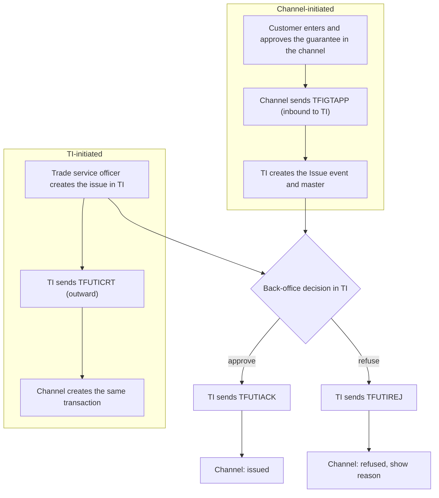

# IGT Issue process: two origins, one outcome

> Hand-written from the TI team's description, the TI setup screenshot and the three mappings received (2026-10-19). Statements marked **[Assumption]** are mine and go to the TI team as open questions.

## 1. TI setup for the channel interface

TI holds one gateway template per outward message for the interfacing party (role *Principal Party*):

| Template | Party role | Description in TI | Meaning for the channel |
|---|---|---|---|
| `TFUTIACK` | Principal Party | TP Gateway - Issued UT Acknowledgement | TI accepted the Issue event (back-office approval) |
| `TFUTICRT` | Principal Party | TP Gateway - Issued UT Issue-Bank Initiated | TI created the issue; the channel must create the same transaction |
| `TFUTIREJ` | Principal Party | TP Gateway - Issued UT Refuse Application Request | TI refused the issue (back-office decision) |

All three mappings are received: [TFUTICRT.md](TFUTICRT.md), [TFUTIACK.md](TFUTIACK.md), [TFUTIREJ.md](TFUTIREJ.md). What they show:

* **`TFUTIACK` is `TFUTICRT` with two differences.** Same 292 fields in the same order, including every `-S` and `-U` value; only the literal `BankComment` ("We have acknowledged your Undertaking Issuance request" instead of "We have Issued this Undertaking") and the name of tag `RTS` (`ResponseToInstructingParty` instead of `ResponseToSender`) differ. So the acknowledgement carries the full as-booked undertaking, and the same parser and crosswalk serve both.
* **`TFUTIREJ` is short (19 fields):** `eBankMasterRef`, `eBankEventRef`, `MasterRef`, `EventRef`, `TransactionDate`, `InstructingPartyRef`, `ApplicationDate`, `OurRequestTypeCodeSend`, `InstructionFromInstructingParty`, the principal and applicant, the two `Charges` tables and the two `AttachedDocuments` tables. **There is no refusal reason field**: `BankComment` is the fixed text "We are unable to process your application. Please contact your account manager for further information". The channel can show that a request was refused, not why.
* **All three echo `eBankMasterRef` and `eBankEventRef`** (tags `EBMR`, `EBER`), so a channel-initiated transaction is matched by the references it sent.

## 2. The process

| Origin | Created first in | Message that carries it | Direction | Result |
|---|---|---|---|---|
| Channel | Channel | `TFIGTAPP` | Channel to TI | TI creates the Issue event; both sides hold the same data |
| TI | TI | `TFUTICRT` | TI to channel | Channel creates the transaction; both sides hold the same data |

Either way the back-office decision in TI on the Issue event ends in `TFUTIACK` or `TFUTIREJ`.

## 3. What this changes in the design

1. **The channel must accept transactions it did not create.** TI confirmed that `TFUTICRT` does **not** fire when TI recognises that the transaction came from the channel. So a `TFUTICRT` always means a TI-initiated transaction: the channel creates it (origin = `TI`, read-only to the customer unless the bank says otherwise), keyed by `MasterRef` / `EventRef`. (Q27 answered.)
2. **Channel-started transactions complete on `TFUTIACK`, not `TFUTICRT`.** It echoes `eBankMasterRef` / `eBankEventRef` and carries the as-booked values. A TI-initiated transaction is issued once its `TFUTIACK` arrives too (**[Assumption]**: TI sends it after the back-office decision on that path as well; Q29).
3. **Refusal has its own message.** `TFUTIREJ` reports a business refusal, with a fixed text and no reason code. This is separate from a gateway `ServiceResponse` error, which only says TI did not accept the message for processing (doc 02, section 5). The state `Rejected by bank` is set by `TFUTIREJ`, not by polling. **[Assumption]**
4. **Duplicate and out-of-order delivery must be safe.** Match by `eBankMasterRef` first, then `MasterRef`. A `TFUTIACK` / `TFUTIREJ` that matches nothing is logged and held for the bank; only a `TFUTICRT` creates a transaction. A repeated `TFUTICRT` with a known `MasterRef` / `EventRef` is ignored. Safety net if TI mis-detects the origin: a `TFUTICRT` whose `eBankMasterRef` matches an open channel transaction is treated as its acknowledgement and logged.
5. **Two data models meet here.** The channel sends the flat Import Guarantee message (`TFIGTAPP`), while `TFUTICRT` is built from the structured undertaking fields (`-U` / `-S` event fields). The existing crosswalk ([TFUTICRT.md](TFUTICRT.md)) compares against the structured `TFUTIAPP` schema; only 9 of its 119 mapped paths also exist in `TFIGTAPP`. A crosswalk against `TFIGTAPP`, using the event field list for the IGT issue event ([event-fields-IGT-IIG.md](event-fields-IGT-IIG.md)), is needed before the as-booked comparison can be shown for a channel-started guarantee (Q28).
6. **Entitlement.** A `TFUTICRT` names a customer mnemonic for the principal. The channel shows the transaction only to users of the corporate that owns that mnemonic; an unknown mnemonic is logged and held for the bank (ground rule 8).

## 4. Channel states

| State | Set by |
|---|---|
| Draft, Pending approval | Channel (channel-initiated only) |
| Submitted | Outbox sends `TFIGTAPP` |
| Accepted by gateway / Rejected by gateway | `ServiceResponse` to `TFIGTAPP` |
| In bank processing | Gateway accepted, or `TFUTICRT` received (TI-initiated) |
| Issued | `TFUTIACK` |
| Refused by bank | `TFUTIREJ` |

## 5. Open questions

| Id | Question | State |
|---|---|---|
| Q26 | `TFUTIACK` / `TFUTIREJ`: refusal reason | Mappings received, references echoed; no reason field. Is a reason available another way? |
| Q27 | Does `TFUTICRT` fire for channel-initiated issues? | **Answered:** no, not when TI recognises the channel origin. |
| Q28 | `TFIGTAPP` (flat model) and the structured undertaking fields in the three messages: how do they correspond? | Open |
| Q29 | Are `TFUTIACK` / `TFUTIREJ` sent only on the Issue event? | Answered in part: after a `TFUTICRT`, TI can send further `TFUTIACK` / `TFUTIREJ` so the channel stays up to date; the last one wins. Other events still open. |

These are also in [open-questions](../agents/open-questions.md).
