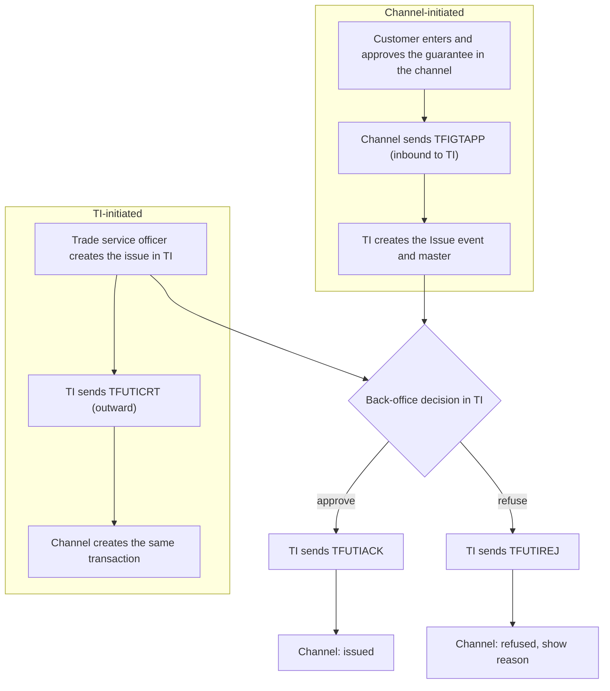

# IGT Issue process: two origins, one outcome

> Hand-written from the TI team's description and the TI setup screenshot (2026-10-19). Statements marked **[Assumption]** are mine and go to the TI team as open questions Q26–Q29.

## 1. TI setup for the channel interface

TI holds one gateway template per outward message for the interfacing party (role *Principal Party*):

| Template | Party role | Description in TI | Meaning for the channel |
|---|---|---|---|
| `TFUTIACK` | Principal Party | TP Gateway - Issued UT Acknowledgement | TI accepted the Issue event (back-office approval) |
| `TFUTICRT` | Principal Party | TP Gateway - Issued UT Issue-Bank Initiated | TI created the issue; the channel must create the same transaction |
| `TFUTIREJ` | Principal Party | TP Gateway - Issued UT Refuse Application Request | TI refused the issue (back-office decision) |

Only `TFUTICRT` has been received as a mapping ([TFUTICRT.md](TFUTICRT.md)). The mappings for `TFUTIACK` and `TFUTIREJ` have not been received (Q26).

## 2. The process

| Origin | Created first in | Message that carries it | Direction | Result |
|---|---|---|---|---|
| Channel | Channel | `TFIGTAPP` | Channel to TI | TI creates the Issue event; both sides hold the same data |
| TI | TI | `TFUTICRT` | TI to channel | Channel creates the transaction; both sides hold the same data |

Either way the back-office decision in TI on the Issue event ends in `TFUTIACK` or `TFUTIREJ`.

## 3. What this changes in the design

1. **The channel must accept transactions it did not create.** A `TFUTICRT` has no channel reference to match, so the channel creates a new transaction (origin = `TI`, read-only to the customer unless the bank says otherwise), keyed by `MasterRef` / `EventRef`. This replaces the earlier reading of `TFUTICRT` as the completion signal for a channel-started request; that reading was wrong for the channel-initiated path (Q26, Q27). **[Assumption]**
2. **Channel-started transactions complete on `TFUTIACK`, not `TFUTICRT`.** The acknowledgement should echo `eBankMasterRef` / `eBankEventRef`; if it does not, matching falls back to enquiry (Q26).
3. **Refusal has its own message.** `TFUTIREJ` gives a business refusal reason. This is separate from a gateway `ServiceResponse` error, which only says TI did not accept the message for processing (doc 02, section 5). The state `Rejected by bank` is set by `TFUTIREJ`, not by polling. **[Assumption]**
4. **Duplicate and out-of-order delivery must be safe.** A transaction that exists in both systems can be reported twice (for example, `TFIGTAPP` accepted, then a `TFUTICRT`-style echo). Matching by `eBankMasterRef` first, then `MasterRef`; a message that matches nothing and carries no echoed reference creates a TI-initiated transaction only when it is a `TFUTICRT` (Q27).
5. **Two data models meet here.** The channel sends the flat Import Guarantee message (`TFIGTAPP`), while `TFUTICRT` is built from the structured undertaking fields (`-U` / `-S` event fields). The existing crosswalk ([TFUTICRT.md](TFUTICRT.md)) compares against the structured `TFUTIAPP` schema; only 9 of its 119 mapped paths also exist in `TFIGTAPP`. A crosswalk against `TFIGTAPP`, using the event field list for the IGT issue event ([event-fields-IGT-IIG.md](event-fields-IGT-IIG.md)), is needed before the as-booked comparison can be shown for a channel-started guarantee (Q28).
6. **Entitlement.** A `TFUTICRT` names a customer mnemonic for the principal. The channel shows the transaction only to users of the corporate that owns that mnemonic; an unknown mnemonic is logged and held for the bank (ground rule 8).

## 4. Channel states

| State | Set by |
|---|---|
| Draft, Pending approval | Channel (channel-initiated only) |
| Submitted | Outbox sends `TFIGTAPP` |
| Accepted by gateway / Rejected by gateway | `ServiceResponse` to `TFIGTAPP` |
| In bank processing | Gateway accepted, or `TFUTICRT` received (TI-initiated) |
| Issued | `TFUTIACK` |
| Refused by bank | `TFUTIREJ` |

## 5. Open questions

| Id | Question |
|---|---|
| Q26 | Mappings of `TFUTIACK` and `TFUTIREJ`: fields, whether they echo `eBankMasterRef` / `eBankEventRef`, and the refusal reason fields |
| Q27 | Does `TFUTICRT` also fire for channel-initiated issues? If yes, how can the channel tell its own transaction from a TI-initiated one? |
| Q28 | `TFIGTAPP` (flat model) and `TFUTICRT` (structured undertaking fields): which TI product and event produce `TFUTICRT` for an IGT issue, and how do the fields correspond? |
| Q29 | Are `TFUTIACK` / `TFUTIREJ` sent only on the Issue event, or on amend, cancel and other events as well? |

These are also in [open-questions](../agents/open-questions.md).
