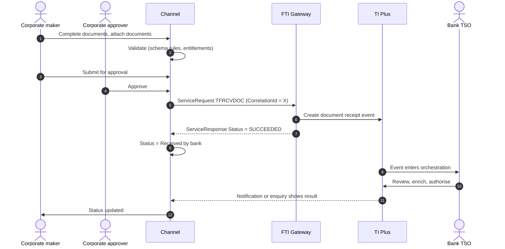

# Documents and System Messages

> Part of the product specifications. Index and shared rules: [README](README.md). Shared message bodies: [shared message shapes](shared-message-shapes.md). Catalogue: [01](../01-interface-catalogue.md) · Functional spec: [02](../02-functional-specification.md).

| | |
|---|---|
| Priority | Always (supports every product) |
| Customer role | Any |
| TI product code (`Context.Product`) | `ILC` **[Assumption – confirm in TI]** |
| Messages | 8 |

## 1. Purpose and scope

Two messages carry **documents** to TI independently of a product-specific instruction: `TFRCVDOC` (documents received, creating a master or an event) and `TFATTDOC` (attach documents to a master). Six more are **system-to-system**: they are exchanged between TI and surrounding systems (e-banking confirmation, delivery notification, watch-list check, event-step verification, expiry, open-API data) and are never raised by customers. They are documented so the channel team knows what the interface contains.

Out of scope: Product instructions (see each product).

> **Reading guide.** Field names, lengths and enumerations come from `sources/xsd_element_docs/`. Statements marked **[Proposed]** or **[Assumption]** are design decisions or guesses that the interface documents cannot confirm. Names are copied exactly from the schema, including its inconsistencies in capitalisation and spelling.

## 2. Messages

| Message | Kind | Creates in TI | Channel exposure | Phase | Body |
|---|---|---|---|---|---|
| `TFRCVDOC` | Other | The event defined by the Product and Event code in the context | Customer | 3 | own |
| `TFATTDOC` | Other | The event defined by the Product and Event code in the context | Customer | 3 | own |
| `TFGENCNF` | Other | - | Bank-side | - | own |
| `TFGWYACK` | Other | - | Bank-side | - | [Shape: Correspondence](shared-message-shapes.md#shape-correspondence) |
| `TFWLCRSP` | Other | - | Bank-side | - | own |
| `TFEXRRSP` | Other | - | Bank-side | - | own |
| `TFEXPEVT` | Other | Expiry event | Bank-side | - | own |
| `TFAPIDTA` | Other | - | Bank-side | - | own |

**Exposure key.** *Customer* – the corporate starts or answers it in the channel. *Review* – schema description does not make the sender clear; confirm with the TI team before exposing. *Bank-side* – raised by the bank or an interbank counterparty; do not expose to customers.

## 3. Business scenario

The customer scans a signed application and sends it to the bank with no structured data: *Send documents*. The channel sends `TFRCVDOC` with the files in `EmbeddedItems`; the TSO creates the master or event in TI. A customer who is mid-process with an existing master can add documents with `TFATTDOC`.

**Send documents**



## 4. Preconditions

1. Document types are loaded.
2. The user may attach documents to the master (entitlement).

## 5. Screens

An upload dialog available from any transaction.

| Step | Section | Fields (schema element) |
|---|---|---|
| 1 | **Choose** | Existing transaction or "new request" |
| 2 | **Upload** | Files, document type, description |
| 3 | **Narrative** | `Narrative`, `ExtraInformation` |
| 4 | **Submit** |  |

> **[Proposed] Fields hidden from the customer or set by configuration.** `Context.Team`, `Context.Step`, `Context.ExchangeNonAutoComplete`, `Context.BehalfOfBranch*`, `ExternalReview`, `ProvisionalFlags`, `BankCodes`, `ContinueEvent`, `Provisional`, `AutoCreateFollowOnEvent`, `FinalWording`, `TakeonExtra`, `InternalMasterRefSequence`, `OutstandingAmount`, `OutstandingAdditionalAmount`, `OriginalMasterReference`, `PreallocatedNo`. They affect routing, bank processing or data take-on, and should be set by channel configuration or left to TI defaults. Confirm each with the TI team (02, Q10).

## 6. Primary message `TFRCVDOC`

This is a general purpose message that is used to send details of documents and or attachments to TI Plus to either create a new master or an event against an existing master. The message consists of the common section described above together with the following details. Creates: The event defined by the Product and Event code in the context.

### 6.1 Context

| Element | Value |
|---|---|
| `Branch` | The booking branch from the corporate configuration. |
| `Customer` | The customer's TI mnemonic (max 20). |
| `Product` | `ILC` **[Assumption]** |
| `Event` | **Required for `TFRCVDOC`.** `Product` and `Event` choose the new master or the event to create. For example `Product` = `ILC`, `Event` = `COR` attaches correspondence documents to an Import LC. **[Assumption]** |
| `TheirReference` | Customer's own reference (max 34). |
| `OurReference` / `MasterRef` | **Required** to attach to an existing master; empty for a new request. |

The remaining `Context` elements (`Team`, `Step`, `BehalfOfBranch*`, `TemplateIdentifier`, `EventReference`, `ExchangeNonAutoComplete`, `SubsidiaryMasterPrefixAndSerial`) are set by configuration. See [README](README.md#common-blocks-in-every-message).

### 6.2 Channel-managed elements

| Element | Value |
|---|---|
| `eBankMasterRef` / `EBankMasterRef` (max 20) | The channel's **transaction number**. Constant for every later event on it. **Confirmed by the bank (2026-10-23).** |
| `eBankEvent` / `eBankEventRef` / `EBankEventRef` (max 20) | The channel's **event number** for this event (issue, claim, amendment, ...). Unique per instruction; the key for idempotent retries. **Confirmed by the bank (2026-10-23).** |
| `TheirRef` (where the message has it, max 35) | **Message reference: unique for every message delivered**, so a re-send of the same event gets a new `TheirRef` but keeps `eBankEventRef`. With no `ServiceRequest` envelope (Q33) it does the job of `CorrelationId`. **Confirmed by the bank (2026-10-23).** |
| `EmbeddedItemss` | Inline attachments (`ID`, `AttachType`, `DocType`, `Description`, `FileName`, `DataStream`, `MimeType`, `DocumentFileName`); `IsCustomerAttachedDocument` = `Y`. |
| `DocumentsReceiveds` | References to documents already in the DMS, if the upload-first approach is chosen (02, Q8). |

**Capitalisation differs between messages** (`eBankMasterRef` in some, `EBankMasterRef` in others; `eBankEvent`, `eBankEventRef` and `EBankEventRef`). The channel generates names from the schema catalogue and must never hand-type them.

### 6.3 Field reference

All top-level elements, in schema order, then the nested structures and enumerations.

| Element | Type / length | Description |
|---|---|---|
| `Narrative` | string ≤32700 | Narrative field. |
| `EventFurtherID` | string 1–5 | Used to further define the type of event. The value in this field must be a valid bank defined TF dictionary value beginning EVTxx e.g. EVT01 - Acc... |
| `ExtraInformation` | string ≤35 | Free format extra information for the event. This information will be shown on the Master summary in the WIP and event history, dashboard and Maste... |
| `AdditionalData` | group | Additional data for the event - where customization is not used the bank can attach details to the event which are mapped to the additional data he... |
| `ExtraData` | group |  |

#### Nested structures of `TFRCVDOC`

**`AdditionalData`**

| Path | Type / length | Description |
|---|---|---|
| `AdditionalData/DataItem` | group ×n | Receives "additional data" from Gateway, which are recorded as event notifications. |
| `AdditionalData/DataItem/Name` | string ≤50 |  |
| `AdditionalData/DataItem/Value` | string |  |


## 7. Other messages

### `TFATTDOC` – Attach documents to a master

| | |
|---|---|
| Creates in TI | The event defined by the Product and Event code in the context |
| Purpose (schema) | This is a general purpose message that is used to send details of documents and or attachments to TI Plus to either create a new master or an event against an existing master The message consists of the common section described above together with the following details |
| Channel exposure | Customer |
| Phase | 3 |

**Body elements** (besides the [common blocks](README.md#common-blocks-in-every-message)):

| Element | Type / length | Description |
|---|---|---|
| `PreallocatedNo` | int | Used only if your bank has pre-allocated a block of reference numbers to the customer for the product as described in the TI Plus System Tailoring... |
| `MasterTeam` | string 1–15 | Master team to which the transaction should be assigned. |
| `EventFurtherID` | string 1–5 | Used to further define the type of event. The value in this field must be a valid bank defined TF dictionary value beginning EVTxx e.g. EVT01 - Acc... |
| `ExtraInformation` | string ≤35 | Free format extra information for the event. This information will be shown on the Master summary in the WIP and event history, dashboard and Maste... |
| `AdditionalData` | group | Additional data for the event - where customization is not used the bank can attach details to the event which are mapped to the additional data he... |
| `ExtraData` | group |  |

#### Nested structures of `TFATTDOC`

**`AdditionalData`**

| Path | Type / length | Description |
|---|---|---|
| `AdditionalData/DataItem` | group ×n | Receives "additional data" from Gateway, which are recorded as event notifications. |
| `AdditionalData/DataItem/Name` | string ≤50 |  |
| `AdditionalData/DataItem/Value` | string |  |


### `TFGENCNF` – General confirmation – upload e-banking reference

| | |
|---|---|
| Creates in TI | - |
| Purpose (schema) | General confirmation. Uploads the E-banking reference |
| Channel exposure | Bank-side |
| Phase | - |

TI-side confirmation that uploads the e-banking reference to a master. Relevant to the channel because it carries the channel's reference back.

Not exposed to customers, so the body is not specified here. Top-level elements, in schema order: `eBankMasterRef`, `eBankEventRef`, `CustomerId`, `AdditionalData`. Details: `sources/xsd_element_docs/TI.TFGENCNF.xsd.txt`.

### `TFGWYACK` – Delivery notification

| | |
|---|---|
| Creates in TI | - |
| Purpose (schema) | Delivery Notification |
| Channel exposure | Bank-side |
| Phase | - |

**Body:** [Shape: Correspondence](shared-message-shapes.md#shape-correspondence) with differences.

* Omits: `ExtraData`

### `TFWLCRSP` – Watch-list checker response

| | |
|---|---|
| Creates in TI | - |
| Purpose (schema) | Watch list checker response |
| Channel exposure | Bank-side |
| Phase | - |

Not exposed to customers, so the body is not specified here. Top-level elements, in schema order: `EventReference`, `WatchListCheckerRef`, `Timestamp`, `Status`, `FailedFields`, `GeneralNarrative`. Details: `sources/xsd_element_docs/TI.TFWLCRSP.xsd.txt`.

### `TFEXRRSP` – Event step verification response

| | |
|---|---|
| Creates in TI | - |
| Purpose (schema) | Incoming response to an event step verification request |
| Channel exposure | Bank-side |
| Phase | - |

Not exposed to customers, so the body is not specified here. Top-level elements, in schema order: `AutoComplete`, `ExtraData`. Details: `sources/xsd_element_docs/TI.TFEXRRSP.xsd.txt`.

### `TFEXPEVT` – Expire a transaction

| | |
|---|---|
| Creates in TI | Expiry event |
| Purpose (schema) | Expire transaction |
| Channel exposure | Bank-side |
| Phase | - |

Not exposed to customers, so the body is not specified here. Top-level elements, in schema order: `DeactivationDate`, `BookOffDate`. Details: `sources/xsd_element_docs/TI.TFEXPEVT.xsd.txt`.

### `TFAPIDTA` – Open API data request

| | |
|---|---|
| Creates in TI | - |
| Purpose (schema) | to use as GET API |
| Channel exposure | Bank-side |
| Phase | - |

Not exposed to customers, so the body is not specified here. Top-level elements, in schema order: `InterestToDate`, `ExtraData`. Details: `sources/xsd_element_docs/TI.TFAPIDTA.xsd.txt`.

## 8. Validation rules

### 8.1 Rules supported directly by the schema

Lengths, data types and the allowed values of coded fields are in the tables in sections 6 and 7 and are the source for the channel's client and server validators. Dates are ISO `xsd:date`. Boolean elements carry `Y` or `N`. Amounts are strings (maximum 22 characters); agree the decimal format with the TI team. `Narrative` ≤ 32,700. `ExtraInformation` ≤ 35. `EventFurtherID` must be a bank-defined `EVTxx` dictionary value.

### 8.2 Business rules to apply in the channel

Normal practice for this product and the checks a TSO would otherwise perform by hand. **[Proposed]**: switch each on or off per bank policy.

| # | Rule |
|---|---|
| V1 | File types and sizes within limits. |
| V2 | At least one file or a narrative. |
| V3 | Document type from the bank list. |
| V4 | Virus scan before sending. **[Proposed]** |

### 8.3 Minimum content for a usable instruction

**[Proposed]** `Context.Product`, `Context.Event` (new), `MasterRef` (existing), at least one `EmbeddedItems`.

## 9. Illustrative requests

Values are invented. Element names, prefixes and order follow `sources/example_xml/`. Elements not shown are omitted, which the schema allows for optional elements. **Test against the gateway before use.**

**`TFRCVDOC`**

```xml
<?xml version="1.0" standalone="yes"?>
<ServiceRequest xmlns:xsi="http://www.w3.org/2001/XMLSchema-instance"
                xmlns:m="urn:messages.service.ti.apps.tiplus2.misys.com"
                xmlns:c="urn:common.service.ti.apps.tiplus2.misys.com"
                xmlns="urn:control.services.tiplus2.misys.com">
  <RequestHeader>
    <Service>TI</Service>
    <Operation>TFRCVDOC</Operation>
    <Credentials><Name>CHANNEL_SVC</Name><Password>********</Password></Credentials>
    <TargetSystem>TI</TargetSystem>
    <SourceSystem>CORPCHANNEL</SourceSystem>
    <CorrelationId>9b1f4c2e-5a0d-4c47-9f3e-2c1d7a6b8e10</CorrelationId>
    <CreationDate>2026-10-18</CreationDate>
  </RequestHeader>
  <m:TFRCVDOC>
    <m:Context>
      <c:Branch>HOBR</c:Branch>
      <c:Customer>ACMEIMP</c:Customer>
      <c:Product>ILC</c:Product>
      <c:Event>COR</c:Event>
      <c:TheirReference>DOCS-2026-07</c:TheirReference>
    </m:Context>
    <m:EmbeddedItemss>
      <m:EmbeddedItems>
        <m:ID>amendment-application.pdf</m:ID>
        <m:AttachType>PDF</m:AttachType>
        <m:DocType>GEN</m:DocType>
        <m:Description>Signed amendment application</m:Description>
        <m:FileName>amendment-application.pdf</m:FileName>
        <m:DataStream>JVBERi0xLjQK...</m:DataStream>
        <m:MimeType>application/pdf</m:MimeType>
        <m:IsCustomerAttachedDocument>Y</m:IsCustomerAttachedDocument>
      </m:EmbeddedItems>
    </m:EmbeddedItemss>
    <m:MasterRef>ILC2600123</m:MasterRef>
    <m:Narrative>Signed amendment application attached.</m:Narrative>
  </m:TFRCVDOC>
</ServiceRequest>
```

## 10. Response handling and tracking

| `Status` | Channel behaviour |
|---|---|
| `SUCCEEDED` | TI accepted the message and created the event. Mark `ReceivedByBank`; keep `Warning` / `Info` texts. |
| `FAILED` | TI rejected the message. Show `Details.Error` to the maker and return the draft. No automatic retry. |
| `UNAVAILABLE` / timeout | Keep in the outbox, retry with back-off, and confirm by enquiry (`eBankEventRef`) before each re-send so no second event is created. |

Rules shared by every product are in [README – Common behaviour](README.md#common-behaviour).

Show uploaded documents on the transaction timeline with status *Received by bank*.

## 11. Exceptions

| Scenario | Handling |
|---|---|
| File rejected by the gateway | Show size/type error; allow re-upload. |
| Wrong master | Ask the bank by correspondence. |
| Gateway `FAILED`, `UNAVAILABLE`, timeout, duplicate click | As in [README – Common behaviour](README.md#common-behaviour). |

## 12. Acceptance criteria

1. Documents are sent once per submission.
2. Document types come from the bank list.
3. Uploaded files appear in TI on the event.
4. Every step is in the audit trail with user, time and `CorrelationId`.
5. The stored request validates against the schema rules in 8.1 and matches the structure in section 9.

## 13. Open items

| # | Item |
|---|---|
| GEN-1 | Confirm the `Product` / `Event` pairs valid for `TFRCVDOC`. |
| GEN-2 | Confirm size limits and inline vs. upload-first (02, Q8). |
| GEN-3 | Confirm whether `TFGENCNF` returns the channel reference to the channel. |
