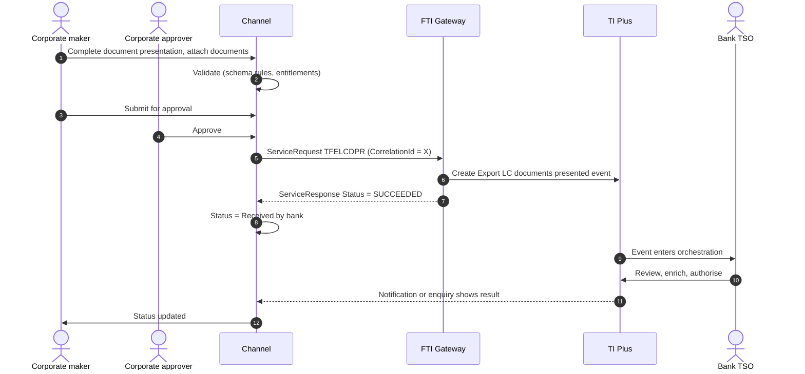
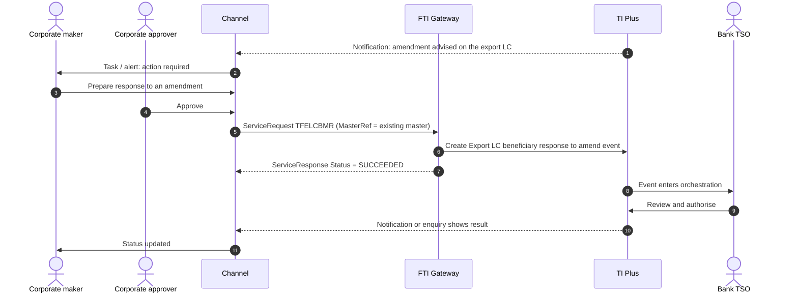

# Export Letter of Credit (Beneficiary side)

> Part of the product specifications. Index and shared rules: [README](README.md). Shared message bodies: [shared message shapes](shared-message-shapes.md). Catalogue: [01](../01-interface-catalogue.md) · Functional spec: [02](../02-functional-specification.md).

| | |
|---|---|
| Priority | P2 |
| Customer role | Beneficiary (exporter) |
| TI product code (`Context.Product`) | `ELC` **[Assumption – confirm in TI]** |
| Messages | 11 |

## 1. Purpose and scope

An **export LC** is a letter of credit issued by a foreign bank in favour of our customer. Our bank **advises** it (and may **confirm** it). The customer's actions: respond to amendments and cancellations, present shipping documents for payment, answer discrepancy notices, assign proceeds or transfer the LC to a supplier, request pre-shipment finance, and correspond with the bank. The `*NEW` and `*AMD` messages of the export products record an instrument **received** from the issuing bank. They are raised by the bank (or by a scanning/advising process), not by the beneficiary customer. They are documented as reference for the data the channel will read, and marked *Bank-side* or *Review*.

Out of scope: Advising and confirmation work done by the bank, and financing of the receivable (see [Financing](financing.md)).

> **Reading guide.** Field names, lengths and enumerations come from `sources/xsd_element_docs/`. Statements marked **[Proposed]** or **[Assumption]** are design decisions or guesses that the interface documents cannot confirm. Names are copied exactly from the schema, including its inconsistencies in capitalisation and spelling.

## 2. Messages

| Message | Kind | Creates in TI | Channel exposure | Phase | Body |
|---|---|---|---|---|---|
| `TFELCDPR` | Claim / presentation | ELC documents presented event | Customer | 4 | own |
| `TFELCADD` | Claim / presentation | Export Letter Of Credit outstanding presentation event" | Customer | 4 | own |
| `TFELCPYR` | Claim / presentation | Export Letter Of Credit outstanding presentation event | Review | 4 | own |
| `TFELCBMR` | Response / request | Export Letter Of Credit beneficiary response to amend event | Customer | 4 | [Shape: Beneficiary response](shared-message-shapes.md#shape-beneficiary-response) |
| `TFELCBCR` | Response / request | Export Letter Of Credit beneficiary response to cancel event | Customer | 4 | own |
| `TFELCAOP` | Other | Export Letter Of Credit assignment of proceeds event | Customer | 4 | [Shape: Assignment of proceeds / transfer](shared-message-shapes.md#shape-assignment-of-proceeds--transfer) |
| `TFELCTRF` | Other | Export Letter Of Credit transfer event | Customer | 4 | [Shape: Assignment of proceeds / transfer](shared-message-shapes.md#shape-assignment-of-proceeds--transfer) |
| `TFELCFLC` | Other | ELC Preshipment Finance event with customisation | Customer | 5 | [Shape: Correspondence](shared-message-shapes.md#shape-correspondence) (+diff) |
| `TFELCCOR` | Correspondence | Export Letter Of Credit correspondence event | Customer | 4 | [Shape: Correspondence](shared-message-shapes.md#shape-correspondence) |
| `TFELCNEW` | Create / issue | Export Letter of Credit advise event | Bank-side | - | own |
| `TFELCAMD` | Amend | Export Letter Of Credit amend event | Bank-side | - | own |

**Exposure key.** *Customer* – the corporate starts or answers it in the channel. *Review* – schema description does not make the sender clear; confirm with the TI team before exposing. *Bank-side* – raised by the bank or an interbank counterparty; do not expose to customers.

## 3. Business scenario

An exporter receives an LC advised through our bank. After shipping, it prepares the documents (invoice, bill of lading, packing list, certificate) and presents them through the channel: the amount presented, the presentation date, the documents with their counts, dispatch details, and instructions for disposal of discrepant documents. The bank examines the documents. If it finds discrepancies, the channel alerts the customer, who can accept the discrepancies (waiver), correct the documents, or ask the bank to send on approval. Payment is credited when the issuing bank pays.

**Presentation of documents**



**Amendment received**



## 4. Preconditions

1. The LC has been advised in TI and appears in the channel for the beneficiary (matched by customer mnemonic).
2. The customer can attach scanned documents; originals are sent under the bank's courier procedure.
3. Payment-action codes are loaded for `PresentersAction`.

## 5. Screens

The channel shows the LC, its amendments and its presentations on one page.

| Step | Section | Fields (schema element) |
|---|---|---|
| 1 | **LC summary** | Read-only: applicant, issuing bank, amount, expiry, terms, amendments, outstanding amount (from the master detail) |
| 2 | **Presentation** | `PresentationDetails` (amount, date, presenter's reference, due date, notes from presenter), `PresentersAction`, `RequestType`, `WithRecourse`, `MixedPay`, `FinalPayment` |
| 3 | **Documents** | `GWRDocumentAs` (document type, face reference, date, description, mailing counts), attachments |
| 4 | **Dispatch** | `DocumentPresentationDetails` (dispatch type, details, number of documents, advise-if-in-order flag, disposal instructions) |
| 5 | **Payment details** | `PaymentDetailss` (drafts: type, maturity, amount) |
| 6 | **Financing (optional)** | `Financing` – request finance together with the presentation |
| 7 | **Review and submit** | Approval route |

> **[Proposed] Fields hidden from the customer or set by configuration.** `Context.Team`, `Context.Step`, `Context.ExchangeNonAutoComplete`, `Context.BehalfOfBranch*`, `ExternalReview`, `ProvisionalFlags`, `BankCodes`, `ContinueEvent`, `Provisional`, `AutoCreateFollowOnEvent`, `FinalWording`, `TakeonExtra`, `InternalMasterRefSequence`, `OutstandingAmount`, `OutstandingAdditionalAmount`, `OriginalMasterReference`, `PreallocatedNo`. They affect routing, bank processing or data take-on, and should be set by channel configuration or left to TI defaults. Confirm each with the TI team (02, Q10). Also `DocumentDiscrepancies` (set by the bank), `SubsidiaryExtraData`.

## 6. Primary message `TFELCDPR`

Primary instruction of this product. Creates: ELC documents presented event.

### 6.1 Context

| Element | Value |
|---|---|
| `Branch` | The booking branch from the corporate configuration. |
| `Customer` | The customer's TI mnemonic (max 20). |
| `Product` | `ELC` **[Assumption]** |
| `Event` | Normally implied by the message name. Leave empty unless the TI team asks for it. **[Assumption]** |
| `TheirReference` | Customer's own reference (max 34). |
| `OurReference` / `MasterRef` | **Required.** `MasterRef` is the export LC reference. |

The remaining `Context` elements (`Team`, `Step`, `BehalfOfBranch*`, `TemplateIdentifier`, `EventReference`, `ExchangeNonAutoComplete`, `SubsidiaryMasterPrefixAndSerial`) are set by configuration. See [README](README.md#common-blocks-in-every-message).

### 6.2 Channel-managed elements

| Element | Value |
|---|---|
| `eBankMasterRef` / `EBankMasterRef` (max 20) | The channel's id for the master. Constant for every later event on it. |
| `eBankEvent` / `eBankEventRef` / `EBankEventRef` (max 20) | The channel's id for this event. Unique per instruction; the key for idempotent retries. |
| `EmbeddedItemss` | Inline attachments (`ID`, `AttachType`, `DocType`, `Description`, `FileName`, `DataStream`, `MimeType`, `DocumentFileName`); `IsCustomerAttachedDocument` = `Y`. |
| `DocumentsReceiveds` | References to documents already in the DMS, if the upload-first approach is chosen (02, Q8). |

**Capitalisation differs between messages** (`eBankMasterRef` in some, `EBankMasterRef` in others; `eBankEvent`, `eBankEventRef` and `EBankEventRef`). The channel generates names from the schema catalogue and must never hand-type them.

### 6.3 Field reference

All top-level elements, in schema order, then the nested structures and enumerations.

| Element | Type / length | Description |
|---|---|---|
| `eBankEventRef` | string ≤20 | Unique reference meaningful to the sending system which applies to this transaction. |
| `eBankMasterRef` | string ≤20 | Unique reference meaningful to the sending system which applies to the master. |
| `Sender` | party | The sender of the message. |
| `PresentersAction` | string ≤3 | Presenter's action as defined by payment actions in system tailoring. |
| `RequestType` | string 1–1 | Underlying behaviour for presenter's action. This is used to find the default presenter's action for the underlying behaviour if the PresentersActi... |
| `PaymentAction` | string 1–1 | Payment action. Available values: 'T'='Accept', 'c'='Adjust maturity', 'K'='Approve authorisation request', 'A'='Await documents', 'I'='Await repla... |
| `PresentationDetails` | group | Presentation details. |
| `RefusalDetails` | string ≤3640 | Narrative relating to the refusal. |
| `MixedPay` | boolean | Boolean values. |
| `WithRecourse` | boolean | Boolean values. |
| `FinalPayment` | boolean | TI-63478. Boolean values. |
| `PaymentDetailss` | group |  |
| `Financing` | group | SImilar to GWR800, containing fields for creating subsidiary financing event to GWRReceivedDocument. |
| `DocumentPresentationDetails` | group | Document presentation details. |
| `AdditionalParties` | group | This contains the additional parties to a transaction. Only applicable for Issue/Create and Amend events. |
| `GWRDocumentAs` | group |  |
| `AdditionalData` | group | Additional data for the event - where customization is not used the bank can attach details to the event which are mapped to the additional data he... |
| `ExtraData` | group |  |
| `SubsidiaryExtraData` | group |  |

#### Nested structures of `TFELCDPR`

**`PresentationDetails`**

| Path | Type / length | Description |
|---|---|---|
| `PresentationDetails/PresentationAmount` | group | The presentation amount. |
| `PresentationDetails/PresentationAmount/Amount` | string ≤22 |  |
| `PresentationDetails/PresentationAmount/Currency` | string 1–3 | Currency. |
| `PresentationDetails/PresentationDate` | date | Presentation date. |
| `PresentationDetails/PresentersReference` | string 1–34 | The reference Id of the presenter. |
| `PresentationDetails/PaymentDueDate` | date | Payment due date. |
| `PresentationDetails/NotesFromPresenter` | string ≤3350 | Notes from presenter. |
| `PresentationDetails/AdditionalAmount` | group | Additional amount if any. |
| `PresentationDetails/AdditionalAmount/Amount` | string ≤22 |  |
| `PresentationDetails/AdditionalAmount/Currency` | string 1–3 | Currency. |
| `PresentationDetails/DocumentDiscrepancies` | string ≤16120 | Document discrepancies. |
| `PresentationDetails/PresentersDiscrepancies` | string ≤16120 | Presenter's discrepancies. |

**`PaymentDetailss`**

| Path | Type / length | Description |
|---|---|---|
| `PaymentDetailss/PaymentDetails` | group ×n |  |
| `PaymentDetailss/PaymentDetails/DraftIdentifier` | string ≤111 |  |
| `PaymentDetailss/PaymentDetails/FromAfter` | string 1–1 | Available values: 'A'='After', 'F'='From', 'E'='From (exclusive)'. |
| `PaymentDetailss/PaymentDetails/MaturityDate` | date |  |
| `PaymentDetailss/PaymentDetails/PeriodUnit` | string 1–1 | M (months) D (days) etc. Available values: 'D'='Days', 'M'='Months', 'Q'='Quarters', 'W'='Weeks', 'Y'='Years'. |
| `PaymentDetailss/PaymentDetails/PeriodNumber` | int |  |
| `PaymentDetailss/PaymentDetails/StartDate` | date |  |
| `PaymentDetailss/PaymentDetails/Type` | string 1–1 | Available values: 'A'='Acceptance', 'D'='Deferred', 'E'='Demand', 'S'='Sight'. |
| `PaymentDetailss/PaymentDetails/ValueDate` | date |  |
| `PaymentDetailss/PaymentDetails/Amount` | string ≤22 |  |
| `PaymentDetailss/PaymentDetails/AmountCurrency` | string 1–3 |  |

**`Financing`**

| Path | Type / length | Description |
|---|---|---|
| `Financing/Amount` | group | Amount Gateway pane. Note that this pane may have the currency included as part of the amount source or the... |
| `Financing/Amount/Amount` | string ≤22 |  |
| `Financing/Amount/Currency` | string 1–3 | Currency. |
| `Financing/AutoMonthlyDebit` | boolean | Boolean values. |
| `Financing/AutoRepay` | boolean | Boolean values. |
| `Financing/DebitParty` | party |  |
| `Financing/EffectiveDate` | date |  |
| `Financing/FinanceAmount` | group | Amount Gateway pane. Note that this pane may have the currency included as part of the amount source or the... |
| `Financing/FinanceAmount/Amount` | string ≤22 |  |
| `Financing/FinanceAmount/Currency` | string 1–3 | Currency. |
| `Financing/FinancePercent` | decimal(17,2) | Percentage. Available Values: 0 to 100 |
| `Financing/FinanceCurrency` | string 1–3 | Currency Code. |
| `Financing/ExchangeRate` | string | Exchange rate. |
| `Financing/FinanceToParty` | party |  |
| `Financing/FinanceInterestDate` | date |  |
| `Financing/InterestRate` | decimal(11,7) | Interest rate - an eleven digit rate with seven decimal places allows rates to be entered in the range 9999... |
| `Financing/InterestSettlementCcy` | string 1–3 | Currency Code. |
| `Financing/MarginRate` | decimal(11,7) | Interest rate - an eleven digit rate with seven decimal places allows rates to be entered in the range 9999... |
| `Financing/MaturityDate` | date |  |
| `Financing/PenaltyPercent` | decimal(11,7) | Interest rate - an eleven digit rate with seven decimal places allows rates to be entered in the range 9999... |
| `Financing/PreferredChargeCcy` | string 1–3 | Currency Code. |
| `Financing/StartDate` | date |  |
| `Financing/TrustReceiptLoan` | boolean | Boolean values. |
| `Financing/UseSchedule` | boolean | Boolean values. |
| `Financing/RelatedMasterRef` | string 1–20 | e.g. Documentary Credit Number, FX contract number. |
| `Financing/InterestType` | string 1–1 | Available values: 'D'='Interest in advance - discount', 'Y'='Interest in advance - discount to yield', 'I'=... |
| `Financing/InterestFromAfter` | string 1–1 | Available values: 'A'='After', 'F'='From', 'E'='From (exclusive)'. |
| `Financing/RateType` | string 1–1 | Available values: 'F'='Fixed', 'S'='Special', 'V'='Variable'. |
| `Financing/BaseCode` | string 2–5 |  |
| `Financing/ActualBaseOrGroupRate` | decimal(11,7) | Interest rate - an eleven digit rate with seven decimal places allows rates to be entered in the range 9999... |
| `Financing/DiffCode` | string 2–2 |  |
| `Financing/NarrativeDetails` | string ≤32000 |  |
| `Financing/InstructionsToFinanceParty` | string ≤32000 |  |
| `Financing/InstructionsToDebitParty` | string ≤32000 |  |
| `Financing/PenaltyRateCode` | string 2–2 |  |
| `Financing/GroupRate` | string 1–6 |  |
| `Financing/MessageToBank` | string ≤32000 |  |
| `Financing/eBankMasterRef` | string ≤20 | Unique reference meaningful to the sending system which applies to the master. |
| `Financing/eBankEventRef` | string ≤20 | Unique reference meaningful to the sending system which applies to this transaction. |
| `Financing/ProductCode` | string ≤4 |  |
| `Financing/RepaymentDetailss` | group |  |
| `Financing/RepaymentDetailss/RepaymentDetails` | group ×n | Irregular repayment details. |
| `Financing/RepaymentDetailss/RepaymentDetails/Amount` | long |  |
| `Financing/RepaymentDetailss/RepaymentDetails/Percent` | decimal(17,2) | The percent figure for the data type. Available Values: 0 to 100 |
| `Financing/RepaymentDetailss/RepaymentDetails/Date` | date |  |
| `Financing/RegularRepaymentDetails` | group | Regular repayment details. |
| `Financing/RegularRepaymentDetails/AmountOrPercent` | group |  |
| `Financing/RegularRepaymentDetails/AmountOrPercent/Amount` | long |  |
| `Financing/RegularRepaymentDetails/AmountOrPercent/Percent` | decimal(17,2) | Percentage. Available Values: 0 to 100 |
| `Financing/RegularRepaymentDetails/Date` | date |  |
| `Financing/RegularRepaymentDetails/Period` | group |  |
| `Financing/RegularRepaymentDetails/Period/Unit` | string 1–1 | Period. Available values: 'D'='Days', 'M'='Months', 'Q'='Quarters', 'W'='Weeks', 'Y'='Years'. |
| `Financing/RegularRepaymentDetails/Period/Number` | int | Number of days (months) etc e.g. 30. |
| `Financing/RegularRepaymentDetails/Period/DayInMonth` | int | Day in month for renewal. |
| `Financing/FinancePeriod` | group |  |
| `Financing/FinancePeriod/TenorDays` | int | Tenor element of the term. |
| `Financing/FinancePeriod/TenorPeriod` | string | Period. Available values: 'D'='Days', 'M'='Months', 'Q'='Quarters', 'W'='Weeks', 'Y'='Years'. |
| `Financing/InterestPeriod` | group |  |
| `Financing/InterestPeriod/Unit` | string 1–1 | Period. Available values: 'D'='Days', 'M'='Months', 'Q'='Quarters', 'W'='Weeks', 'Y'='Years'. |
| `Financing/InterestPeriod/Number` | int | Number of days (months) etc e.g. 30. |
| … | | 210 more paths – see `TI.<message>.xsd.txt` for `Financing` |

**`DocumentPresentationDetails`**

| Path | Type / length | Description |
|---|---|---|
| `DocumentPresentationDetails/DispatchType` | string 1–4 | SWIFT SCORE Document dispatch type. Available values: 'AIRM'='By airmail', 'COUR'='By courier (e.g. FedEx,... |
| `DocumentPresentationDetails/DispatchDetails` | string ≤35 | Document dispatch details. |
| `DocumentPresentationDetails/AdvisePresenterDocsInOrder` | boolean | Whether to produce an advice of discharge on release. Boolean values. |
| `DocumentPresentationDetails/SentDate` | date | Date documents sent. |
| `DocumentPresentationDetails/DocumentCount` | int | Number of documents sent. |
| `DocumentPresentationDetails/DisposalInstructions` | string 1–1 | Document disposal instructions. Available values: 'Y'='Hold', 'F'='Notify', 'P'='Previous instructions', 'N... |
| `DocumentPresentationDetails/DisposalDetails` | string ≤111 | Document disposal details. |

**`AdditionalParties`**

| Path | Type / length | Description |
|---|---|---|
| `AdditionalParties/AdditionalPartiesToAdd` | party ×n | Receives details of additional parties via the gateway. Mapped to and displayed under the Party list pane i... |

**`GWRDocumentAs`**

| Path | Type / length | Description |
|---|---|---|
| `GWRDocumentAs/GWRDocumentA` | group ×n |  |
| `GWRDocumentAs/GWRDocumentA/Document` | string | The document type code - this must match one of the bank defined document types in TI Plus. e.g. - BOL = Bi... |
| `GWRDocumentAs/GWRDocumentA/DocumentFaceReference` | string ≤20 |  |
| `GWRDocumentAs/GWRDocumentA/DocumentDate` | date | Date of the document. |
| `GWRDocumentAs/GWRDocumentA/DocumentDesc` | string | Document description. |
| `GWRDocumentAs/GWRDocumentA/DocumentMailing1` | string ≤20 |  |
| `GWRDocumentAs/GWRDocumentA/DocumentMailing2` | string ≤20 |  |
| `GWRDocumentAs/GWRDocumentA/DocumentMailingTotal` | string ≤20 |  |
| `GWRDocumentAs/GWRDocumentA/IsCustomerAttachedDocument` | boolean | Boolean values. |
| `GWRDocumentAs/GWRDocumentA/TransportDocumentReference` | string ≤256 |  |
| `GWRDocumentAs/GWRDocumentA/DocumentFileName` | string ≤128 |  |

**`AdditionalData`**

| Path | Type / length | Description |
|---|---|---|
| `AdditionalData/DataItem` | group ×n | Receives "additional data" from Gateway, which are recorded as event notifications. |
| `AdditionalData/DataItem/Name` | string ≤50 |  |
| `AdditionalData/DataItem/Value` | string |  |


#### Enumerated values in `TFELCDPR`

| Path | Allowed values |
|---|---|
| `RequestType` | `S` Documents sent on approval; `O` Other; `R` Pay and claim reimbursement; `F` Request acceptance; `A` Request authorisation to pay; `q` Request pay or extend; `P` Request payment; `D` Sender has debited our account |
| `PaymentAction` | `T` Accept; `c` Adjust maturity; `K` Approve authorisation request; `A` Await documents; `I` Await replacement invoices; `p` Claim against counter; `B` Claim reimbursement; `e` Extend; `n` Finance offer; `F` Forward documents only; `Y` General request to applicant; `H` General request to issuer; `Z` General request to presenter; `a` General request to transferee; `i` Intent to pay; `V` Issue trust receipt; `W` Issue trust receipt loan; `P` Pay; `C` Pay & claim reimbursement; `o` Pay and claim against counter; `M` Pay at maturity; `j` Pay early; `b` Pay from suspense; `D` Pay with discrepancies; `X` Pay with financing; `L` Refuse authorisation request; `G` Refuse documents; `R` Reject; `Q` Reject and claim refund; `u` Reject and continue; `x` Repay finance; `U` Request acceptance; `N` Request approval from applicant; `J` Request authorisation to pay; `d` Request original document; `q` Request pay or extend; `E` Request payment; `r` Reverse payment; `S` Send documents on approval |
| `PaymentDetailss/PaymentDetails/FromAfter` | `A` After; `F` From; `E` From (exclusive) |
| `PaymentDetailss/PaymentDetails/PeriodUnit` | `D` Days; `M` Months; `Q` Quarters; `W` Weeks; `Y` Years |
| `PaymentDetailss/PaymentDetails/Type` | `A` Acceptance; `D` Deferred; `E` Demand; `S` Sight |
| `Financing/InterestType` | `D` Interest in advance - discount; `Y` Interest in advance - discount to yield; `I` Interest in advance - interest to yield; `S` Interest in advance - standard; `E` Interest in arrears - standard |
| `Financing/InterestFromAfter` | `A` After; `F` From; `E` From (exclusive) |
| `Financing/RateType` | `F` Fixed; `S` Special; `V` Variable |
| `Financing/RegularRepaymentDetails/Period/Unit` | `D` Days; `M` Months; `Q` Quarters; `W` Weeks; `Y` Years |
| `Financing/FinancePeriod/TenorPeriod` | `D` Days; `M` Months; `Q` Quarters; `W` Weeks; `Y` Years |
| `Financing/InterestPeriod/Unit` | `D` Days; `M` Months; `Q` Quarters; `W` Weeks; `Y` Years |
| `Financing/Collateral/CollateralDetail/OtherDetailsType` | `G` General; `S` Specific |
| `Financing/FinanceResponse` | `A` Offer is accepted; `R` Offer is rejected; `G` Offer is renegotiated |
| `Financing/InterestScheduleTiers/InterestScheduleTier/PeriodUnit` | `D` Days; `M` Months; `Q` Quarters; `W` Weeks; `Y` Years |
| `Financing/SettlementInstructionss/SettlementInstructions/PayReceiveFlag` | `P` Pay; `R` Receive |
| `Financing/SettlementInstructionss/SettlementInstructions/MovementType` | `C` Charge; `I` Interest; `P` Principal |
| `Financing/SettlementInstructionss/SettlementInstructions/PayFundsVia` | `T` Account transfer; `A` Acct at nostro/vostro; `B` Beneficiary bank; `C` Beneficiary bank with cover; `X` Clearing ID; `I` Intermediary bank; `P` Intermediary with cover; `O` Other account |
| `Financing/SettlementInstructionss/SettlementInstructions/SettlesBy` | `A` Account; `X` Clearing ID; `N` Nostro; `O` Other account; `V` Vostro |
| `Financing/SettlementInstructionss/SettlementInstructions/SwiftCharges` | `BEN` Beneficiary; `OUR` Our; `SHA` Shared |
| `DocumentPresentationDetails/DispatchType` | `AIRM` By airmail; `COUR` By courier (e.g. FedEx, DHL, UPS); `ELEC` Electronically |
| `DocumentPresentationDetails/DisposalInstructions` | `Y` Hold; `F` Notify; `P` Previous instructions; `N` Return |


## 7. Other messages

### `TFELCADD` – Respond to an advice of discrepancy

| | |
|---|---|
| Creates in TI | Export Letter Of Credit outstanding presentation event" |
| Purpose (schema) | processes corporate to bank advice of discrepancy response |
| Channel exposure | Customer |
| Phase | 4 |

Schema: "processes corporate to bank advice of discrepancy response".

**Body elements** (besides the [common blocks](README.md#common-blocks-in-every-message)):

| Element | Type / length | Description |
|---|---|---|
| `ClaimId` | string ≤6 | Reference of the claim being approved or rejected. e.g. CLM001 This reference is used to identify the claim to the payment response is related to. |
| `Sender` | party | The Sender of the message. |
| `ResponseAction` | string ≤3 | Response action as defined by payment actions in system tailoring. Either Response action or Response type should be specified. |
| `ResponseType` | string ≤1 | Underlying behaviour for response action. This is used to find the default response action for the underlying behaviour if the ResponseAction field... |
| `ResponseDetails` | string ≤32000 | Narrative relating to the approval or refusal. |
| `RefusalDetails` | string ≤3640 | Narrative relating to the refusal. |
| `eBankMasterRef` | string ≤20 | Unique reference meaningful to the sending system which applies to the master. |
| `eBankEventRef` | string ≤20 | Unique reference meaningful to the sending system which applies to this transaction. |
| `NetAmountPaid` | group | Amount Gateway pane. Note that this pane may have the currency included as part of the amount source or the currency may be entered separately. |
| `AuthorisationInstructions` | string 1–10 | Note keep the store list in capitals or the Swift validation for field 23 in message 752 will fail (see message.swf, search MT752) Also REJECT remo... |
| `Financing` | group | SImilar to GWR800, containing fields for creating subsidiary financing event to GWRReceivedDocument. |
| `WithRecourse` | boolean | Boolean values. |
| `FinalPay` | boolean | Boolean values. |
| `MixedPay` | boolean | Boolean values. |
| `InstructionsReceived` | string ≤32000 |  |
| `PresentedDocumentNotes` | group |  |
| `ResponseNarrative` | string ≤1820 |  |
| `AdditionalParties` | group | This contains the additional parties to a transaction. Only applicable for Issue/Create and Amend events. |
| `OriginalClaimDate` | date |  |
| `OriginalClaimAmount` | group | Amount Gateway pane. Note that this pane may have the currency included as part of the amount source or the currency may be entered separately. |
| `ResponseReceivedDate` | date |  |
| `PaymentDetailss` | group |  |
| `IssueDate` | date |  |
| `PresentationDate` | date |  |
| `PresentationAmount` | group | Amount Gateway pane. Note that this pane may have the currency included as part of the amount source or the currency may be entered separately. |
| `AdditionalData` | group | Additional data for the event - where customization is not used the bank can attach details to the event which are mapped to the additional data he... |
| `ExtraData` | group |  |

#### Nested structures of `TFELCADD`

**`NetAmountPaid`**

| Path | Type / length | Description |
|---|---|---|
| `NetAmountPaid/Amount` | string ≤22 |  |
| `NetAmountPaid/Currency` | string 1–3 | Currency. |

**`Financing`**

| Path | Type / length | Description |
|---|---|---|
| `Financing/Amount` | group | Amount Gateway pane. Note that this pane may have the currency included as part of the amount source or the... |
| `Financing/Amount/Amount` | string ≤22 |  |
| `Financing/Amount/Currency` | string 1–3 | Currency. |
| `Financing/AutoMonthlyDebit` | boolean | Boolean values. |
| `Financing/AutoRepay` | boolean | Boolean values. |
| `Financing/DebitParty` | party |  |
| `Financing/EffectiveDate` | date |  |
| `Financing/FinanceAmount` | group | Amount Gateway pane. Note that this pane may have the currency included as part of the amount source or the... |
| `Financing/FinanceAmount/Amount` | string ≤22 |  |
| `Financing/FinanceAmount/Currency` | string 1–3 | Currency. |
| `Financing/FinancePercent` | decimal(17,2) | Percentage. Available Values: 0 to 100 |
| `Financing/FinanceCurrency` | string 1–3 | Currency Code. |
| `Financing/ExchangeRate` | string | Exchange rate. |
| `Financing/FinanceToParty` | party |  |
| `Financing/FinanceInterestDate` | date |  |
| `Financing/InterestRate` | decimal(11,7) | Interest rate - an eleven digit rate with seven decimal places allows rates to be entered in the range 9999... |
| `Financing/InterestSettlementCcy` | string 1–3 | Currency Code. |
| `Financing/MarginRate` | decimal(11,7) | Interest rate - an eleven digit rate with seven decimal places allows rates to be entered in the range 9999... |
| `Financing/MaturityDate` | date |  |
| `Financing/PenaltyPercent` | decimal(11,7) | Interest rate - an eleven digit rate with seven decimal places allows rates to be entered in the range 9999... |
| `Financing/PreferredChargeCcy` | string 1–3 | Currency Code. |
| `Financing/StartDate` | date |  |
| `Financing/TrustReceiptLoan` | boolean | Boolean values. |
| `Financing/UseSchedule` | boolean | Boolean values. |
| `Financing/RelatedMasterRef` | string 1–20 | e.g. Documentary Credit Number, FX contract number. |
| `Financing/InterestType` | string 1–1 | Available values: 'D'='Interest in advance - discount', 'Y'='Interest in advance - discount to yield', 'I'=... |
| `Financing/InterestFromAfter` | string 1–1 | Available values: 'A'='After', 'F'='From', 'E'='From (exclusive)'. |
| `Financing/RateType` | string 1–1 | Available values: 'F'='Fixed', 'S'='Special', 'V'='Variable'. |
| `Financing/BaseCode` | string 2–5 |  |
| `Financing/ActualBaseOrGroupRate` | decimal(11,7) | Interest rate - an eleven digit rate with seven decimal places allows rates to be entered in the range 9999... |
| `Financing/DiffCode` | string 2–2 |  |
| `Financing/NarrativeDetails` | string ≤32000 |  |
| `Financing/InstructionsToFinanceParty` | string ≤32000 |  |
| `Financing/InstructionsToDebitParty` | string ≤32000 |  |
| `Financing/PenaltyRateCode` | string 2–2 |  |
| `Financing/GroupRate` | string 1–6 |  |
| `Financing/MessageToBank` | string ≤32000 |  |
| `Financing/eBankMasterRef` | string ≤20 | Unique reference meaningful to the sending system which applies to the master. |
| `Financing/eBankEventRef` | string ≤20 | Unique reference meaningful to the sending system which applies to this transaction. |
| `Financing/ProductCode` | string ≤4 |  |
| `Financing/RepaymentDetailss` | group |  |
| `Financing/RepaymentDetailss/RepaymentDetails` | group ×n | Irregular repayment details. |
| `Financing/RepaymentDetailss/RepaymentDetails/Amount` | long |  |
| `Financing/RepaymentDetailss/RepaymentDetails/Percent` | decimal(17,2) | The percent figure for the data type. Available Values: 0 to 100 |
| `Financing/RepaymentDetailss/RepaymentDetails/Date` | date |  |
| `Financing/RegularRepaymentDetails` | group | Regular repayment details. |
| `Financing/RegularRepaymentDetails/AmountOrPercent` | group |  |
| `Financing/RegularRepaymentDetails/AmountOrPercent/Amount` | long |  |
| `Financing/RegularRepaymentDetails/AmountOrPercent/Percent` | decimal(17,2) | Percentage. Available Values: 0 to 100 |
| `Financing/RegularRepaymentDetails/Date` | date |  |
| `Financing/RegularRepaymentDetails/Period` | group |  |
| `Financing/RegularRepaymentDetails/Period/Unit` | string 1–1 | Period. Available values: 'D'='Days', 'M'='Months', 'Q'='Quarters', 'W'='Weeks', 'Y'='Years'. |
| `Financing/RegularRepaymentDetails/Period/Number` | int | Number of days (months) etc e.g. 30. |
| `Financing/RegularRepaymentDetails/Period/DayInMonth` | int | Day in month for renewal. |
| `Financing/FinancePeriod` | group |  |
| `Financing/FinancePeriod/TenorDays` | int | Tenor element of the term. |
| `Financing/FinancePeriod/TenorPeriod` | string | Period. Available values: 'D'='Days', 'M'='Months', 'Q'='Quarters', 'W'='Weeks', 'Y'='Years'. |
| `Financing/InterestPeriod` | group |  |
| `Financing/InterestPeriod/Unit` | string 1–1 | Period. Available values: 'D'='Days', 'M'='Months', 'Q'='Quarters', 'W'='Weeks', 'Y'='Years'. |
| `Financing/InterestPeriod/Number` | int | Number of days (months) etc e.g. 30. |
| … | | 210 more paths – see `TI.<message>.xsd.txt` for `Financing` |

**`PresentedDocumentNotes`**

| Path | Type / length | Description |
|---|---|---|
| `PresentedDocumentNotes/DispatchType` | string 1–4 | SWIFT SCORE Document dispatch type. Available values: 'AIRM'='By airmail', 'COUR'='By courier (e.g. FedEx,... |
| `PresentedDocumentNotes/DispatchDetails` | string ≤35 | Document dispatch details. |
| `PresentedDocumentNotes/AdvisePresenterDocsInOrder` | boolean | Whether to produce an advice of discharge on release. Boolean values. |
| `PresentedDocumentNotes/SentDate` | date | Date documents sent. |
| `PresentedDocumentNotes/DocumentCount` | int | Number of documents sent. |
| `PresentedDocumentNotes/DisposalInstructions` | string 1–1 | Document disposal instructions. Available values: 'Y'='Hold', 'F'='Notify', 'P'='Previous instructions', 'N... |
| `PresentedDocumentNotes/DisposalDetails` | string ≤111 | Document disposal details. |

**`AdditionalParties`**

| Path | Type / length | Description |
|---|---|---|
| `AdditionalParties/AdditionalPartiesToAdd` | party ×n | Receives details of additional parties via the gateway. Mapped to and displayed under the Party list pane i... |

**`OriginalClaimAmount`**

| Path | Type / length | Description |
|---|---|---|
| `OriginalClaimAmount/Amount` | string ≤22 |  |
| `OriginalClaimAmount/Currency` | string 1–3 | Currency. |

**`PaymentDetailss`**

| Path | Type / length | Description |
|---|---|---|
| `PaymentDetailss/PaymentDetails` | group ×n |  |
| `PaymentDetailss/PaymentDetails/DraftIdentifier` | string ≤111 |  |
| `PaymentDetailss/PaymentDetails/FromAfter` | string 1–1 | Available values: 'A'='After', 'F'='From', 'E'='From (exclusive)'. |
| `PaymentDetailss/PaymentDetails/MaturityDate` | date |  |
| `PaymentDetailss/PaymentDetails/PeriodUnit` | string 1–1 | M (months) D (days) etc. Available values: 'D'='Days', 'M'='Months', 'Q'='Quarters', 'W'='Weeks', 'Y'='Years'. |
| `PaymentDetailss/PaymentDetails/PeriodNumber` | int |  |
| `PaymentDetailss/PaymentDetails/StartDate` | date |  |
| `PaymentDetailss/PaymentDetails/Type` | string 1–1 | Available values: 'A'='Acceptance', 'D'='Deferred', 'E'='Demand', 'S'='Sight'. |
| `PaymentDetailss/PaymentDetails/ValueDate` | date |  |
| `PaymentDetailss/PaymentDetails/Amount` | string ≤22 |  |
| `PaymentDetailss/PaymentDetails/AmountCurrency` | string 1–3 |  |

**`PresentationAmount`**

| Path | Type / length | Description |
|---|---|---|
| `PresentationAmount/Amount` | string ≤22 |  |
| `PresentationAmount/Currency` | string 1–3 | Currency. |

**`AdditionalData`**

| Path | Type / length | Description |
|---|---|---|
| `AdditionalData/DataItem` | group ×n | Receives "additional data" from Gateway, which are recorded as event notifications. |
| `AdditionalData/DataItem/Name` | string ≤50 |  |
| `AdditionalData/DataItem/Value` | string |  |


#### Enumerated values in `TFELCADD`

| Path | Allowed values |
|---|---|
| `ResponseType` | `B` Advice of payment; `A` Approval; `x` Pay or extend response - Extend; `p` Pay or extend response - Pay; `R` Refusal |
| `AuthorisationInstructions` | `ACCEPT` Accept; `DEBIT` Debit selves; `NEGOTIATE` Negotiate; `REIMBURSE` Pay and claim reimbursement; `REMITTED` Receive remittance; `SEE72` See details |
| `Financing/InterestType` | `D` Interest in advance - discount; `Y` Interest in advance - discount to yield; `I` Interest in advance - interest to yield; `S` Interest in advance - standard; `E` Interest in arrears - standard |
| `Financing/InterestFromAfter` | `A` After; `F` From; `E` From (exclusive) |
| `Financing/RateType` | `F` Fixed; `S` Special; `V` Variable |
| `Financing/RegularRepaymentDetails/Period/Unit` | `D` Days; `M` Months; `Q` Quarters; `W` Weeks; `Y` Years |
| `Financing/FinancePeriod/TenorPeriod` | `D` Days; `M` Months; `Q` Quarters; `W` Weeks; `Y` Years |
| `Financing/InterestPeriod/Unit` | `D` Days; `M` Months; `Q` Quarters; `W` Weeks; `Y` Years |
| `Financing/Collateral/CollateralDetail/OtherDetailsType` | `G` General; `S` Specific |
| `Financing/FinanceResponse` | `A` Offer is accepted; `R` Offer is rejected; `G` Offer is renegotiated |
| `Financing/InterestScheduleTiers/InterestScheduleTier/PeriodUnit` | `D` Days; `M` Months; `Q` Quarters; `W` Weeks; `Y` Years |
| `Financing/SettlementInstructionss/SettlementInstructions/PayReceiveFlag` | `P` Pay; `R` Receive |
| `Financing/SettlementInstructionss/SettlementInstructions/MovementType` | `C` Charge; `I` Interest; `P` Principal |
| `Financing/SettlementInstructionss/SettlementInstructions/PayFundsVia` | `T` Account transfer; `A` Acct at nostro/vostro; `B` Beneficiary bank; `C` Beneficiary bank with cover; `X` Clearing ID; `I` Intermediary bank; `P` Intermediary with cover; `O` Other account |
| `Financing/SettlementInstructionss/SettlementInstructions/SettlesBy` | `A` Account; `X` Clearing ID; `N` Nostro; `O` Other account; `V` Vostro |
| `Financing/SettlementInstructionss/SettlementInstructions/SwiftCharges` | `BEN` Beneficiary; `OUR` Our; `SHA` Shared |
| `PresentedDocumentNotes/DispatchType` | `AIRM` By airmail; `COUR` By courier (e.g. FedEx, DHL, UPS); `ELEC` Electronically |
| `PresentedDocumentNotes/DisposalInstructions` | `Y` Hold; `F` Notify; `P` Previous instructions; `N` Return |
| `PaymentDetailss/PaymentDetails/FromAfter` | `A` After; `F` From; `E` From (exclusive) |
| `PaymentDetailss/PaymentDetails/PeriodUnit` | `D` Days; `M` Months; `Q` Quarters; `W` Weeks; `Y` Years |
| `PaymentDetailss/PaymentDetails/Type` | `A` Acceptance; `D` Deferred; `E` Demand; `S` Sight |


### `TFELCPYR` – Respond to an outstanding presentation

| | |
|---|---|
| Creates in TI | Export Letter Of Credit outstanding presentation event |
| Purpose (schema) | - |
| Channel exposure | Review |
| Phase | 4 |

Response to the bank's advice about a presentation (for example, payment action).

**Body:** same elements as `TFELCADD` (section above), with the differences below.

* Omits: `IssueDate`, `PresentationDate`, `PresentationAmount`
* Adds:

| Element | Type / length | Description |
|---|---|---|
| `SubsidiaryExtraData` | group |  |

### `TFELCBMR` – Respond to an amendment

| | |
|---|---|
| Creates in TI | Export Letter Of Credit beneficiary response to amend event |
| Purpose (schema) | - |
| Channel exposure | Customer |
| Phase | 4 |

**Body:** [Shape: Beneficiary response](shared-message-shapes.md#shape-beneficiary-response).

### `TFELCBCR` – Respond to a cancellation

| | |
|---|---|
| Creates in TI | Export Letter Of Credit beneficiary response to cancel event |
| Purpose (schema) | - |
| Channel exposure | Customer |
| Phase | 4 |

**Body elements** (besides the [common blocks](README.md#common-blocks-in-every-message)):

| Element | Type / length | Description |
|---|---|---|
| `CancelRef` | string |  |
| `Sender` | party |  |
| `ResponseType` | string 1–1 | Available values: 'A'='Approved', 'R'='Refused'. |
| `ReceivedDate` | date |  |
| `ResponseDetails` | string ≤32000 |  |
| `ResponseToBeneficiary` | string ≤32000 |  |
| `ResponseToIssuingBank` | string ≤32000 |  |
| `eBankMasterRef` | string ≤20 | Unique reference meaningful to the sending system which applies to the master. |
| `eBankEventRef` | string ≤20 | Unique reference meaningful to the sending system which applies to this transaction. |
| `AdditionalData` | group | Additional data for the event - where customization is not used the bank can attach details to the event which are mapped to the additional data he... |
| `ExtraData` | group |  |

#### Nested structures of `TFELCBCR`

**`AdditionalData`**

| Path | Type / length | Description |
|---|---|---|
| `AdditionalData/DataItem` | group ×n | Receives "additional data" from Gateway, which are recorded as event notifications. |
| `AdditionalData/DataItem/Name` | string ≤50 |  |
| `AdditionalData/DataItem/Value` | string |  |


#### Enumerated values in `TFELCBCR`

| Path | Allowed values |
|---|---|
| `ResponseType` | `A` Approved; `R` Refused |


### `TFELCAOP` – Assign proceeds

| | |
|---|---|
| Creates in TI | Export Letter Of Credit assignment of proceeds event |
| Purpose (schema) | - |
| Channel exposure | Customer |
| Phase | 4 |

**Body:** [Shape: Assignment of proceeds / transfer](shared-message-shapes.md#shape-assignment-of-proceeds--transfer).

### `TFELCTRF` – Transfer LC

| | |
|---|---|
| Creates in TI | Export Letter Of Credit transfer event |
| Purpose (schema) | - |
| Channel exposure | Customer |
| Phase | 4 |

**Body:** [Shape: Assignment of proceeds / transfer](shared-message-shapes.md#shape-assignment-of-proceeds--transfer) with differences.

* Omits: `AssigneeDetailAs`

### `TFELCFLC` – Request pre-shipment finance

| | |
|---|---|
| Creates in TI | ELC Preshipment Finance event with customisation |
| Purpose (schema) | - |
| Channel exposure | Customer |
| Phase | 5 |

**Body:** [Shape: Correspondence](shared-message-shapes.md#shape-correspondence) with differences.

* Adds: `Financing`
* Omits: `AdditionalData`

| Element | Type / length | Description |
|---|---|---|
| `Financing` | group | SImilar to GWR800, containing fields for creating subsidiary financing event to GWRReceivedDocument. |

**`Financing`**

| Path | Type / length | Description |
|---|---|---|
| `Financing/Amount` | group | Amount Gateway pane. Note that this pane may have the currency included as part of the amount source or the... |
| `Financing/Amount/Amount` | string ≤22 |  |
| `Financing/Amount/Currency` | string 1–3 | Currency. |
| `Financing/AutoMonthlyDebit` | boolean | Boolean values. |
| `Financing/AutoRepay` | boolean | Boolean values. |
| `Financing/DebitParty` | party |  |
| `Financing/EffectiveDate` | date |  |
| `Financing/FinanceAmount` | group | Amount Gateway pane. Note that this pane may have the currency included as part of the amount source or the... |
| `Financing/FinanceAmount/Amount` | string ≤22 |  |
| `Financing/FinanceAmount/Currency` | string 1–3 | Currency. |
| `Financing/FinancePercent` | decimal(17,2) | Percentage. Available Values: 0 to 100 |
| `Financing/FinanceCurrency` | string 1–3 | Currency Code. |
| `Financing/ExchangeRate` | string | Exchange rate. |
| `Financing/FinanceToParty` | party |  |
| `Financing/FinanceInterestDate` | date |  |
| `Financing/InterestRate` | decimal(11,7) | Interest rate - an eleven digit rate with seven decimal places allows rates to be entered in the range 9999... |
| `Financing/InterestSettlementCcy` | string 1–3 | Currency Code. |
| `Financing/MarginRate` | decimal(11,7) | Interest rate - an eleven digit rate with seven decimal places allows rates to be entered in the range 9999... |
| `Financing/MaturityDate` | date |  |
| `Financing/PenaltyPercent` | decimal(11,7) | Interest rate - an eleven digit rate with seven decimal places allows rates to be entered in the range 9999... |
| `Financing/PreferredChargeCcy` | string 1–3 | Currency Code. |
| `Financing/StartDate` | date |  |
| `Financing/TrustReceiptLoan` | boolean | Boolean values. |
| `Financing/UseSchedule` | boolean | Boolean values. |
| `Financing/RelatedMasterRef` | string 1–20 | e.g. Documentary Credit Number, FX contract number. |
| `Financing/InterestType` | string 1–1 | Available values: 'D'='Interest in advance - discount', 'Y'='Interest in advance - discount to yield', 'I'=... |
| `Financing/InterestFromAfter` | string 1–1 | Available values: 'A'='After', 'F'='From', 'E'='From (exclusive)'. |
| `Financing/RateType` | string 1–1 | Available values: 'F'='Fixed', 'S'='Special', 'V'='Variable'. |
| `Financing/BaseCode` | string 2–5 |  |
| `Financing/ActualBaseOrGroupRate` | decimal(11,7) | Interest rate - an eleven digit rate with seven decimal places allows rates to be entered in the range 9999... |
| `Financing/DiffCode` | string 2–2 |  |
| `Financing/NarrativeDetails` | string ≤32000 |  |
| `Financing/InstructionsToFinanceParty` | string ≤32000 |  |
| `Financing/InstructionsToDebitParty` | string ≤32000 |  |
| `Financing/PenaltyRateCode` | string 2–2 |  |
| `Financing/GroupRate` | string 1–6 |  |
| `Financing/MessageToBank` | string ≤32000 |  |
| `Financing/eBankMasterRef` | string ≤20 | Unique reference meaningful to the sending system which applies to the master. |
| `Financing/eBankEventRef` | string ≤20 | Unique reference meaningful to the sending system which applies to this transaction. |
| `Financing/ProductCode` | string ≤4 |  |
| `Financing/RepaymentDetailss` | group |  |
| `Financing/RepaymentDetailss/RepaymentDetails` | group ×n | Irregular repayment details. |
| `Financing/RepaymentDetailss/RepaymentDetails/Amount` | long |  |
| `Financing/RepaymentDetailss/RepaymentDetails/Percent` | decimal(17,2) | The percent figure for the data type. Available Values: 0 to 100 |
| `Financing/RepaymentDetailss/RepaymentDetails/Date` | date |  |
| `Financing/RegularRepaymentDetails` | group | Regular repayment details. |
| `Financing/RegularRepaymentDetails/AmountOrPercent` | group |  |
| `Financing/RegularRepaymentDetails/AmountOrPercent/Amount` | long |  |
| `Financing/RegularRepaymentDetails/AmountOrPercent/Percent` | decimal(17,2) | Percentage. Available Values: 0 to 100 |
| `Financing/RegularRepaymentDetails/Date` | date |  |
| `Financing/RegularRepaymentDetails/Period` | group |  |
| `Financing/RegularRepaymentDetails/Period/Unit` | string 1–1 | Period. Available values: 'D'='Days', 'M'='Months', 'Q'='Quarters', 'W'='Weeks', 'Y'='Years'. |
| `Financing/RegularRepaymentDetails/Period/Number` | int | Number of days (months) etc e.g. 30. |
| `Financing/RegularRepaymentDetails/Period/DayInMonth` | int | Day in month for renewal. |
| `Financing/FinancePeriod` | group |  |
| `Financing/FinancePeriod/TenorDays` | int | Tenor element of the term. |
| `Financing/FinancePeriod/TenorPeriod` | string | Period. Available values: 'D'='Days', 'M'='Months', 'Q'='Quarters', 'W'='Weeks', 'Y'='Years'. |
| `Financing/InterestPeriod` | group |  |
| `Financing/InterestPeriod/Unit` | string 1–1 | Period. Available values: 'D'='Days', 'M'='Months', 'Q'='Quarters', 'W'='Weeks', 'Y'='Years'. |
| `Financing/InterestPeriod/Number` | int | Number of days (months) etc e.g. 30. |
| … | | 210 more paths – see `TI.<message>.xsd.txt` for `Financing` |


### `TFELCCOR` – Correspondence

| | |
|---|---|
| Creates in TI | Export Letter Of Credit correspondence event |
| Purpose (schema) | A general purpose message that is sent by the Beneficiary to the Advising Bank in the form of an Ancillary message, General correspondence, Queries or Answers |
| Channel exposure | Customer |
| Phase | 4 |

**Body:** [Shape: Correspondence](shared-message-shapes.md#shape-correspondence).

### `TFELCNEW` – LC advised (received)

| | |
|---|---|
| Creates in TI | Export Letter of Credit advise event |
| Purpose (schema) | - |
| Channel exposure | Bank-side |
| Phase | - |

Not exposed to customers, so the body is not specified here. Top-level elements, in schema order: `AddAmount`, `AddAmountText`, `AdditionalConditions`, `SpecialPaymentConditions`, `AdviseThru`, `AdviseThruAccount`, `NextAdvisingBank`, `ApplcableRules`, `ApplcableRulesNarrative`, `Applicant`, `ApplicantInstructions`, `ApplicantBank`, `AdviseDate`, `AvailableWith`, `BankCodes`, `BenAccNo`, `Beneficiary`, `ConfirmationDetails`, `ChargeAccount`, `ChargeDetails`, `ChargeText`, `OtherBankConfirmation`, `Confirmation`, `Documents`, `DomesticExpiry`, `ExpiryDate`, `ExpiryPlace`, `FreightPrepaid`, `Goods`, `GoodsCode`, `IncoTerms`, `IncoPlace`, `InstructionsToNextAdvisingBank`, `InstructionsFromInterBank`, `InsuranceForBuyer`, `InternalMasterRefSequence`, `InvoicePct`, `IssuanceChgsFor`, `AdviseBy`, `IssueDate`, `LCAmount`, `LCAmountSpec`, `Operative`, `OriginalMasterReference`, `OutstandingAdditionalAmount`, `OutstandingAmount`, `OverseasChgsFor`, `PartShipment`, `PortOfDischarge`, `PortOfLoading`, `PreallocatedNo`, `PreferredCcy`, `PresentationDays`, `PresentationPeriod`, `ReimbursementApplicableRules`, `Revocable`, `Revolving`, `ShipmentDate`, `ShipmentFrom`, `ShipmentPeriod`, `ShipmentTo`, `TaxFor`, `TermsOfPayment`, `TransShipment`, `Transferable`, `ReceivedFromBank`, `InstructionsReceived`, `IssuingBank`, `NonBankIssuer`, `ReimbursingBank`, `DeliveryNumber`, `DocumentsToBeSentBy`, `EBankEventRef`, `EBankMasterRef`, `FXOptionDeal`, `ProductType`, `DeferChgs`, `AdvisingBank`, `MarginDeposit`, `Collateral`, `FxContracts`, `LicenseDetails`, `HSCode`, `InstructionsToPayingBank`, `Provisional`, `AutoCreateFollowOnEvent`, `AdditionalParties`, `AdditionalData`, `ExtraData`. Details: `sources/xsd_element_docs/TI.TFELCNEW.xsd.txt`.

### `TFELCAMD` – LC amendment received

| | |
|---|---|
| Creates in TI | Export Letter Of Credit amend event |
| Purpose (schema) | Sent by the Applicant to the Bank to under an Export Letter Of Credit requesting an amendment to the Letter Of Credit |
| Channel exposure | Bank-side |
| Phase | - |

Schema text says "Sent by the Applicant to the Bank", but the event is the amendment of an advised LC. Treat as bank-side unless the TI team says otherwise.

Not exposed to customers, so the body is not specified here. Top-level elements, in schema order: `AddAmount`, `AddAmountText`, `AdditionalConditions`, `SpecialPaymentConditions`, `AdviseThru`, `AdviseThruAccount`, `NextAdvisingBank`, `ApplcableRules`, `ApplcableRulesNarrative`, `Applicant`, `ApplicantInstructions`, `ApplicantBank`, `AdviseDate`, `AvailableWith`, `BankCodes`, `BenAccNo`, `Beneficiary`, `ConfirmationDetails`, `ChargeAccount`, `ChargeDetails`, `ChargeText`, `OtherBankConfirmation`, `Confirmation`, `Documents`, `DomesticExpiry`, `ExpiryDate`, `ExpiryPlace`, `FreightPrepaid`, `Goods`, `GoodsCode`, `IncoTerms`, `IncoPlace`, `InstructionsToNextAdvisingBank`, `InstructionsFromInterBank`, `InsuranceForBuyer`, `InternalMasterRefSequence`, `InvoicePct`, `IssuanceChgsFor`, `AdviseBy`, `IssueDate`, `LCAmount`, `LCAmountSpec`, `Operative`, `OriginalMasterReference`, `OutstandingAdditionalAmount`, `OutstandingAmount`, `OverseasChgsFor`, `PartShipment`, `PortOfDischarge`, `PortOfLoading`, `PreallocatedNo`, `PreferredCcy`, `PresentationDays`, `PresentationPeriod`, `ReimbursementApplicableRules`, `Revocable`, `Revolving`, `ShipmentDate`, `ShipmentFrom`, `ShipmentPeriod`, `ShipmentTo`, `TaxFor`, `TermsOfPayment`, `TransShipment`, `Transferable`, `ReceivedFromBank`, `InstructionsReceived`, `IssuingBank`, `NonBankIssuer`, `ReimbursingBank`, `DeliveryNumber`, `DocumentsToBeSentBy`, `EBankEventRef`, `EBankMasterRef`, `FXOptionDeal`, `ProductType`, `DeferChgs`, `AdvisingBank`, `MarginDeposit`, `Collateral`, `FxContracts`, `LicenseDetails`, `HSCode`, `InstructionsToPayingBank`, `Sender`, `BenApprovalReq`, `IncreaseAmount`, `DecreaseAmount`, `AmendmentDetails`, `AmendmentNarrative`, `AmendChanges`, `AdditionalParties`, `AmendDate`, `AdditionalData`, `ExtraData`. Details: `sources/xsd_element_docs/TI.TFELCAMD.xsd.txt`.

## 8. Validation rules

### 8.1 Rules supported directly by the schema

Lengths, data types and the allowed values of coded fields are in the tables in sections 6 and 7 and are the source for the channel's client and server validators. Dates are ISO `xsd:date`. Boolean elements carry `Y` or `N`. Amounts are strings (maximum 22 characters); agree the decimal format with the TI team. * `DocumentPresentationDetails.DispatchType` ∈ {`AIRM`, `COUR`, `ELEC`}; `DisposalInstructions` ∈ {`Y`, `F`, `P`, `N`}.
* `PaymentDetails.Type` ∈ {`A`, `D`, `E`, `S`}; `FromAfter` ∈ {`A`, `F`, `E`}; `PeriodUnit` ∈ {`D`, `M`, `Q`, `W`, `Y`}.
* `PresentersAction` and `RequestType` use the bank's payment-action tailoring; give one of them.

### 8.2 Business rules to apply in the channel

Normal practice for this product and the checks a TSO would otherwise perform by hand. **[Proposed]**: switch each on or off per bank policy.

| # | Rule |
|---|---|
| V1 | Presentation date is within the LC's presentation period after shipment and not after expiry. |
| V2 | Presentation amount ≤ outstanding LC amount (considering tolerance). |
| V3 | Document list covers the documents required by the LC; missing or extra documents produce a warning, not a block. **[Proposed]** |
| V4 | Partial presentations only if `PartShipment` allows it. |
| V5 | A response to an amendment must reference the amendment (`AmendRef`). |
| V6 | Assignment: assignee is known to the bank; the amount does not exceed the LC outstanding; the LC allows assignment of proceeds. |
| V7 | Transfer: the LC is transferable; amount, expiry and prices are no more favourable than the original. |

### 8.3 Minimum content for a usable instruction

**[Proposed]** `MasterRef`, `Sender`, `PresentationDetails` (amount, date), documents list, dispatch details, `eBankMasterRef`, `eBankEventRef`.

## 9. Illustrative requests

Values are invented. Element names, prefixes and order follow `sources/example_xml/`. Elements not shown are omitted, which the schema allows for optional elements. **Test against the gateway before use.**

**`TFELCDPR`**

```xml
<?xml version="1.0" standalone="yes"?>
<ServiceRequest xmlns:xsi="http://www.w3.org/2001/XMLSchema-instance"
                xmlns:m="urn:messages.service.ti.apps.tiplus2.misys.com"
                xmlns:c="urn:common.service.ti.apps.tiplus2.misys.com"
                xmlns="urn:control.services.tiplus2.misys.com">
  <RequestHeader>
    <Service>TI</Service>
    <Operation>TFELCDPR</Operation>
    <Credentials><Name>CHANNEL_SVC</Name><Password>********</Password></Credentials>
    <SourceSystem>CORPCHANNEL</SourceSystem>
    <TargetSystem>TI</TargetSystem>
    <CorrelationId>9b1f4c2e-5a0d-4c47-9f3e-2c1d7a6b8e10</CorrelationId>
    <CreationDate>2026-10-18T09:30:00Z</CreationDate>
  </RequestHeader>
  <m:TFELCDPR>
    <m:Context>
      <c:Branch>HOBR</c:Branch>
      <c:Customer>ACMEEXP</c:Customer>
      <c:Product>ELC</c:Product>
      <c:TheirReference>SALES-2026-311</c:TheirReference>
    </m:Context>
    <m:MasterRef>ELC2600012</m:MasterRef>
    <m:eBankEventRef>CH-ELC-000012-04</m:eBankEventRef>
    <m:eBankMasterRef>CH-ELC-000012</m:eBankMasterRef>
    <m:Sender>
      <c:Customer>ACMEEXP</c:Customer>
    </m:Sender>
    <m:PresentersAction>Sam</m:PresentersAction>
    <m:PresentationDetails>
      <c:PresentationAmount>
        <c:Amount>120000.00</c:Amount>
        <c:Currency>USD</c:Currency>
      </c:PresentationAmount>
      <c:PresentationDate>2026-10-15</c:PresentationDate>
      <c:PresentersReference>PRES-8812</c:PresentersReference>
      <c:NotesFromPresenter>Documents presented under cover of letter dated 2026-10-15.</c:NotesFromPresenter>
    </m:PresentationDetails>
    <m:DocumentPresentationDetails>
      <c:DispatchType>COUR</c:DispatchType>
      <c:DocumentCount>5</c:DocumentCount>
      <c:DisposalInstructions>P</c:DisposalInstructions>
    </m:DocumentPresentationDetails>
    <m:GWRDocumentAs>
      <m:GWRDocumentA>
        <m:DocumentDesc>COMMERCIAL INVOICE 3 ORIGINALS</m:DocumentDesc>
      </m:GWRDocumentA>
    </m:GWRDocumentAs>
  </m:TFELCDPR>
</ServiceRequest>
```

## 10. Response handling and tracking

| `Status` | Channel behaviour |
|---|---|
| `SUCCEEDED` | TI accepted the message and created the event. Mark `ReceivedByBank`; keep `Warning` / `Info` texts. |
| `FAILED` | TI rejected the message. Show `Details.Error` to the maker and return the draft. No automatic retry. |
| `UNAVAILABLE` / timeout | Keep in the outbox, retry with back-off, and confirm by enquiry (`eBankEventRef`) before each re-send so no second event is created. |

Rules shared by every product are in [README – Common behaviour](README.md#common-behaviour).

Follow the presentation: *Documents received by bank* → *Under examination* → *Discrepant (action required)* or *Accepted* → *Payment received*. The discrepancy notice and its deadline are the main alert. Payment advice shows the credited amount.

## 11. Exceptions

| Scenario | Handling |
|---|---|
| Documents discrepant | Alert with the discrepancy list and deadline. The customer answers with `TFELCADD`: correct and re-present, send on approval, or authorise payment under reserve. |
| Amendment must be accepted before shipment | Alert and block presentation until the amendment is answered if the LC terms depend on it. |
| LC expires before presentation | Block presentation after expiry; show the last presentation date prominently. |
| Gateway `FAILED`, `UNAVAILABLE`, timeout, duplicate click | As in [README – Common behaviour](README.md#common-behaviour). |

## 12. Acceptance criteria

1. Beneficiary sees advised LCs and their amendments.
2. A presentation produces one correct `TFELCDPR` with its documents.
3. Discrepancy alerts reach the customer with the deadline; a response produces `TFELCADD`.
4. Amendment responses reference the amendment.
5. Bank-side messages are never offered to customers.
6. Every step is in the audit trail with user, time and `CorrelationId`.
7. The stored request validates against the schema rules in 8.1 and matches the structure in section 9.

## 13. Open items

| # | Item |
|---|---|
| ELC-1 | Confirm which of `TFELCPYR`, `TFELCADD` and `TFELCDPR` the bank wants customers to use for each step of a presentation. |
| ELC-2 | Confirm how documents are physically delivered and how the electronic copy relates to originals. |
| ELC-3 | Confirm whether assignment of proceeds and LC transfer are offered to customers. |
| ELC-4 | Obtain tailored `PresentersAction` codes. |
