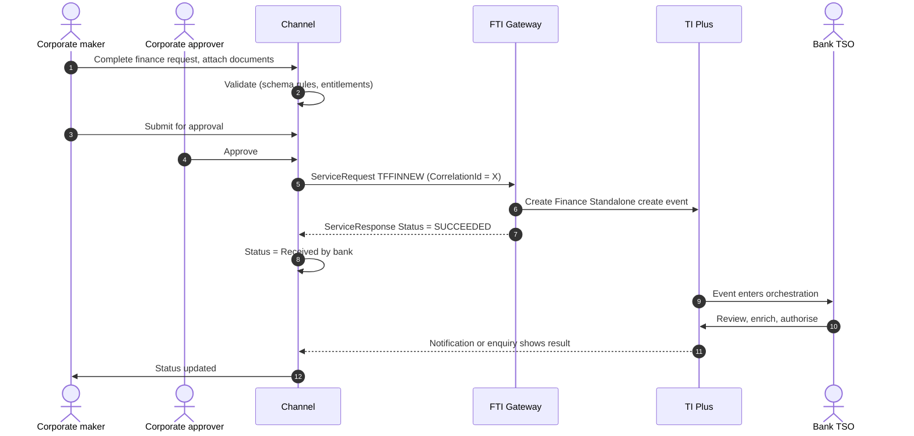
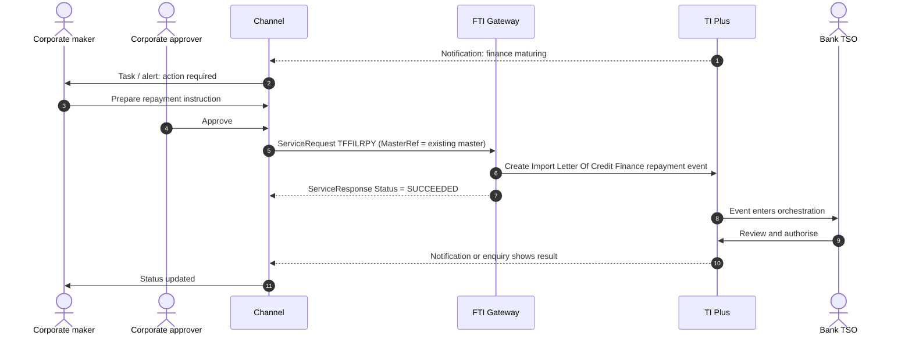

# Trade Finance and Repayments

> Part of the product specifications. Index and shared rules: [README](README.md). Shared message bodies: [shared message shapes](shared-message-shapes.md). Catalogue: [01](../01-interface-catalogue.md) · Functional spec: [02](../02-functional-specification.md).

| | |
|---|---|
| Priority | P3 |
| Customer role | Borrower |
| TI product code (`Context.Product`) | `FIN` **[Assumption – confirm in TI]** |
| Messages | 20 |

## 1. Purpose and scope

Trade finance lends money against a trade transaction (import/export LC, collection, open account, invoice) or stands alone. The customer requests **finance** and later **repays** it. Repayments share one body whatever the underlying product, so they are documented once as the [Finance repayment shape](shared-message-shapes.md#shape-finance-repayment). Messages also cover factoring drawdowns and finance-related correspondence.

Out of scope: Credit approval, pricing and interest rules (set in TI), and invoice-level finance requests (see [Invoices and SCF](invoice-and-scf.md)).

> **Reading guide.** Field names, lengths and enumerations come from `sources/xsd_element_docs/`. Statements marked **[Proposed]** or **[Assumption]** are design decisions or guesses that the interface documents cannot confirm. Names are copied exactly from the schema, including its inconsistencies in capitalisation and spelling.

## 2. Messages

| Message | Kind | Creates in TI | Channel exposure | Phase | Body |
|---|---|---|---|---|---|
| `TFFINNEW` | Create / issue | Finance Standalone create event with disburse to muultiple parties details | Customer | 5 | [Shape: Finance create](shared-message-shapes.md#shape-finance-create) |
| `TFFECNEW` | Create / issue | Finance Existing Collection create event with disburse to multiple parties details | Customer | 5 | [Shape: Finance create](shared-message-shapes.md#shape-finance-create) |
| `TFFSCNEW` | Create / issue | Finance SCF create event | Customer | 5 | [Shape: Finance create](shared-message-shapes.md#shape-finance-create) |
| `TFFSARPY` | Repayment | Standalone Finance repayment event | Customer | 5 | [Shape: Finance repayment](shared-message-shapes.md#shape-finance-repayment) |
| `TFFSCRPY` | Repayment | Finance SCF repayment event | Customer | 5 | [Shape: Finance repayment](shared-message-shapes.md#shape-finance-repayment) |
| `TFFCBRPY` | Repayment | Clean BA Finance repayment event | Customer | 5 | [Shape: Finance repayment](shared-message-shapes.md#shape-finance-repayment) |
| `TFFELRPY` | Repayment | Export LC Finance repayment event | Customer | 5 | [Shape: Finance repayment](shared-message-shapes.md#shape-finance-repayment) |
| `TFFEORPY` | Repayment | Export Open Account Finance repayment event | Customer | 5 | [Shape: Finance repayment](shared-message-shapes.md#shape-finance-repayment) |
| `TFFIARPY` | Repayment | Finance Invoice Advance repayment event | Customer | 5 | [Shape: Finance repayment](shared-message-shapes.md#shape-finance-repayment) |
| `TFFICRPY` | Repayment | Inward Collection Finance repayment event | Customer | 5 | [Shape: Finance repayment](shared-message-shapes.md#shape-finance-repayment) |
| `TFFILRPY` | Repayment | Import Letter Of Credit Finance repayment event | Customer | 5 | [Shape: Finance repayment](shared-message-shapes.md#shape-finance-repayment) |
| `TFFIORPY` | Repayment | Import Open Account Finance repayment event | Customer | 5 | [Shape: Finance repayment](shared-message-shapes.md#shape-finance-repayment) |
| `TFFOCRPY` | Repayment | Outward Collection Finance repayment event | Customer | 5 | [Shape: Finance repayment](shared-message-shapes.md#shape-finance-repayment) |
| `TFFRBRPY` | Repayment | Reimbursement Finance repayment event | Customer | 5 | [Shape: Finance repayment](shared-message-shapes.md#shape-finance-repayment) |
| `TFIRFRPY` | Repayment | Buyer Centric Finance repayment event | Customer | 5 | [Shape: Finance repayment](shared-message-shapes.md#shape-finance-repayment) |
| `TFIDSRPY` | Repayment | Seller Centric Finance repayment event | Customer | 5 | [Shape: Finance repayment](shared-message-shapes.md#shape-finance-repayment) |
| `TFFACDRD` | Other | Factoring drawdown event | Customer | 5 | own |
| `TFFACDRF` | Other | Factoring drawdown forecast event | Customer | 5 | own |
| `TFFINCOR` | Correspondence | Financing correspondence event | Customer | 5 | [Shape: Correspondence](shared-message-shapes.md#shape-correspondence) |
| `TFFSACOR` | Correspondence | Financing correspondence event with customisation | Customer | 5 | [Shape: Correspondence](shared-message-shapes.md#shape-correspondence) |

**Exposure key.** *Customer* – the corporate starts or answers it in the channel. *Review* – schema description does not make the sender clear; confirm with the TI team before exposing. *Bank-side* – raised by the bank or an interbank counterparty; do not expose to customers.

## 3. Business scenario

An importer needs USD 800,000 for 90 days to pay an LC. It requests finance: amount or percentage, currency, start and maturity, repayment mode (auto-repay, auto monthly debit), interest and rate details (usually fixed by the bank), instructions to the finance party, and the account to debit. TI books the loan. At maturity the customer repays through the channel (`TFFILRPY` for an LC loan) or authorises auto-repay; partial repayments and interest-only payments are possible.

**Finance request**



**Repayment**



## 4. Preconditions

1. A credit line for finance exists.
2. The customer is enabled for `FIN`.
3. For finance on an existing trade, the master exists and is live.

## 5. Screens

A finance wizard and a repayment form.

| Step | Section | Fields (schema element) |
|---|---|---|
| 1 | **Finance** | `FinanceAmount`, `FinancePercent`, `FinanceCurrency`, `StartDate`, `MaturityDate`, `FinancePeriod`, `RelatedMasterRef`, `ProductCode`, `ProductType` |
| 2 | **Parties** | `DebitParty`, `FinanceToParty`, `FundingParty` |
| 3 | **Repayment** | `AutoRepay`, `AutoMonthlyDebit`, `RepaymentDetailss`, `RegularRepaymentDetails`, `RepaymentNoticeRequired`, `RepaymentNoticeDays` |
| 4 | **Interest (display)** | `InterestType`, `InterestRate`, `RateType`, `BaseCode`, `MarginRate`, `PenaltyPercent`, `InterestScheduleTiers` – normally bank-set |
| 5 | **Instructions** | `MessageToBank`, `InstructionsToFinanceParty`, `InstructionsToDebitParty`, `NarrativeDetails` |
| 6 | **Accounts and cover** | `PrincipalAccount`, `ChargeAccount`, `Collateral`, `LicenseDetails`, `DisbursementDetailss`, `MasterSettlementInstructionss` |
| 7 | **Repayment form** | Shared body: `RepaymentAction`, `RepaymentReference`, `ValueDate`, `RepaymentPayer`, principal/interest/total, `TransferCurrency`, `PrincipalAccount`, `FeeAccount`, `CustomerInstructions` |

> **[Proposed] Fields hidden from the customer or set by configuration.** `Context.Team`, `Context.Step`, `Context.ExchangeNonAutoComplete`, `Context.BehalfOfBranch*`, `ExternalReview`, `ProvisionalFlags`, `BankCodes`, `ContinueEvent`, `Provisional`, `AutoCreateFollowOnEvent`, `FinalWording`, `TakeonExtra`, `InternalMasterRefSequence`, `OutstandingAmount`, `OutstandingAdditionalAmount`, `OriginalMasterReference`, `PreallocatedNo`. They affect routing, bank processing or data take-on, and should be set by channel configuration or left to TI defaults. Confirm each with the TI team (02, Q10). Also pricing elements (`InterestRate`, `MarginRate`, `PenaltyPercent`, `GroupRate`, `ActualBaseOrGroupRate`, `DiffCode`, `RateType`), which the bank sets.

## 6. Primary message `TFFINNEW`

Primary instruction of this product. Creates: Finance Standalone create event with disburse to muultiple parties details.

### 6.1 Context

| Element | Value |
|---|---|
| `Branch` | The booking branch from the corporate configuration. |
| `Customer` | The customer's TI mnemonic (max 20). |
| `Product` | `FIN` **[Assumption]** |
| `Event` | Normally implied by the message name. Leave empty unless the TI team asks for it. **[Assumption]** |
| `TheirReference` | Customer's own reference (max 34). |
| `OurReference` / `MasterRef` | Empty for a new finance; for repayments `MasterRef` is the finance master. |

The remaining `Context` elements (`Team`, `Step`, `BehalfOfBranch*`, `TemplateIdentifier`, `EventReference`, `ExchangeNonAutoComplete`, `SubsidiaryMasterPrefixAndSerial`) are set by configuration. See [README](README.md#common-blocks-in-every-message).

### 6.2 Channel-managed elements

| Element | Value |
|---|---|
| `eBankMasterRef` / `EBankMasterRef` (max 20) | The channel's id for the master. Constant for every later event on it. |
| `eBankEvent` / `eBankEventRef` / `EBankEventRef` (max 20) | The channel's id for this event. Unique per instruction; the key for idempotent retries. |
| `EmbeddedItemss` | Inline attachments (`ID`, `AttachType`, `DocType`, `Description`, `FileName`, `DataStream`, `MimeType`, `DocumentFileName`); `IsCustomerAttachedDocument` = `Y`. |
| `DocumentsReceiveds` | References to documents already in the DMS, if the upload-first approach is chosen (02, Q8). |

**Capitalisation differs between messages** (`eBankMasterRef` in some, `EBankMasterRef` in others; `eBankEvent`, `eBankEventRef` and `EBankEventRef`). The channel generates names from the schema catalogue and must never hand-type them.

### 6.3 Field reference

All top-level elements, in schema order, then the nested structures and enumerations.

| Element | Type / length | Description |
|---|---|---|
| `Amount` | group | Amount Gateway pane. Note that this pane may have the currency included as part of the amount source or the currency may be entered separately. |
| `AutoMonthlyDebit` | boolean | Boolean values. |
| `AutoRepay` | boolean | Boolean values. |
| `DebitParty` | party |  |
| `EffectiveDate` | date |  |
| `FinanceAmount` | group | Amount Gateway pane. Note that this pane may have the currency included as part of the amount source or the currency may be entered separately. |
| `FinancePercent` | decimal(17,2) | Percentage. Available Values: 0 to 100 |
| `FinanceCurrency` | string 1–3 | Currency Code. |
| `ExchangeRate` | string | Exchange rate. |
| `FinanceToParty` | party |  |
| `FinanceInterestDate` | date |  |
| `InterestRate` | decimal(11,7) | Interest rate - an eleven digit rate with seven decimal places allows rates to be entered in the range 9999.999999- to 9999.9999999-. Available Val... |
| `InterestSettlementCcy` | string 1–3 | Currency Code. |
| `MarginRate` | decimal(11,7) | Interest rate - an eleven digit rate with seven decimal places allows rates to be entered in the range 9999.999999- to 9999.9999999-. Available Val... |
| `MaturityDate` | date |  |
| `PenaltyPercent` | decimal(11,7) | Interest rate - an eleven digit rate with seven decimal places allows rates to be entered in the range 9999.999999- to 9999.9999999-. Available Val... |
| `PreferredChargeCcy` | string 1–3 | Currency Code. |
| `StartDate` | date |  |
| `TrustReceiptLoan` | boolean | Boolean values. |
| `UseSchedule` | boolean | Boolean values. |
| `RelatedMasterRef` | string 1–20 | e.g. Documentary Credit Number, FX contract number. |
| `InterestType` | string 1–1 | Available values: 'D'='Interest in advance - discount', 'Y'='Interest in advance - discount to yield', 'I'='Interest in advance - interest to yield... |
| `InterestFromAfter` | string 1–1 | Available values: 'A'='After', 'F'='From', 'E'='From (exclusive)'. |
| `RateType` | string 1–1 | Available values: 'F'='Fixed', 'S'='Special', 'V'='Variable'. |
| `BaseCode` | string 2–5 |  |
| `ActualBaseOrGroupRate` | decimal(11,7) | Interest rate - an eleven digit rate with seven decimal places allows rates to be entered in the range 9999.999999- to 9999.9999999-. Available Val... |
| `DiffCode` | string 2–2 |  |
| `NarrativeDetails` | string ≤32000 |  |
| `InstructionsToFinanceParty` | string ≤32000 |  |
| `InstructionsToDebitParty` | string ≤32000 |  |
| `PenaltyRateCode` | string 2–2 |  |
| `GroupRate` | string 1–6 |  |
| `MessageToBank` | string ≤32000 |  |
| `eBankMasterRef` | string ≤20 | Unique reference meaningful to the sending system which applies to the master. |
| `eBankEventRef` | string ≤20 | Unique reference meaningful to the sending system which applies to this transaction. |
| `ProductCode` | string ≤4 |  |
| `RepaymentDetailss` | group |  |
| `RegularRepaymentDetails` | group | Regular repayment details. |
| `FinancePeriod` | group |  |
| `InterestPeriod` | group |  |
| `TheirRef` | string 1–34 |  |
| `ProductType` | string ≤3 | TI Product type. |
| `ChargeAccount` | string 1–34 | The account number from which charges should be taken. |
| `PrincipalAccount` | string 1–34 | Principal account. Creates an action item for the user to create master settlement instructions or advise to third parties as required. |
| `BankCodes` | group | Bank defined codes for their own purposes. Defined using 'List value' in TI Plus System tailoring. |
| `AdditionalParties` | group | This contains the additional parties to a transaction. Only applicable for Issue/Create and Amend events. |
| `Collateral` | group |  |
| `Provisional` | boolean | Boolean values. |
| `FinanceResponse` | string ≤1 | Available values: 'A'='Offer is accepted', 'R'='Offer is rejected', 'G'='Offer is renegotiated'. |
| `InstructionsFromFinanceToParty` | string ≤32000 |  |
| `AutoCreateFollowOnEvent` | boolean | Used to specify if the next event should be automatically created when the current event is completed. Boolean values. |
| `LicenseDetails` | group |  |
| `AdviseNoticeDays` | int | Notice days. |
| `FundingParty` | party |  |
| `InterestScheduleTiers` | group |  |
| `RepaymentNoticeDays` | int | Integer with no domain restrictions. |
| `RepaymentNoticeRequired` | boolean | Boolean values. |
| `WithRecourse` | boolean | Boolean values. |
| `DisbursementDetailss` | group |  |
| `MasterSettlementInstructionss` | group |  |
| `AdditionalData` | group | Additional data for the event - where customization is not used the bank can attach details to the event which are mapped to the additional data he... |
| `ExtraData` | group |  |

#### Nested structures of `TFFINNEW`

**`Amount`**

| Path | Type / length | Description |
|---|---|---|
| `Amount/Amount` | string ≤22 |  |
| `Amount/Currency` | string 1–3 | Currency. |

**`FinanceAmount`**

| Path | Type / length | Description |
|---|---|---|
| `FinanceAmount/Amount` | string ≤22 |  |
| `FinanceAmount/Currency` | string 1–3 | Currency. |

**`RepaymentDetailss`**

| Path | Type / length | Description |
|---|---|---|
| `RepaymentDetailss/RepaymentDetails` | group ×n | Irregular repayment details. |
| `RepaymentDetailss/RepaymentDetails/Amount` | long |  |
| `RepaymentDetailss/RepaymentDetails/Percent` | decimal(17,2) | The percent figure for the data type. Available Values: 0 to 100 |
| `RepaymentDetailss/RepaymentDetails/Date` | date |  |

**`RegularRepaymentDetails`**

| Path | Type / length | Description |
|---|---|---|
| `RegularRepaymentDetails/AmountOrPercent` | group |  |
| `RegularRepaymentDetails/AmountOrPercent/Amount` | long |  |
| `RegularRepaymentDetails/AmountOrPercent/Percent` | decimal(17,2) | Percentage. Available Values: 0 to 100 |
| `RegularRepaymentDetails/Date` | date |  |
| `RegularRepaymentDetails/Period` | group |  |
| `RegularRepaymentDetails/Period/Unit` | string 1–1 | Period. Available values: 'D'='Days', 'M'='Months', 'Q'='Quarters', 'W'='Weeks', 'Y'='Years'. |
| `RegularRepaymentDetails/Period/Number` | int | Number of days (months) etc e.g. 30. |
| `RegularRepaymentDetails/Period/DayInMonth` | int | Day in month for renewal. |

**`FinancePeriod`**

| Path | Type / length | Description |
|---|---|---|
| `FinancePeriod/TenorDays` | int | Tenor element of the term. |
| `FinancePeriod/TenorPeriod` | string | Period. Available values: 'D'='Days', 'M'='Months', 'Q'='Quarters', 'W'='Weeks', 'Y'='Years'. |

**`InterestPeriod`**

| Path | Type / length | Description |
|---|---|---|
| `InterestPeriod/Unit` | string 1–1 | Period. Available values: 'D'='Days', 'M'='Months', 'Q'='Quarters', 'W'='Weeks', 'Y'='Years'. |
| `InterestPeriod/Number` | int | Number of days (months) etc e.g. 30. |
| `InterestPeriod/DayInMonth` | int | Day in month for renewal. |

**`BankCodes`**

| Path | Type / length | Description |
|---|---|---|
| `BankCodes/BankCode1` | string ≤4 |  |
| `BankCodes/BankCode2` | string ≤4 |  |
| `BankCodes/BankCode3` | string ≤4 |  |
| `BankCodes/BankCode4` | string ≤4 |  |
| `BankCodes/BankCode5` | string ≤4 |  |

**`AdditionalParties`**

| Path | Type / length | Description |
|---|---|---|
| `AdditionalParties/AdditionalPartiesToAdd` | party ×n | Receives details of additional parties via the gateway. Mapped to and displayed under the Party list pane i... |

**`Collateral`**

| Path | Type / length | Description |
|---|---|---|
| `Collateral/CollateralDetail` | group ×n |  |
| `Collateral/CollateralDetail/Code` | string 1–8 |  |
| `Collateral/CollateralDetail/Description` | string ≤25 |  |
| `Collateral/CollateralDetail/Amount` | long | Amount. |
| `Collateral/CollateralDetail/Currency` | string 1–3 | Currency mnemonic. |
| `Collateral/CollateralDetail/OtherDetailsType` | string | Available values: 'G'='General', 'S'='Specific'. |
| `Collateral/CollateralDetail/CustomerDDA` | string ≤25 |  |
| `Collateral/CollateralDetail/OtherPledge` | string ≤50 |  |
| `Collateral/CollateralDetail/OwnPledge` | string ≤50 |  |
| `Collateral/CollateralDetail/Surety` | string ≤50 |  |

**`LicenseDetails`**

| Path | Type / length | Description |
|---|---|---|
| `LicenseDetails/LicenseDetail` | group ×n | Provides the link between a product (LC, Collection etc.) and a License. |
| `LicenseDetails/LicenseDetail/OurReference` | string 1–20 | e.g. Documentary Credit Number, FX contract number. |
| `LicenseDetails/LicenseDetail/EBankMasterRef` | string ≤20 |  |
| `LicenseDetails/LicenseDetail/AuthorityReference` | string ≤35 |  |
| `LicenseDetails/LicenseDetail/Number` | string ≤35 |  |
| `LicenseDetails/LicenseDetail/AllocatedAmount` | string ≤22 |  |
| `LicenseDetails/LicenseDetail/AllocatedCurrency` | string 1–3 |  |

**`InterestScheduleTiers`**

| Path | Type / length | Description |
|---|---|---|
| `InterestScheduleTiers/InterestScheduleTier` | group ×n | TIer Interest Schedule. |
| `InterestScheduleTiers/InterestScheduleTier/TierNumber` | int |  |
| `InterestScheduleTiers/InterestScheduleTier/Amount` | long |  |
| `InterestScheduleTiers/InterestScheduleTier/PeriodUnit` | string | Available values: 'D'='Days', 'M'='Months', 'Q'='Quarters', 'W'='Weeks', 'Y'='Years'. |
| `InterestScheduleTiers/InterestScheduleTier/Period` | int |  |
| `InterestScheduleTiers/InterestScheduleTier/BaseRateCode` | string 2–5 |  |
| `InterestScheduleTiers/InterestScheduleTier/ActualBaseOrGroupRate` | decimal(11,7) | Available Values: -10000 to 10000 |
| `InterestScheduleTiers/InterestScheduleTier/DifferentialRate` | string 2–2 |  |
| `InterestScheduleTiers/InterestScheduleTier/SpreadRate` | decimal(11,7) | Available Values: -10000 to 10000 |
| `InterestScheduleTiers/InterestScheduleTier/GroupRate` | string 1–6 |  |
| `InterestScheduleTiers/InterestScheduleTier/Rate` | decimal(11,7) | Available Values: -10000 to 10000 |

**`DisbursementDetailss`**

| Path | Type / length | Description |
|---|---|---|
| `DisbursementDetailss/DisbursementDetails` | party ×n |  |

**`MasterSettlementInstructionss`**

| Path | Type / length | Description |
|---|---|---|
| `MasterSettlementInstructionss/MasterSettlementInstructions` | group ×n |  |
| `MasterSettlementInstructionss/MasterSettlementInstructions/PayReceiveFlag` | string 1–1 | Available values: 'P'='Pay', 'R'='Receive'. |
| `MasterSettlementInstructionss/MasterSettlementInstructions/MovementType` | string 1–1 | Available values: 'C'='Charge', 'I'='Interest', 'P'='Principal'. |
| `MasterSettlementInstructionss/MasterSettlementInstructions/Currency` | string 1–3 | Currency mnemonic. |
| `MasterSettlementInstructionss/MasterSettlementInstructions/SettlementCurrency` | string 1–3 | Currency mnemonic. |
| `MasterSettlementInstructionss/MasterSettlementInstructions/SettlementPartyCustomer` | string 1–20 |  |
| `MasterSettlementInstructionss/MasterSettlementInstructions/SettlementPartyNameAddress` | string ≤1024 |  |
| `MasterSettlementInstructionss/MasterSettlementInstructions/SettlementPartySwiftAddress` | string ≤11 |  |
| `MasterSettlementInstructionss/MasterSettlementInstructions/SettlementPartyRole` | string 1–3 |  |
| `MasterSettlementInstructionss/MasterSettlementInstructions/BeneficiaryBankCustomer` | string 1–20 |  |
| `MasterSettlementInstructionss/MasterSettlementInstructions/BeneficiaryBankSwiftAddress` | string ≤14 |  |
| `MasterSettlementInstructionss/MasterSettlementInstructions/BeneficiaryBankNameAddress` | string ≤148 |  |
| `MasterSettlementInstructionss/MasterSettlementInstructions/BeneficiaryBankMXAddressBuildingName` | string ≤35 |  |
| `MasterSettlementInstructionss/MasterSettlementInstructions/BeneficiaryBankMXAddressBuildingNumber` | string ≤16 |  |
| `MasterSettlementInstructionss/MasterSettlementInstructions/BeneficiaryBankMXAddressCountry` | string 1–2 |  |
| `MasterSettlementInstructionss/MasterSettlementInstructions/BeneficiaryBankMXAddressCountrySubDivision` | string ≤35 |  |
| `MasterSettlementInstructionss/MasterSettlementInstructions/BeneficiaryBankMXAddressDepartment` | string ≤70 |  |
| `MasterSettlementInstructionss/MasterSettlementInstructions/BeneficiaryBankMXAddressDistrictName` | string ≤35 |  |
| `MasterSettlementInstructionss/MasterSettlementInstructions/BeneficiaryBankMXAddressFloor` | string ≤70 |  |
| `MasterSettlementInstructionss/MasterSettlementInstructions/BeneficiaryBankMXAddressName` | string ≤140 |  |
| `MasterSettlementInstructionss/MasterSettlementInstructions/BeneficiaryBankMXAddressPostBox` | string ≤16 |  |
| `MasterSettlementInstructionss/MasterSettlementInstructions/BeneficiaryBankMXAddressPostCode` | string ≤16 |  |
| `MasterSettlementInstructionss/MasterSettlementInstructions/BeneficiaryBankMXAddressRoom` | string ≤70 |  |
| `MasterSettlementInstructionss/MasterSettlementInstructions/BeneficiaryBankMXAddressStreetName` | string ≤70 |  |
| `MasterSettlementInstructionss/MasterSettlementInstructions/BeneficiaryBankMXAddressSubDepartment` | string ≤70 |  |
| `MasterSettlementInstructionss/MasterSettlementInstructions/BeneficiaryBankMXAddressTownLocationName` | string ≤35 |  |
| `MasterSettlementInstructionss/MasterSettlementInstructions/BeneficiaryBankMXAddressTownName` | string ≤35 |  |
| `MasterSettlementInstructionss/MasterSettlementInstructions/BeneficiaryBankMXAddressAddressLine1` | string ≤70 |  |
| `MasterSettlementInstructionss/MasterSettlementInstructions/BeneficiaryBankMXAddressAddressLine2` | string ≤70 |  |
| `MasterSettlementInstructionss/MasterSettlementInstructions/BeneficiaryBankAccount` | string ≤35 |  |
| `MasterSettlementInstructionss/MasterSettlementInstructions/IntermediaryBankCustomer` | string 1–20 |  |
| `MasterSettlementInstructionss/MasterSettlementInstructions/IntermediaryBankSwiftAddress` | string ≤14 |  |
| `MasterSettlementInstructionss/MasterSettlementInstructions/IntermediaryBankNameAddress` | string ≤148 |  |
| `MasterSettlementInstructionss/MasterSettlementInstructions/IntermediaryBankMXAddressBuildingName` | string ≤35 |  |
| `MasterSettlementInstructionss/MasterSettlementInstructions/IntermediaryBankMXAddressBuildingNumber` | string ≤16 |  |
| `MasterSettlementInstructionss/MasterSettlementInstructions/IntermediaryBankMXAddressCountry` | string 1–2 |  |
| `MasterSettlementInstructionss/MasterSettlementInstructions/IntermediaryBankMXAddressCountrySubDivision` | string ≤35 |  |
| `MasterSettlementInstructionss/MasterSettlementInstructions/IntermediaryBankMXAddressDepartment` | string ≤70 |  |
| `MasterSettlementInstructionss/MasterSettlementInstructions/IntermediaryBankMXAddressDistrictName` | string ≤35 |  |
| `MasterSettlementInstructionss/MasterSettlementInstructions/IntermediaryBankMXAddressFloor` | string ≤70 |  |
| `MasterSettlementInstructionss/MasterSettlementInstructions/IntermediaryBankMXAddressName` | string ≤140 |  |
| `MasterSettlementInstructionss/MasterSettlementInstructions/IntermediaryBankMXAddressPostBox` | string ≤16 |  |
| `MasterSettlementInstructionss/MasterSettlementInstructions/IntermediaryBankMXAddressPostCode` | string ≤16 |  |
| `MasterSettlementInstructionss/MasterSettlementInstructions/IntermediaryBankMXAddressRoom` | string ≤70 |  |
| `MasterSettlementInstructionss/MasterSettlementInstructions/IntermediaryBankMXAddressStreetName` | string ≤70 |  |
| `MasterSettlementInstructionss/MasterSettlementInstructions/IntermediaryBankMXAddressSubDepartment` | string ≤70 |  |
| `MasterSettlementInstructionss/MasterSettlementInstructions/IntermediaryBankMXAddressTownLocationName` | string ≤35 |  |
| `MasterSettlementInstructionss/MasterSettlementInstructions/IntermediaryBankMXAddressTownName` | string ≤35 |  |
| `MasterSettlementInstructionss/MasterSettlementInstructions/IntermediaryBankMXAddressAddressLine1` | string ≤70 |  |
| `MasterSettlementInstructionss/MasterSettlementInstructions/IntermediaryBankMXAddressAddressLine2` | string ≤70 |  |
| `MasterSettlementInstructionss/MasterSettlementInstructions/IntermediaryBankAccount` | string ≤35 |  |
| `MasterSettlementInstructionss/MasterSettlementInstructions/IntermediaryReimbursingBankCustomer` | string 1–20 |  |
| `MasterSettlementInstructionss/MasterSettlementInstructions/IntermediaryReimbursingBankSwiftAddress` | string ≤14 |  |
| `MasterSettlementInstructionss/MasterSettlementInstructions/IntermediaryReimbursingBankNameAddress` | string ≤148 |  |
| `MasterSettlementInstructionss/MasterSettlementInstructions/IntermediaryReimbursingBankMXAddressBuildingName` | string ≤35 |  |
| `MasterSettlementInstructionss/MasterSettlementInstructions/IntermediaryReimbursingBankMXAddressBuildingNumber` | string ≤16 |  |
| `MasterSettlementInstructionss/MasterSettlementInstructions/IntermediaryReimbursingBankMXAddressCountry` | string 1–2 |  |
| `MasterSettlementInstructionss/MasterSettlementInstructions/IntermediaryReimbursingBankMXAddressCountrySubDivision` | string ≤35 |  |
| `MasterSettlementInstructionss/MasterSettlementInstructions/IntermediaryReimbursingBankMXAddressDepartment` | string ≤70 |  |
| `MasterSettlementInstructionss/MasterSettlementInstructions/IntermediaryReimbursingBankMXAddressDistrictName` | string ≤35 |  |
| … | | 82 more paths – see `TI.<message>.xsd.txt` for `MasterSettlementInstructionss` |

**`AdditionalData`**

| Path | Type / length | Description |
|---|---|---|
| `AdditionalData/DataItem` | group ×n | Receives "additional data" from Gateway, which are recorded as event notifications. |
| `AdditionalData/DataItem/Name` | string ≤50 |  |
| `AdditionalData/DataItem/Value` | string |  |


#### Enumerated values in `TFFINNEW`

| Path | Allowed values |
|---|---|
| `InterestType` | `D` Interest in advance - discount; `Y` Interest in advance - discount to yield; `I` Interest in advance - interest to yield; `S` Interest in advance - standard; `E` Interest in arrears - standard |
| `InterestFromAfter` | `A` After; `F` From; `E` From (exclusive) |
| `RateType` | `F` Fixed; `S` Special; `V` Variable |
| `RegularRepaymentDetails/Period/Unit` | `D` Days; `M` Months; `Q` Quarters; `W` Weeks; `Y` Years |
| `FinancePeriod/TenorPeriod` | `D` Days; `M` Months; `Q` Quarters; `W` Weeks; `Y` Years |
| `InterestPeriod/Unit` | `D` Days; `M` Months; `Q` Quarters; `W` Weeks; `Y` Years |
| `Collateral/CollateralDetail/OtherDetailsType` | `G` General; `S` Specific |
| `FinanceResponse` | `A` Offer is accepted; `R` Offer is rejected; `G` Offer is renegotiated |
| `InterestScheduleTiers/InterestScheduleTier/PeriodUnit` | `D` Days; `M` Months; `Q` Quarters; `W` Weeks; `Y` Years |
| `DisbursementDetailss/DisbursementDetails/PaySIPayFundsVia` | `T` Account transfer; `A` Acct at nostro/vostro; `B` Beneficiary bank; `C` Beneficiary bank with cover; `X` Clearing ID; `I` Intermediary bank; `P` Intermediary with cover; `O` Other account |
| `DisbursementDetailss/DisbursementDetails/PaySISettlesBy` | `A` Account; `X` Clearing ID; `N` Nostro; `O` Other account; `V` Vostro |
| `DisbursementDetailss/DisbursementDetails/PaySISwiftCharges` | `BEN` Beneficiary; `OUR` Our; `SHA` Shared |
| `MasterSettlementInstructionss/MasterSettlementInstructions/PayReceiveFlag` | `P` Pay; `R` Receive |
| `MasterSettlementInstructionss/MasterSettlementInstructions/MovementType` | `C` Charge; `I` Interest; `P` Principal |
| `MasterSettlementInstructionss/MasterSettlementInstructions/PayFundsVia` | `T` Account transfer; `A` Acct at nostro/vostro; `B` Beneficiary bank; `C` Beneficiary bank with cover; `X` Clearing ID; `I` Intermediary bank; `P` Intermediary with cover; `O` Other account |
| `MasterSettlementInstructionss/MasterSettlementInstructions/SettlesBy` | `A` Account; `X` Clearing ID; `N` Nostro; `O` Other account; `V` Vostro |
| `MasterSettlementInstructionss/MasterSettlementInstructions/SwiftCharges` | `BEN` Beneficiary; `OUR` Our; `SHA` Shared |


## 7. Other messages

### `TFFECNEW` – Request finance on an existing collection

| | |
|---|---|
| Creates in TI | Finance Existing Collection create event with disburse to multiple parties details |
| Purpose (schema) | - |
| Channel exposure | Customer |
| Phase | 5 |

**Body:** [Shape: Finance create](shared-message-shapes.md#shape-finance-create).

### `TFFSCNEW` – Request SCF finance

| | |
|---|---|
| Creates in TI | Finance SCF create event |
| Purpose (schema) | - |
| Channel exposure | Customer |
| Phase | 5 |

**Body:** [Shape: Finance create](shared-message-shapes.md#shape-finance-create) with differences.

* Adds: `SCFDetails`, `OtherBanksChargesAs`, `InterestDaysBasis`
* Omits: `DisbursementDetailss`

| Element | Type / length | Description |
|---|---|---|
| `SCFDetails` | group |  |
| `OtherBanksChargesAs` | group |  |
| `InterestDaysBasis` | string 1–1 | Interest days basis WARNING - SIGNIFICANT " " IN DOMAIN LIST MIGHT BE READ BACK AS NULL OR ''. Interest days basis WARNING - SIGNIFICANT " " IN DOM... |

**`SCFDetails`**

| Path | Type / length | Description |
|---|---|---|
| `SCFDetails/ProgrammeType` | string 1–1 | Available values: 'P'='Account Payables Finance', 'R'='Account Receivables Finance', 'D'='Dealer/Distributo... |
| `SCFDetails/ProgrammeReference` | string 1–34 |  |
| `SCFDetails/Anchor` | string 1–1 | Available values: 'B'='Buyer', 'S'='Seller'. |
| `SCFDetails/FinanceTo` | string 1–1 | Available values: 'B'='Buyer', 'S'='Seller'. |
| `SCFDetails/DebitParty` | string 1–1 | Available values: 'B'='Buyer', 'S'='Seller'. |
| `SCFDetails/InterestPaidBy` | string 1–1 | Available values: 'B'='Buyer', 'S'='Seller'. |
| `SCFDetails/Buyer` | party |  |
| `SCFDetails/Seller` | party |  |
| `SCFDetails/Invoices` | group |  |
| `SCFDetails/Invoices/Invoice` | group ×n |  |
| `SCFDetails/Invoices/Invoice/Reference` | string |  |
| `SCFDetails/Invoices/Invoice/InvoiceAmount` | string ≤22 |  |
| `SCFDetails/Invoices/Invoice/InvoiceCurrency` | string |  |
| `SCFDetails/Invoices/Invoice/InvoiceDate` | date |  |
| `SCFDetails/Invoices/Invoice/DueDate` | date |  |


**`OtherBanksChargesAs`**

| Path | Type / length | Description |
|---|---|---|
| `OtherBanksChargesAs/OtherBanksChargesA` | group ×n |  |
| `OtherBanksChargesAs/OtherBanksChargesA/ChargingBank` | string ≤8 | Event field code for the party (from the dropdown). |
| `OtherBanksChargesAs/OtherBanksChargesA/ChargeFor` | string ≤1 | Available values: O = Ourselves - B = Buyer - S = Seller. |
| `OtherBanksChargesAs/OtherBanksChargesA/ChargeType` | string ≤10 | Charge type ID. |
| `OtherBanksChargesAs/OtherBanksChargesA/Action` | string ≤1 | Available values: W = Waive - Y = Defer - N = Take - C = Claim. |
| `OtherBanksChargesAs/OtherBanksChargesA/ChargePayAmount` | string | (Use if option OtherBanksChargeForOurselves = Y). |
| `OtherBanksChargesAs/OtherBanksChargesA/ChargePayAmountCcy` | string ≤3 |  |
| `OtherBanksChargesAs/OtherBanksChargesA/ReceiveFxRate` | string ≤20 | (Use if option OtherBanksChargeForOurselves = Y). |
| `OtherBanksChargesAs/OtherBanksChargesA/ChargeReceiveAmount` | string | (Use if option OtherBanksChargeForOurselves = Y). |
| `OtherBanksChargesAs/OtherBanksChargesA/ChargeReceiveAmountCcy` | string ≤3 |  |
| `OtherBanksChargesAs/OtherBanksChargesA/Amount` | string | (Use if option OtherBanksChargeForOurselves = N). |
| `OtherBanksChargesAs/OtherBanksChargesA/AmountCcy` | string ≤3 |  |
| `OtherBanksChargesAs/OtherBanksChargesA/ChargeTextForDocuments` | string ≤10000 |  |
| `OtherBanksChargesAs/OtherBanksChargesA/ChargeTextForSWIFT` | string ≤74 |  |
| `OtherBanksChargesAs/OtherBanksChargesA/ReceiveValueDate` | string ≤10 |  |
| `OtherBanksChargesAs/OtherBanksChargesA/ChargeUserAttribute1` | string ≤1 | Y or N. |
| `OtherBanksChargesAs/OtherBanksChargesA/ChargeUserAttribute2` | string ≤1 | Y or N. |


### `TFFSARPY` – Repay standalone finance

| | |
|---|---|
| Creates in TI | Standalone Finance repayment event |
| Purpose (schema) | - |
| Channel exposure | Customer |
| Phase | 5 |

**Body:** [Shape: Finance repayment](shared-message-shapes.md#shape-finance-repayment).

### `TFFSCRPY` – Repay SCF finance

| | |
|---|---|
| Creates in TI | Finance SCF repayment event |
| Purpose (schema) | - |
| Channel exposure | Customer |
| Phase | 5 |

**Body:** [Shape: Finance repayment](shared-message-shapes.md#shape-finance-repayment) with differences.

* Adds: `MasterSettlementInstructionss`

| Element | Type / length | Description |
|---|---|---|
| `MasterSettlementInstructionss` | group |  |

**`MasterSettlementInstructionss`**

| Path | Type / length | Description |
|---|---|---|
| `MasterSettlementInstructionss/MasterSettlementInstructions` | group ×n | ReceiversCorrespondentOrThirdReimbBank, PayingBank. |
| `MasterSettlementInstructionss/MasterSettlementInstructions/PayReceiveFlag` | string 1–1 | Available values: 'P'='Pay', 'R'='Receive'. |
| `MasterSettlementInstructionss/MasterSettlementInstructions/MovementType` | string 1–1 | Available values: 'C'='Charge', 'I'='Interest', 'P'='Principal'. |
| `MasterSettlementInstructionss/MasterSettlementInstructions/Currency` | string 1–3 | Currency mnemonic. |
| `MasterSettlementInstructionss/MasterSettlementInstructions/SettlementCurrency` | string 1–3 | Currency mnemonic. |
| `MasterSettlementInstructionss/MasterSettlementInstructions/SettlementPartyCustomer` | string 1–20 |  |
| `MasterSettlementInstructionss/MasterSettlementInstructions/SettlementPartyNameAddress` | string ≤1024 |  |
| `MasterSettlementInstructionss/MasterSettlementInstructions/SettlementPartySwiftAddress` | string ≤11 |  |
| `MasterSettlementInstructionss/MasterSettlementInstructions/SettlementPartyRole` | string 1–3 |  |
| `MasterSettlementInstructionss/MasterSettlementInstructions/BeneficiaryBankCustomer` | string 1–20 |  |
| `MasterSettlementInstructionss/MasterSettlementInstructions/BeneficiaryBankSwiftAddress` | string ≤14 |  |
| `MasterSettlementInstructionss/MasterSettlementInstructions/BeneficiaryBankNameAddress` | string ≤148 |  |
| `MasterSettlementInstructionss/MasterSettlementInstructions/BeneficiaryBankAccount` | string ≤35 |  |
| `MasterSettlementInstructionss/MasterSettlementInstructions/IntermediaryBankCustomer` | string 1–20 |  |
| `MasterSettlementInstructionss/MasterSettlementInstructions/IntermediaryBankSwiftAddress` | string ≤14 |  |
| `MasterSettlementInstructionss/MasterSettlementInstructions/IntermediaryBankNameAddress` | string ≤148 |  |
| `MasterSettlementInstructionss/MasterSettlementInstructions/IntermediaryBankAccount` | string ≤35 |  |
| `MasterSettlementInstructionss/MasterSettlementInstructions/IntermediaryReimbursingBankCustomer` | string 1–20 |  |
| `MasterSettlementInstructionss/MasterSettlementInstructions/IntermediaryReimbursingBankSwiftAddress` | string ≤14 |  |
| `MasterSettlementInstructionss/MasterSettlementInstructions/IntermediaryReimbursingBankNameAddress` | string ≤148 |  |
| `MasterSettlementInstructionss/MasterSettlementInstructions/IntermediaryReimbursingBankAccount` | string ≤35 |  |
| `MasterSettlementInstructionss/MasterSettlementInstructions/PayingBankCustomer` | string 1–20 |  |
| `MasterSettlementInstructionss/MasterSettlementInstructions/PayingBankSwiftAddress` | string ≤14 |  |
| `MasterSettlementInstructionss/MasterSettlementInstructions/PayingBankNameAddress` | string ≤148 |  |
| `MasterSettlementInstructionss/MasterSettlementInstructions/PayingBankAccount` | string ≤35 |  |
| `MasterSettlementInstructionss/MasterSettlementInstructions/ReceiversCorrespondentOrThirdReimbBankCustomer` | string 1–20 |  |
| `MasterSettlementInstructionss/MasterSettlementInstructions/ReceiversCorrespondentOrThirdReimbBankSwiftAddress` | string ≤14 |  |
| `MasterSettlementInstructionss/MasterSettlementInstructions/ReceiversCorrespondentOrThirdReimbBankNameAddress` | string ≤148 |  |
| `MasterSettlementInstructionss/MasterSettlementInstructions/ReceiversCorrespondentOrThirdReimbBankAccount` | string ≤35 |  |
| `MasterSettlementInstructionss/MasterSettlementInstructions/NostroToCredit` | string 1–6 |  |
| `MasterSettlementInstructionss/MasterSettlementInstructions/AccountToCredit` | string 1–34 |  |
| `MasterSettlementInstructionss/MasterSettlementInstructions/AccountTransferNarrative` | string ≤222 |  |
| `MasterSettlementInstructionss/MasterSettlementInstructions/BeneficiaryAccountNumber` | string 1–34 |  |
| `MasterSettlementInstructionss/MasterSettlementInstructions/OtherAccountNumber` | string 1–34 |  |
| `MasterSettlementInstructionss/MasterSettlementInstructions/CLSTime` | string ≤9 |  |
| `MasterSettlementInstructionss/MasterSettlementInstructions/RNCTime` | string ≤9 |  |
| `MasterSettlementInstructionss/MasterSettlementInstructions/SNDTime` | string ≤9 |  |
| `MasterSettlementInstructionss/MasterSettlementInstructions/MainPaymentTransferMethod` | string 2–2 |  |
| `MasterSettlementInstructionss/MasterSettlementInstructions/CoverPaymentTransferMethod` | string 2–2 |  |
| `MasterSettlementInstructionss/MasterSettlementInstructions/ReceiveTransferMethod` | string 2–2 |  |
| `MasterSettlementInstructionss/MasterSettlementInstructions/ReceiveFundsViaNostro` | string 1–6 |  |
| `MasterSettlementInstructionss/MasterSettlementInstructions/ReceiveFundsViaAccount` | string 1–34 |  |
| `MasterSettlementInstructionss/MasterSettlementInstructions/InstructionLine1` | string ≤35 |  |
| `MasterSettlementInstructionss/MasterSettlementInstructions/InstructionLine2` | string ≤35 |  |
| `MasterSettlementInstructionss/MasterSettlementInstructions/InstructionLine3` | string ≤35 |  |
| `MasterSettlementInstructionss/MasterSettlementInstructions/InstructionLine4` | string ≤35 |  |
| `MasterSettlementInstructionss/MasterSettlementInstructions/InstructionLine5` | string ≤35 |  |
| `MasterSettlementInstructionss/MasterSettlementInstructions/InstructionLine6` | string ≤35 |  |
| `MasterSettlementInstructionss/MasterSettlementInstructions/NotesForReceiver` | string ≤222 |  |
| `MasterSettlementInstructionss/MasterSettlementInstructions/NotesForReceiverCover` | string ≤222 |  |
| `MasterSettlementInstructionss/MasterSettlementInstructions/PayFundsVia` | string 1–1 | Available values: 'T'='Account transfer', 'A'='Acct at nostro/vostro', 'B'='Beneficiary bank', 'C'='Benefic... |
| `MasterSettlementInstructionss/MasterSettlementInstructions/PaymentDetails` | string ≤140 |  |
| `MasterSettlementInstructionss/MasterSettlementInstructions/SettlesBy` | string ≤1 | Available values: 'A'='Account', 'X'='Clearing ID', 'N'='Nostro', 'O'='Other account', 'V'='Vostro'. |
| `MasterSettlementInstructionss/MasterSettlementInstructions/SundryRefCode` | string ≤2 |  |
| `MasterSettlementInstructionss/MasterSettlementInstructions/SwiftCharges` | string 1–3 | Available values: 'BEN'='Beneficiary', 'OUR'='Our', 'SHA'='Shared'. |
| `MasterSettlementInstructionss/MasterSettlementInstructions/UserCode1` | string ≤3 |  |
| `MasterSettlementInstructionss/MasterSettlementInstructions/UserCode2` | string ≤3 |  |


### `TFFCBRPY` – Repay clean BA finance

| | |
|---|---|
| Creates in TI | Clean BA Finance repayment event |
| Purpose (schema) | - |
| Channel exposure | Customer |
| Phase | 5 |

**Body:** [Shape: Finance repayment](shared-message-shapes.md#shape-finance-repayment).

### `TFFELRPY` – Repay export LC finance

| | |
|---|---|
| Creates in TI | Export LC Finance repayment event |
| Purpose (schema) | - |
| Channel exposure | Customer |
| Phase | 5 |

**Body:** [Shape: Finance repayment](shared-message-shapes.md#shape-finance-repayment).

### `TFFEORPY` – Repay export open account finance

| | |
|---|---|
| Creates in TI | Export Open Account Finance repayment event |
| Purpose (schema) | - |
| Channel exposure | Customer |
| Phase | 5 |

**Body:** [Shape: Finance repayment](shared-message-shapes.md#shape-finance-repayment).

### `TFFIARPY` – Repay invoice advance finance

| | |
|---|---|
| Creates in TI | Finance Invoice Advance repayment event |
| Purpose (schema) | - |
| Channel exposure | Customer |
| Phase | 5 |

**Body:** [Shape: Finance repayment](shared-message-shapes.md#shape-finance-repayment).

### `TFFICRPY` – Repay inward collection finance

| | |
|---|---|
| Creates in TI | Inward Collection Finance repayment event |
| Purpose (schema) | - |
| Channel exposure | Customer |
| Phase | 5 |

**Body:** [Shape: Finance repayment](shared-message-shapes.md#shape-finance-repayment).

### `TFFILRPY` – Repay import LC finance

| | |
|---|---|
| Creates in TI | Import Letter Of Credit Finance repayment event |
| Purpose (schema) | - |
| Channel exposure | Customer |
| Phase | 5 |

**Body:** [Shape: Finance repayment](shared-message-shapes.md#shape-finance-repayment).

### `TFFIORPY` – Repay import open account finance

| | |
|---|---|
| Creates in TI | Import Open Account Finance repayment event |
| Purpose (schema) | - |
| Channel exposure | Customer |
| Phase | 5 |

**Body:** [Shape: Finance repayment](shared-message-shapes.md#shape-finance-repayment).

### `TFFOCRPY` – Repay outward collection finance

| | |
|---|---|
| Creates in TI | Outward Collection Finance repayment event |
| Purpose (schema) | - |
| Channel exposure | Customer |
| Phase | 5 |

**Body:** [Shape: Finance repayment](shared-message-shapes.md#shape-finance-repayment).

### `TFFRBRPY` – Repay reimbursement finance

| | |
|---|---|
| Creates in TI | Reimbursement Finance repayment event |
| Purpose (schema) | - |
| Channel exposure | Customer |
| Phase | 5 |

**Body:** [Shape: Finance repayment](shared-message-shapes.md#shape-finance-repayment).

### `TFIRFRPY` – Repay buyer-centric finance

| | |
|---|---|
| Creates in TI | Buyer Centric Finance repayment event |
| Purpose (schema) | - |
| Channel exposure | Customer |
| Phase | 5 |

**Body:** [Shape: Finance repayment](shared-message-shapes.md#shape-finance-repayment).

### `TFIDSRPY` – Repay seller-centric finance

| | |
|---|---|
| Creates in TI | Seller Centric Finance repayment event |
| Purpose (schema) | - |
| Channel exposure | Customer |
| Phase | 5 |

**Body:** [Shape: Finance repayment](shared-message-shapes.md#shape-finance-repayment).

### `TFFACDRD` – Factoring drawdown

| | |
|---|---|
| Creates in TI | Factoring drawdown event |
| Purpose (schema) | - |
| Channel exposure | Customer |
| Phase | 5 |

**Body elements** (besides the [common blocks](README.md#common-blocks-in-every-message)):

| Element | Type / length | Description |
|---|---|---|
| `eBankMasterRef` | string ≤20 | Unique reference meaningful to the sending system which applies to the master. |
| `eBankEventRef` | string ≤20 | Unique reference meaningful to the sending system which applies to this transaction. |
| `FactoringCustomer` | party |  |
| `InstructionsReceived` | string ≤520 |  |
| `AdditionalData` | group | Additional data for the event - where customization is not used the bank can attach details to the event which are mapped to the additional data he... |
| `ExtraData` | group |  |

#### Nested structures of `TFFACDRD`

**`AdditionalData`**

| Path | Type / length | Description |
|---|---|---|
| `AdditionalData/DataItem` | group ×n | Receives "additional data" from Gateway, which are recorded as event notifications. |
| `AdditionalData/DataItem/Name` | string ≤50 |  |
| `AdditionalData/DataItem/Value` | string |  |


### `TFFACDRF` – Factoring drawdown forecast

| | |
|---|---|
| Creates in TI | Factoring drawdown forecast event |
| Purpose (schema) | - |
| Channel exposure | Customer |
| Phase | 5 |

**Body:** same elements as `TFFACDRD` (section above), with the differences below.

* Omits: `InstructionsReceived`

### `TFFINCOR` – Financing correspondence

| | |
|---|---|
| Creates in TI | Financing correspondence event |
| Purpose (schema) | - |
| Channel exposure | Customer |
| Phase | 5 |

**Body:** [Shape: Correspondence](shared-message-shapes.md#shape-correspondence).

### `TFFSACOR` – Financing correspondence (customised)

| | |
|---|---|
| Creates in TI | Financing correspondence event with customisation |
| Purpose (schema) | - |
| Channel exposure | Customer |
| Phase | 5 |

**Body:** [Shape: Correspondence](shared-message-shapes.md#shape-correspondence).

## 8. Validation rules

### 8.1 Rules supported directly by the schema

Lengths, data types and the allowed values of coded fields are in the tables in sections 6 and 7 and are the source for the channel's client and server validators. Dates are ISO `xsd:date`. Boolean elements carry `Y` or `N`. Amounts are strings (maximum 22 characters); agree the decimal format with the TI team. * `RepaymentAction` and `RepaymentPayer` are listed in the shape. `InterestType` has code values in the enumeration table of section 6.
* Finance may be defined by an amount or a percentage (`FinanceAmount` vs. `FinancePercent`); give one.

### 8.2 Business rules to apply in the channel

Normal practice for this product and the checks a TSO would otherwise perform by hand. **[Proposed]**: switch each on or off per bank policy.

| # | Rule |
|---|---|
| V1 | `MaturityDate` after `StartDate`; business days. |
| V2 | Finance amount ≤ the amount available against the underlying trade (TI also checks). |
| V3 | Repayment amount = principal + interest unless a partial repayment is allowed. |
| V4 | Interest-only repayment is available only when the loan type allows it. |
| V5 | Early repayment shows the interest refund or waiver (`WaiveInterestRefund`). |
| V6 | `PrincipalAccount` belongs to the borrower. |

### 8.3 Minimum content for a usable instruction

**[Proposed]** For finance: amount or percentage, currency, maturity, debit account. For repayment: `MasterRef`, `RepaymentAction`, `ValueDate`, amounts, `PrincipalAccount`.

## 9. Illustrative requests

Values are invented. Element names, prefixes and order follow `sources/example_xml/`. Elements not shown are omitted, which the schema allows for optional elements. **Test against the gateway before use.**

**`TFFINNEW`**

```xml
<?xml version="1.0" standalone="yes"?>
<ServiceRequest xmlns:xsi="http://www.w3.org/2001/XMLSchema-instance"
                xmlns:m="urn:messages.service.ti.apps.tiplus2.misys.com"
                xmlns:c="urn:common.service.ti.apps.tiplus2.misys.com"
                xmlns="urn:control.services.tiplus2.misys.com">
  <RequestHeader>
    <Service>TI</Service>
    <Operation>TFFINNEW</Operation>
    <Credentials><Name>CHANNEL_SVC</Name><Password>********</Password></Credentials>
    <SourceSystem>CORPCHANNEL</SourceSystem>
    <TargetSystem>TI</TargetSystem>
    <CorrelationId>9b1f4c2e-5a0d-4c47-9f3e-2c1d7a6b8e10</CorrelationId>
    <CreationDate>2026-10-18T09:30:00Z</CreationDate>
  </RequestHeader>
  <m:TFFINNEW>
    <m:Context>
      <c:Branch>HOBR</c:Branch>
      <c:Customer>ACMEIMP</c:Customer>
      <c:Product>FIN</c:Product>
      <c:TheirReference>FIN-REQ-2026-9</c:TheirReference>
    </m:Context>
    <m:AutoRepay>Y</m:AutoRepay>
    <m:DebitParty>
      <c:Customer>ACMEIMP</c:Customer>
    </m:DebitParty>
    <m:FinanceAmount>
      <c:Amount>800000.00</c:Amount>
      <c:Currency>USD</c:Currency>
    </m:FinanceAmount>
    <m:FinanceCurrency>USD</m:FinanceCurrency>
    <m:FinanceToParty>
      <c:Customer>ACMEIMP</c:Customer>
    </m:FinanceToParty>
    <m:MaturityDate>2027-01-18</m:MaturityDate>
    <m:StartDate>2026-10-20</m:StartDate>
    <m:RelatedMasterRef>ILC2600123</m:RelatedMasterRef>
    <m:MessageToBank>Finance against import LC ILC2600123.</m:MessageToBank>
    <m:eBankMasterRef>CH-FIN-000101</m:eBankMasterRef>
    <m:eBankEventRef>CH-FIN-000101-01</m:eBankEventRef>
    <m:ChargeAccount>1234567890</m:ChargeAccount>
    <m:PrincipalAccount>1234567890</m:PrincipalAccount>
  </m:TFFINNEW>
</ServiceRequest>
```

**`TFFILRPY`**

```xml
<?xml version="1.0" standalone="yes"?>
<ServiceRequest xmlns:xsi="http://www.w3.org/2001/XMLSchema-instance"
                xmlns:m="urn:messages.service.ti.apps.tiplus2.misys.com"
                xmlns:c="urn:common.service.ti.apps.tiplus2.misys.com"
                xmlns="urn:control.services.tiplus2.misys.com">
  <RequestHeader>
    <Service>TI</Service>
    <Operation>TFFILRPY</Operation>
    <Credentials><Name>CHANNEL_SVC</Name><Password>********</Password></Credentials>
    <SourceSystem>CORPCHANNEL</SourceSystem>
    <TargetSystem>TI</TargetSystem>
    <CorrelationId>9b1f4c2e-5a0d-4c47-9f3e-2c1d7a6b8e10</CorrelationId>
    <CreationDate>2026-10-18T09:30:00Z</CreationDate>
  </RequestHeader>
  <m:TFFILRPY>
    <m:Context>
      <c:Branch>HOBR</c:Branch>
      <c:Customer>ACMEIMP</c:Customer>
      <c:Product>FIN</c:Product>
      <c:TheirReference>FIN-REQ-2026-9</c:TheirReference>
    </m:Context>
    <m:MasterRef>FIN2600101</m:MasterRef>
    <m:EBankMasterRef>CH-FIN-000101</m:EBankMasterRef>
    <m:EBankEventRef>CH-FIN-000101-02</m:EBankEventRef>
    <m:RepaymentAction>F</m:RepaymentAction>
    <m:RepaymentReference>RPY-2026-10-18</m:RepaymentReference>
    <m:ValueDate>2026-10-20</m:ValueDate>
    <m:RepaymentPayer>D</m:RepaymentPayer>
    <m:PrincipalRepaymentAmount>
      <c:Amount>500000.00</c:Amount>
      <c:Currency>USD</c:Currency>
    </m:PrincipalRepaymentAmount>
    <m:InterestRepaymentAmount>
      <c:Amount>4200.00</c:Amount>
      <c:Currency>USD</c:Currency>
    </m:InterestRepaymentAmount>
    <m:TotalRepaymentAmount>
      <c:Amount>504200.00</c:Amount>
      <c:Currency>USD</c:Currency>
    </m:TotalRepaymentAmount>
    <m:PrincipalAccount>1234567890</m:PrincipalAccount>
    <m:CustomerInstructions>Debit the operating account.</m:CustomerInstructions>
  </m:TFFILRPY>
</ServiceRequest>
```

## 10. Response handling and tracking

| `Status` | Channel behaviour |
|---|---|
| `SUCCEEDED` | TI accepted the message and created the event. Mark `ReceivedByBank`; keep `Warning` / `Info` texts. |
| `FAILED` | TI rejected the message. Show `Details.Error` to the maker and return the draft. No automatic retry. |
| `UNAVAILABLE` / timeout | Keep in the outbox, retry with back-off, and confirm by enquiry (`eBankEventRef`) before each re-send so no second event is created. |

Rules shared by every product are in [README – Common behaviour](README.md#common-behaviour).

*Requested* → *Booked* → *Running* → *Repaid*. Show outstanding principal, accrued interest, next payment and maturity from the master detail; alert before maturity.

## 11. Exceptions

| Scenario | Handling |
|---|---|
| Insufficient funds on the value date | TI manages the debit; the channel shows the shortfall as a bank query. |
| Repayment sent for the wrong finance type | Choose the repayment message from the master's product; the channel does this automatically. |
| Rate change between request and booking | Show indicative terms only; final terms are the bank's. |
| Gateway `FAILED`, `UNAVAILABLE`, timeout, duplicate click | As in [README – Common behaviour](README.md#common-behaviour). |

## 12. Acceptance criteria

1. Finance can be requested standalone, on a collection, or in SCF.
2. The correct repayment message is chosen from the underlying product.
3. Partial and interest-only repayments are supported where TI allows.
4. Maturity alerts fire.
5. Every step is in the audit trail with user, time and `CorrelationId`.
6. The stored request validates against the schema rules in 8.1 and matches the structure in section 9.

## 13. Open items

| # | Item |
|---|---|
| FIN-1 | Which finance products are offered to customers? |
| FIN-2 | Should pricing be shown to the customer before submission? |
| FIN-3 | Which repayment modes (`AutoRepay`, `AutoMonthlyDebit`) are offered? |
| FIN-4 | Confirm `RepaymentAction` code labels. |
