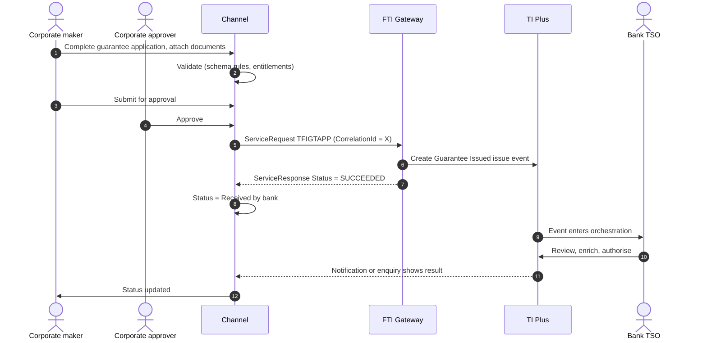
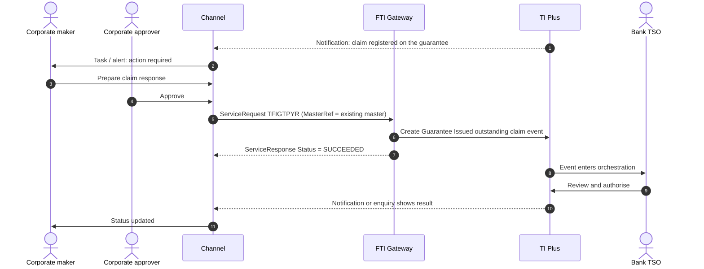

# Guarantee Issued (Import Guarantee)

> Part of the product specifications. Index and shared rules: [README](README.md). Shared message bodies: [shared message shapes](shared-message-shapes.md). Catalogue: [01](../01-interface-catalogue.md) · Functional spec: [02](../02-functional-specification.md).

| | |
|---|---|
| Priority | P1, wave 2 |
| Customer role | Applicant (principal) |
| TI product code (`Context.Product`) | `IGT` **[Assumption – confirm in TI]** |
| Messages | 6 |

## 1. Purpose and scope

The customer, as **principal**, asks the bank to issue a **guarantee** (bid bond, performance bond, advance-payment guarantee, retention, customs or financial guarantee) in favour of a beneficiary. Payment is made on a written demand, so the beneficiary can claim without proving a default. Governed by URDG 758 or local law. The guarantee shares the standby data model, so this specification is written as a delta to [Import Standby LC](import-standby-lc.md); the guarantee-specific elements are the contract and counter-guarantee blocks, the guarantee details, and the shipping-guarantee-style fields (`LetterOfIndemnity`, `BillNumber`, `VesselName`...).

Out of scope: data take-on, SWIFT MT760 generation, and the newer Undertaking messages (see [Undertaking Issued](undertaking-issued.md)).

> **Reading guide.** Field names, lengths and enumerations come from `sources/xsd_element_docs/`. Statements marked **[Proposed]** or **[Assumption]** are design decisions or guesses that the interface documents cannot confirm. Names are copied exactly from the schema, including its inconsistencies in capitalisation and spelling.

## 2. Messages

| Message | Kind | Creates in TI | Channel exposure | Phase | Body |
|---|---|---|---|---|---|
| `TFIGTAPP` | Create / issue | Guarantee Issued issue event | Customer | 2 | as `TFISBAPP` |
| `TFIGTAMN` | Amend | Guarantee Issued amend event | Customer | 2 | as `TFIGTAPP` |
| `TFIGTAMR` | Amend | Guarantee Issued (old) amend event | Customer | 2 | [Shape: Correspondence](shared-message-shapes.md#shape-correspondence) |
| `TFIGTCAN` | Cancel | Guarantee Issued cancel event | Customer | 2 | [Shape: Cancellation request](shared-message-shapes.md#shape-cancellation-request) |
| `TFIGTPYR` | Claim response | Guarantee Issued outstanding claim event | Customer | 2 | [Shape: Claim response](shared-message-shapes.md#shape-claim-response) |
| `TFIGTCOR` | Correspondence | Guarantee Issued correspondence event | Customer | 2 | [Shape: Correspondence](shared-message-shapes.md#shape-correspondence) |

**Exposure key.** *Customer* – the corporate starts or answers it in the channel. *Review* – schema description does not make the sender clear; confirm with the TI team before exposing. *Bank-side* – raised by the bank or an interbank counterparty; do not expose to customers.

## 3. Business scenario

A contractor needs a performance guarantee of 10% of a contract value for a public tender. It applies for an IGT with contract details (reference, tender closing date, guarantee value percentage), an expiry tied to the contract completion, and, if the beneficiary insists on a local bank, a counter-guarantee instruction to an overseas bank. The TSO issues the guarantee and, where needed, the counter-guarantee. If the beneficiary claims, the customer answers the claim.

**Issuance**



**Claim received**



## 4. Preconditions

1. The corporate is enabled for product `IGT`; user entitlements and limits apply.
2. A guarantee limit exists in the bank's limit system for the customer.
3. Reference data includes guarantee types, contract reference codes, and country codes.
4. If a counter-guarantee is used, the counter-guarantee bank is known (address book or SWIFT directory).

## 5. Screens

Same wizard as the standby, with two guarantee-specific steps (Contract, Counter-guarantee).

| Step | Section | Fields (schema element) |
|---|---|---|
| 1 | **Basics** | `Applicant`; `Context.TheirReference`; `ApplicationDate`; template |
| 2 | **Beneficiary** | `Beneficiary`; `BenAccNo`; advising bank; `AdviseDirect`; `ConfirmingBank` |
| 3 | **Guarantee terms** | `LCAmount`; `ExpiryDetails`; `Renewal`; drawing options; `GuaranteeDetails` (**guarantee-specific**: `ReceiverOfUndertaking`, `UnlimitedExpiry`); `ApplicableRules`; `GoverningLawDetails` |
| 4 | **Contract** | `ContractDetails` (**guarantee-specific**): reference code and narrative, reference date, tender closing date, total order amount, guarantee value percent |
| 5 | **Counter-guarantee** | `CounterGuaranteeAmount`, `CounterGuaranteeExpiryDate`, `CounterGuaranteeIssBank`, `CounterGuaranteePrincipalBank`, `CustomerCounter`, `CounterGteeIdentifier` (**guarantee-specific**) |
| 6 | **Shipping-related (optional)** | `LetterOfIndemnity`, `BillNumber`, `FlightDetails`, `ShippingCompany`, `VesselName`, `ShipmentAdditionalInformation` |
| 7 | **Wording** | `UseFreeFormat`, `FreeFormatInstructionsForSWIFT`, `Documents`, `AdditionalConditions` |
| 8 | **Delivery** | `UndertakingDeliveryDetails` |
| 9 | **Charges, accounts, cover** | As for the standby |
| 10 | **Instructions and documents** | `ApplicantInstructions`, instructions to advising/paying bank, attachments |
| 11 | **Review and submit** |  |

> **[Proposed] Fields hidden from the customer or set by configuration.** `Context.Team`, `Context.Step`, `Context.ExchangeNonAutoComplete`, `Context.BehalfOfBranch*`, `ExternalReview`, `ProvisionalFlags`, `BankCodes`, `ContinueEvent`, `Provisional`, `AutoCreateFollowOnEvent`, `FinalWording`, `TakeonExtra`, `InternalMasterRefSequence`, `OutstandingAmount`, `OutstandingAdditionalAmount`, `OriginalMasterReference`, `PreallocatedNo`. They affect routing, bank processing or data take-on, and should be set by channel configuration or left to TI defaults. Confirm each with the TI team (02, Q10).

## 6. Primary message `TFIGTAPP`

Sent by the Applicant to the Bank under a Guarantee Issued. Creates: Guarantee Issued issue event.

### 6.1 Context

| Element | Value |
|---|---|
| `Branch` | The booking branch from the corporate configuration. |
| `Customer` | The customer's TI mnemonic (max 20). |
| `Product` | `IGT` **[Assumption]** |
| `Event` | Normally implied by the message name. Leave empty unless the TI team asks for it. **[Assumption]** |
| `TheirReference` | Customer's own reference (max 34). |
| `OurReference` / `MasterRef` | Empty for a new guarantee; `MasterRef` for later messages. |

The remaining `Context` elements (`Team`, `Step`, `BehalfOfBranch*`, `TemplateIdentifier`, `EventReference`, `ExchangeNonAutoComplete`, `SubsidiaryMasterPrefixAndSerial`) are set by configuration. See [README](README.md#common-blocks-in-every-message).

### 6.2 Channel-managed elements

| Element | Value |
|---|---|
| `eBankMasterRef` / `EBankMasterRef` (max 20) | The channel's id for the master. Constant for every later event on it. |
| `eBankEvent` / `eBankEventRef` / `EBankEventRef` (max 20) | The channel's id for this event. Unique per instruction; the key for idempotent retries. |
| `EmbeddedItemss` | Inline attachments (`ID`, `AttachType`, `DocType`, `Description`, `FileName`, `DataStream`, `MimeType`, `DocumentFileName`); `IsCustomerAttachedDocument` = `Y`. |
| `DocumentsReceiveds` | References to documents already in the DMS, if the upload-first approach is chosen (02, Q8). |

**Capitalisation differs between messages** (`eBankMasterRef` in some, `EBankMasterRef` in others; `eBankEvent`, `eBankEventRef` and `EBankEventRef`). The channel generates names from the schema catalogue and must never hand-type them.

### 6.3 Field reference

`TFIGTAPP` carries the same top-level elements as `TFISBAPP` ([Import Standby LC, section 6.3](import-standby-lc.md)). Differences:

* Omits: `AdditionalInformation`
* Adds:

| Element | Type / length | Description |
|---|---|---|
| `GuaranteeDetails` | group |  |
| `ContractDetails` | group |  |
| `CounterGuaranteeAmount` | group | Counter guarantee amount. |
| `CounterGuaranteeExpiryDate` | date | Counter guarantee expiry date. |
| `CounterGuaranteeIssBank` | party | Issuing bank of the Counter Guarantee. |
| `CounterGuaranteePrincipalBank` | party | Counter Guarantee Principal Bank. |
| `CustomerCounter` | boolean | Y or N. Boolean values. |
| `CustomerCounterExpiryDate` | date | Customer counter expiry date. |
| `ShipmentAdditionalInformation` | string ≤222 | Additional details relating to shipment. |
| `BillNumber` | string ≤35 | AirwayBill/Bill of lading number. |
| `FlightDetails` | string ≤35 | Flight no Details. |
| `LetterOfIndemnity` | boolean | Y or N. Boolean values. |
| `ShippingCompany` | string ≤65 | Shipping company. |
| `VesselName` | string ≤35 | Vessel name. |
| `CounterGteeIdentifier` | string 1–1 | Counter guarantee type. Available values: 'C'='Counter received', 'T'='Ctr Received-Request', 'R'='Request issuance'. |
| `FreeFormatInstructionsForSWIFT` | string ≤26800 |  |

**`GuaranteeDetails`**

| Path | Type / length | Description |
|---|---|---|
| `GuaranteeDetails/ReceiverOfUndertaking` | string 1–3 |  |
| `GuaranteeDetails/UserField1` | string 1–5 |  |
| `GuaranteeDetails/UserField2` | string 1–5 |  |
| `GuaranteeDetails/UnlimitedExpiry` | boolean | Set to true where transaction has a unlimited expiry date. Boolean values. |

**`ContractDetails`**

| Path | Type / length | Description |
|---|---|---|
| `ContractDetails/ReferenceCode` | string 1–4 | Available values: 'CONT'='CONTRACT', 'DELV'='DELIVERY', 'OFFR'='OFFER', 'ORDR'='ORDER', 'PINV'='PROFORMA IN... |
| `ContractDetails/ReferenceNarrative` | string 1–35 |  |
| `ContractDetails/ReferenceDate` | date |  |
| `ContractDetails/TenderClosingDate` | date |  |
| `ContractDetails/TotalOrderAmount` | group | Amount Gateway pane. Note that this pane may have the currency included as part of the amount source or the... |
| `ContractDetails/TotalOrderAmount/Amount` | string ≤22 |  |
| `ContractDetails/TotalOrderAmount/Currency` | string 1–3 | Currency. |
| `ContractDetails/GuaranteeValuePercent` | decimal(15,12) |  |

**`CounterGuaranteeAmount`**

| Path | Type / length | Description |
|---|---|---|
| `CounterGuaranteeAmount/Amount` | string ≤22 |  |
| `CounterGuaranteeAmount/Currency` | string 1–3 | Currency. |


| Path | Allowed values |
|---|---|
| `ContractDetails/ReferenceCode` | `CONT` CONTRACT; `DELV` DELIVERY; `OFFR` OFFER; `ORDR` ORDER; `PINV` PROFORMA INVOICE; `PROJ` PROJECT; `TEND` TENDER |
| `CounterGteeIdentifier` | `C` Counter received; `T` Ctr Received-Request; `R` Request issuance |

For the shared elements, use the field reference in [Import Standby LC, section 6.3](import-standby-lc.md).

## 7. Other messages

### `TFIGTAMN` – Amend guarantee

| | |
|---|---|
| Creates in TI | Guarantee Issued amend event |
| Purpose (schema) | - |
| Channel exposure | Customer |
| Phase | 2 |

**Body:** same elements as `TFIGTAPP` (section 6.3 of this document), with the differences below.

* Omits: `PreallocatedNo`, `PreAdvise`, `InstructionsToApplicant`, `ApplicableRules`, `OtherProductType`, `GuaranteeDetails`, `CounterGuaranteeIssBank`, `CounterGteeIdentifier`, `FreeFormatInstructionsForSWIFT`, `FinalWording`, `Provisional`, `AutoCreateFollowOnEvent`
* Adds:

| Element | Type / length | Description |
|---|---|---|
| `Sender` | party | Sender. |
| `BenApprovalReq` | boolean | Whether the amendment requires beneficiary approval - Y = Beneficiary approval required - N = Not required. Boolean values. |
| `IncreaseAmount` | group | Amount and currency of increase. |
| `DecreaseAmount` | group | Amount and currency of decrease. |
| `AmendmentDetails` | group | Amendment details. |
| `AmendmentNarrative` | string ≤15860 | General narrative regarding the amendment. |
| `AmendChanges` | string ≤1820 | Details of the amendments. |
| `AmendDate` | date | Amend date. |
| `LCMasterGoodsAmendments` | group |  |
| `SpecialPaymentConditionsAmendments` | group |  |
| `AdditionalInformation` | string ≤30820 |  |
| `NonExtension` | boolean | Used to indicate the amendment is a non-extension only. Boolean values. |
| `Reduction` | group | Reduction details. |
| `StandbyGuaranteeApplicableRules` | group | Applicable rules. |
| `AdviseBy` | string 1–1 | Code for transfer method format, defined by its domain list. Code for transfer method format, defined by its domain list. Available values: 'e'='E-... |
| `CounterGuaranteeIssuingBank` | party |  |
| `GWRGuaranteeDetails` | group |  |
| `CounterGuaranteeIdentifier` | string 1–1 | Available values: 'C'='Counter received', 'T'='Ctr Received-Request', 'R'='Request issuance'. |

**`IncreaseAmount`**

| Path | Type / length | Description |
|---|---|---|
| `IncreaseAmount/Amount` | string ≤22 |  |
| `IncreaseAmount/Currency` | string 1–3 | Currency. |


**`DecreaseAmount`**

| Path | Type / length | Description |
|---|---|---|
| `DecreaseAmount/Amount` | string ≤22 |  |
| `DecreaseAmount/Currency` | string 1–3 | Currency. |


**`AmendmentDetails`**

| Path | Type / length | Description |
|---|---|---|
| `AmendmentDetails/AmendmentNumber` | int | Amenrment number. |
| `AmendmentDetails/AmendmentChargesBy` | group | The party responsible for the payment of amendment charges. |
| `AmendmentDetails/AmendmentChargesBy/Code` | string 1–1 | Available values: 'A'='Applicant', 'B'='Beneficiary', 'O'='Other arrangement'. |
| `AmendmentDetails/AmendmentChargesBy/OtherText` | string ≤222 | Narrative regarding Other party. |


**`LCMasterGoodsAmendments`**

| Path | Type / length | Description |
|---|---|---|
| `LCMasterGoodsAmendments/GoodsDescriptionAmendmentInstructions` | group |  |
| `LCMasterGoodsAmendments/GoodsDescriptionAmendmentInstructions/Instruction` | group ×n |  |
| `LCMasterGoodsAmendments/GoodsDescriptionAmendmentInstructions/Instruction/Type` | string 1–1 | Available values: 'A'='ADD', 'D'='DELETE'. |
| `LCMasterGoodsAmendments/GoodsDescriptionAmendmentInstructions/Instruction/Text` | string |  |
| `LCMasterGoodsAmendments/DocumentsRequiredAmendmentInstructions` | group |  |
| `LCMasterGoodsAmendments/DocumentsRequiredAmendmentInstructions/Instruction` | group ×n |  |
| `LCMasterGoodsAmendments/DocumentsRequiredAmendmentInstructions/Instruction/Type` | string 1–1 | Available values: 'A'='ADD', 'D'='DELETE'. |
| `LCMasterGoodsAmendments/DocumentsRequiredAmendmentInstructions/Instruction/Text` | string |  |
| `LCMasterGoodsAmendments/AdditionalConditionsAmendmentInstructions` | group |  |
| `LCMasterGoodsAmendments/AdditionalConditionsAmendmentInstructions/Instruction` | group ×n |  |
| `LCMasterGoodsAmendments/AdditionalConditionsAmendmentInstructions/Instruction/Type` | string 1–1 | Available values: 'A'='ADD', 'D'='DELETE'. |
| `LCMasterGoodsAmendments/AdditionalConditionsAmendmentInstructions/Instruction/Text` | string |  |


**`SpecialPaymentConditionsAmendments`**

| Path | Type / length | Description |
|---|---|---|
| `SpecialPaymentConditionsAmendments/ForBeneficiaryAmendmentInstructions` | group |  |
| `SpecialPaymentConditionsAmendments/ForBeneficiaryAmendmentInstructions/Instruction` | group ×n |  |
| `SpecialPaymentConditionsAmendments/ForBeneficiaryAmendmentInstructions/Instruction/Type` | string 1–1 | Available values: 'A'='ADD', 'D'='DELETE'. |
| `SpecialPaymentConditionsAmendments/ForBeneficiaryAmendmentInstructions/Instruction/Text` | string |  |
| `SpecialPaymentConditionsAmendments/ForReceivingBankAmendmentInstructions` | group |  |
| `SpecialPaymentConditionsAmendments/ForReceivingBankAmendmentInstructions/Instruction` | group ×n |  |
| `SpecialPaymentConditionsAmendments/ForReceivingBankAmendmentInstructions/Instruction/Type` | string 1–1 | Available values: 'A'='ADD', 'D'='DELETE'. |
| `SpecialPaymentConditionsAmendments/ForReceivingBankAmendmentInstructions/Instruction/Text` | string |  |


**`Reduction`**

| Path | Type / length | Description |
|---|---|---|
| `Reduction/Advise` | boolean | Whether reductions are to be advised. Boolean values. |
| `Reduction/AdviseNoticeDays` | int | Notice days for reduction notice. |
| `Reduction/IsIncrease` | boolean | Increase or decrease - Y = Increase - N = Decrease. Boolean values. |
| `Reduction/IncreaseOrReductionDate` | date | First date. |
| `Reduction/IsRegular` | boolean | Whether regular or irregular - Y = Regular - N = Irregular. Boolean values. |
| `Reduction/MaxIncreases` | int | Maximum number of increases(reductions). |
| `Reduction/Period` | group | Increase(reduction) frequency. |
| `Reduction/Period/Unit` | string 1–1 | Period. Available values: 'D'='Days', 'M'='Months', 'Q'='Quarters', 'W'='Weeks', 'Y'='Years'. |
| `Reduction/Period/Number` | int | Number of days (months) etc e.g. 30. |
| `Reduction/Period/DayInMonth` | int | Day in month for renewal. |
| `Reduction/Remaining` | int | Remaining increases(reductions). |
| `Reduction/StartDate` | date | Fisrt date for increase(reductions). |
| `Reduction/AmountOrPercent` | group | Amount or percentage of increase(reduction). |
| `Reduction/AmountOrPercent/Amount` | long |  |
| `Reduction/AmountOrPercent/Percent` | decimal(17,2) | Percentage. Available Values: 0 to 100 |
| `Reduction/IrregularAs` | group |  |
| `Reduction/IrregularAs/IrregularA` | group ×n | This requires IsRegular=N to be set in the xml. |
| `Reduction/IrregularAs/IrregularA/IsIncrease` | string ≤1 | Y or N. |
| `Reduction/IrregularAs/IrregularA/Date` | string |  |
| `Reduction/IrregularAs/IrregularA/Amount` | string ≤22 | Use this or Percent, but not both. |
| `Reduction/IrregularAs/IrregularA/Percent` | string ≤22 | Use this or Amount, but not both. |


**`StandbyGuaranteeApplicableRules`**

| Path | Type / length | Description |
|---|---|---|
| `StandbyGuaranteeApplicableRules/Code` | string 1–4 | Applicable rules that apply. Available values: 'ISPR'='ISPR', 'NONE'='NONE', 'OTHR'='OTHR', 'UCPR'='UCPR',... |
| `StandbyGuaranteeApplicableRules/Narrative` | string ≤35 | Additional description where 'OTHR'. |


**`GWRGuaranteeDetails`**

| Path | Type / length | Description |
|---|---|---|
| `GWRGuaranteeDetails/ReceiverOfUndertaking` | string 1–3 |  |
| `GWRGuaranteeDetails/UserField1` | string 1–5 |  |
| `GWRGuaranteeDetails/UserField2` | string 1–5 |  |
| `GWRGuaranteeDetails/UnlimitedExpiry` | boolean | Set to true where transaction has a unlimited expiry date. Boolean values. |


| Path | Allowed values |
|---|---|
| `AmendmentDetails/AmendmentChargesBy/Code` | `A` Applicant; `B` Beneficiary; `O` Other arrangement |
| `LCMasterGoodsAmendments/GoodsDescriptionAmendmentInstructions/Instruction/Type` | `A` ADD; `D` DELETE |
| `LCMasterGoodsAmendments/DocumentsRequiredAmendmentInstructions/Instruction/Type` | `A` ADD; `D` DELETE |
| `LCMasterGoodsAmendments/AdditionalConditionsAmendmentInstructions/Instruction/Type` | `A` ADD; `D` DELETE |
| `SpecialPaymentConditionsAmendments/ForBeneficiaryAmendmentInstructions/Instruction/Type` | `A` ADD; `D` DELETE |
| `SpecialPaymentConditionsAmendments/ForReceivingBankAmendmentInstructions/Instruction/Type` | `A` ADD; `D` DELETE |
| `Reduction/Period/Unit` | `D` Days; `M` Months; `Q` Quarters; `W` Weeks; `Y` Years |
| `StandbyGuaranteeApplicableRules/Code` | `ISPR` ISPR; `NONE` NONE; `OTHR` OTHR; `UCPR` UCPR; `URDG` URDG |
| `AdviseBy` | `e` E-mail; `o` E-mail Account Officer; `5` Fax; `a` Gateway; `i` Internal; `1` Mail; `6` No doc required; `4` SWIFT; `2` Telex; `3` Telex via SWIFT |
| `CounterGuaranteeIdentifier` | `C` Counter received; `T` Ctr Received-Request; `R` Request issuance |

### `TFIGTAMR` – Basic amendment request (free text)

| | |
|---|---|
| Creates in TI | Guarantee Issued (old) amend event |
| Purpose (schema) | - |
| Channel exposure | Customer |
| Phase | 2 |

**Body:** [Shape: Correspondence](shared-message-shapes.md#shape-correspondence) with differences.

* Adds: `AmendmentNarrative`

| Element | Type / length | Description |
|---|---|---|
| `AmendmentNarrative` | string | Details of the amendments. |

### `TFIGTCAN` – Cancel guarantee

| | |
|---|---|
| Creates in TI | Guarantee Issued cancel event |
| Purpose (schema) | Sent by the Applicant to the Issuing bank to request the cancellation of a Guarantee Issued |
| Channel exposure | Customer |
| Phase | 2 |

**Body:** [Shape: Cancellation request](shared-message-shapes.md#shape-cancellation-request).

### `TFIGTPYR` – Respond to a claim

| | |
|---|---|
| Creates in TI | Guarantee Issued outstanding claim event |
| Purpose (schema) | - |
| Channel exposure | Customer |
| Phase | 2 |

**Body:** [Shape: Claim response](shared-message-shapes.md#shape-claim-response).

### `TFIGTCOR` – Correspondence

| | |
|---|---|
| Creates in TI | Guarantee Issued correspondence event |
| Purpose (schema) | A general purpose message that is sent by the Applicant to the Issuing Bank in the form of an Ancillary message, General correspondence, Queries or Answers |
| Channel exposure | Customer |
| Phase | 2 |

**Body:** [Shape: Correspondence](shared-message-shapes.md#shape-correspondence).

## 8. Validation rules

### 8.1 Rules supported directly by the schema

Lengths, data types and the allowed values of coded fields are in the tables in sections 6 and 7 and are the source for the channel's client and server validators. Dates are ISO `xsd:date`. Boolean elements carry `Y` or `N`. Amounts are strings (maximum 22 characters); agree the decimal format with the TI team. Guarantee points to watch:

* `CounterGteeIdentifier` ∈ {`C` counter received, `T` counter received – request, `R` request issuance}.
* `ContractDetails.GuaranteeValuePercent` is `decimal(15,12)`; do not round on the client.
* The element names for counter-guarantee fields differ between `TFIGTAPP` (`CounterGuaranteeIssBank`, `CounterGteeIdentifier`) and `TFIGTAMN` (`CounterGuaranteeIssuingBank`, `CounterGuaranteeIdentifier`). Take names from the schema catalogue per message.
* Other coded fields follow the standby (`ExpiryType` C/N/Y, `ApplicableRules.Rules`).

### 8.2 Business rules to apply in the channel

Normal practice for this product and the checks a TSO would otherwise perform by hand. **[Proposed]**: switch each on or off per bank policy.

| # | Rule |
|---|---|
| V1 | All standby rules on expiry, renewal and amounts apply (see [Import Standby LC](import-standby-lc.md), section 8.2). |
| V2 | `ContractDetails.ReferenceDate` is not in the future; `TenderClosingDate` is before the guarantee expiry if both are given. |
| V3 | `GuaranteeValuePercent` is between 0 and 100; if `TotalOrderAmount` and `LCAmount` are both given they agree with the percentage within a tolerance set by the bank. **[Proposed]** |
| V4 | If a counter-guarantee is requested, `CounterGuaranteeIssBank` is present and `CounterGuaranteeExpiryDate` is on or after the guarantee expiry. **[Proposed]** |
| V5 | `LetterOfIndemnity` = `Y` is accepted only when shipping data is supplied. **[Proposed]** |
| V6 | Guarantee wording: if `UseFreeFormat` = `Y`, `FreeFormatInstructionsForSWIFT` is required and SWIFT-safe. |

### 8.3 Minimum content for a usable instruction

**[Proposed]** `Applicant`, `Beneficiary`, `LCAmount`, `ExpiryDetails`, `ApplicableRules`, `ContractDetails.ReferenceCode`, `ChargeAccount`, `IssuanceChgsFor`; counter-guarantee fields when requested.

## 9. Illustrative requests

Values are invented. Element names, prefixes and order follow `sources/example_xml/`. Elements not shown are omitted, which the schema allows for optional elements. **Test against the gateway before use.**

**`TFIGTAPP`**

```xml
<?xml version="1.0" standalone="yes"?>
<ServiceRequest xmlns:xsi="http://www.w3.org/2001/XMLSchema-instance"
                xmlns:m="urn:messages.service.ti.apps.tiplus2.misys.com"
                xmlns:c="urn:common.service.ti.apps.tiplus2.misys.com"
                xmlns="urn:control.services.tiplus2.misys.com">
  <RequestHeader>
    <Service>TI</Service>
    <Operation>TFIGTAPP</Operation>
    <Credentials><Name>CHANNEL_SVC</Name><Password>********</Password></Credentials>
    <TargetSystem>TI</TargetSystem>
    <SourceSystem>CORPCHANNEL</SourceSystem>
    <CorrelationId>9b1f4c2e-5a0d-4c47-9f3e-2c1d7a6b8e10</CorrelationId>
    <CreationDate>2026-10-18</CreationDate>
  </RequestHeader>
  <m:TFIGTAPP>
    <m:Context>
      <c:Branch>HOBR</c:Branch>
      <c:Customer>ACMEIMP</c:Customer>
      <c:Product>IGT</c:Product>
      <c:TheirReference>TENDER-2026-044</c:TheirReference>
    </m:Context>
    <m:Applicant>
      <c:Customer>ACMEIMP</c:Customer>
    </m:Applicant>
    <m:Beneficiary>
      <c:NameAddress>MINISTRY OF PUBLIC WORKS
JALAN MERDEKA 1
JAKARTA</c:NameAddress>
      <c:Country>ID</c:Country>
    </m:Beneficiary>
    <m:LCAmount>
      <c:Amount>350000.00</c:Amount>
      <c:Currency>USD</c:Currency>
    </m:LCAmount>
    <m:ExpiryPlace>JAKARTA</m:ExpiryPlace>
    <m:Documents>+WRITTEN DEMAND STATING THAT THE PRINCIPAL IS IN BREACH OF TENDER 2026/INF/044</m:Documents>
    <m:IssuanceChgsFor>A</m:IssuanceChgsFor>
    <m:OverseasChgsFor>A</m:OverseasChgsFor>
    <m:ChargeAccount>1234567890</m:ChargeAccount>
    <m:eBankMasterRef>CH-IGT-000012</m:eBankMasterRef>
    <m:eBankEvent>CH-IGT-000012-01</m:eBankEvent>
    <m:ApplicableRules>
      <c:Rules>URDG</c:Rules>
    </m:ApplicableRules>
    <m:ExpiryDetails>
      <c:ExpiryType>N</c:ExpiryType>
      <c:Date>2027-12-31</c:Date>
    </m:ExpiryDetails>
    <m:ContractDetails>
      <c:ReferenceCode>CONT</c:ReferenceCode>
      <c:ReferenceNarrative>TENDER 2026/INF/044</c:ReferenceNarrative>
      <c:TenderClosingDate>2026-11-30</c:TenderClosingDate>
      <c:GuaranteeValuePercent>10.000000000000</c:GuaranteeValuePercent>
    </m:ContractDetails>
  </m:TFIGTAPP>
</ServiceRequest>
```

## 10. Response handling and tracking

| `Status` | Channel behaviour |
|---|---|
| `SUCCEEDED` | TI accepted the message and created the event. Mark `ReceivedByBank`; keep `Warning` / `Info` texts. |
| `FAILED` | TI rejected the message. Show `Details.Error` to the maker and return the draft. No automatic retry. |
| `UNAVAILABLE` / timeout | Keep in the outbox, retry with back-off, and confirm by enquiry (`eBankEventRef`) before each re-send so no second event is created. |

Rules shared by every product are in [README – Common behaviour](README.md#common-behaviour).

As for the standby. Guarantees usually have a long life, so the channel's expiry and renewal alerts and the **claim** alert (trigger for `TFIGTPYR`) are the important status features. If a counter-guarantee is issued, TI may create a linked master; show it under the main guarantee when the enquiry exposes the link.

## 11. Exceptions

| Scenario | Handling |
|---|---|
| Beneficiary demands extension or payment | Claim response carries `RequestedNewExpiryDate`; show a clear "extend or pay" choice. |
| Counter-guarantee bank rejects | TI event is held; the channel shows "Bank action required" and the reason if exposed. |
| Guarantee expires while an amendment is pending | Block submit of amendments that would be effective after expiry; show warning. |
| Gateway `FAILED`, `UNAVAILABLE`, timeout, duplicate click | As in [README – Common behaviour](README.md#common-behaviour). |

## 12. Acceptance criteria

1. A maker can complete the guarantee form including contract and counter-guarantee blocks and resume a draft.
2. Element names are generated per message from the schema (no hand-typed names).
3. One `TFIGTAPP` per approved instruction; no duplicates.
4. Expiry alerts and claim alerts reach the right users.
5. A claim can be approved or refused with `TFIGTPYR`, with optional extension date.
6. Every step is in the audit trail with user, time and `CorrelationId`.
7. The stored request validates against the schema rules in 8.1 and matches the structure in section 9.

## 13. Open items

| # | Item |
|---|---|
| IGT-1 | Confirm the TI guarantee `ProductType` list and whether IGT or UTI is the strategic message for new business (both exist). |
| IGT-2 | Confirm counter-guarantee handling: does TI create a separate master? |
| IGT-3 | Obtain tailored `ResponseAction` values for guarantee claims. |
| IGT-4 | Confirm legal wording templates for customer selection. |
