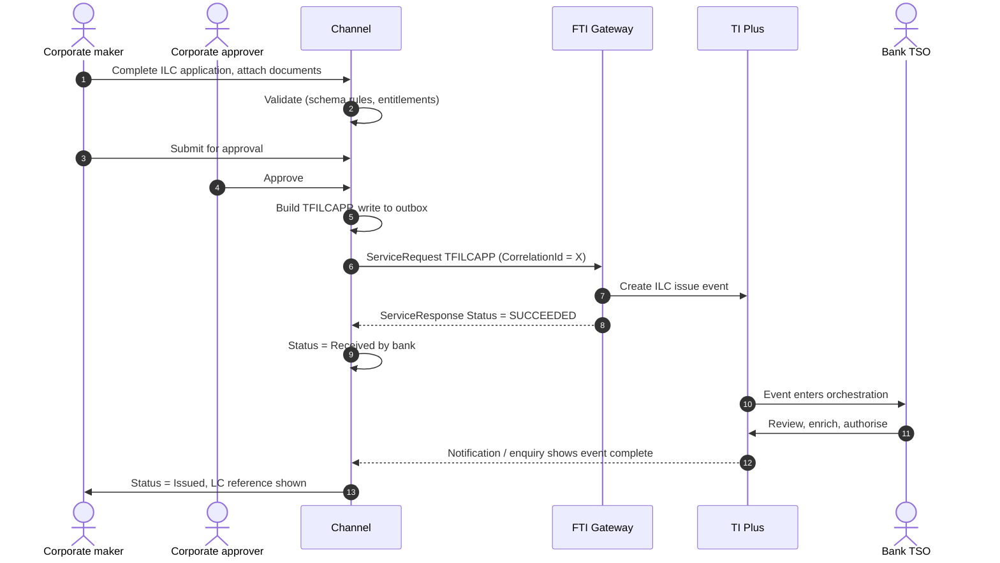

# Import Letter of Credit (`TFILCAPP` and servicing)

> Part of the product specifications. Index and shared rules: [README](README.md). Shared message bodies: [shared message shapes](shared-message-shapes.md).
> Catalogue: [01](../01-interface-catalogue.md) · Functional spec: [02](../02-functional-specification.md).

## 1. Purpose

This document specifies the first end-to-end flow of the channel: a corporate customer, acting as **applicant**, instructs the bank to **issue an import letter of credit (ILC)**. It covers the screens, the mapping from screen to `TFILCAPP`, the exchange with the FTI Gateway, status handling, error handling, and the follow-on servicing messages. It doubles as the pattern for every other `TF*` message.

Message: **`TFILCAPP`** – "Sent by the Applicant to the Bank under an Import Letter Of Credit. Creates: Import Letter Of Credit issue event."

> **Reading guide.** Statements about field names, lengths and enumerations come directly from `sources/xsd_element_docs/TI.TFILCAPP.xsd.txt`. Statements marked **[Proposed]** or **[Assumption]** are design decisions or guesses that the interface documents cannot confirm. They must be checked against our TI configuration ([02, section 11](../02-functional-specification.md)).

## 2. Business scenario

A buyer (applicant) wants the bank to issue an LC in favour of a seller (beneficiary) abroad. The applicant states the amount, expiry, shipment terms, goods, documents the seller must present, how the LC is payable, who pays charges, and which account to debit. The bank's TSO reviews the instruction in TI, checks limits and compliance, completes anything missing, and authorises the issuance, which TI then transmits (typically by SWIFT MT700) to the advising bank.



## 3. Preconditions

| # | Precondition |
|---|---|
| 1 | The corporate has a TI customer mnemonic and is enabled in the channel for product `ILC`. |
| 2 | The user has the entitlement *create* (maker) or *approve* for `ILC` and the amount in the instruction does not exceed their limit for the currency. |
| 3 | The channel holds current reference data: currencies, countries, Incoterms, goods codes, document types ([01, section 6](../01-interface-catalogue.md)). |
| 4 | The charge account (if used) belongs to the corporate. **[Assumption: validated by the channel from the bank's account service. TI validates again.]** |
| 5 | The corporate's credit facility is arranged in the bank's limit system. This is the bank's check at TI. The channel does not decide it. |

## 4. Screens

The capture form follows the structure of the LC. Sections can be shown as steps of a wizard or as collapsible panels.

| Step | Section | Fields (TFILCAPP element) |
|---|---|---|
| 1 | **Basics** | Applicant (pre-filled, read-only) `Applicant`; your reference `Context.TheirReference`; application date `ApplicationDate`; template `Context.TemplateIdentifier` |
| 2 | **Beneficiary** | Beneficiary party `Beneficiary` (address book or free text); beneficiary account at overseas bank `BenAccNo`; advising bank `AdvisingBank`; advise-through bank `AdviseThru` |
| 3 | **Amount and validity** | Currency and amount `LCAmount`; tolerance `LCAmountSpec`; additional amounts `AddAmount`, `AddAmountText`; expiry date `ExpiryDate`; expiry place `ExpiryPlace`; revolving `Revolving` |
| 4 | **Type and rules** | Revocable `Revocable`; transferable `Transferable`; confirmation `Confirmation`, `ConfirmationDetails`; applicable rules `ApplcableRules` (+ narrative); standby `StandBy`; back-to-back (separate message `TFILCBTB`) |
| 5 | **Payment terms** | Available by `TermsOfPayment.AvailableBy`; tenor `TermsOfPayment.Tenor`, `FromAfter`, `TenorFrom`, `TenorText`, `TenorMaturityDate`; drafts drawn on `DraftsDrawnOn` (+ bank); available with `AvailableWith`; drafts drawn by `DraftsDrawnByDetails`; invoice percent `InvoicePct`; special payment conditions `SpecialPaymentConditions` |
| 6 | **Shipment** | Ports / places `PortOfLoading`, `PortOfDischarge`, `ShipmentFrom`, `ShipmentTo`; latest shipment date `ShipmentDate` or period `ShipmentPeriod`; partial / transhipment `PartShipment`, `TransShipment`; Incoterm `Incoterm`, `IncoPlace`; freight `FreightPrepaid`; insurance `InsuranceFor` |
| 7 | **Goods and documents** | Goods description `Goods`; goods code `GoodsCode`; HS code `HSCode`; documents required `Documents`; additional conditions `AdditionalConditions`; presentation period `PresentationDays` / `PresentationPeriod`; purchase orders `PurchaseOrderss` |
| 8 | **Charges and accounts** | Issuance charges for `IssuanceChgsFor`; overseas charges `OverseasChgsFor`; tax `TaxFor`; defer charges `DeferChgs`; charge account `ChargeAccount`; preferred charge currency `PreferredCcy`; principal account `PrincipalAccount`; reimbursement `ReimbursingBank` and instructions |
| 9 | **Cover and risk** | Margin deposit `MarginDeposit`; collateral `Collateral`; FX contracts `FxContracts`; FX option deal reference `FXOptDealRef`; licence details `LicenseDetails` |
| 10 | **Instructions and documents** | Instructions to the bank `ApplicantInstructions`; instructions to advising / paying bank `InstructionsToAdvisingBank`, `InstructionsToPayingBank`; attachments `EmbeddedItemss` |
| 11 | **Review and submit** | Read-only summary and preview; approval route; confirmation |

> **[Proposed] Fields hidden from the customer.** `Context.Team`, `Context.Step`, `Context.ExchangeNonAutoComplete`, `Context.BehalfOfBranch*`, `ExternalReview`, `ProvisionalFlags`, `BankCodes`, `ContinueEvent`, `FinalWording`, `Provisional`, `AutoCreateFollowOnEvent`, `IssueBy`, `PreallocatedNo`, `OriginalMasterReference`, `TakeonExtra`, `OutstandingAmount`, `OutstandingAdditionalAmount`, `InternalMasterRefSequence`. They affect routing, bank processing or data take-on, and should be set by the channel configuration (or left to TI defaults), not by the customer. Confirm each with the TI team ([02, Q10](../02-functional-specification.md)).

## 5. Message construction

### 5.1 Request header

| Element | Value from the channel |
|---|---|
| `Service` | `TI` |
| `Operation` | `TFILCAPP` |
| `Credentials` | Channel's gateway service account (`Name`, `Password`, and `Certificate` / `Digest` if required). **[Assumption]** |
| `SourceSystem` | Channel identifier agreed with the TI team. **[Assumption]** |
| `TargetSystem` | TI instance identifier. **[Assumption]** |
| `CorrelationId` | New unique value per attempt. Stored with the submission. |
| `CreationDate` | Business date of the data (`xsd:date`, for example `2026-10-18`). |
| `ReplyFormat`, `ReplyTarget`, `NoRepair`, `NoOverride`, `TransactionControl`, `GroupingId` | Values to be defined with the TI team ([02, Q2](../02-functional-specification.md)). The sample file uses `FULL`, `Y`, `Y`, `NONE`. |

### 5.2 Context

| Element | Value | Source |
|---|---|---|
| `Branch` | The bank branch that books the transaction. | Corporate configuration. |
| `Customer` | Applicant's TI customer mnemonic (max 20). | Selected corporate. |
| `CustomerSwiftAddress` | Applicant BIC if the bank uses it (max 14). | Corporate configuration. |
| `Product` | `ILC` | Fixed. |
| `Event` | `ISI` (issuance). The schema's own example for ILC / ELC is "ISI – Issuance". **[Assumption: confirm in our TI event-type table.]** | Fixed. |
| `TheirReference` | Customer's own reference (max 34). | Form. |
| `OurReference` | Empty for a new LC. TI allocates the master reference. | – |
| `TemplateIdentifier` | Bank deal template, if used (max 35). | Form / configuration. |
| `EventReference` | Leave empty unless the TI team asks otherwise (max 6, prefix plus number). | – |

### 5.3 Body – channel-managed elements

| Element | Value |
|---|---|
| `eBankMasterRef` (max 20) | Channel's id for the LC (master). Stays the same for every later event on this LC. |
| `eBankEvent` (max 20) | Channel's id for this issuance event. The schema names this element `eBankEvent` in `TFILCAPP`; later events (`TFILCAMN`, `TFILCPYR` ...) use `eBankEventRef` where the schema defines it. Always take names from the schema catalogue. |
| `ProductType` (max 3) | TI product type (sub-type of ILC), chosen by the customer or defaulted. **[Assumption]** |
| `DocumentsReceiveds` | References to documents already in the DMS (if the upload-first approach is chosen). |
| `EmbeddedItemss` | Inline attachments: `ID`, `AttachType`, `DocType`, `Description`, `FileName`, `DataStream`, `MimeType`, `DocumentFileName`. Set `IsCustomerAttachedDocument` = Y. |

### 5.4 Complete field reference for `TFILCAPP`

All 110 top-level elements, in schema order. Nested content (party addresses, tenor, amounts, etc.) follows the patterns shown in the shared blocks of [01, section 4](../01-interface-catalogue.md), and in section 5.5 below. For nested paths, read `sources/xsd_element_docs/TI.TFILCAPP.xsd.txt`.

| Element | Type / length | Description (schema text, shortened) |
|---|---|---|
| `Context` | group | The Context data of the message is used to provide basic information about the Customer, References, Team and the Product and Event that the message relates to.When cr... |
| `DocumentsReceiveds` | group |  |
| `EventNotificationss` | group |  |
| `FileIdentification` | string 4–70 | File Identification and associated file name. |
| `EmbeddedItemss` | group |  |
| `MasterRef` | string 1–20 | e.g. Documentary Credit Number, FX contract number. |
| `ContinueEvent` | string ≤6 |  |
| `ProvisionalFlags` | group |  |
| `ExternalReview` | group |  |
| `Applicant` | group | Applicant. |
| `ApplicantInstructions` | string ≤32000 | General instructions from the Applicant. |
| `Beneficiary` | group | Beneficiary. |
| `BenAccNo` | string 1–34 | Beneficiary account number at overseas bank. |
| `ConfirmationDetails` | group | Confirmation details. |
| `IssueBy` | string 1–1 | Code for transfer method format, defined by its domain list. Code for transfer method format, defined by its domain list. Available values: 'e'='E-mail', 'o'='E-mail A... |
| `LCAmount` | group | Letter of Credit Amount. |
| `LCAmountSpec` | group | Further amount specification Gateway pane. |
| `Revocable` | boolean | - Y = Revocable - N = Irrevocable. Boolean values. |
| `Confirmation` | string 1–1 | Confirmation Instructions as entered by the Issuing Bank. Available values: 'C'='Confirmed', 'M'='May Add', 'W'='Unconfirmed'. |
| `Revolving` | group | Revolving details. |
| `Transferable` | boolean | - Y = Transferable - N = Non-transferable. Boolean values. |
| `StandBy` | boolean |  Boolean values. |
| `ExpiryDate` | date | Expiry date. |
| `ApplicationDate` | date | Application date. |
| `IssueDate` | date | Issue date. |
| `ExpiryPlace` | string 1–29 | Expiry place. |
| `TermsOfPayment` | group | Payment terms. |
| `AvailableWith` | group | Available with. |
| `InvoicePct` | decimal(17,2) | Invoice percent e.g 95.25. Available Values: 0 to 100 |
| `DraftsDrawnByDetails` | group |  |
| `ShipmentFrom` | string ≤144 | Shipment from. |
| `ShipmentTo` | string ≤144 | Shipment to. |
| `ShipmentDate` | date | Shipment date. |
| `ShipmentPeriod` | string ≤402 | Shipment period. |
| `TransShipment` | string 1–35 | Transhipment. Available values (before SWIFT2018): 'A'='Allowed', 'NA'='Not allowed', 'N'='None', 'O'='Other' or text up to 35 chars. As from SWIFT2018, available valu... |
| `PartShipment` | string 1–35 | Partial shipment. Available values (before SWIFT2018): 'A'='Allowed', 'NA'='Not allowed', 'N'='None', 'O'='Other' or text up to 35 chars. As from SWIFT2018, available ... |
| `Incoterm` | string 1–3 | Incoterm (for example, CFR - Cost and Freight). |
| `IncoPlace` | string ≤142 |  |
| `InsuranceFor` | boolean | Change description to say - Y = Buyer - N = Seller. Boolean values. |
| `FreightPrepaid` | string 1–1 | Freight charges pre-paid or collect. Freight charges pre-paid or collect. Available values: 'C'='Collect', 'P'='Pre-paid'. |
| `PresentationDays` | int | Presentation days. |
| `PresentationPeriod` | string ≤148 | Presentation period text. |
| `Goods` | string ≤53600 | Description of Goods. |
| `Documents` | string ≤53600 | Documents required. |
| `AdditionalConditions` | string ≤53600 | Additional conditions. |
| `SpecialPaymentConditions` | group | Special payment conditions *** Not required for Guarantees ***. |
| `GoodsCode` | string 1–10 | TI Plus goods code. |
| `IssuanceChgsFor` | string 1–1 | Issuance charges for. Available values: 'A'='Applicant', 'B'='Beneficiary'. |
| `TaxFor` | string 1–1 | Tax paid by. Tax paid by. Available values: 'P'='Charge payer', 'C'='Customer'. |
| `OverseasChgsFor` | string 1–1 |  Available values: 'A'='Applicant', 'B'='Beneficiary'. |
| `ChargeText` | string ≤222 | Free format charge text. |
| `AddAmount` | group | Additional amounts. |
| `AddAmountText` | string ≤804 | Additional  amount text. |
| `AdviseThru` | group | Advise through bank, through which the credit is to be advised. |
| `AdviseThruAccount` | string 1–35 | Advise Thru Bank Account. |
| `PreferredCcy` | string 1–3 | Preferred charge currency. |
| `ChargeAccount` | string 1–34 | Account from which charges are to be taken. |
| `ChargeDetails` | group |  |
| `PrincipalAccount` | string 1–34 | Principal account. Creates an action item for the user to create master settlement instructions or advise to third parties as required. |
| `FXOptDealRef` | string 1–20 | Details of any forward foreign exchange contract that this master may utilise. |
| `BankCodes` | group | Bank defined codes for their own purposes. Defined using 'List value' in TI Plus System tailoring. |
| `AdvisingBank` | group | Advising Bank. |
| `eBankMasterRef` | string ≤20 | Unique reference meaningful to the sending system which applies to the master. |
| `eBankEvent` | string ≤20 | Unique reference meaningful to the sending system which applies to this transaction. |
| `RelatedMasterRef` | string 1–20 | e.g. Documentary Credit Number, FX contract number. |
| `AdviseDirect` | boolean | To be advised direct Y or N. Boolean values. |
| `DomesticExpiry` | boolean | Domestic Expiry. Boolean values. |
| `Operative` | boolean | Operative. Boolean values. |
| `ApplcableRules` | string 1–1 | Applicable Rules. This field specifies the rules the credit is subject to. Available values: 'E'='EUCP LATEST VERSION', 'P'='EUCPURR LATEST VERSION', 'I'='ISP LATEST V... |
| `ApplcableRulesNarrative` | string ≤35 | The credit is subject to any other rules. Only used if ApplicableRules is 'OTHR'. |
| `ReimbursementApplicableRules` | string 1–1 | This field specifies the rules the credit is subject to. This field specifies the rules the credit is subject to. Available values: 'N'='NOTURR', 'U'='URR LATEST VERSI... |
| `PortOfLoading` | string ≤144 | Port of loading. |
| `PortOfDischarge` | string ≤144 | Port of discharge. |
| `PurchaseOrderss` | group |  |
| `OutstandingAdditionalAmount` | group | Outstanding additional amount. |
| `OutstandingAmount` | group | Outstanding amount. |
| `OriginalMasterReference` | string 1–20 | e.g. Documentary Credit Number, FX contract number. |
| `TakeonExtra` | group | Extra Take on data. |
| `InstructionsToAdvisingBank` | string ≤32000 | Instructions to Advising bank. |
| `InternalMasterRefSequence` | int | Internal master sequence. |
| `DocumentsToBeSentBy` | string ≤2 | Documents to be sent by:. Available values: 'AM'='Air mail', 'CL'='Collect', 'CO'='Courier', 'FC'='First class mail', 'HD'='Hand delivery', 'RD'='Recorded delivery', '... |
| `DeliveryNumber` | int | Number of document delivery 1-3. Available Values: 1 to 3 |
| `DeferChgs` | boolean | Defer bank's charges. Boolean values. |
| `MarginDeposit` | group |  |
| `Collateral` | group |  |
| `FxContracts` | group |  |
| `ReimbursingBank` | group | Reimbursing bank. |
| `ReimbursingBankAccount` | string 1–34 | Reimbursing bank account. |
| `ReimbursingBankAccountNumber` | string 1–34 | Account number at reimbursing bank. |
| `ReimbursingBankTransferMethod` | string 2–2 | Reimbursing bank transfer method. |
| `ReimbursingBankCharge` | string ≤3 | Reimbursing bank charges for. Reimbursing bank's charges. Available values: 'CLM'='Claimant', 'OUR'='Issuer'. |
| `InstructionsToReimbursingBank` | string ≤1820 | Instructions to reimbursing bank. |
| `LicenseDetails` | group |  |
| `HSCode` | string ≤1000 |  |
| `InstructionsToPayingBank` | string ≤2010 | Instructions to paying bank. |
| `PreallocatedNo` | int | Used only if your bank has pre-allocated a block of reference numbers to the customer for the product as described in the TI Plus System Tailoring Guide. Available Val... |
| `ProductType` | string ≤3 | TI Product type. |
| `PreAdvise` | boolean | Pre-Advise LC. Boolean values. |
| `ApplicantBank` | group | Applicant Bank. |
| `InstructionsToApplicant` | string ≤222 | Instructions to Applicant. |
| `FinalWording` | boolean | Used to indicate whether the wording is final for the transaction. Boolean values. |
| `Provisional` | boolean | Used to specify if the message is to create a provisional event. Boolean values. |
| `AutoCreateFollowOnEvent` | boolean | Used to specify if the next event should be automatically created when the current event is completed. Boolean values. |
| `AdditionalParties` | group | This contains the additional parties to a transaction. Only applicable for Issue/Create and Amend events. |
| `ReimbursementAmount` | group | Reimbursement amount. |
| `ReimbursementAmountSpec` | group | Reimbursement amount specification. |
| `ReibursementAdditionalAmount` | group | Reimbursement additional amounts. |
| `ReimbursementAdditionalAmountText` | string ≤804 | Reimbursement additional  amount text. |
| `AdditionalData` | group | Additional data for the event - where customization is not used the bank can attach details to the event which are mapped to the additional data held for the event. |
| `ExtraData` | group |  |

### 5.5 Nested structures worth knowing

| Block | Children | Notes |
|---|---|---|
| Party (`Applicant`, `Beneficiary`, `AdvisingBank`, `AdviseThru`, `ReimbursingBank`, `ApplicantBank`, `AvailableWith`, additional parties) | `Customer`, `LegalEntityIdentifier`, `NameAddress` (≤ 1,024), `SwiftAddress` (BIC ≤ 14), `Reference` (≤ 34), `Contact`, `ZipCode`, `Telephone`, `FaxNumber`, `TelexNumber`, `Country` (2), `Email`, `Language` (2), `MXAddress`, `SwiftTradeAddress` | Provide **either** a TI customer mnemonic **or** the name/address. For SWIFT-bound output the 4-line `SwiftTradeAddress` (lines ≤ 35) is the safest. **[Assumption]** |
| `MXAddress` | `Name` (≤ 140), `Department`, `SubDepartment`, `StreetName`, `BuildingNumber`, `BuildingName`, `Floor`, `PostBox`, `Room`, `PostCode`, `TownName`, `TownLocationName`, `DistrictName`, `CountrySubDivision`, `Country`, `AddressLine1/2` (≤ 70) | ISO 20022 structured address. |
| `LCAmount` | `Amount` (string ≤ 22), `Currency` (3) | Amount is a string in the schema. Agree the decimal format with the TI team. |
| `LCAmountSpec` | `Qualifier` ∈ {A About, E Exact, M Maximum, X Min/Max, N Not exceeding, O Other, U Up to}; `Min`, `Max` (percent); `AmountMin`, `AmountMax` | Tolerance, SWIFT field 39A/39B. |
| `TermsOfPayment` | `Tenor{TenorDays, TenorPeriod ∈ D,M,Q,W,Y}`, `FromAfter` ∈ {A, F, E}, `TenorFrom`, `TenorText`, `TenorMaturityDate`, `MixedPayDtls`, `DraftsDrawnOn` ∈ {O, N, A, I, S, R}, `DraftsDrawnOnBank`, `AvailableBy` ∈ {A Acceptance, D Deferred, M Mixed, N Negotiation, E On demand, S Sight}, `ExpectedLatestPaymentDate` | Use `TenorMaturityDate` **or** the tenor elements, not both ("blank if tenor details entered"). |
| `AvailableWith` | `Type` (O named bank, H advise-through, A advising, W any bank, T any bank in city, U any bank in country ...), `Bank`, `Ctry`, `City` | |
| `Revolving` | `Revolving`, `Cumulative`, `Period`, `Revolutions`, `NextDate`, `NoticeDays`, `ChargeToFirstPeriod` | Only when the LC is revolving. |
| `ConfirmationDetails` | `ConfirmationCharges` ∈ {A, B}, `RequestedConfirmationParty`, `RequestedConfirmationPartyRole` ∈ {THB, ADV, OTH} | Only when `Confirmation` is C (Confirmed) or M (May add). |
| `PurchaseOrderss/PurchaseOrders` ×n | `Number`, `POAmount`, `POCurrency`, `Description`, `Quantity`, `UnitPrice`, `EarliestShipmentDate`, `LatestShipmentDate`, ... | Optional line detail. |
| `Collateral/CollateralDetail` ×n, `MarginDeposit`, `FxContracts/FxContract` ×n, `LicenseDetails/LicenseDetail` ×n | see schema | Cover and risk data. Visible only for customers where the bank allows it. |

## 6. Validation rules

### 6.1 Rules taken directly from the schema

| Rule | Element(s) |
|---|---|
| Length limits as in section 5.4 | all |
| `Confirmation` ∈ {C Confirmed, M May add, W Unconfirmed} | `Confirmation` |
| `ApplcableRules` ∈ {E EUCP, P EUCPURR, I ISP, O OTHR, U UCP, C UCPURR}; narrative (≤ 35) only if `O` | `ApplcableRules`, `ApplcableRulesNarrative` |
| `ReimbursementApplicableRules` ∈ {N NOTURR, U URR} | |
| `IssuanceChgsFor`, `OverseasChgsFor` ∈ {A Applicant, B Beneficiary}; `TaxFor` ∈ {P Charge payer, C Customer}; `FreightPrepaid` ∈ {C Collect, P Pre-paid}; `ReimbursingBankCharge` ∈ {CLM Claimant, OUR Issuer} | |
| `PartShipment`, `TransShipment`: from SWIFT 2018 the values are A (allowed), NA (not allowed), C (conditional). Before 2018 also N and O were used. | |
| `DocumentsToBeSentBy` ∈ {AM, CL, CO, FC, HD, RD, RA, RM}; `DeliveryNumber` 1–3 | |
| `InvoicePct` 0–100, two decimals | |
| Dates are ISO `xsd:date` | `ExpiryDate`, `ApplicationDate`, `IssueDate`, `ShipmentDate` |

### 6.2 Business rules to apply in the channel

These are normal LC practice and the checks a TSO would otherwise perform by hand. **[Proposed]**: switch each on or off per bank policy.

| # | Rule |
|---|---|
| V1 | `ExpiryDate` is after today and not before the latest shipment date; `ShipmentDate` and `ShipmentPeriod` are not both set. |
| V2 | `LCAmount` > 0; precision matches the currency. If `LCAmountSpec.Qualifier` = X, then `Min` and `Max` are both present. |
| V3 | Exactly one of: tenor elements, `TenorMaturityDate`, or `AvailableBy` = Sight / On demand with no tenor. |
| V4 | `Beneficiary` has a name, address and country. |
| V5 | `Goods`, `Documents` and `AdditionalConditions` use only characters allowed in SWIFT field 45A / 46A / 47A, with line length 65 and the maximum number of lines for the field. **[Assumption: confirm against our SWIFT release.]** |
| V6 | `ChargeAccount` and `PrincipalAccount` belong to the applicant. |
| V7 | If `Confirmation` ≠ W, a confirming party or `ConfirmationDetails` is present. |
| V8 | `PresentationDays` is set or `PresentationPeriod` is set, not both. |
| V9 | Attachments: allowed MIME types, size per file and per message within gateway limits, document type from the bank list, no duplicates. |

### 6.3 Minimum content for a usable instruction

The schema does not mark mandatory elements. As a **[Proposed]** starting point, derived from the SWIFT MT700 mandatory set, the channel should require:

`Applicant`, `Beneficiary`, `LCAmount` (amount and currency), `ExpiryDate`, `ExpiryPlace`, `TermsOfPayment.AvailableBy` plus `AvailableWith`, `Revocable` (or default irrevocable), `Confirmation`, `Goods`, `Documents`, `PartShipment`, `TransShipment`, `PortOfLoading` or `ShipmentFrom`, `PortOfDischarge` or `ShipmentTo`, `ShipmentDate` or `ShipmentPeriod`, `IssuanceChgsFor` / `OverseasChgsFor`, `PresentationDays` or `PresentationPeriod`, `ApplcableRules`, and `ChargeAccount`.

Validate this set by sending test messages with minimal content to the TI test environment and recording which fields TI rejects or leaves for the TSO to complete.

## 7. Illustrative request

Values are invented. Element names, prefixes and order follow `sources/example_xml/TI.TFILCAPP.xml`. Elements not shown are omitted, which the schema allows for optional elements. **Test against the gateway before use.**

```xml
<?xml version="1.0" standalone="yes"?>
<ServiceRequest xmlns:xsi="http://www.w3.org/2001/XMLSchema-instance"
                xmlns:m="urn:messages.service.ti.apps.tiplus2.misys.com"
                xmlns:c="urn:common.service.ti.apps.tiplus2.misys.com"
                xmlns="urn:control.services.tiplus2.misys.com">
  <RequestHeader>
    <Service>TI</Service>
    <Operation>TFILCAPP</Operation>
    <Credentials>
      <Name>CHANNEL_SVC</Name>
      <Password>********</Password>
    </Credentials>
    <TargetSystem>TI</TargetSystem>
    <SourceSystem>CORPCHANNEL</SourceSystem>
    <CorrelationId>9b1f4c2e-5a0d-4c47-9f3e-2c1d7a6b8e10</CorrelationId>
    <CreationDate>2026-10-18</CreationDate>
  </RequestHeader>
  <m:TFILCAPP>
    <m:Context>
      <c:Branch>HOBR</c:Branch>
      <c:Customer>ACMEIMP</c:Customer>
      <c:Product>ILC</c:Product>
      <c:Event>ISI</c:Event>
      <c:TheirReference>PO-2026-0457</c:TheirReference>
    </m:Context>
    <m:EmbeddedItemss>
      <m:EmbeddedItems>
        <m:ID>proforma-invoice.pdf</m:ID>
        <m:AttachType>PDF</m:AttachType>
        <m:DocType>GEN</m:DocType>
        <m:Description>Proforma invoice</m:Description>
        <m:FileName>proforma-invoice.pdf</m:FileName>
        <m:DataStream>JVBERi0xLjQK...</m:DataStream>
        <m:MimeType>application/pdf</m:MimeType>
        <m:IsCustomerAttachedDocument>Y</m:IsCustomerAttachedDocument>
      </m:EmbeddedItems>
    </m:EmbeddedItemss>
    <m:Applicant>
      <c:Customer>ACMEIMP</c:Customer>
    </m:Applicant>
    <m:Beneficiary>
      <c:NameAddress>SHENZHEN WIDGETS CO LTD
88 NANSHAN AVENUE
SHENZHEN</c:NameAddress>
      <c:Country>CN</c:Country>
    </m:Beneficiary>
    <m:LCAmount>
      <c:Amount>250000.00</c:Amount>
      <c:Currency>USD</c:Currency>
    </m:LCAmount>
    <m:LCAmountSpec>
      <c:Qualifier>A</c:Qualifier>
      <c:Min>5</c:Min>
      <c:Max>5</c:Max>
    </m:LCAmountSpec>
    <m:Revocable>N</m:Revocable>
    <m:Confirmation>W</m:Confirmation>
    <m:Transferable>N</m:Transferable>
    <m:ExpiryDate>2027-01-31</m:ExpiryDate>
    <m:ApplicationDate>2026-10-18</m:ApplicationDate>
    <m:ExpiryPlace>SHENZHEN</m:ExpiryPlace>
    <m:TermsOfPayment>
      <c:Tenor>
        <c:TenorDays>90</c:TenorDays>
        <c:TenorPeriod>D</c:TenorPeriod>
      </c:Tenor>
      <c:FromAfter>F</c:FromAfter>
      <c:TenorFrom>L</c:TenorFrom>
      <c:DraftsDrawnOn>I</c:DraftsDrawnOn>
      <c:AvailableBy>A</c:AvailableBy>
    </m:TermsOfPayment>
    <m:AvailableWith>
      <c:Type>A</c:Type>
    </m:AvailableWith>
    <m:ShipmentFrom>SHENZHEN, CHINA</m:ShipmentFrom>
    <m:ShipmentTo>JAKARTA, INDONESIA</m:ShipmentTo>
    <m:ShipmentDate>2026-12-31</m:ShipmentDate>
    <m:TransShipment>NA</m:TransShipment>
    <m:PartShipment>A</m:PartShipment>
    <m:Incoterm>CIF</m:Incoterm>
    <m:IncoPlace>JAKARTA</m:IncoPlace>
    <m:PresentationDays>21</m:PresentationDays>
    <m:Goods>5000 UNITS OF MODEL X WIDGETS AS PER PROFORMA INVOICE PO-2026-0457</m:Goods>
    <m:Documents>+SIGNED COMMERCIAL INVOICE IN 3 ORIGINALS
+FULL SET CLEAN ON BOARD BILLS OF LADING
+PACKING LIST IN 2 COPIES</m:Documents>
    <m:IssuanceChgsFor>A</m:IssuanceChgsFor>
    <m:OverseasChgsFor>B</m:OverseasChgsFor>
    <m:ChargeAccount>1234567890</m:ChargeAccount>
    <m:eBankMasterRef>CH-ILC-000123</m:eBankMasterRef>
    <m:eBankEvent>CH-ILC-000123-01</m:eBankEvent>
    <m:ApplcableRules>U</m:ApplcableRules>
  </m:TFILCAPP>
</ServiceRequest>
```

## 8. Response handling

| `Status` | Meaning for the channel | Action |
|---|---|---|
| `SUCCEEDED` | TI accepted the message and created the event. | Mark `ReceivedByBank`. Store the TI master reference if it is returned, otherwise read it with `SearchMasters` / `RetrieveMasterDetail` using `eBankMasterRef`. Keep any `Warning` / `Info` texts for the customer. |
| `FAILED` | TI rejected the message, usually for data reasons. `Details.Error` holds the reason. | Mark `ReturnedToCustomer`. Translate the error text where a mapping exists (use `CustomError` definitions as a starting list), otherwise show it as-is. Return the draft to the maker. Never auto-retry. |
| `UNAVAILABLE` | The gateway or TI could not process the request now. | Keep the item in the outbox, mark `Retry`, retry with exponential back-off. Before each retry, enquire by `eBankEventRef`: if TI already has the event, treat as `SUCCEEDED`. |
| No response (timeout) | Outcome unknown. | Same as `UNAVAILABLE`, plus raise an operational alert after N attempts. |

Warnings on a `SUCCEEDED` response do not block the transaction but are shown to the bank operations console.

The body of a response to a `TF*` message is not documented in this repository, only the `ServiceResponse` envelope. Capture real responses in the TI test environment and add them to the contract tests ([02, section 10](../02-functional-specification.md)).

## 9. After submission: tracking

| Step | Mechanism |
|---|---|
| Immediately | Gateway response (section 8). |
| Short term | Poll `SearchMasters` filtered by customer, product `ILC`, and recent window, then `RetrieveMasterSummaries` for the references found. Match to the channel record by `eBankMasterRef` if it is returned by the chosen `DefinitionID`, otherwise by `TheirReference` plus amount and beneficiary. |
| Event-driven | `Notifications.All` messages, if enabled ([02, Q4](../02-functional-specification.md)). Match on the TI master reference in the `Payload`. |
| Completion | Master appears with status `LIV` (live; the `SearchMasters` default status filter). Channel shows "Issued" and the LC reference. |
| Bank query | A TSO query arrives as a notification or a correspondence event. The customer answers with `TFILCCOR` (section 10.4). |
| Rejection | Master or event status `CAN` / aborted / rejected. Channel shows "Rejected by bank" with the reason if available. |

`SearchMasters` status values seen in the schema documentation include `BKF`, `CAN` and `EXP`, with `LIV` as default. The full list is in `sources/xsd_element_docs/TI.SearchMasters.xsd.txt`.

## 10. Follow-on messages for an issued ILC

Same envelope and `Context` as `TFILCAPP`. `Context.Product` = `ILC`, `Context.Event` per event type, `MasterRef` = TI master reference of the LC. `eBankMasterRef` stays the same as in issuance.

### 10.1 Amendment – `TFILCAMN`

Applicant requests an amendment. The body repeats the LC data blocks of `TFILCAPP` (parties, amount, dates, terms, shipment, goods, documents, charges) so the form can be pre-filled from the current master and show a before / after comparison, plus:

| Element | Description |
|---|---|
| `AmendmentDetails.AmendmentNumber` | Sequence number of the amendment (int). |
| `AmendmentDetails.AmendmentChargesBy.Code` | A Applicant, B Beneficiary, O Other arrangement; `OtherText` ≤ 222. |
| `Sender` | The sending party block. |

`TFILCBMR` carries the beneficiary's response to an amendment.

### 10.2 Cancellation – `TFILCCAN`

| Element | Description |
|---|---|
| `Sender` | Party block. |
| `CancelInstructions` | ≤ 32,000. Applicant's cancellation instructions. |
| `BenApprovalReq` | Y / N. Whether the beneficiary's approval is required. |
| `InstructionsToPayingAcceptingNegotiatingBank` | ≤ 804. |
| `eBankMasterRef`, `eBankEventRef` | Channel references. |

### 10.3 Claim response – `TFILCPYR`

When the beneficiary presents documents, the bank registers a claim on the LC. The applicant approves or refuses it.

| Element | Description |
|---|---|
| `ClaimId` (≤ 6) | The claim being answered (for example `CLM001`). Obtain from the master detail. |
| `ResponseAction` (≤ 3) **or** `ResponseType` (1) | Response action as defined in TI payment-action tailoring. One of the two must be given. The tailored values must be loaded into the channel. |
| `ResponseDetails` (≤ 32,000), `RefusalDetails` (≤ 3,640) | Narrative for approval or refusal. |
| `NetAmountPaid` | Amount and currency. |
| `AuthorisationInstructions` | ≤ 10 characters, **upper case**, because it feeds SWIFT MT752 field 23. |
| `Financing` | Optional: create subsidiary financing together with the response. |

`TFILCCLM` ("ILC claim received") has presenter-side fields (`PresentersAction`, `PaymentAction`, `PresentationDetails`). It is not an applicant message; do not expose it to the customer.

### 10.4 Correspondence – `TFILCCOR`

| Element | Description |
|---|---|
| `Subject` (≤ 35) | |
| `CorresType` | G General, Q Query, A Answer, N Ancillary. |
| `MessageText` (≤ 10,000) | |
| `RelatedRef` (≤ 20), `RelatedInformation` (≤ 1,820), `ExtraInformation` (≤ 35) | Link to the bank query being answered. |
| `EventFurtherID` | Sub-type that must be a bank-defined dictionary value (`EVTxx`). |
| `eBankCorpRef` | Reference of the master in the external system. |

### 10.5 Documents – `TFRCVDOC` / `TFATTDOC`

`TFRCVDOC` sends documents to TI and creates a master or an event according to the `Context.Product` / `Context.Event` values. `TFATTDOC` sends attachments to an existing master. Both reuse `EmbeddedItems` / `DocumentsReceived`.

### 10.6 Shipping guarantee – `TFSHGAPP`

When goods arrive before the original bill of lading, the applicant asks for a shipping guarantee against the LC. See `TI.TFSHGAPP.xsd.txt`.


### 10.7 Back-to-back issuance – `TFILCBTB`

Used when the customer is an intermediary who issues a back-to-back LC against an export LC it holds. The body is identical to `TFILCAPP` and adds:

| Element | Description |
|---|---|
| `BackToBackDetails` | `ParentLCReference` (the export LC the back-to-back relies on), `ExchangeRate`, `ELCAmountEquivalent`, `UniqueID` |
| `BackToBackLCAs` / `BackToBackLCA` | Repeating link records between the master LC and the parent export LCs |

The parent export LC must belong to the same customer. Offer this only to customers approved for back-to-back business. See also `TFELCNEW` in [Export LC](export-letter-of-credit.md) for the parent.

### 10.8 Beneficiary response to an amendment – `TFILCBMR`

Records the beneficiary's acceptance or refusal of an amendment. Elements: `AmendRef`, `Sender`, `ResponseType`, `ResponseDetails`, `EBankMasterRef`, `EBankEventRef`. It is raised when the beneficiary's answer arrives (by SWIFT or from the beneficiary's bank), so it is **bank-side**; the channel only needs to display the outcome.

## 11. Error and exception scenarios

| Scenario | Handling |
|---|---|
| Validation fails in the channel | Block submission; show messages per field. |
| Gateway `FAILED` | Return to maker with the TI error text; keep the original request for support. |
| Gateway `UNAVAILABLE` or timeout | Retry per section 8; never create a second event; alert after N attempts. |
| Approval received after a user's entitlement is removed | Reject at dispatch time; re-check entitlement when the outbox is read. |
| Reference data changed between draft and submit (for example a code was retired) | Re-validate at approval time; return to maker. |
| Attachment too large or wrong type | Block at upload. |
| Customer edits a draft while it is pending approval | Not permitted; approver must return it first. |
| Duplicate click on "Submit" | The `eBankEventRef` makes the second call a no-op in the channel; the outbox holds one row per instruction. |
| TSO rejects in TI after acceptance | Status becomes `RejectedByBank`; reason shown if exposed. The customer may copy the instruction to a new draft. |
| Gateway version upgrade changes a field | The schema catalogue regeneration highlights differences; the message builder is versioned. |

## 12. Acceptance criteria

1. A maker can complete every section in section 4, save a draft, and resume it.
2. All schema rules in section 6.1 are enforced on the client and the server; each failing rule produces a message that names the field.
3. An approver can approve, return or reject; a maker cannot approve their own instruction.
4. After approval, exactly one `TFILCAPP` is sent; the stored request validates against the schema catalogue and matches the sample structure in section 7.
5. `SUCCEEDED`, `FAILED` and `UNAVAILABLE` each produce the channel behaviour in section 8, demonstrated against the TI test environment.
6. A duplicate send of the same instruction creates no second event in TI.
7. Attachments sent with the instruction are visible in TI on the new event.
8. The channel shows the LC as issued, with its TI reference, after the TSO authorises it, with no manual action by channel staff.
9. Every step is in the audit trail with user, time and `CorrelationId`.
10. A TSO review of ten pilot LCs finds that the instruction needs no re-keying for the fields the customer provided.

## 13. Open items specific to this flow

| # | Item |
|---|---|
| ILC-1 | Confirm the `Event` code for issuance (`ISI`) and whether the channel must send `Product` / `Event` at all for `TFILCAPP`. |
| ILC-2 | Confirm the list of `ProductType` values and which the customer may choose. |
| ILC-3 | Decide whether customers can enter `IssueDate`, or leave it to the bank. |
| ILC-4 | Confirm the amount string format (decimal separator, thousands separators). |
| ILC-5 | Confirm which parties can be given as a TI customer mnemonic and which must be free text (beneficiary, advising bank). |
| ILC-6 | Obtain a real `ServiceResponse` for `TFILCAPP` and for a `FAILED` case. |
| ILC-7 | Confirm how and when TI returns the new LC reference. |
| ILC-8 | Settle the attachment approach (inline vs. upload first) and size limits. |
| ILC-9 | Obtain the tailored `ResponseAction` values for claim responses (`TFILCPYR`). |
