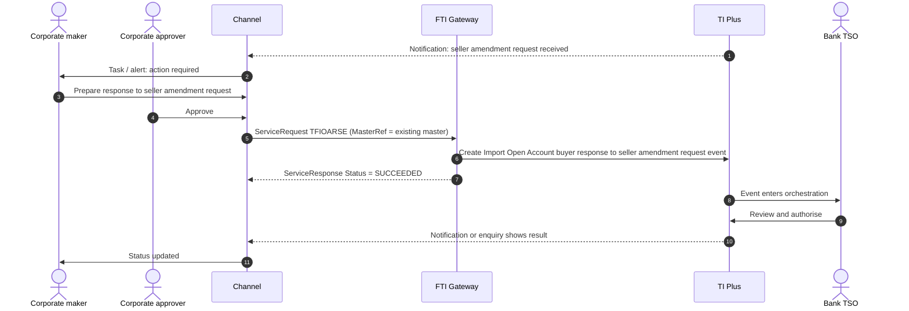

# Import Open Account (Buyer side, TMA)

> Part of the product specifications. Index and shared rules: [README](README.md). Shared message bodies: [shared message shapes](shared-message-shapes.md). Catalogue: [01](../01-interface-catalogue.md) · Functional spec: [02](../02-functional-specification.md).

| | |
|---|---|
| Priority | P3 |
| Customer role | Buyer |
| TI product code (`Context.Product`) | `IOA` **[Assumption – confirm in TI]** |
| Messages | 17 |

## 1. Purpose and scope

**Open account** means the seller ships first and is paid later, with no bank instrument. The bank adds value by matching purchase orders, invoices and shipment data (SWIFT TSU / **TMA**, transaction matching application) and, optionally, by **paying** or **financing** against the matched data (a Bank Payment Obligation). The buyer's messages cover amending or cancelling the baseline, responding to the seller's requests, and requesting or answering payment.

Out of scope: Seller-side messages (see [Export Open Account](export-open-account.md)), and financing of the payment (see [Financing](financing.md)).

> **Reading guide.** Field names, lengths and enumerations come from `sources/xsd_element_docs/`. Statements marked **[Proposed]** or **[Assumption]** are design decisions or guesses that the interface documents cannot confirm. Names are copied exactly from the schema, including its inconsistencies in capitalisation and spelling.

## 2. Messages

| Message | Kind | Creates in TI | Channel exposure | Phase | Body |
|---|---|---|---|---|---|
| `TFIOACRE` | Create / issue | Import Open Account create event | Review | 5 | own |
| `TFIOAAME` | Amend | Import Open Acount amendment event | Customer | 5 | [Shape: Open account amendment](shared-message-shapes.md#shape-open-account-amendment) |
| `TFIOABRE` | Response / request | Import Open Acount buyer amendment request event | Customer | 5 | [Shape: Open account amendment](shared-message-shapes.md#shape-open-account-amendment) |
| `TFIOABRC` | Response / request | Import Open Acount buyer cancellation request event | Customer | 5 | [Shape: Open account cancellation request](shared-message-shapes.md#shape-open-account-cancellation-request) |
| `TFIOACAR` | Cancel | Import Open Account cancel event | Customer | 5 | [Shape: Open account cancellation request](shared-message-shapes.md#shape-open-account-cancellation-request) |
| `TFIOASRE` | Response / request | Import Open Acount seller amendment request event | Review | 5 | [Shape: Open account amendment](shared-message-shapes.md#shape-open-account-amendment) |
| `TFIOASRC` | Response / request | Import Open Acount seller cancellation request event | Review | 5 | [Shape: Open account cancellation request](shared-message-shapes.md#shape-open-account-cancellation-request) (+diff) |
| `TFIOARSE` | Response / request | Import Open Acount buyer response to seller amendment request event | Customer | 5 | [Shape: Open account response](shared-message-shapes.md#shape-open-account-response) |
| `TFIOARSC` | Response / request | Import Open Acount buyer response to seller cancellation request event | Customer | 5 | [Shape: Open account response](shared-message-shapes.md#shape-open-account-response) (+diff) |
| `TFIOARBC` | Response / request | Import Open Acount TMA response to buyer cancellation request event | Bank-side | - | [Shape: Open account response](shared-message-shapes.md#shape-open-account-response) |
| `TFIOATBE` | Response / request | Import Open Acount TMA response to buyer amendment request event | Bank-side | - | [Shape: Open account response](shared-message-shapes.md#shape-open-account-response) |
| `TFIOATSC` | Response / request | Import Open Acount TMA response to seller cancellation request event | Bank-side | - | [Shape: Open account response](shared-message-shapes.md#shape-open-account-response) |
| `TFIOATSE` | Response / request | Import Open Acount TMA response to seller amendment request event | Bank-side | - | [Shape: Open account response](shared-message-shapes.md#shape-open-account-response) |
| `TFIOARPY` | Payment / acceptance | Import Open Account request payment event | Customer | 5 | [Shape: Open account payment presentation](shared-message-shapes.md#shape-open-account-payment-presentation) |
| `TFIOAPBR` | Response / request | Import Open Account payment request buyer response to mismatches event | Customer | 5 | own |
| `TFIOAPGR` | Response / request | Import Open Account payment request general response event | Customer | 5 | own |
| `TFIOAPTR` | Response / request | Import Open Account payment request TMA notification of mismatch accept or reject event | Bank-side | - | own |

**Exposure key.** *Customer* – the corporate starts or answers it in the channel. *Review* – schema description does not make the sender clear; confirm with the TI team before exposing. *Bank-side* – raised by the bank or an interbank counterparty; do not expose to customers.

## 3. Business scenario

A buyer agrees a baseline with a seller: purchase order PO-2026-0457, USD 180,000, shipment from Shenzhen to Jakarta, payment 60 days after shipment. The baseline is registered in TI (and matched in the TMA). Later the seller asks to extend the shipment date; the buyer **accepts** (`TFIOARSE`). When the seller presents the invoice and shipment data, TI matches them; on a mismatch the buyer sees the discrepancies and **responds** (`TFIOAPBR`), and when matched the payment obligation is settled.

**Seller asks for an amendment**



## 4. Preconditions

1. Open account is enabled for the customer and a master exists.
2. TMA connectivity is in place if the bank offers matching.
3. The buyer knows the purchase-order and matching references (`PurchaseOrderReference`, `TransactionMatchingReference`).

## 5. Screens

Open-account transactions are an event stream on a master. The channel presents a timeline and the next action.

| Step | Section | Fields (schema element) |
|---|---|---|
| 1 | **Baseline** | `Buyer`, `Seller`, `OpenAccountAmount`, `IssueDate`, `ExpiryDate`, `ShipmentFrom/To`, `PortOfLoading/Discharge`, `PartShipment`, `Goods`, `GoodsCode`, `ObligationDetails`, `ObligationPaymentTerms` |
| 2 | **Requests** | Amend or cancel (buyer-initiated): `TFIOAAME`/`TFIOABRE`, `TFIOABRC`; respond to the seller: `TFIOARSE`/`TFIOARSC` |
| 3 | **Payment** | Payment request and mismatch responses: `TFIOARPY`, `TFIOAPBR`, `TFIOAPGR` |
| 4 | **Charges and accounts** | `OurCharges`, `OverseaChargesFor`, `PreferredCcy`, `PrincipalAccount`, `ChargeAccount` |
| 5 | **Attachments and submit** | Purchase order, invoice, transport documents |

> **[Proposed] Fields hidden from the customer or set by configuration.** `Context.Team`, `Context.Step`, `Context.ExchangeNonAutoComplete`, `Context.BehalfOfBranch*`, `ExternalReview`, `ProvisionalFlags`, `BankCodes`, `ContinueEvent`, `Provisional`, `AutoCreateFollowOnEvent`, `FinalWording`, `TakeonExtra`, `InternalMasterRefSequence`, `OutstandingAmount`, `OutstandingAdditionalAmount`, `OriginalMasterReference`, `PreallocatedNo`. They affect routing, bank processing or data take-on, and should be set by channel configuration or left to TI defaults. Confirm each with the TI team (02, Q10). Also `MatchStatus`, `BankAction`, `BPOIncluded`, `TMAUsed`, `TransactionMatchingReference` (set from the master).

## 6. Primary message `TFIOACRE`

Primary instruction of this product. Creates: Import Open Account create event.

### 6.1 Context

| Element | Value |
|---|---|
| `Branch` | The booking branch from the corporate configuration. |
| `Customer` | The customer's TI mnemonic (max 20). |
| `Product` | `IOA` **[Assumption]** |
| `Event` | Normally implied by the message name. Leave empty unless the TI team asks for it. **[Assumption]** |
| `TheirReference` | Customer's own reference (max 34). |
| `OurReference` / `MasterRef` | **Required** for all messages except the baseline: `MasterRef` is the open-account master. |

The remaining `Context` elements (`Team`, `Step`, `BehalfOfBranch*`, `TemplateIdentifier`, `EventReference`, `ExchangeNonAutoComplete`, `SubsidiaryMasterPrefixAndSerial`) are set by configuration. See [README](README.md#common-blocks-in-every-message).

### 6.2 Channel-managed elements

| Element | Value |
|---|---|
| `eBankMasterRef` / `EBankMasterRef` (max 20) | The channel's id for the master. Constant for every later event on it. |
| `eBankEvent` / `eBankEventRef` / `EBankEventRef` (max 20) | The channel's id for this event. Unique per instruction; the key for idempotent retries. |
| `EmbeddedItemss` | Inline attachments (`ID`, `AttachType`, `DocType`, `Description`, `FileName`, `DataStream`, `MimeType`, `DocumentFileName`); `IsCustomerAttachedDocument` = `Y`. |
| `DocumentsReceiveds` | References to documents already in the DMS, if the upload-first approach is chosen (02, Q8). |

**Capitalisation differs between messages** (`eBankMasterRef` in some, `EBankMasterRef` in others; `eBankEvent`, `eBankEventRef` and `EBankEventRef`). The channel generates names from the schema catalogue and must never hand-type them.

### 6.3 Field reference

All top-level elements, in schema order, then the nested structures and enumerations.

| Element | Type / length | Description |
|---|---|---|
| `eBankMasterRef` | string ≤20 | Unique reference meaningful to the sending system which applies to the master. |
| `eBankEventRef` | string ≤20 | Unique reference meaningful to the sending system which applies to this transaction. |
| `PurchaseOrderReference` | string 1–34 | Purchase order reference. |
| `TMAUsed` | boolean | TMA used. Boolean values. |
| `TransactionMatchingReference` | string ≤35 | Transaction matching reference. |
| `BPOIncluded` | boolean | Bank payment obligations included. Boolean values. |
| `ReceivedOnDate` | date |  |
| `IssueDate` | date | Issue date. |
| `ExpiryDate` | date | Expiry date. |
| `ExpiryPlace` | string 1–29 | Expiry place. |
| `Buyer` | party |  |
| `Seller` | party |  |
| `SubmittingBank` | party |  |
| `OpenAccountAmount` | group | Open account transaction amount. |
| `LCAmountSpec` | group | Open account transaction amount additional spec. |
| `InstructionsFromBuyer` | string ≤32000 | Instructions from buyer. |
| `InformationForBuyer` | string ≤32000 |  |
| `PaymentInstructions` | string ≤150 |  |
| `ShipmentFrom` | string ≤144 | Shipment from. |
| `ShipmentTo` | string ≤144 | Shipment to. |
| `PortOfLoading` | string ≤144 | Port of loading. |
| `PortOfDischarge` | string ≤144 | Port of discharge. |
| `PartShipment` | string 1–35 | Partial shipment text. |
| `GoodsCode` | string 1–10 | TI Plus goods code. |
| `Goods` | string ≤26800 | Description of Goods. |
| `FXOptionDeal` | string 1–20 | Details of any forward foreign exchange contract that this master may utilise. |
| `BankCodes` | group | Bank defined codes for their own purposes. Defined using 'List value' in TI Plus System tailoring. |
| `ObligationDetails` | group |  |
| `ObligationPaymentTerms` | group |  |
| `OurCharges` | string 1–1 | Available values: 'A'='Applicant', 'B'='Beneficiary'. |
| `OverseaChargesFor` | string 1–1 | Available values: 'A'='Applicant', 'B'='Beneficiary'. |
| `DeferChgs` | boolean | Defer bank's charges. Boolean values. |
| `PreferredCcy` | string 1–3 | Preferred charge currency. |
| `TaxFor` | string 1–1 | Tax paid by. Tax paid by. Available values: 'P'='Charge payer', 'C'='Customer'. |
| `BillingLevel` | string 1–1 | Available values: 'C'='Customer', 'P'='Product', 'T'='Transaction', 'X'='User-defined'. |
| `PrincipalAccount` | string 1–34 | Principal account. Creates an action item for the user to create master settlement instructions or advise to third parties as required. |
| `ChargeAccount` | string 1–34 | Account from which charges are to be taken. |
| `ChargeText` | string ≤222 | Free format charge text. |
| `MarginDeposit` | group |  |
| `ProductType` | string 1–3 | TI Product type. |
| `PreallocatedNo` | int | Used only if your bank has pre-allocated a block of reference numbers to the customer for the product as described in the TI Plus System Tailoring... |
| `Collaterals` | group |  |
| `FxContracts` | group |  |
| `OriginalMasterReference` | string 1–20 | e.g. Documentary Credit Number, FX contract number. |
| `InternalMasterRefSequence` | int | Internal master sequence. |
| `Provisional` | boolean | Used to specify if the message is to create a provisional event. Boolean values. |
| `PurchaseOrderIssueDate` | date | Purchase order issue date. |
| `MatchStatus` | string 1–1 | Available values: 'F'='Full', 'P'='Partial', 'U'='Status not yet available'. |
| `BankAction` | string 1–1 | The bank action the banking user makes when creating a new open account transaction. The bank action the banking user makes when creating a new ope... |
| `SellersBank` | party |  |
| `AdditionalData` | group | Additional data for the event - where customization is not used the bank can attach details to the event which are mapped to the additional data he... |
| `ExtraData` | group |  |

#### Nested structures of `TFIOACRE`

**`OpenAccountAmount`**

| Path | Type / length | Description |
|---|---|---|
| `OpenAccountAmount/Amount` | string ≤22 |  |
| `OpenAccountAmount/Currency` | string 1–3 | Currency. |

**`LCAmountSpec`**

| Path | Type / length | Description |
|---|---|---|
| `LCAmountSpec/Qualifier` | string 1–1 | Tolerance. Available values: 'A'='About', 'E'='Exact', 'M'='Maximum', 'X'='Min/Max', 'N'='Not Exceeding', '... |
| `LCAmountSpec/Min` | string 1–2 | Min percentage tolerance. |
| `LCAmountSpec/Max` | string 1–2 | Max percentage tolerance. |
| `LCAmountSpec/AmountMin` | long | Min amount tolerance. |
| `LCAmountSpec/AmountMax` | long | Min amount tolerance. |

**`BankCodes`**

| Path | Type / length | Description |
|---|---|---|
| `BankCodes/BankCode1` | string ≤4 |  |
| `BankCodes/BankCode2` | string ≤4 |  |
| `BankCodes/BankCode3` | string ≤4 |  |
| `BankCodes/BankCode4` | string ≤4 |  |
| `BankCodes/BankCode5` | string ≤4 |  |

**`ObligationDetails`**

| Path | Type / length | Description |
|---|---|---|
| `ObligationDetails/ObligationDetail` | group ×n |  |
| `ObligationDetails/ObligationDetail/ObligationType` | string 1–1 | Available values: 'B'='Other bank obligor', 'O'='Ourselves / buyer's bank'. |
| `ObligationDetails/ObligationDetail/ObligorSwiftAddress` | string ≤14 |  |
| `ObligationDetails/ObligationDetail/ObligorCustomer` | string 1–20 |  |
| `ObligationDetails/ObligationDetail/ObligationAmount` | string ≤22 |  |
| `ObligationDetails/ObligationDetail/ObligationCurrency` | string 1–3 |  |
| `ObligationDetails/ObligationDetail/ObligationPercent` | decimal(15,12) | Available Values: 0 to 100 |
| `ObligationDetails/ObligationDetail/ExpiryDate` | date |  |
| `ObligationDetails/ObligationDetail/ApplicableLawCountry` | string 1–2 |  |
| `ObligationDetails/ObligationDetail/ChargeAmount` | string ≤22 |  |
| `ObligationDetails/ObligationDetail/ChargeCurrency` | string 1–3 |  |
| `ObligationDetails/ObligationDetail/ChargePercent` | decimal(15,12) | Available Values: 0 to 100 |
| `ObligationDetails/ObligationDetail/SettlementTermsCreditorAgentSwiftAddress` | string ≤14 |  |
| `ObligationDetails/ObligationDetail/SettlementTermsCreditorAgentName` | string 1–70 |  |
| `ObligationDetails/ObligationDetail/SettlementTermsCreditorAgentAddressStreetName` | string 1–70 | Name of street or thoroughfare. |
| `ObligationDetails/ObligationDetail/SettlementTermsCreditorAgentAddressPostCodeIdentification` | string 1–15 | ZIP or post code. |
| `ObligationDetails/ObligationDetail/SettlementTermsCreditorAgentAddressTownName` | string 1–35 | Name of a build-up area, with defined boundaries, and a local government. |
| `ObligationDetails/ObligationDetail/SettlementTermsCreditorAgentAddressCountrySubDivision` | string 1–35 | Identifies a subdivision of a country eg state, region county. |
| `ObligationDetails/ObligationDetail/SettlementTermsCreditorAgentAddressCountry` | string 1–2 |  |
| `ObligationDetails/ObligationDetail/SettlementTermsCreditorAccountIdentificationIBAN` | string 1–34 |  |
| `ObligationDetails/ObligationDetail/SettlementTermsCreditorAccountIdentificationOtherIdentification` | string 1–34 | Identification assigned by an institution. |
| `ObligationDetails/ObligationDetail/SettlementTermsCreditorAccountIdentificationOtherSchemeNameCode` | string 1–4 |  |
| `ObligationDetails/ObligationDetail/SettlementTermsCreditorAccountIdentificationOtherSchemeNameProprietary` | string 1–35 | Name of the identification scheme in a free text form. |
| `ObligationDetails/ObligationDetail/SettlementTermsCreditorAccountIdentificationOtherIssuer` | string 1–35 | Entity that assignes the identification. |
| `ObligationDetails/ObligationDetail/SettlementTermsCreditorAccountTypeCode` | string 1–4 |  |
| `ObligationDetails/ObligationDetail/SettlementTermsCreditorAccountTypeProprietary` | string 1–35 | Name of the identification scheme in a free text form. |
| `ObligationDetails/ObligationDetail/SettlementTermsCreditorAccountCurrency` | string 1–3 |  |
| `ObligationDetails/ObligationDetail/SettlementTermsCreditorAccountName` | string 1–70 |  |

**`ObligationPaymentTerms`**

| Path | Type / length | Description |
|---|---|---|
| `ObligationPaymentTerms/ObligationPaymentTerm` | group ×n |  |
| `ObligationPaymentTerms/ObligationPaymentTerm/ObligationType` | string 1–1 | Available values: 'B'='Other bank obligor', 'O'='Ourselves / buyer's bank'. |
| `ObligationPaymentTerms/ObligationPaymentTerm/ObligorSwiftAddress` | string ≤14 |  |
| `ObligationPaymentTerms/ObligationPaymentTerm/ObligorCustomer` | string 1–20 |  |
| `ObligationPaymentTerms/ObligationPaymentTerm/PaymentCodeCode` | string 1–4 |  |
| `ObligationPaymentTerms/ObligationPaymentTerm/PaymentCodeNumberOfDays` | long |  |
| `ObligationPaymentTerms/ObligationPaymentTerm/OtherPaymentTerms` | string 1–140 | Specifies payment terms not present in a code list. |
| `ObligationPaymentTerms/ObligationPaymentTerm/PaymentAmount` | string ≤22 |  |
| `ObligationPaymentTerms/ObligationPaymentTerm/PaymentCurrency` | string 1–3 |  |
| `ObligationPaymentTerms/ObligationPaymentTerm/PaymentPercent` | decimal(15,12) | Available Values: 0 to 100 |

**`MarginDeposit`**

| Path | Type / length | Description |
|---|---|---|
| `MarginDeposit/AmountFieldCode` | string 3–10 | Code for a field (real or calculated) in an event (used in postings rules). |
| `MarginDeposit/Account` | string 1–34 | Account number. |
| `MarginDeposit/Code` | string 1–8 |  |
| `MarginDeposit/Description` | string ≤140 |  |
| `MarginDeposit/MarginAmount` | group | Amount Gateway pane. Note that this pane may have the currency included as part of the amount source or the... |
| `MarginDeposit/MarginAmount/Amount` | string ≤22 |  |
| `MarginDeposit/MarginAmount/Currency` | string 1–3 | Currency. |
| `MarginDeposit/Percentage` | decimal(17,2) | Percentage. |

**`Collaterals`**

| Path | Type / length | Description |
|---|---|---|
| `Collaterals/Collateral` | group ×n |  |
| `Collaterals/Collateral/Code` | string 1–8 |  |
| `Collaterals/Collateral/Description` | string ≤25 |  |
| `Collaterals/Collateral/Amount` | long | Amount. |
| `Collaterals/Collateral/Currency` | string 1–3 | Currency mnemonic. |
| `Collaterals/Collateral/OtherDetailsType` | string | Available values: 'G'='General', 'S'='Specific'. |
| `Collaterals/Collateral/CustomerDDA` | string ≤25 |  |
| `Collaterals/Collateral/OtherPledge` | string ≤50 |  |
| `Collaterals/Collateral/OwnPledge` | string ≤50 |  |
| `Collaterals/Collateral/Surety` | string ≤50 |  |

**`FxContracts`**

| Path | Type / length | Description |
|---|---|---|
| `FxContracts/FxContract` | group ×n |  |
| `FxContracts/FxContract/Reference` | string 1–20 |  |
| `FxContracts/FxContract/Branch` | string 1–8 |  |
| `FxContracts/FxContract/DealType` | string 1–3 |  |
| `FxContracts/FxContract/PurchaseCcy` | string 1–3 |  |
| `FxContracts/FxContract/SaleCcy` | string 1–3 |  |
| `FxContracts/FxContract/ExchangeRate` | decimal(28,20) | Available Values: 0 to 99999999 |

**`AdditionalData`**

| Path | Type / length | Description |
|---|---|---|
| `AdditionalData/DataItem` | group ×n | Receives "additional data" from Gateway, which are recorded as event notifications. |
| `AdditionalData/DataItem/Name` | string ≤50 |  |
| `AdditionalData/DataItem/Value` | string |  |


#### Enumerated values in `TFIOACRE`

| Path | Allowed values |
|---|---|
| `LCAmountSpec/Qualifier` | `A` About; `E` Exact; `M` Maximum; `X` Min/Max; `N` Not Exceeding; `O` Other; `U` Up to |
| `ObligationDetails/ObligationDetail/ObligationType` | `B` Other bank obligor; `O` Ourselves / buyer |
| `ObligationPaymentTerms/ObligationPaymentTerm/ObligationType` | `B` Other bank obligor; `O` Ourselves / buyer |
| `OurCharges` | `A` Applicant; `B` Beneficiary |
| `OverseaChargesFor` | `A` Applicant; `B` Beneficiary |
| `TaxFor` | `P` Charge payer; `C` Customer |
| `BillingLevel` | `C` Customer; `P` Product; `T` Transaction; `X` User-defined |
| `Collaterals/Collateral/OtherDetailsType` | `G` General; `S` Specific |
| `MatchStatus` | `F` Full; `P` Partial; `U` Status not yet available |
| `BankAction` | `F` Finalise this transaction in the bank; `J` Proceed to baseline re-submission; `C` Proceed to change status to close; `I` Proceed to initial baseline submission; `R` Request customer to reconsider; `S` Request customer to review and revise |


## 7. Other messages

### `TFIOAAME` – Buyer amends baseline

| | |
|---|---|
| Creates in TI | Import Open Acount amendment event |
| Purpose (schema) | - |
| Channel exposure | Customer |
| Phase | 5 |

**Body:** [Shape: Open account amendment](shared-message-shapes.md#shape-open-account-amendment).

### `TFIOABRE` – Buyer amendment request

| | |
|---|---|
| Creates in TI | Import Open Acount buyer amendment request event |
| Purpose (schema) | - |
| Channel exposure | Customer |
| Phase | 5 |

**Body:** [Shape: Open account amendment](shared-message-shapes.md#shape-open-account-amendment).

### `TFIOABRC` – Buyer cancellation request

| | |
|---|---|
| Creates in TI | Import Open Acount buyer cancellation request event |
| Purpose (schema) | - |
| Channel exposure | Customer |
| Phase | 5 |

**Body:** [Shape: Open account cancellation request](shared-message-shapes.md#shape-open-account-cancellation-request).

### `TFIOACAR` – Cancel

| | |
|---|---|
| Creates in TI | Import Open Account cancel event |
| Purpose (schema) | - |
| Channel exposure | Customer |
| Phase | 5 |

**Body:** [Shape: Open account cancellation request](shared-message-shapes.md#shape-open-account-cancellation-request).

### `TFIOASRE` – Seller amendment request (recorded)

| | |
|---|---|
| Creates in TI | Import Open Acount seller amendment request event |
| Purpose (schema) | - |
| Channel exposure | Review |
| Phase | 5 |

**Body:** [Shape: Open account amendment](shared-message-shapes.md#shape-open-account-amendment) with differences.

* Omits: `AdditionalData`

### `TFIOASRC` – Seller cancellation request (recorded)

| | |
|---|---|
| Creates in TI | Import Open Acount seller cancellation request event |
| Purpose (schema) | - |
| Channel exposure | Review |
| Phase | 5 |

**Body:** [Shape: Open account cancellation request](shared-message-shapes.md#shape-open-account-cancellation-request) with differences.

* Omits: `AdditionalData`

### `TFIOARSE` – Buyer response to seller amendment request

| | |
|---|---|
| Creates in TI | Import Open Acount buyer response to seller amendment request event |
| Purpose (schema) | - |
| Channel exposure | Customer |
| Phase | 5 |

**Body:** [Shape: Open account response](shared-message-shapes.md#shape-open-account-response).

### `TFIOARSC` – Buyer response to seller cancellation request

| | |
|---|---|
| Creates in TI | Import Open Acount buyer response to seller cancellation request event |
| Purpose (schema) | - |
| Channel exposure | Customer |
| Phase | 5 |

**Body:** [Shape: Open account response](shared-message-shapes.md#shape-open-account-response) with differences.

* Omits: `AdditionalData`

### `TFIOARBC` – TMA response to buyer cancellation request

| | |
|---|---|
| Creates in TI | Import Open Acount TMA response to buyer cancellation request event |
| Purpose (schema) | - |
| Channel exposure | Bank-side |
| Phase | - |

**Body:** [Shape: Open account response](shared-message-shapes.md#shape-open-account-response).

### `TFIOATBE` – TMA response to buyer amendment request

| | |
|---|---|
| Creates in TI | Import Open Acount TMA response to buyer amendment request event |
| Purpose (schema) | - |
| Channel exposure | Bank-side |
| Phase | - |

**Body:** [Shape: Open account response](shared-message-shapes.md#shape-open-account-response).

### `TFIOATSC` – TMA response to seller cancellation request

| | |
|---|---|
| Creates in TI | Import Open Acount TMA response to seller cancellation request event |
| Purpose (schema) | - |
| Channel exposure | Bank-side |
| Phase | - |

**Body:** [Shape: Open account response](shared-message-shapes.md#shape-open-account-response).

### `TFIOATSE` – TMA response to seller amendment request

| | |
|---|---|
| Creates in TI | Import Open Acount TMA response to seller amendment request event |
| Purpose (schema) | - |
| Channel exposure | Bank-side |
| Phase | - |

**Body:** [Shape: Open account response](shared-message-shapes.md#shape-open-account-response).

### `TFIOARPY` – Request payment

| | |
|---|---|
| Creates in TI | Import Open Account request payment event |
| Purpose (schema) | - |
| Channel exposure | Customer |
| Phase | 5 |

**Body:** [Shape: Open account payment presentation](shared-message-shapes.md#shape-open-account-payment-presentation).

### `TFIOAPBR` – Buyer response to payment request mismatches

| | |
|---|---|
| Creates in TI | Import Open Account payment request buyer response to mismatches event |
| Purpose (schema) | - |
| Channel exposure | Customer |
| Phase | 5 |

**Body elements** (besides the [common blocks](README.md#common-blocks-in-every-message)):

| Element | Type / length | Description |
|---|---|---|
| `EBankMasterRef` | string ≤20 | TSDS-264 (PG). |
| `EBankEventRef` | string ≤20 | TSDS-264 (PG). |
| `EBankCorpRef` | string ≤20 | TSDS-264 (PG). |
| `InvoiceReference` | string 1–34 |  |
| `PurchaseOrderReference` | string 1–34 |  |
| `TransactionMatchingReference` | string 1–34 |  |
| `RequestResponse` | group |  |
| `Instructions` | string ≤32000 |  |
| `ResponsePartyReference` | string 1–34 |  |
| `ExtraData` | group |  |

#### Nested structures of `TFIOAPBR`

**`RequestResponse`**

| Path | Type / length | Description |
|---|---|---|
| `RequestResponse/RequestResponseAction` | string ≤3 |  |
| `RequestResponse/Discrepancies` | string ≤1480 |  |


### `TFIOAPGR` – General response to payment request

| | |
|---|---|
| Creates in TI | Import Open Account payment request general response event |
| Purpose (schema) | - |
| Channel exposure | Customer |
| Phase | 5 |

**Body:** same elements as `TFIOAPBR` (section above), with the differences below.

* Adds:

| Element | Type / length | Description |
|---|---|---|
| `ResponseParty` | string 1–3 |  |

### `TFIOAPTR` – TMA notification of mismatch accepted or rejected

| | |
|---|---|
| Creates in TI | Import Open Account payment request TMA notification of mismatch accept or reject event |
| Purpose (schema) | - |
| Channel exposure | Bank-side |
| Phase | - |

Not exposed to customers, so the body is not specified here. Top-level elements, in schema order: `EBankMasterRef`, `EBankEventRef`, `EBankCorpRef`, `InvoiceReference`, `PurchaseOrderReference`, `TransactionMatchingReference`, `RequestResponse`, `ExtraData`. Details: `sources/xsd_element_docs/TI.TFIOAPTR.xsd.txt`.

## 8. Validation rules

### 8.1 Rules supported directly by the schema

Lengths, data types and the allowed values of coded fields are in the tables in sections 6 and 7 and are the source for the channel's client and server validators. Dates are ISO `xsd:date`. Boolean elements carry `Y` or `N`. Amounts are strings (maximum 22 characters); agree the decimal format with the TI team. Response messages use `ResponseType` ∈ {`A` accepted, `R` rejected}. Amounts in `OpenAccountAmount` are strings (≤ 22).

### 8.2 Business rules to apply in the channel

Normal practice for this product and the checks a TSO would otherwise perform by hand. **[Proposed]**: switch each on or off per bank policy.

| # | Rule |
|---|---|
| V1 | Only actions valid for the current state of the baseline are shown (for example, no amendment request while another is pending). |
| V2 | A response must refer to the original request (`CancellationRef`, `AmendmentDate`, or the request event). |
| V3 | Payment responses must list all open discrepancies. |
| V4 | Changes to amount, shipment dates or goods are shown as a before/after comparison. |

### 8.3 Minimum content for a usable instruction

**[Proposed]** `MasterRef`, `PurchaseOrderReference`, `eBankMasterRef`, `eBankEventRef`, plus the action's own elements.

## 9. Illustrative requests

Values are invented. Element names, prefixes and order follow `sources/example_xml/`. Elements not shown are omitted, which the schema allows for optional elements. **Test against the gateway before use.**

**`TFIOARSE`**

```xml
<?xml version="1.0" standalone="yes"?>
<ServiceRequest xmlns:xsi="http://www.w3.org/2001/XMLSchema-instance"
                xmlns:m="urn:messages.service.ti.apps.tiplus2.misys.com"
                xmlns:c="urn:common.service.ti.apps.tiplus2.misys.com"
                xmlns="urn:control.services.tiplus2.misys.com">
  <RequestHeader>
    <Service>TI</Service>
    <Operation>TFIOARSE</Operation>
    <Credentials><Name>CHANNEL_SVC</Name><Password>********</Password></Credentials>
    <SourceSystem>CORPCHANNEL</SourceSystem>
    <TargetSystem>TI</TargetSystem>
    <CorrelationId>9b1f4c2e-5a0d-4c47-9f3e-2c1d7a6b8e10</CorrelationId>
    <CreationDate>2026-10-18T09:30:00Z</CreationDate>
  </RequestHeader>
  <m:TFIOARSE>
    <m:Context>
      <c:Branch>HOBR</c:Branch>
      <c:Customer>ACMEIMP</c:Customer>
      <c:Product>IOA</c:Product>
      <c:TheirReference>PO-2026-0457</c:TheirReference>
    </m:Context>
    <m:MasterRef>IOA2600007</m:MasterRef>
    <m:eBankMasterRef>CH-IOA-000007</m:eBankMasterRef>
    <m:eBankEventRef>CH-IOA-000007-02</m:eBankEventRef>
    <m:PurchaseOrderReference>PO-2026-0457</m:PurchaseOrderReference>
    <m:TMAUsed>Y</m:TMAUsed>
    <m:TransactionMatchingReference>TMA-99817</m:TransactionMatchingReference>
    <m:ResponseType>A</m:ResponseType>
    <m:ResponseNarrative>Buyer agrees to the new shipment date.</m:ResponseNarrative>
    <m:ResponseDate>2026-10-18</m:ResponseDate>
    <m:Sender>
      <c:Customer>ACMEIMP</c:Customer>
    </m:Sender>
  </m:TFIOARSE>
</ServiceRequest>
```

## 10. Response handling and tracking

| `Status` | Channel behaviour |
|---|---|
| `SUCCEEDED` | TI accepted the message and created the event. Mark `ReceivedByBank`; keep `Warning` / `Info` texts. |
| `FAILED` | TI rejected the message. Show `Details.Error` to the maker and return the draft. No automatic retry. |
| `UNAVAILABLE` / timeout | Keep in the outbox, retry with back-off, and confirm by enquiry (`eBankEventRef`) before each re-send so no second event is created. |

Rules shared by every product are in [README – Common behaviour](README.md#common-behaviour).

Show a timeline of events on the master. Statuses include *Baseline matched*, *Amendment requested*, *Mismatch*, *Payment due*, *Settled*. Mismatch detail comes from the master detail enquiry.

## 11. Exceptions

| Scenario | Handling |
|---|---|
| Seller and buyer submit conflicting amendments | TI or TMA decides; the channel shows the pending request and blocks a new one. |
| Mismatch not answered in time | Alert with deadline; the bank may reject by default. |
| Gateway `FAILED`, `UNAVAILABLE`, timeout, duplicate click | As in [README – Common behaviour](README.md#common-behaviour). |

## 12. Acceptance criteria

1. Buyer can see the baseline and its event timeline.
2. Each buyer action produces one correct message for the current state.
3. Mismatch responses list the discrepancies and the buyer's decision.
4. Status updates after the bank processes the event.
5. Every step is in the audit trail with user, time and `CorrelationId`.
6. The stored request validates against the schema rules in 8.1 and matches the structure in section 9.

## 13. Open items

| # | Item |
|---|---|
| IOA-1 | Which party sends the baseline (`TFIOACRE`): buyer, seller, TMA, or the bank? |
| IOA-2 | Are BPO obligations (`ObligationDetails`) offered to customers? |
| IOA-3 | Confirm the TMA role names (TMA response messages are system-to-system). |
| IOA-4 | Confirm customer demand for open account in the first release. |
