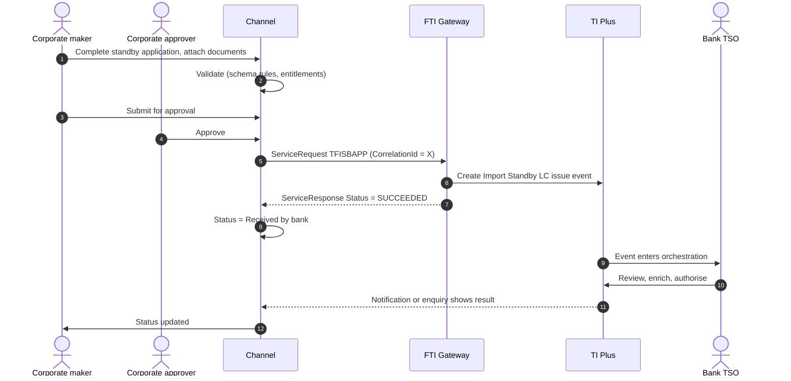
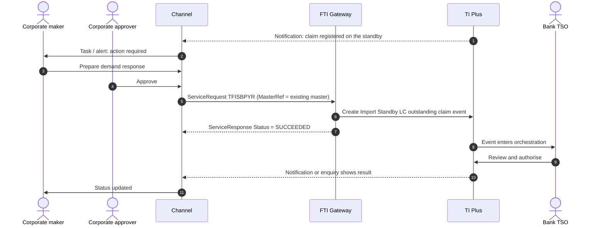

# Import Standby Letter of Credit

> Part of the product specifications. Index and shared rules: [README](README.md). Shared message bodies: [shared message shapes](shared-message-shapes.md). Catalogue: [01](../01-interface-catalogue.md) · Functional spec: [02](../02-functional-specification.md).

| | |
|---|---|
| Priority | P1, wave 2 (after Import LC) |
| Customer role | Applicant |
| TI product code (`Context.Product`) | `ISB` **[Assumption – confirm in TI]** |
| Messages | 6 |

## 1. Purpose and scope

The customer asks the bank to issue a **standby letter of credit** in favour of a beneficiary. A standby is a bank undertaking that pays on presentation of a demand or statement, typically to secure a payment or performance obligation (financial standby) or a trade obligation (trade standby). It is governed by ISP98, UCP 600 or URDG 758, and unlike a documentary LC it is usually drawn only if the customer defaults. In TI the standby shares the Import LC data model, so this specification is written as a delta to the [Import LC specification](import-letter-of-credit.md); the standby-specific elements are `Trade`, `Financial`, drawing options, renewal, expiry details, delivery and governing law.

Out of scope: data take-on of existing standbys, SWIFT message generation, and the back-to-back variant (not offered for standbys in the interface).

> **Reading guide.** Field names, lengths and enumerations come from `sources/xsd_element_docs/`. Statements marked **[Proposed]** or **[Assumption]** are design decisions or guesses that the interface documents cannot confirm. Names are copied exactly from the schema, including its inconsistencies in capitalisation and spelling.

## 2. Messages

| Message | Kind | Creates in TI | Channel exposure | Phase | Body |
|---|---|---|---|---|---|
| `TFISBAPP` | Create / issue | Import Standby Letter Of Credit issue event | Customer | 2 | as `TFILCAPP` |
| `TFISBAMN` | Amend | Import Standby Letter Of Credit amend event | Customer | 2 | as `TFISBAPP` |
| `TFISBAMR` | Amend | Import Standby Letter Of Credit (old) amend event | Customer | 2 | [Shape: Correspondence](shared-message-shapes.md#shape-correspondence) |
| `TFISBCAN` | Cancel | Import Standby Letter Of Credit cancel event | Customer | 2 | [Shape: Cancellation request](shared-message-shapes.md#shape-cancellation-request) |
| `TFISBPYR` | Claim response | Import Standby Letter Of Credit outstanding claim event | Customer | 2 | [Shape: Claim response](shared-message-shapes.md#shape-claim-response) |
| `TFISBCOR` | Correspondence | Import Standby Letter Of Credit correspondence event | Customer | 2 | [Shape: Correspondence](shared-message-shapes.md#shape-correspondence) |

**Exposure key.** *Customer* – the corporate starts or answers it in the channel. *Review* – schema description does not make the sender clear; confirm with the TI team before exposing. *Bank-side* – raised by the bank or an interbank counterparty; do not expose to customers.

## 3. Business scenario

A construction company must give its client a performance security. It asks the bank to issue a standby for USD 1,000,000, valid for 12 months, payable on the beneficiary's signed statement that the contractor is in default, with automatic annual renewal unless the bank gives notice. The TSO checks the facility, applies standard wording, and issues the standby by SWIFT (MT760). If the beneficiary later makes a demand, TI registers a claim, the channel alerts the customer, and the customer approves or refuses payment within the examination period.

**Issuance**



**Demand received**



## 4. Preconditions

1. The corporate is enabled for product `ISB` and the user has *create* or *approve* entitlement within their amount limit.
2. The bank has a credit facility for standbys for this customer. TI checks it; the channel does not.
3. Reference data is loaded: currencies, countries, standby `ProductType` values, applicable-rules codes, delivery methods.
4. For a demand response, the channel has received (or polls for) the claim and knows its `ClaimId`.

## 5. Screens

The wizard follows the Import LC form; sections that differ are marked.

| Step | Section | Fields (schema element) |
|---|---|---|
| 1 | **Basics** | Applicant `Applicant` (pre-filled); your reference `Context.TheirReference`; application date `ApplicationDate`; template `Context.TemplateIdentifier` |
| 2 | **Beneficiary** | `Beneficiary`; `BenAccNo`; advising bank `AdvisingBank`; advise through `AdviseThru`; confirming bank `ConfirmingBank` (**standby-specific**) |
| 3 | **Purpose** | Financial or trade standby `Financial` / `Trade` (**standby-specific**); standby flag `StandBy`; product type `ProductType`, `OtherProductType` |
| 4 | **Amount** | `LCAmount`; tolerance `LCAmountSpec`; additional amounts `AddAmount`, `AddAmountText` |
| 5 | **Validity** | Expiry `ExpiryDetails` (type, date, condition); expiry place `ExpiryPlace`; "not payable before" `NotPayableBeforeDate`; renewal `Renewal`, `RenewalDetails`; domestic expiry `DomesticExpiry` |
| 6 | **Drawing** | Partial drawings `PartialDrawingsAllowed`; multiple drawings `MultipleDrawingsAllowed`; transferable `Transferable`, `TransferableConditions`; documents required for a demand `Documents`; additional conditions `AdditionalConditions` |
| 7 | **Rules and law** | Applicable rules `ApplicableRules` (rules and narrative); governing law and jurisdiction `GoverningLawDetails`; free-format SWIFT wording `UseFreeFormat` |
| 8 | **Delivery** | How the original is delivered `UndertakingDeliveryDetails` |
| 9 | **Charges and accounts** | `IssuanceChgsFor`, `OverseasChgsFor`, `TaxFor`, `DeferChgs`, `ChargeAccount`, `PreferredCcy`, `PrincipalAccount`, reimbursing bank |
| 10 | **Cover and risk** | `MarginDeposit`, `Collateral`, `FxContracts`, `FXOptDealRef` |
| 11 | **Instructions and documents** | `ApplicantInstructions`, `InstructionsToAdvisingBank`, `InstructionsToPayingBank`, attachments |
| 12 | **Review and submit** | Summary, preview, approval route |

> **[Proposed] Fields hidden from the customer or set by configuration.** `Context.Team`, `Context.Step`, `Context.ExchangeNonAutoComplete`, `Context.BehalfOfBranch*`, `ExternalReview`, `ProvisionalFlags`, `BankCodes`, `ContinueEvent`, `Provisional`, `AutoCreateFollowOnEvent`, `FinalWording`, `TakeonExtra`, `InternalMasterRefSequence`, `OutstandingAmount`, `OutstandingAdditionalAmount`, `OriginalMasterReference`, `PreallocatedNo`. They affect routing, bank processing or data take-on, and should be set by channel configuration or left to TI defaults. Confirm each with the TI team (02, Q10). Also `ApplicantBank`, `InstructionsToApplicant`, `PreAdvise`.

## 6. Primary message `TFISBAPP`

Primary instruction of this product. Creates: Import Standby Letter Of Credit issue event.

### 6.1 Context

| Element | Value |
|---|---|
| `Branch` | The booking branch from the corporate configuration. |
| `Customer` | The customer's TI mnemonic (max 20). |
| `Product` | `ISB` **[Assumption]** |
| `Event` | Normally implied by the message name. Leave empty unless the TI team asks for it. **[Assumption]** |
| `TheirReference` | Customer's own reference (max 34). |
| `OurReference` / `MasterRef` | Empty for a new standby; TI allocates the reference. For all later messages set `MasterRef` to the standby reference. |

The remaining `Context` elements (`Team`, `Step`, `BehalfOfBranch*`, `TemplateIdentifier`, `EventReference`, `ExchangeNonAutoComplete`, `SubsidiaryMasterPrefixAndSerial`) are set by configuration. See [README](README.md#common-blocks-in-every-message).

### 6.2 Channel-managed elements

| Element | Value |
|---|---|
| `eBankMasterRef` / `EBankMasterRef` (max 20) | The channel's id for the master. Constant for every later event on it. |
| `eBankEvent` / `eBankEventRef` / `EBankEventRef` (max 20) | The channel's id for this event. Unique per instruction; the key for idempotent retries. |
| `EmbeddedItemss` | Inline attachments (`ID`, `AttachType`, `DocType`, `Description`, `FileName`, `DataStream`, `MimeType`, `DocumentFileName`); `IsCustomerAttachedDocument` = `Y`. |
| `DocumentsReceiveds` | References to documents already in the DMS, if the upload-first approach is chosen (02, Q8). |

**Capitalisation differs between messages** (`eBankMasterRef` in some, `EBankMasterRef` in others; `eBankEvent`, `eBankEventRef` and `EBankEventRef`). The channel generates names from the schema catalogue and must never hand-type them.

### 6.3 Field reference

`TFISBAPP` carries the same top-level elements as `TFILCAPP` ([Import LC specification, section 5.4](import-letter-of-credit.md)). Differences:

* Omits: `ReimbursementAmount`, `ReimbursementAmountSpec`, `ReibursementAdditionalAmount`, `ReimbursementAdditionalAmountText`
* Adds:

| Element | Type / length | Description |
|---|---|---|
| `Trade` | boolean | Y or N. Boolean values. |
| `Financial` | boolean | Y or N. Boolean values. |
| `PartialDrawingsAllowed` | boolean | Y or N. Boolean values. |
| `MultipleDrawingsAllowed` | boolean | Used to indicate if multiple drawings(demands) are permitted. Boolean values. |
| `NotPayableBeforeDate` | date | Not payable before. |
| `ApplicableRules` | group | Applicable rules narrative where Applicables rules = OTHR. |
| `UseFreeFormat` | boolean | Whether to use Freeformat details for SWIFT. Boolean values. |
| `ConfirmingBank` | party |  |
| `OtherProductType` | string ≤3 |  |
| `Renewal` | group | These renewal fields are used to set details for 'First renewal/Rolling renewal'. |
| `RenewalDetails` | group | These renewal fields are used to set details for 'Regular renewal'. |
| `TransferableConditions` | string ≤804 |  |
| `ExpiryDetails` | group | Set the expiry date, type and condition (if type is C). |
| `UndertakingDeliveryDetails` | group | Specifies the method by which the original undertaking is to be delivered (e.g. Registered mail) and to whom it is to be delivered to or collected by. |
| `GoverningLawDetails` | group |  |
| `AdditionalInformation` | string ≤26800 |  |

**`ApplicableRules`**

| Path | Type / length | Description |
|---|---|---|
| `ApplicableRules/Rules` | string 1–4 | Available values: 'ISPR'='ISPR', 'NONE'='NONE', 'OTHR'='OTHR', 'UCPR'='UCPR', 'URDG'='URDG'. |
| `ApplicableRules/Narrative` | string ≤35 |  |

**`Renewal`**

| Path | Type / length | Description |
|---|---|---|
| `Renewal/Advise` | boolean | Whether renewal is to be advised. Boolean values. |
| `Renewal/AdviseNoticeDays` | int | Notice days for renewal notice. |
| `Renewal/CalendarDate` | date | Calendar date for start of the next renewal. |
| `Renewal/RenewalDate` | date | Renewal date. |
| `Renewal/NextExpiryDate` | date | Next renewal expiry based on renewal period. |
| `Renewal/RenewalWhen` | string ≤1 | When renewals are to occur. Available values: 'C'='On calendar', 'E'='On expiry'. |
| `Renewal/RenewForPeriod` | group | Renewal period. |
| `Renewal/RenewForPeriod/TenorDays` | int | Tenor element of the term. |
| `Renewal/RenewForPeriod/TenorPeriod` | string | Period. Available values: 'D'='Days', 'M'='Months', 'Q'='Quarters', 'W'='Weeks', 'Y'='Years'. |
| `Renewal/RollingRenewal` | group | Rolling renewal details. |
| `Renewal/RollingRenewal/CancellationNotice` | int | Cancellation notice days. |
| `Renewal/RollingRenewal/EveryPEriod` | group | Rolling renewal frequency. |
| `Renewal/RollingRenewal/EveryPEriod/Unit` | string 1–1 | Period. Available values: 'D'='Days', 'M'='Months', 'Q'='Quarters', 'W'='Weeks', 'Y'='Years'. |
| `Renewal/RollingRenewal/EveryPEriod/Number` | int | Number of days (months) etc e.g. 30. |
| `Renewal/RollingRenewal/EveryPEriod/DayInMonth` | int | Day in month for renewal. |
| `Renewal/RollingRenewal/NumberOf` | int | Maximum number of renewals. |
| `Renewal/RollingRenewal/RenewOn` | string ≤1 | When rolling renewal is to occur e.g. every 3 months Or Expiry. Available values: 'V'='Every', 'X'='Expiry'. |
| `Renewal/RollingRenewal/AdjustedFinalExpiryDate` | date |  |
| `Renewal/IsRollingRenewal` | boolean | Whether a Rolling renewal - Y = Rolling renewal - N = Not rolling renewal. Boolean values. |
| `Renewal/UseAmount` | string ≤1 | Amount to use for the renewal. Available values: 'C'='Current', 'O'='Original'. |
| `Renewal/RenewalOn` | boolean | Boolean values. |
| `Renewal/NonExtensionNotificationDetails` | string ≤804 | Non-extension notification details. |

**`RenewalDetails`**

| Path | Type / length | Description |
|---|---|---|
| `RenewalDetails/RenewFor` | string ≤1 | Renewal for. Available values: 'C'='Calendar days', 'S'='One year same day', 'O'='Other'. |
| `RenewalDetails/NumberOfDays` | int | Number of days for 'Calendar days'. |
| `RenewalDetails/EveryPeriod` | group | Renewal frequency for Other. |
| `RenewalDetails/EveryPeriod/Unit` | string 1–1 | Period. Available values: 'D'='Days', 'M'='Months', 'Q'='Quarters', 'W'='Weeks', 'Y'='Years'. |
| `RenewalDetails/EveryPeriod/Number` | int | Number of days (months) etc e.g. 30. |
| `RenewalDetails/EveryPeriod/DayInMonth` | int | Day in month for renewal. |
| `RenewalDetails/Advise` | boolean | Whether renewal is to be advised. Boolean values. |
| `RenewalDetails/AdviseNoticeDays` | int | Notice days for renewal notice. |
| `RenewalDetails/NumberOfRenewals` | int | Maximum number of renewals. |
| `RenewalDetails/NotificationDays` | int | Notification days for non-extension. |
| `RenewalDetails/UseAmount` | string ≤1 | Amount to use for the renewal. Available values: 'C'='Current', 'O'='Original'. |
| `RenewalDetails/NonExtensionNotificationDetails` | string ≤804 | Non-extension notification details. |
| `RenewalDetails/ExtensionDetails` | string ≤35 | Extension details. |

**`ExpiryDetails`**

| Path | Type / length | Description |
|---|---|---|
| `ExpiryDetails/ExpiryType` | string ≤1 | Available values: 'C'='Conditional', 'N'='Specific date', 'Y'='Unlimited'. |
| `ExpiryDetails/Date` | date |  |
| `ExpiryDetails/ApproximateExpiryDate` | date |  |
| `ExpiryDetails/Condition` | string ≤804 |  |

**`UndertakingDeliveryDetails`**

| Path | Type / length | Description |
|---|---|---|
| `UndertakingDeliveryDetails/DeliveryByMethod` | string 1–4 | Available values: 'COLL'='Collection', 'COUR'='Courier', 'MAIL'='Mail', 'MESS'='Messenger - Hand-deliver',... |
| `UndertakingDeliveryDetails/AdditionalInformation` | string ≤35 | Specified when Courier or Other delivery method is used. |
| `UndertakingDeliveryDetails/DeliveryToCode` | string 1–4 | Available values: 'BENE'='Beneficiary', 'OTHR'='Other addressee'. |
| `UndertakingDeliveryDetails/DeliveryToParty` | party | Starting SWIFT version 2023, use DeliveryDetails - DeliveryToNarrative instead. |
| `UndertakingDeliveryDetails/DeliveryToNarrative` | string ≤804 | Starting SWIFT version 2023, use this field instead of DeliveryDetails - DeliveryToParty. |

**`GoverningLawDetails`**

| Path | Type / length | Description |
|---|---|---|
| `GoverningLawDetails/GoverningLawCountry` | string 1–2 | Country code. |
| `GoverningLawDetails/PlaceOfJurisdiction` | string ≤65 |  |
| `GoverningLawDetails/CountrySubDivision` | string ≤35 |  |


| Path | Allowed values |
|---|---|
| `ApplicableRules/Rules` | `ISPR` ISPR; `NONE` NONE; `OTHR` OTHR; `UCPR` UCPR; `URDG` URDG |
| `Renewal/RenewalWhen` | `C` On calendar; `E` On expiry |
| `Renewal/RenewForPeriod/TenorPeriod` | `D` Days; `M` Months; `Q` Quarters; `W` Weeks; `Y` Years |
| `Renewal/RollingRenewal/EveryPEriod/Unit` | `D` Days; `M` Months; `Q` Quarters; `W` Weeks; `Y` Years |
| `Renewal/RollingRenewal/RenewOn` | `V` Every; `X` Expiry |
| `Renewal/UseAmount` | `C` Current; `O` Original |
| `RenewalDetails/RenewFor` | `C` Calendar days; `S` One year same day; `O` Other |
| `RenewalDetails/EveryPeriod/Unit` | `D` Days; `M` Months; `Q` Quarters; `W` Weeks; `Y` Years |
| `RenewalDetails/UseAmount` | `C` Current; `O` Original |
| `ExpiryDetails/ExpiryType` | `C` Conditional; `N` Specific date; `Y` Unlimited |
| `UndertakingDeliveryDetails/DeliveryByMethod` | `COLL` Collection; `COUR` Courier; `MAIL` Mail; `MESS` Messenger - Hand-deliver; `OTHR` Other method; `REGM` Registered Mail or Airmail |
| `UndertakingDeliveryDetails/DeliveryToCode` | `BENE` Beneficiary; `OTHR` Other addressee |

For the shared elements, use the field reference in [Import LC specification, section 5.4](import-letter-of-credit.md).

## 7. Other messages

### `TFISBAMN` – Amend standby

| | |
|---|---|
| Creates in TI | Import Standby Letter Of Credit amend event |
| Purpose (schema) | Import Standby Letter Of Credit amendment request that is sent by the Applicant to the Issuing Bank |
| Channel exposure | Customer |
| Phase | 2 |

**Body:** same elements as `TFISBAPP` (section 6.3 of this document), with the differences below.

* Omits: `PreallocatedNo`, `PreAdvise`, `InstructionsToApplicant`, `ApplicableRules`, `ConfirmingBank`, `OtherProductType`, `FinalWording`, `Provisional`, `AutoCreateFollowOnEvent`
* Adds:

| Element | Type / length | Description |
|---|---|---|
| `Sender` | party | Sender. |
| `BenApprovalReq` | boolean | Whether the amendment requires beneficiary approval - Y = Beneficiary approval required - N = Not required. Boolean values. |
| `IncreaseAmount` | group | Amount and currency of increase. |
| `DecreaseAmount` | group | Amount and currency of decrease. |
| `AmendmentDetails` | group | Amendment details. |
| `AmendmentNarrative` | string ≤15860 | General narrative regarding the amendment. |
| `AmendChanges` | string ≤1820 | Details of the amendments. |
| `AmendDate` | date | Amend date. |
| `LCMasterGoodsAmendments` | group |  |
| `SpecialPaymentConditionsAmendments` | group |  |
| `NonExtension` | boolean | Used to indicate the amendment is a non-extension only. Boolean values. |
| `Reduction` | group | Reduction details. |
| `StandbyGuaranteeApplicableRules` | group | Applicable rules. |
| `AdviseBy` | string 1–1 | Code for transfer method format, defined by its domain list. Code for transfer method format, defined by its domain list. Available values: 'e'='E-... |

**`IncreaseAmount`**

| Path | Type / length | Description |
|---|---|---|
| `IncreaseAmount/Amount` | string ≤22 |  |
| `IncreaseAmount/Currency` | string 1–3 | Currency. |


**`DecreaseAmount`**

| Path | Type / length | Description |
|---|---|---|
| `DecreaseAmount/Amount` | string ≤22 |  |
| `DecreaseAmount/Currency` | string 1–3 | Currency. |


**`AmendmentDetails`**

| Path | Type / length | Description |
|---|---|---|
| `AmendmentDetails/AmendmentNumber` | int | Amenrment number. |
| `AmendmentDetails/AmendmentChargesBy` | group | The party responsible for the payment of amendment charges. |
| `AmendmentDetails/AmendmentChargesBy/Code` | string 1–1 | Available values: 'A'='Applicant', 'B'='Beneficiary', 'O'='Other arrangement'. |
| `AmendmentDetails/AmendmentChargesBy/OtherText` | string ≤222 | Narrative regarding Other party. |


**`LCMasterGoodsAmendments`**

| Path | Type / length | Description |
|---|---|---|
| `LCMasterGoodsAmendments/GoodsDescriptionAmendmentInstructions` | group |  |
| `LCMasterGoodsAmendments/GoodsDescriptionAmendmentInstructions/Instruction` | group ×n |  |
| `LCMasterGoodsAmendments/GoodsDescriptionAmendmentInstructions/Instruction/Type` | string 1–1 | Available values: 'A'='ADD', 'D'='DELETE'. |
| `LCMasterGoodsAmendments/GoodsDescriptionAmendmentInstructions/Instruction/Text` | string |  |
| `LCMasterGoodsAmendments/DocumentsRequiredAmendmentInstructions` | group |  |
| `LCMasterGoodsAmendments/DocumentsRequiredAmendmentInstructions/Instruction` | group ×n |  |
| `LCMasterGoodsAmendments/DocumentsRequiredAmendmentInstructions/Instruction/Type` | string 1–1 | Available values: 'A'='ADD', 'D'='DELETE'. |
| `LCMasterGoodsAmendments/DocumentsRequiredAmendmentInstructions/Instruction/Text` | string |  |
| `LCMasterGoodsAmendments/AdditionalConditionsAmendmentInstructions` | group |  |
| `LCMasterGoodsAmendments/AdditionalConditionsAmendmentInstructions/Instruction` | group ×n |  |
| `LCMasterGoodsAmendments/AdditionalConditionsAmendmentInstructions/Instruction/Type` | string 1–1 | Available values: 'A'='ADD', 'D'='DELETE'. |
| `LCMasterGoodsAmendments/AdditionalConditionsAmendmentInstructions/Instruction/Text` | string |  |


**`SpecialPaymentConditionsAmendments`**

| Path | Type / length | Description |
|---|---|---|
| `SpecialPaymentConditionsAmendments/ForBeneficiaryAmendmentInstructions` | group |  |
| `SpecialPaymentConditionsAmendments/ForBeneficiaryAmendmentInstructions/Instruction` | group ×n |  |
| `SpecialPaymentConditionsAmendments/ForBeneficiaryAmendmentInstructions/Instruction/Type` | string 1–1 | Available values: 'A'='ADD', 'D'='DELETE'. |
| `SpecialPaymentConditionsAmendments/ForBeneficiaryAmendmentInstructions/Instruction/Text` | string |  |
| `SpecialPaymentConditionsAmendments/ForReceivingBankAmendmentInstructions` | group |  |
| `SpecialPaymentConditionsAmendments/ForReceivingBankAmendmentInstructions/Instruction` | group ×n |  |
| `SpecialPaymentConditionsAmendments/ForReceivingBankAmendmentInstructions/Instruction/Type` | string 1–1 | Available values: 'A'='ADD', 'D'='DELETE'. |
| `SpecialPaymentConditionsAmendments/ForReceivingBankAmendmentInstructions/Instruction/Text` | string |  |


**`Reduction`**

| Path | Type / length | Description |
|---|---|---|
| `Reduction/Advise` | boolean | Whether reductions are to be advised. Boolean values. |
| `Reduction/AdviseNoticeDays` | int | Notice days for reduction notice. |
| `Reduction/IsIncrease` | boolean | Increase or decrease - Y = Increase - N = Decrease. Boolean values. |
| `Reduction/IncreaseOrReductionDate` | date | First date. |
| `Reduction/IsRegular` | boolean | Whether regular or irregular - Y = Regular - N = Irregular. Boolean values. |
| `Reduction/MaxIncreases` | int | Maximum number of increases(reductions). |
| `Reduction/Period` | group | Increase(reduction) frequency. |
| `Reduction/Period/Unit` | string 1–1 | Period. Available values: 'D'='Days', 'M'='Months', 'Q'='Quarters', 'W'='Weeks', 'Y'='Years'. |
| `Reduction/Period/Number` | int | Number of days (months) etc e.g. 30. |
| `Reduction/Period/DayInMonth` | int | Day in month for renewal. |
| `Reduction/Remaining` | int | Remaining increases(reductions). |
| `Reduction/StartDate` | date | Fisrt date for increase(reductions). |
| `Reduction/AmountOrPercent` | group | Amount or percentage of increase(reduction). |
| `Reduction/AmountOrPercent/Amount` | long |  |
| `Reduction/AmountOrPercent/Percent` | decimal(17,2) | Percentage. Available Values: 0 to 100 |
| `Reduction/IrregularAs` | group |  |
| `Reduction/IrregularAs/IrregularA` | group ×n | This requires IsRegular=N to be set in the xml. |
| `Reduction/IrregularAs/IrregularA/IsIncrease` | string ≤1 | Y or N. |
| `Reduction/IrregularAs/IrregularA/Date` | string |  |
| `Reduction/IrregularAs/IrregularA/Amount` | string ≤22 | Use this or Percent, but not both. |
| `Reduction/IrregularAs/IrregularA/Percent` | string ≤22 | Use this or Amount, but not both. |


**`StandbyGuaranteeApplicableRules`**

| Path | Type / length | Description |
|---|---|---|
| `StandbyGuaranteeApplicableRules/Code` | string 1–4 | Applicable rules that apply. Available values: 'ISPR'='ISPR', 'NONE'='NONE', 'OTHR'='OTHR', 'UCPR'='UCPR',... |
| `StandbyGuaranteeApplicableRules/Narrative` | string ≤35 | Additional description where 'OTHR'. |


| Path | Allowed values |
|---|---|
| `AmendmentDetails/AmendmentChargesBy/Code` | `A` Applicant; `B` Beneficiary; `O` Other arrangement |
| `LCMasterGoodsAmendments/GoodsDescriptionAmendmentInstructions/Instruction/Type` | `A` ADD; `D` DELETE |
| `LCMasterGoodsAmendments/DocumentsRequiredAmendmentInstructions/Instruction/Type` | `A` ADD; `D` DELETE |
| `LCMasterGoodsAmendments/AdditionalConditionsAmendmentInstructions/Instruction/Type` | `A` ADD; `D` DELETE |
| `SpecialPaymentConditionsAmendments/ForBeneficiaryAmendmentInstructions/Instruction/Type` | `A` ADD; `D` DELETE |
| `SpecialPaymentConditionsAmendments/ForReceivingBankAmendmentInstructions/Instruction/Type` | `A` ADD; `D` DELETE |
| `Reduction/Period/Unit` | `D` Days; `M` Months; `Q` Quarters; `W` Weeks; `Y` Years |
| `StandbyGuaranteeApplicableRules/Code` | `ISPR` ISPR; `NONE` NONE; `OTHR` OTHR; `UCPR` UCPR; `URDG` URDG |
| `AdviseBy` | `e` E-mail; `o` E-mail Account Officer; `5` Fax; `a` Gateway; `i` Internal; `1` Mail; `6` No doc required; `4` SWIFT; `2` Telex; `3` Telex via SWIFT |

### `TFISBAMR` – Basic amendment request (free text)

| | |
|---|---|
| Creates in TI | Import Standby Letter Of Credit (old) amend event |
| Purpose (schema) | A basic amendment request that is sent by the Applicant to the Issuing Bank in a simple text format allowing the bank to then make the appropriate changes to the details of the Import Standby Letter Of Credit |
| Channel exposure | Customer |
| Phase | 2 |

Use when the customer wants to describe a change in words and let the TSO key it. Same body as correspondence plus `AmendmentNarrative`.

**Body:** [Shape: Correspondence](shared-message-shapes.md#shape-correspondence) with differences.

* Adds: `AmendmentNarrative`

| Element | Type / length | Description |
|---|---|---|
| `AmendmentNarrative` | string | Details of the amendments. |

### `TFISBCAN` – Cancel standby

| | |
|---|---|
| Creates in TI | Import Standby Letter Of Credit cancel event |
| Purpose (schema) | - |
| Channel exposure | Customer |
| Phase | 2 |

**Body:** [Shape: Cancellation request](shared-message-shapes.md#shape-cancellation-request).

### `TFISBPYR` – Respond to a demand

| | |
|---|---|
| Creates in TI | Import Standby Letter Of Credit outstanding claim event |
| Purpose (schema) | - |
| Channel exposure | Customer |
| Phase | 2 |

A demand under the standby is registered by the bank as a claim. The applicant approves or refuses it.

**Body:** [Shape: Claim response](shared-message-shapes.md#shape-claim-response).

### `TFISBCOR` – Correspondence

| | |
|---|---|
| Creates in TI | Import Standby Letter Of Credit correspondence event |
| Purpose (schema) | A general purpose message that is sent by the Applicant to the Issuing Bank in the form of an Ancillary message, General correspondence, Queries or Answers |
| Channel exposure | Customer |
| Phase | 2 |

**Body:** [Shape: Correspondence](shared-message-shapes.md#shape-correspondence).

## 8. Validation rules

### 8.1 Rules supported directly by the schema

Lengths, data types and the allowed values of coded fields are in the tables in sections 6 and 7 and are the source for the channel's client and server validators. Dates are ISO `xsd:date`. Boolean elements carry `Y` or `N`. Amounts are strings (maximum 22 characters); agree the decimal format with the TI team. Points that are easy to get wrong:

* `ExpiryDetails.ExpiryType` is **`C` Conditional, `N` Specific date, `Y` Unlimited**. `Y` does not mean "has an expiry".
* `ApplicableRules` is a group (`Rules`, `Narrative`) in standbys, whereas the Import LC uses the single element `ApplcableRules` (sic). `Rules` ∈ {`ISPR`, `UCPR`, `URDG`, `NONE`, `OTHR`}; `Narrative` (≤ 35) only for `OTHR`.
* `UndertakingDeliveryDetails.DeliveryByMethod` ∈ {`COLL`, `COUR`, `MAIL`, `MESS`, `OTHR`, `REGM`}.
* `Renewal.RenewalWhen` ∈ {`C` on calendar, `E` on expiry}; `Renewal.UseAmount` ∈ {`C` current, `O` original}.

### 8.2 Business rules to apply in the channel

Normal practice for this product and the checks a TSO would otherwise perform by hand. **[Proposed]**: switch each on or off per bank policy.

| # | Rule |
|---|---|
| V1 | Exactly one expiry mode: `ExpiryType` = `N` requires `ExpiryDetails.Date`; `C` requires `Condition`; `Y` requires neither. A date expiry is after today. |
| V2 | If `Renewal` is used, `NextExpiryDate` or `RenewForPeriod` is present and `NextExpiryDate` is after `ExpiryDetails.Date`; a rolling renewal needs `NumberOf` or a final expiry date. |
| V3 | `NotPayableBeforeDate` is not after the expiry date. |
| V4 | `Financial` and `Trade` are not both `Y`. **[Proposed]** |
| V5 | `LCAmount` > 0; if `LCAmountSpec.Qualifier` = `X`, both tolerances are present. |
| V6 | `ApplicableRules.Rules` = `OTHR` requires `Narrative`. |
| V7 | Governing law: `GoverningLawCountry` is a valid ISO country; `PlaceOfJurisdiction` is not set without it. |
| V8 | Text in `Documents` and `AdditionalConditions` uses only SWIFT-permitted characters and line length. **[Assumption]** |
| V9 | `ChargeAccount` and `PrincipalAccount` belong to the applicant. |
| V10 | Attachments: allowed MIME types, size limits, document type from the bank list. |

### 8.3 Minimum content for a usable instruction

**[Proposed]** `Applicant`, `Beneficiary`, `LCAmount`, `ExpiryDetails`, `ApplicableRules`, `Documents` (what the beneficiary must present to claim), `Financial` or `Trade`, `ChargeAccount`, `IssuanceChgsFor`. Validate against the TI test environment.

## 9. Illustrative requests

Values are invented. Element names, prefixes and order follow `sources/example_xml/`. Elements not shown are omitted, which the schema allows for optional elements. **Test against the gateway before use.**

**`TFISBAPP`**

```xml
<?xml version="1.0" standalone="yes"?>
<ServiceRequest xmlns:xsi="http://www.w3.org/2001/XMLSchema-instance"
                xmlns:m="urn:messages.service.ti.apps.tiplus2.misys.com"
                xmlns:c="urn:common.service.ti.apps.tiplus2.misys.com"
                xmlns="urn:control.services.tiplus2.misys.com">
  <RequestHeader>
    <Service>TI</Service>
    <Operation>TFISBAPP</Operation>
    <Credentials><Name>CHANNEL_SVC</Name><Password>********</Password></Credentials>
    <SourceSystem>CORPCHANNEL</SourceSystem>
    <TargetSystem>TI</TargetSystem>
    <CorrelationId>9b1f4c2e-5a0d-4c47-9f3e-2c1d7a6b8e10</CorrelationId>
    <CreationDate>2026-10-18T09:30:00Z</CreationDate>
  </RequestHeader>
  <m:TFISBAPP>
    <m:Context>
      <c:Branch>HOBR</c:Branch>
      <c:Customer>ACMEIMP</c:Customer>
      <c:Product>ISB</c:Product>
      <c:TheirReference>CT-2026-118</c:TheirReference>
    </m:Context>
    <m:Applicant>
      <c:Customer>ACMEIMP</c:Customer>
    </m:Applicant>
    <m:Beneficiary>
      <c:NameAddress>GLOBAL DEVELOPMENTS PTE LTD
1 RAFFLES PLACE
SINGAPORE</c:NameAddress>
      <c:Country>SG</c:Country>
    </m:Beneficiary>
    <m:LCAmount>
      <c:Amount>1000000.00</c:Amount>
      <c:Currency>USD</c:Currency>
    </m:LCAmount>
    <m:StandBy>Y</m:StandBy>
    <m:ExpiryPlace>SINGAPORE</m:ExpiryPlace>
    <m:Documents>+BENEFICIARY SIGNED STATEMENT THAT THE APPLICANT HAS FAILED TO PERFORM ITS OBLIGATIONS UNDER CONTRACT CT-2026-118</m:Documents>
    <m:IssuanceChgsFor>A</m:IssuanceChgsFor>
    <m:OverseasChgsFor>A</m:OverseasChgsFor>
    <m:ChargeAccount>1234567890</m:ChargeAccount>
    <m:eBankMasterRef>CH-ISB-000045</m:eBankMasterRef>
    <m:eBankEvent>CH-ISB-000045-01</m:eBankEvent>
    <m:Trade>Y</m:Trade>
    <m:Financial>N</m:Financial>
    <m:PartialDrawingsAllowed>Y</m:PartialDrawingsAllowed>
    <m:MultipleDrawingsAllowed>Y</m:MultipleDrawingsAllowed>
    <m:ApplicableRules>
      <c:Rules>ISPR</c:Rules>
    </m:ApplicableRules>
    <m:ExpiryDetails>
      <c:ExpiryType>N</c:ExpiryType>
      <c:Date>2027-10-31</c:Date>
    </m:ExpiryDetails>
    <m:UndertakingDeliveryDetails>
      <c:DeliveryByMethod>COUR</c:DeliveryByMethod>
    </m:UndertakingDeliveryDetails>
    <m:GoverningLawDetails>
      <c:GoverningLawCountry>SG</c:GoverningLawCountry>
    </m:GoverningLawDetails>
  </m:TFISBAPP>
</ServiceRequest>
```

**`TFISBPYR`**

```xml
<?xml version="1.0" standalone="yes"?>
<ServiceRequest xmlns:xsi="http://www.w3.org/2001/XMLSchema-instance"
                xmlns:m="urn:messages.service.ti.apps.tiplus2.misys.com"
                xmlns:c="urn:common.service.ti.apps.tiplus2.misys.com"
                xmlns="urn:control.services.tiplus2.misys.com">
  <RequestHeader>
    <Service>TI</Service>
    <Operation>TFISBPYR</Operation>
    <Credentials><Name>CHANNEL_SVC</Name><Password>********</Password></Credentials>
    <SourceSystem>CORPCHANNEL</SourceSystem>
    <TargetSystem>TI</TargetSystem>
    <CorrelationId>9b1f4c2e-5a0d-4c47-9f3e-2c1d7a6b8e10</CorrelationId>
    <CreationDate>2026-10-18T09:30:00Z</CreationDate>
  </RequestHeader>
  <m:TFISBPYR>
    <m:Context>
      <c:Branch>HOBR</c:Branch>
      <c:Customer>ACMEIMP</c:Customer>
      <c:Product>ISB</c:Product>
      <c:TheirReference>CT-2026-118</c:TheirReference>
    </m:Context>
    <m:MasterRef>ISB2600045</m:MasterRef>
    <m:ClaimId>CLM001</m:ClaimId>
    <m:ResponseAction>Sam</m:ResponseAction>
    <m:ResponseDetails>Documents are in order. Approve payment.</m:ResponseDetails>
    <m:eBankMasterRef>CH-ISB-000045</m:eBankMasterRef>
    <m:eBankEventRef>CH-ISB-000045-10</m:eBankEventRef>
    <m:NetAmountPaid>
      <c:Amount>250000.00</c:Amount>
      <c:Currency>USD</c:Currency>
    </m:NetAmountPaid>
    <m:AuthorisationInstructions>PAY</m:AuthorisationInstructions>
  </m:TFISBPYR>
</ServiceRequest>
```

## 10. Response handling and tracking

| `Status` | Channel behaviour |
|---|---|
| `SUCCEEDED` | TI accepted the message and created the event. Mark `ReceivedByBank`; keep `Warning` / `Info` texts. |
| `FAILED` | TI rejected the message. Show `Details.Error` to the maker and return the draft. No automatic retry. |
| `UNAVAILABLE` / timeout | Keep in the outbox, retry with back-off, and confirm by enquiry (`eBankEventRef`) before each re-send so no second event is created. |

Rules shared by every product are in [README – Common behaviour](README.md#common-behaviour).

Tracking works as for the Import LC (see [Import LC specification, section 9](import-letter-of-credit.md)): gateway response, then `SearchMasters` filtered by product, then `RetrieveMasterDetail`. Standbys add two events to watch: **claims** (an outstanding claim with its `ClaimId` is the trigger for `TFISBPYR`) and **renewals** (the channel should alert the customer before the notice date computed from `Renewal`).

## 11. Exceptions

| Scenario | Handling |
|---|---|
| Claim arrives and the response window is short | Alert the maker and approvers with the deadline from the claim; escalate before the deadline; allow a single-approver fast path configured by the bank. |
| Customer wants to stop a renewal | Send `TFISBAMR` (free-text) or `TFISBAMN` with the renewal group changed before the notice date. Show the notice date on the form. |
| Beneficiary has not accepted an amendment | The channel shows the amendment as pending acceptance until TI reports the beneficiary response. |
| Facility is insufficient | TI rejects or holds the event; the channel shows "Under review by bank" and, if given, the reason. |
| Gateway `FAILED`, `UNAVAILABLE`, timeout, duplicate click | As in [README – Common behaviour](README.md#common-behaviour). |

## 12. Acceptance criteria

1. A maker can complete the standby form, save a draft, and resume it.
2. All schema rules in 8.1 are enforced client- and server-side with field-named messages.
3. A maker cannot approve their own instruction; approver can approve, return or reject.
4. Exactly one `TFISBAPP` is sent per approved instruction, and a duplicate send creates no second event in TI.
5. The standby appears as issued, with its TI reference, after the TSO authorises it.
6. A claim raised in TI reaches the customer as an alert and can be approved or refused with `TFISBPYR`.
7. Renewal notice dates are computed and alerts fire before them.
8. Every step is in the audit trail with user, time and `CorrelationId`.
9. The stored request validates against the schema rules in 8.1 and matches the structure in section 9.

## 13. Open items

| # | Item |
|---|---|
| ISB-1 | Confirm `Product` code and which `ProductType` values apply to standbys. |
| ISB-2 | Confirm whether `TFISBAPP` or the Import LC message (`TFILCAPP` with `StandBy` = `Y`) is the one to use for new standbys; both exist in the schema. |
| ISB-3 | Obtain the tailored `ResponseAction` values for demands. |
| ISB-4 | Decide how renewal reminders are produced (channel computation vs. TI notification). |
| ISB-5 | Confirm which standby wordings are available for customer selection (`UseFreeFormat`). |
