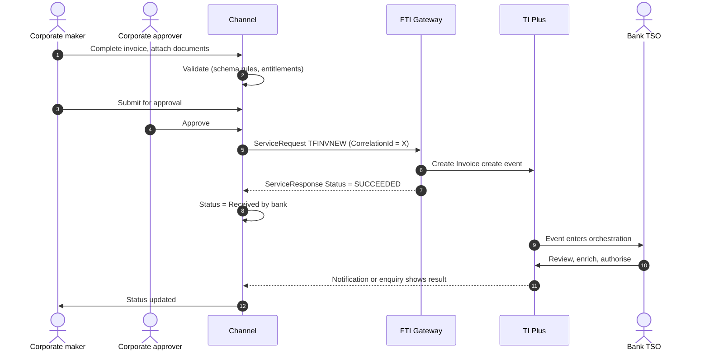

# Invoices, Credit Notes and Supply Chain Finance

> Part of the product specifications. Index and shared rules: [README](README.md). Shared message bodies: [shared message shapes](shared-message-shapes.md). Catalogue: [01](../01-interface-catalogue.md) · Functional spec: [02](../02-functional-specification.md).

| | |
|---|---|
| Priority | P3 |
| Customer role | Seller, buyer or anchor party in a supply chain finance (SCF) programme |
| TI product code (`Context.Product`) | `INV` **[Assumption – confirm in TI]** |
| Messages | 17 |

## 1. Purpose and scope

In an **SCF programme** an anchor party (usually the large buyer) and its sellers (suppliers) agree that the bank will finance approved invoices. The customer registers invoices and credit notes, requests finance against them, receives settlement, and manages bulk payments. Programmes are either **seller-centric** (the seller originates the invoice and requests finance), **buyer-centric** (the buyer approves invoices and the seller may be financed early), or **bulk** (a payment covers many invoices). This specification covers all customer-facing invoice, credit-note and bulk messages.

Out of scope: Programme set-up and limits, repayment of finance (see [Financing](financing.md)), and ERP integration.

> **Reading guide.** Field names, lengths and enumerations come from `sources/xsd_element_docs/`. Statements marked **[Proposed]** or **[Assumption]** are design decisions or guesses that the interface documents cannot confirm. Names are copied exactly from the schema, including its inconsistencies in capitalisation and spelling.

## 2. Messages

| Message | Kind | Creates in TI | Channel exposure | Phase | Body |
|---|---|---|---|---|---|
| `TFINVNEW` | Create / issue | Invoice create event | Customer | 5 | [Shape: Invoice create or amend](shared-message-shapes.md#shape-invoice-create-or-amend) |
| `TFINVAMD` | Amend | Invoice amend event | Customer | 5 | [Shape: Invoice create or amend](shared-message-shapes.md#shape-invoice-create-or-amend) |
| `TFINVCAN` | Cancel | Invoice cancel event | Customer | 5 | own |
| `TFINVDIS` | Other | Invoice discount event | Customer | 5 | own |
| `TFINVSET` | Payment / acceptance | Invoice settlement event | Customer | 5 | own |
| `TFCRNNEW` | Create / issue | Create Note create event | Customer | 5 | own |
| `TFCRNADJ` | Amend | Credit Note adjust event | Customer | 5 | own |
| `TFCRNCAN` | Cancel | Credit Note cancel event | Customer | 5 | own |
| `TFCRNLNK` | Other | Credit Note link or unlink event | Customer | 5 | own |
| `TFSELFIN` | Create / issue | Invoice Seller Centric Finance create event | Customer | 5 | [Shape: Invoice finance request](shared-message-shapes.md#shape-invoice-finance-request) |
| `TFSELCAN` | Cancel | Invoice Seller Centric Finance cancel event | Customer | 5 | own |
| `TFBUYFIN` | Create / issue | Invoice Buyer Centric Finance create event | Customer | 5 | [Shape: Invoice finance request](shared-message-shapes.md#shape-invoice-finance-request) |
| `TFBUYCAN` | Cancel | Invoice Buyer Centric Finance cancel event | Customer | 5 | own |
| `TFIBPCRE` | Create / issue | Invoice Bulk Payment create event | Customer | 5 | [Shape: Bulk payment](shared-message-shapes.md#shape-bulk-payment) |
| `TFIBPAMD` | Amend | Invoice Bulk Payment amend event | Customer | 5 | [Shape: Bulk payment](shared-message-shapes.md#shape-bulk-payment) |
| `TFIBPCAN` | Cancel | Invoice Bulk Payment cancel event | Customer | 5 | own |
| `TFIBFCRE` | Create / issue | Invoice Bulk Finance create event | Customer | 5 | own |

**Exposure key.** *Customer* – the corporate starts or answers it in the channel. *Review* – schema description does not make the sender clear; confirm with the TI team before exposing. *Bank-side* – raised by the bank or an interbank counterparty; do not expose to customers.

## 3. Business scenario

A supplier in a buyer-led programme uploads or keys an invoice: programme, buyer, invoice number and date, face value, due date, payment instructions. The buyer approves it (`InvoiceApproved`). The supplier may then **request finance** at a percentage of the face value (`TFSELFIN`) and receive the proceeds early; the buyer pays the bank at maturity. If a credit note reduces the invoice, the supplier or buyer registers it and links it (`TFCRNNEW`, `TFCRNLNK`).

**Register an invoice**



## 4. Preconditions

1. The programme exists and the customer is a member (seller, buyer or anchor).
2. Programme code, counterparty codes and vendor codes are known.
3. For buyer-centric programmes, an approval workflow exists on the buyer side.

## 5. Screens

A list-and-batch UI with single-item forms.

| Step | Section | Fields (schema element) |
|---|---|---|
| 1 | **Programme** | `Programme`, role (`AnchorParty`), `Seller`, `Buyer` |
| 2 | **Invoice** | `InvoiceNumber`, `IssueDate`, `FaceValue`, `OutstandingAmount`, `AdjustmentAmount`, `AdjustmentDirection`, `SettlementDate`, `RelatedGoodsOrServices`, `VendorCode` |
| 3 | **Approval (buyer)** | `InvoiceApproved` |
| 4 | **Finance request** | `MaturityDate`, `FinanceCurrency`, `FinancePercent`, `FinanceDate`, `FinanceInstructions`, `FinanceOfferOnly`, `InvoiceNumberss`, `DealerFinanceTo` |
| 5 | **Credit notes** | `CreditNoteAmount`, `IssueDate`, `ReasonsForIssuance`, `CreditNoteInvoiceLinkss`, `AutoLinkInvoice` |
| 6 | **Bulk** | Invoice sets, `SettlementAmount`, `SettlementDate`, `PreferredCurrency`, `FinancingAmountOrPercent` |
| 7 | **Batch upload** | File upload with `BatchID` |

> **[Proposed] Fields hidden from the customer or set by configuration.** `Context.Team`, `Context.Step`, `Context.ExchangeNonAutoComplete`, `Context.BehalfOfBranch*`, `ExternalReview`, `ProvisionalFlags`, `BankCodes`, `ContinueEvent`, `Provisional`, `AutoCreateFollowOnEvent`, `FinalWording`, `TakeonExtra`, `InternalMasterRefSequence`, `OutstandingAmount`, `OutstandingAdditionalAmount`, `OriginalMasterReference`, `PreallocatedNo`. They affect routing, bank processing or data take-on, and should be set by channel configuration or left to TI defaults. Confirm each with the TI team (02, Q10). Also `ProductType` and `BulkPaymentBankDiscretion` unless the bank offers choices.

## 6. Primary message `TFINVNEW`

Primary instruction of this product. Creates: Invoice create event.

### 6.1 Context

| Element | Value |
|---|---|
| `Branch` | The booking branch from the corporate configuration. |
| `Customer` | The customer's TI mnemonic (max 20). |
| `Product` | `INV` **[Assumption]** |
| `Event` | Normally implied by the message name. Leave empty unless the TI team asks for it. **[Assumption]** |
| `TheirReference` | Customer's own reference (max 34). |
| `OurReference` / `MasterRef` | Empty for a new invoice; `MasterRef` for later messages. `TheirRef` carries the customer's own reference. |

The remaining `Context` elements (`Team`, `Step`, `BehalfOfBranch*`, `TemplateIdentifier`, `EventReference`, `ExchangeNonAutoComplete`, `SubsidiaryMasterPrefixAndSerial`) are set by configuration. See [README](README.md#common-blocks-in-every-message).

### 6.2 Channel-managed elements

| Element | Value |
|---|---|
| `eBankMasterRef` / `EBankMasterRef` (max 20) | The channel's **transaction number**. Constant for every later event on it. **Confirmed by the bank (2026-10-23).** |
| `eBankEvent` / `eBankEventRef` / `EBankEventRef` (max 20) | The channel's **event number** for this event (issue, claim, amendment, ...). Unique per instruction; the key for idempotent retries. **Confirmed by the bank (2026-10-23).** |
| `TheirRef` (where the message has it, max 35) | **Message reference: unique for every message delivered**, so a re-send of the same event gets a new `TheirRef` but keeps `eBankEventRef`. With no `ServiceRequest` envelope (Q33) it does the job of `CorrelationId`. **Confirmed by the bank (2026-10-23).** |
| `EmbeddedItemss` | Inline attachments (`ID`, `AttachType`, `DocType`, `Description`, `FileName`, `DataStream`, `MimeType`, `DocumentFileName`); `IsCustomerAttachedDocument` = `Y`. |
| `DocumentsReceiveds` | References to documents already in the DMS, if the upload-first approach is chosen (02, Q8). |

**Capitalisation differs between messages** (`eBankMasterRef` in some, `EBankMasterRef` in others; `eBankEvent`, `eBankEventRef` and `EBankEventRef`). The channel generates names from the schema catalogue and must never hand-type them.

### 6.3 Field reference

All top-level elements, in schema order, then the nested structures and enumerations.

| Element | Type / length | Description |
|---|---|---|
| `TheirRef` | string 1–34 |  |
| `eBankMasterRef` | string ≤20 | Unique reference meaningful to the sending system which applies to the master. |
| `eBankEventRef` | string ≤20 | Unique reference meaningful to the sending system which applies to this transaction. |
| `Programme` | string ≤35 | Programme identifier - indicates the credit line to which the invoice relates. |
| `Seller` | string 1–20 | The customer who is the credit party on the invoice(s). |
| `Buyer` | string 1–20 | The customer who is the debit party on the invoice(s). |
| `AnchorParty` | string 1–20 | The buyer or seller mnemonic: the customer of the bank who originates the invoice(s). |
| `ReceivedOn` | date | Date of receipt of the incoming message. |
| `BatchID` | string 1–20 | A batch identifier associated with the invoice, provided by the customer. |
| `InvoiceNumber` | string 1–34 | Invoice identifier - a unigue identifier for the invoice(s) , provided by the customer  SCFBDS5 (PG). |
| `IssueDate` | date | The date the invoice(s) were issued. |
| `FaceValue` | group | The total amount of the invoice in the denominated currency. |
| `AdjustmentAmount` | group | The amount of any credit notes. |
| `AdjustmentDirection` | string ≤4 |  |
| `OutstandingAmount` | group | Face value amount less any related adjustments. |
| `SettlementDate` | date | Invoice payment due date. |
| `RelatedGoodsOrServices` | string ≤222 | Products or services covered by the invoice and for which it was raised. |
| `AdditionalDetails` | string ≤370 | Any additional information relating to the invoice(s). |
| `SenderToReceiver` | string ≤148 | Sender to receiver information. |
| `PaymentInstructions` | string ≤222 | Payment instructions for the invoice(s) DC - Gateway validation :: Set type. |
| `InvoiceApproved` | boolean | For buyer centric invoices - indicates whether the invoice has been approved by the buyer for financing. Boolean values. |
| `ProductType` | string ≤3 |  |
| `VendorCode` | string ≤35 | Unique code provided by a customer to identify a counterparty. |
| `AdditionalData` | group | Additional data for the event - where customization is not used the bank can attach details to the event which are mapped to the additional data he... |
| `ExtraData` | group |  |

#### Nested structures of `TFINVNEW`

**`FaceValue`**

| Path | Type / length | Description |
|---|---|---|
| `FaceValue/Amount` | string ≤22 |  |
| `FaceValue/Currency` | string 1–3 | Currency. |

**`AdjustmentAmount`**

| Path | Type / length | Description |
|---|---|---|
| `AdjustmentAmount/Amount` | string ≤22 |  |
| `AdjustmentAmount/Currency` | string 1–3 | Currency. |

**`OutstandingAmount`**

| Path | Type / length | Description |
|---|---|---|
| `OutstandingAmount/Amount` | string ≤22 |  |
| `OutstandingAmount/Currency` | string 1–3 | Currency. |

**`AdditionalData`**

| Path | Type / length | Description |
|---|---|---|
| `AdditionalData/DataItem` | group ×n | Receives "additional data" from Gateway, which are recorded as event notifications. |
| `AdditionalData/DataItem/Name` | string ≤50 |  |
| `AdditionalData/DataItem/Value` | string |  |


## 7. Other messages

### `TFINVAMD` – Amend invoice

| | |
|---|---|
| Creates in TI | Invoice amend event |
| Purpose (schema) | - |
| Channel exposure | Customer |
| Phase | 5 |

**Body:** [Shape: Invoice create or amend](shared-message-shapes.md#shape-invoice-create-or-amend).

### `TFINVCAN` – Cancel invoice

| | |
|---|---|
| Creates in TI | Invoice cancel event |
| Purpose (schema) | - |
| Channel exposure | Customer |
| Phase | 5 |

**Body elements** (besides the [common blocks](README.md#common-blocks-in-every-message)):

| Element | Type / length | Description |
|---|---|---|
| `TheirRef` | string 1–34 |  |
| `eBankMasterRef` | string ≤20 | Unique reference meaningful to the sending system which applies to the master. |
| `eBankEventRef` | string ≤20 | Unique reference meaningful to the sending system which applies to this transaction. |
| `Programme` | string ≤35 | Programme identifier - indicates the credit line to which the invoice relates. |
| `Seller` | string 1–20 | The customer who is the credit party on the invoice(s). |
| `Buyer` | string 1–20 | The customer who is the debit party on the invoice(s). |
| `AnchorParty` | string 1–20 | The buyer or seller mnemonic: the customer of the bank who originates the invoice(s). |
| `ReceivedOn` | date | Date of receipt of the incoming message. |
| `BatchIdentifier` | string 1–20 |  |
| `InvoiceNumber` | string 1–34 | Invoice identifier - a unigue identifier for the invoice(s) , provided by the customer  SCFBDS5 (PG). |
| `IssueDate` | date |  |
| `CancellationDate` | date |  |
| `CancellationNarrative` | string ≤222 |  |
| `AdditionalData` | group | Additional data for the event - where customization is not used the bank can attach details to the event which are mapped to the additional data he... |
| `ExtraData` | group |  |

#### Nested structures of `TFINVCAN`

**`AdditionalData`**

| Path | Type / length | Description |
|---|---|---|
| `AdditionalData/DataItem` | group ×n | Receives "additional data" from Gateway, which are recorded as event notifications. |
| `AdditionalData/DataItem/Name` | string ≤50 |  |
| `AdditionalData/DataItem/Value` | string |  |


### `TFINVDIS` – Discount invoice (advance)

| | |
|---|---|
| Creates in TI | Invoice discount event |
| Purpose (schema) | - |
| Channel exposure | Customer |
| Phase | 5 |

**Body elements** (besides the [common blocks](README.md#common-blocks-in-every-message)):

| Element | Type / length | Description |
|---|---|---|
| `TheirRef` | string 1–34 |  |
| `eBankMasterRef` | string ≤20 | Unique reference meaningful to the sending system which applies to the master. |
| `eBankEventRef` | string ≤20 | Unique reference meaningful to the sending system which applies to this transaction. |
| `Programme` | string ≤35 | Programme identifier - indicates the credit line to which the invoice relates. |
| `Seller` | string 1–20 | The customer who is the credit party on the invoice(s). |
| `Buyer` | string 1–20 | The customer who is the debit party on the invoice(s). |
| `AnchorParty` | string 1–20 | The buyer or seller mnemonic: the customer of the bank who originates the invoice(s). |
| `ReceivedOn` | date | Date of receipt of the incoming message. |
| `AdvanceMoney` | group | Amount Gateway pane. Note that this pane may have the currency included as part of the amount source or the currency may be entered separately. |
| `AdvanceInstructions` | string ≤520 |  |
| `AdditionalData` | group | Additional data for the event - where customization is not used the bank can attach details to the event which are mapped to the additional data he... |
| `ExtraData` | group |  |

#### Nested structures of `TFINVDIS`

**`AdvanceMoney`**

| Path | Type / length | Description |
|---|---|---|
| `AdvanceMoney/Amount` | string ≤22 |  |
| `AdvanceMoney/Currency` | string 1–3 | Currency. |

**`AdditionalData`**

| Path | Type / length | Description |
|---|---|---|
| `AdditionalData/DataItem` | group ×n | Receives "additional data" from Gateway, which are recorded as event notifications. |
| `AdditionalData/DataItem/Name` | string ≤50 |  |
| `AdditionalData/DataItem/Value` | string |  |


### `TFINVSET` – Settle invoice

| | |
|---|---|
| Creates in TI | Invoice settlement event |
| Purpose (schema) | - |
| Channel exposure | Customer |
| Phase | 5 |

**Body elements** (besides the [common blocks](README.md#common-blocks-in-every-message)):

| Element | Type / length | Description |
|---|---|---|
| `TheirRef` | string 1–34 |  |
| `eBankMasterRef` | string ≤20 | Unique reference meaningful to the sending system which applies to the master. |
| `eBankEventRef` | string ≤20 | Unique reference meaningful to the sending system which applies to this transaction. |
| `Programme` | string ≤35 | Programme identifier - indicates the credit line to which the invoice relates. |
| `Seller` | string 1–20 | The customer who is the credit party on the invoice(s). |
| `Buyer` | string 1–20 | The customer who is the debit party on the invoice(s). |
| `AnchorParty` | string 1–20 | The buyer or seller mnemonic: the customer of the bank who originates the invoice(s). |
| `ReceivedOn` | date | Date of receipt of the incoming message. |
| `BatchID` | string 1–20 | The invoice batch identifier. |
| `InvoiceNumber` | string 1–34 | Invoice identifier - a unigue identifier for the invoice(s) , provided by the customer. |
| `PaymentValueDate` | date | The payment value date. |
| `PaymentAmount` | group | The invoice payment amount. |
| `PaymentInstructions` | string ≤222 | Instructions for the paying bank. |
| `AdditionalData` | group | Additional data for the event - where customization is not used the bank can attach details to the event which are mapped to the additional data he... |
| `ExtraData` | group |  |

#### Nested structures of `TFINVSET`

**`PaymentAmount`**

| Path | Type / length | Description |
|---|---|---|
| `PaymentAmount/Amount` | string ≤22 |  |
| `PaymentAmount/Currency` | string 1–3 | Currency. |

**`AdditionalData`**

| Path | Type / length | Description |
|---|---|---|
| `AdditionalData/DataItem` | group ×n | Receives "additional data" from Gateway, which are recorded as event notifications. |
| `AdditionalData/DataItem/Name` | string ≤50 |  |
| `AdditionalData/DataItem/Value` | string |  |


### `TFCRNNEW` – Register credit note

| | |
|---|---|
| Creates in TI | Create Note create event |
| Purpose (schema) | - |
| Channel exposure | Customer |
| Phase | 5 |

**Body elements** (besides the [common blocks](README.md#common-blocks-in-every-message)):

| Element | Type / length | Description |
|---|---|---|
| `TheirRef` | string 1–34 |  |
| `eBankMasterRef` | string ≤20 | Unique reference meaningful to the sending system which applies to the master. |
| `eBankEventRef` | string ≤20 | Unique reference meaningful to the sending system which applies to this transaction. |
| `Programme` | string ≤35 | Programme identifier - indicates the credit line to which the invoice relates. |
| `Seller` | string 1–20 | The customer who is the credit party on the invoice(s). |
| `Buyer` | string 1–20 | The customer who is the debit party on the invoice(s). |
| `AnchorParty` | string 1–20 | The buyer or seller mnemonic: the customer of the bank who originates the invoice(s). |
| `ReceivedOn` | date | Date of receipt of the incoming message. |
| `CreditNoteAmount` | group | The face value of the credit note. |
| `IssueDate` | date |  |
| `ReasonsForIssuance` | string ≤222 | Narrative text related to issuance of credit note. |
| `ReceivedFrom` | string 1–1 | Who the credit note is received from. Available values: 'B'='Buyer', 'S'='Seller'. |
| `CreditNoteReceivedOn` | date |  |
| `CreditNoteInvoiceLinkss` | group |  |
| `AutoLinkInvoice` | boolean | Flag used to indicate that the credit note will be automatically linked to one or more available invoices in TI. Boolean values. |
| `AdditionalData` | group | Additional data for the event - where customization is not used the bank can attach details to the event which are mapped to the additional data he... |
| `ExtraData` | group |  |

#### Nested structures of `TFCRNNEW`

**`CreditNoteAmount`**

| Path | Type / length | Description |
|---|---|---|
| `CreditNoteAmount/Amount` | string ≤22 |  |
| `CreditNoteAmount/Currency` | string 1–3 | Currency. |

**`CreditNoteInvoiceLinkss`**

| Path | Type / length | Description |
|---|---|---|
| `CreditNoteInvoiceLinkss/CreditNoteInvoiceLinks` | group ×n |  |
| `CreditNoteInvoiceLinkss/CreditNoteInvoiceLinks/InvoiceNumber` | string 1–34 |  |
| `CreditNoteInvoiceLinkss/CreditNoteInvoiceLinks/AmountToCredit` | string ≤16 |  |
| `CreditNoteInvoiceLinkss/CreditNoteInvoiceLinks/AmountToCreditCurrency` | string ≤3 |  |
| `CreditNoteInvoiceLinkss/CreditNoteInvoiceLinks/AmountToCreditFXRateCode` | string ≤6 |  |
| `CreditNoteInvoiceLinkss/CreditNoteInvoiceLinks/AmountToCreditExchangeRate` | string |  |
| `CreditNoteInvoiceLinkss/CreditNoteInvoiceLinks/AmountToCreditEquivalent` | string ≤16 |  |
| `CreditNoteInvoiceLinkss/CreditNoteInvoiceLinks/AmountToCreditEquivalentCurrency` | string ≤3 |  |
| `CreditNoteInvoiceLinkss/CreditNoteInvoiceLinks/ReasonsForIssuance` | string ≤370 |  |

**`AdditionalData`**

| Path | Type / length | Description |
|---|---|---|
| `AdditionalData/DataItem` | group ×n | Receives "additional data" from Gateway, which are recorded as event notifications. |
| `AdditionalData/DataItem/Name` | string ≤50 |  |
| `AdditionalData/DataItem/Value` | string |  |


#### Enumerated values in `TFCRNNEW`

| Path | Allowed values |
|---|---|
| `ReceivedFrom` | `B` Buyer; `S` Seller |


### `TFCRNADJ` – Adjust credit note

| | |
|---|---|
| Creates in TI | Credit Note adjust event |
| Purpose (schema) | - |
| Channel exposure | Customer |
| Phase | 5 |

**Body:** same elements as `TFCRNNEW` (section above), with the differences below.

* Omits: `CreditNoteInvoiceLinkss`, `AutoLinkInvoice`
* Adds:

| Element | Type / length | Description |
|---|---|---|
| `AdjustmentDate` | date |  |
| `AdjustmentNarrative` | string ≤222 |  |

### `TFCRNCAN` – Cancel credit note

| | |
|---|---|
| Creates in TI | Credit Note cancel event |
| Purpose (schema) | - |
| Channel exposure | Customer |
| Phase | 5 |

**Body:** same elements as `TFINVCAN` (section above), with the differences below.

* Omits: `BatchIdentifier`, `InvoiceNumber`, `IssueDate`

### `TFCRNLNK` – Link or unlink credit note to invoices

| | |
|---|---|
| Creates in TI | Credit Note link or unlink event |
| Purpose (schema) | - |
| Channel exposure | Customer |
| Phase | 5 |

**Body elements** (besides the [common blocks](README.md#common-blocks-in-every-message)):

| Element | Type / length | Description |
|---|---|---|
| `TheirRef` | string 1–34 |  |
| `eBankMasterRef` | string ≤20 | Unique reference meaningful to the sending system which applies to the master. |
| `eBankEventRef` | string ≤20 | Unique reference meaningful to the sending system which applies to this transaction. |
| `Programme` | string ≤35 | Programme identifier - indicates the credit line to which the invoice relates. |
| `Seller` | string 1–20 | The customer who is the credit party on the invoice(s). |
| `Buyer` | string 1–20 | The customer who is the debit party on the invoice(s). |
| `AnchorParty` | string 1–20 | The buyer or seller mnemonic: the customer of the bank who originates the invoice(s). |
| `ReceivedOn` | date | Date of receipt of the incoming message. |
| `CreditNoteInvoiceLinkss` | group |  |
| `CreditNoteInvoiceUnlinkss` | group |  |
| `AdditionalData` | group | Additional data for the event - where customization is not used the bank can attach details to the event which are mapped to the additional data he... |
| `ExtraData` | group |  |

#### Nested structures of `TFCRNLNK`

**`CreditNoteInvoiceLinkss`**

| Path | Type / length | Description |
|---|---|---|
| `CreditNoteInvoiceLinkss/CreditNoteInvoiceLinks` | group ×n |  |
| `CreditNoteInvoiceLinkss/CreditNoteInvoiceLinks/InvoiceNumber` | string 1–34 |  |
| `CreditNoteInvoiceLinkss/CreditNoteInvoiceLinks/AmountToCredit` | string ≤16 |  |
| `CreditNoteInvoiceLinkss/CreditNoteInvoiceLinks/AmountToCreditCurrency` | string ≤3 |  |
| `CreditNoteInvoiceLinkss/CreditNoteInvoiceLinks/AmountToCreditFXRateCode` | string ≤6 |  |
| `CreditNoteInvoiceLinkss/CreditNoteInvoiceLinks/AmountToCreditExchangeRate` | string |  |
| `CreditNoteInvoiceLinkss/CreditNoteInvoiceLinks/AmountToCreditEquivalent` | string ≤16 |  |
| `CreditNoteInvoiceLinkss/CreditNoteInvoiceLinks/AmountToCreditEquivalentCurrency` | string ≤3 |  |
| `CreditNoteInvoiceLinkss/CreditNoteInvoiceLinks/ReasonsForIssuance` | string ≤370 |  |

**`CreditNoteInvoiceUnlinkss`**

| Path | Type / length | Description |
|---|---|---|
| `CreditNoteInvoiceUnlinkss/InvoiceNumber` | string 1–34 ×n |  |

**`AdditionalData`**

| Path | Type / length | Description |
|---|---|---|
| `AdditionalData/DataItem` | group ×n | Receives "additional data" from Gateway, which are recorded as event notifications. |
| `AdditionalData/DataItem/Name` | string ≤50 |  |
| `AdditionalData/DataItem/Value` | string |  |


### `TFSELFIN` – Seller-centric finance request

| | |
|---|---|
| Creates in TI | Invoice Seller Centric Finance create event |
| Purpose (schema) | - |
| Channel exposure | Customer |
| Phase | 5 |

**Body:** [Shape: Invoice finance request](shared-message-shapes.md#shape-invoice-finance-request).

### `TFSELCAN` – Seller-centric finance cancel

| | |
|---|---|
| Creates in TI | Invoice Seller Centric Finance cancel event |
| Purpose (schema) | - |
| Channel exposure | Customer |
| Phase | 5 |

**Body:** same elements as `TFCRNCAN` (section above), with the differences below.

* Omits: `CancellationDate`
* Adds:

| Element | Type / length | Description |
|---|---|---|
| `CancellationDateDate` | date | The cancellation date of the advance. |

### `TFBUYFIN` – Buyer-centric finance request

| | |
|---|---|
| Creates in TI | Invoice Buyer Centric Finance create event |
| Purpose (schema) | - |
| Channel exposure | Customer |
| Phase | 5 |

**Body:** [Shape: Invoice finance request](shared-message-shapes.md#shape-invoice-finance-request).

### `TFBUYCAN` – Buyer-centric finance cancel

| | |
|---|---|
| Creates in TI | Invoice Buyer Centric Finance cancel event |
| Purpose (schema) | - |
| Channel exposure | Customer |
| Phase | 5 |

**Body:** same elements as `TFSELCAN` (section above).


### `TFIBPCRE` – Create bulk payment

| | |
|---|---|
| Creates in TI | Invoice Bulk Payment create event |
| Purpose (schema) | - |
| Channel exposure | Customer |
| Phase | 5 |

**Body:** [Shape: Bulk payment](shared-message-shapes.md#shape-bulk-payment) with differences.

* Adds: `EBankMasterRefx`

| Element | Type / length | Description |
|---|---|---|
| `EBankMasterRefx` | string ≤20 | Unique reference meaningful to the sending system which applies to the master. |

### `TFIBPAMD` – Amend bulk payment

| | |
|---|---|
| Creates in TI | Invoice Bulk Payment amend event |
| Purpose (schema) | - |
| Channel exposure | Customer |
| Phase | 5 |

**Body:** [Shape: Bulk payment](shared-message-shapes.md#shape-bulk-payment).

### `TFIBPCAN` – Cancel bulk payment

| | |
|---|---|
| Creates in TI | Invoice Bulk Payment cancel event |
| Purpose (schema) | - |
| Channel exposure | Customer |
| Phase | 5 |

**Body elements** (besides the [common blocks](README.md#common-blocks-in-every-message)):

| Element | Type / length | Description |
|---|---|---|
| `Sender` | party | The Sender of the message. |
| `CancellationDate` | date | Cancellation date. |
| `CancellationInstructions` | string ≤15860 | Cancellation instructions. |
| `AdditionalData` | group | Additional data for the event - where customization is not used the bank can attach details to the event which are mapped to the additional data he... |
| `ExtraData` | group |  |

#### Nested structures of `TFIBPCAN`

**`AdditionalData`**

| Path | Type / length | Description |
|---|---|---|
| `AdditionalData/DataItem` | group ×n | Receives "additional data" from Gateway, which are recorded as event notifications. |
| `AdditionalData/DataItem/Name` | string ≤50 |  |
| `AdditionalData/DataItem/Value` | string |  |


### `TFIBFCRE` – Create bulk finance

| | |
|---|---|
| Creates in TI | Invoice Bulk Finance create event |
| Purpose (schema) | - |
| Channel exposure | Customer |
| Phase | 5 |

**Body elements** (besides the [common blocks](README.md#common-blocks-in-every-message)):

| Element | Type / length | Description |
|---|---|---|
| `ProductTypeCode` | string ≤3 | TI Product type. |
| `BatchIdentifier` | string 1–20 | A batch identifier associated with the invoices to be financed. |
| `PreexistingInvoices` | boolean | Boolean values. |
| `Invoicess` | group |  |
| `FinancingInstructions` | string ≤32000 |  |
| `PreferredSettlementCurrency` | string 1–3 | Preferred currency for settlements. (if not specified settlements will in the invoice currency). |
| `FinancingAmountOrPercent` | group |  |
| `PreferredChargeCurrency` | string 1–3 | Preferred currency for charges to be taken. (if not specified charges will be taken in transaction currency ). |
| `EBankMasterRef` | string ≤20 | Unique reference meaningful to the sending system which applies to the master. |
| `EBankEventRef` | string ≤20 | Unique reference meaningful to the sending system which applies to this transaction. |
| `FxContractss` | group |  |
| `Collateralss` | group |  |
| `AdditionalData` | group | Additional data for the event - where customization is not used the bank can attach details to the event which are mapped to the additional data he... |
| `ExtraData` | group |  |

#### Nested structures of `TFIBFCRE`

**`Invoicess`**

| Path | Type / length | Description |
|---|---|---|
| `Invoicess/Invoices` | group ×n |  |
| `Invoicess/Invoices/Programme` | string ≤35 |  |
| `Invoicess/Invoices/Seller` | string 1–20 |  |
| `Invoicess/Invoices/Buyer` | string 1–20 |  |
| `Invoicess/Invoices/AnchorParty` | string 1–20 |  |
| `Invoicess/Invoices/InvoiceNumber` | string 1–34 |  |
| `Invoicess/Invoices/IssueDate` | date |  |
| `Invoicess/Invoices/OutstandingAmount` | string ≤22 |  |
| `Invoicess/Invoices/OutstandingAmountCurrency` | string 1–3 |  |
| `Invoicess/Invoices/EBankFinanceMasterRef` | string ≤20 |  |
| `Invoicess/Invoices/EBankFinanceEventRef` | string ≤20 |  |

**`FinancingAmountOrPercent`**

| Path | Type / length | Description |
|---|---|---|
| `FinancingAmountOrPercent/Amount` | long |  |
| `FinancingAmountOrPercent/Percent` | decimal(17,2) | Percentage. Available Values: 0 to 100 |

**`FxContractss`**

| Path | Type / length | Description |
|---|---|---|
| `FxContractss/FxContracts` | group ×n |  |
| `FxContractss/FxContracts/Reference` | string 1–20 |  |
| `FxContractss/FxContracts/Branch` | string 1–8 |  |
| `FxContractss/FxContracts/DealType` | string 1–3 |  |
| `FxContractss/FxContracts/PurchaseCcy` | string 1–3 |  |
| `FxContractss/FxContracts/SaleCcy` | string 1–3 |  |
| `FxContractss/FxContracts/ExchangeRate` | decimal(28,20) | Available Values: 0 to 99999999 |

**`Collateralss`**

| Path | Type / length | Description |
|---|---|---|
| `Collateralss/Collaterals` | group ×n |  |
| `Collateralss/Collaterals/Code` | string 1–8 |  |
| `Collateralss/Collaterals/Description` | string ≤25 |  |
| `Collateralss/Collaterals/Amount` | long | Amount. |
| `Collateralss/Collaterals/Currency` | string 1–3 | Currency mnemonic. |
| `Collateralss/Collaterals/OtherDetailsType` | string | Available values: 'G'='General', 'S'='Specific'. |
| `Collateralss/Collaterals/CustomerDDA` | string ≤25 |  |
| `Collateralss/Collaterals/OtherPledge` | string ≤50 |  |
| `Collateralss/Collaterals/OwnPledge` | string ≤50 |  |
| `Collateralss/Collaterals/Surety` | string ≤50 |  |

**`AdditionalData`**

| Path | Type / length | Description |
|---|---|---|
| `AdditionalData/DataItem` | group ×n | Receives "additional data" from Gateway, which are recorded as event notifications. |
| `AdditionalData/DataItem/Name` | string ≤50 |  |
| `AdditionalData/DataItem/Value` | string |  |


#### Enumerated values in `TFIBFCRE`

| Path | Allowed values |
|---|---|
| `Collateralss/Collaterals/OtherDetailsType` | `G` General; `S` Specific |


## 8. Validation rules

### 8.1 Rules supported directly by the schema

Lengths, data types and the allowed values of coded fields are in the tables in sections 6 and 7 and are the source for the channel's client and server validators. Dates are ISO `xsd:date`. Boolean elements carry `Y` or `N`. Amounts are strings (maximum 22 characters); agree the decimal format with the TI team. Invoice messages use `TheirRef` and `Programme` (≤ 35) rather than `Context.TheirReference`. `Seller`, `Buyer` and `AnchorParty` are customer mnemonics (strings), not party blocks.

### 8.2 Business rules to apply in the channel

Normal practice for this product and the checks a TSO would otherwise perform by hand. **[Proposed]**: switch each on or off per bank policy.

| # | Rule |
|---|---|
| V1 | Invoice number is unique within the programme and seller. |
| V2 | Face value > 0; `SettlementDate` after `IssueDate`. |
| V3 | Finance percent does not exceed the programme maximum. |
| V4 | A credit note cannot exceed the invoice it is linked to. |
| V5 | Cancelling an invoice that has finance requires the finance to be cancelled first (`TFSELCAN` or `TFBUYCAN`). **[Proposed]** |
| V6 | Buyer-centric invoices are financed only after `InvoiceApproved` = `Y`. |

### 8.3 Minimum content for a usable instruction

**[Proposed]** `Programme`, `Seller`, `Buyer`, `AnchorParty`, `InvoiceNumber`, `IssueDate`, `FaceValue`, `SettlementDate`.

## 9. Illustrative requests

Values are invented. Element names, prefixes and order follow `sources/example_xml/`. Elements not shown are omitted, which the schema allows for optional elements. **Test against the gateway before use.**

**`TFINVNEW`**

```xml
<?xml version="1.0" standalone="yes"?>
<ServiceRequest xmlns:xsi="http://www.w3.org/2001/XMLSchema-instance"
                xmlns:m="urn:messages.service.ti.apps.tiplus2.misys.com"
                xmlns:c="urn:common.service.ti.apps.tiplus2.misys.com"
                xmlns="urn:control.services.tiplus2.misys.com">
  <RequestHeader>
    <Service>TI</Service>
    <Operation>TFINVNEW</Operation>
    <Credentials><Name>CHANNEL_SVC</Name><Password>********</Password></Credentials>
    <TargetSystem>TI</TargetSystem>
    <SourceSystem>CORPCHANNEL</SourceSystem>
    <CorrelationId>9b1f4c2e-5a0d-4c47-9f3e-2c1d7a6b8e10</CorrelationId>
    <CreationDate>2026-10-18</CreationDate>
  </RequestHeader>
  <m:TFINVNEW>
    <m:Context>
      <c:Branch>HOBR</c:Branch>
      <c:Customer>ACMEIMP</c:Customer>
      <c:Product>INV</c:Product>
      <c:TheirReference>INV-77120</c:TheirReference>
    </m:Context>
    <m:TheirRef>INV-77120</m:TheirRef>
    <m:eBankMasterRef>CH-INV-000155</m:eBankMasterRef>
    <m:eBankEventRef>CH-INV-000155-01</m:eBankEventRef>
    <m:Programme>PROG01</m:Programme>
    <m:Seller>ACMEEXP</m:Seller>
    <m:Buyer>BIGBUYER</m:Buyer>
    <m:AnchorParty>BIGBUYER</m:AnchorParty>
    <m:InvoiceNumber>INV-77120</m:InvoiceNumber>
    <m:IssueDate>2026-10-10</m:IssueDate>
    <m:FaceValue>
      <c:Amount>60000.00</c:Amount>
      <c:Currency>USD</c:Currency>
    </m:FaceValue>
    <m:SettlementDate>2027-01-10</m:SettlementDate>
  </m:TFINVNEW>
</ServiceRequest>
```

**`TFSELFIN`**

```xml
<?xml version="1.0" standalone="yes"?>
<ServiceRequest xmlns:xsi="http://www.w3.org/2001/XMLSchema-instance"
                xmlns:m="urn:messages.service.ti.apps.tiplus2.misys.com"
                xmlns:c="urn:common.service.ti.apps.tiplus2.misys.com"
                xmlns="urn:control.services.tiplus2.misys.com">
  <RequestHeader>
    <Service>TI</Service>
    <Operation>TFSELFIN</Operation>
    <Credentials><Name>CHANNEL_SVC</Name><Password>********</Password></Credentials>
    <TargetSystem>TI</TargetSystem>
    <SourceSystem>CORPCHANNEL</SourceSystem>
    <CorrelationId>9b1f4c2e-5a0d-4c47-9f3e-2c1d7a6b8e10</CorrelationId>
    <CreationDate>2026-10-18</CreationDate>
  </RequestHeader>
  <m:TFSELFIN>
    <m:Context>
      <c:Branch>HOBR</c:Branch>
      <c:Customer>ACMEIMP</c:Customer>
      <c:Product>INV</c:Product>
      <c:TheirReference>INV-77120</c:TheirReference>
    </m:Context>
    <m:TheirRef>FIN-REQ-1</m:TheirRef>
    <m:eBankMasterRef>CH-INV-000155</m:eBankMasterRef>
    <m:eBankEventRef>CH-INV-000155-02</m:eBankEventRef>
    <m:Programme>PROG01</m:Programme>
    <m:Seller>ACMEEXP</m:Seller>
    <m:Buyer>BIGBUYER</m:Buyer>
    <m:AnchorParty>BIGBUYER</m:AnchorParty>
    <m:MaturityDate>2027-01-10</m:MaturityDate>
    <m:FinanceCurrency>USD</m:FinanceCurrency>
    <m:FinancePercent>90.00</m:FinancePercent>
    <m:FinanceDate>2026-10-20</m:FinanceDate>
  </m:TFSELFIN>
</ServiceRequest>
```

## 10. Response handling and tracking

| `Status` | Channel behaviour |
|---|---|
| `SUCCEEDED` | TI accepted the message and created the event. Mark `ReceivedByBank`; keep `Warning` / `Info` texts. |
| `FAILED` | TI rejected the message. Show `Details.Error` to the maker and return the draft. No automatic retry. |
| `UNAVAILABLE` / timeout | Keep in the outbox, retry with back-off, and confirm by enquiry (`eBankEventRef`) before each re-send so no second event is created. |

Rules shared by every product are in [README – Common behaviour](README.md#common-behaviour).

Show invoices by state: *Registered*, *Approved*, *Financed*, *Settled*, *Cancelled*. Finance proceeds and maturity are key. Bulk payments show settlement status.

## 11. Exceptions

| Scenario | Handling |
|---|---|
| Invoice rejected by the buyer | State *Rejected*; the seller may amend and resubmit. |
| Duplicate invoice number | TI rejects; show the clash. |
| Credit note arrives after finance | TI recalculates; the channel shows the revised finance amount from the enquiry. |
| Gateway `FAILED`, `UNAVAILABLE`, timeout, duplicate click | As in [README – Common behaviour](README.md#common-behaviour). |

## 12. Acceptance criteria

1. Invoices and credit notes can be registered singly or by batch.
2. Finance requests honour programme percentages.
3. Each message is idempotent via `eBankEventRef`.
4. Batch upload reports per-line outcome.
5. Every step is in the audit trail with user, time and `CorrelationId`.
6. The stored request validates against the schema rules in 8.1 and matches the structure in section 9.

## 13. Open items

| # | Item |
|---|---|
| INV-1 | Which programme types does the bank run (seller-, buyer-centric, bulk)? |
| INV-2 | How are invoices in batch uploads matched to `BatchID`? |
| INV-3 | What are the `AdjustmentDirection` codes? |
| INV-4 | Does the bank want ERP file ingestion in the first release? |
