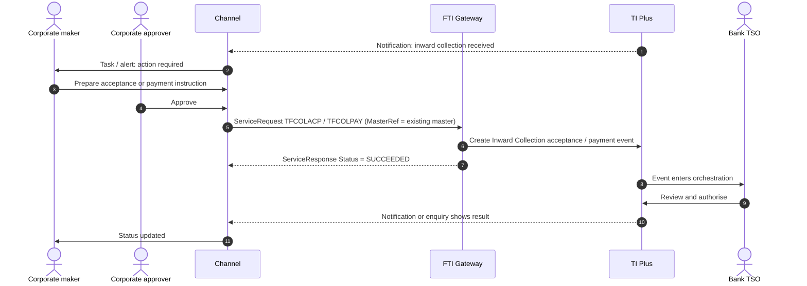

# Inward (Import) Collection

> Part of the product specifications. Index and shared rules: [README](README.md). Shared message bodies: [shared message shapes](shared-message-shapes.md). Catalogue: [01](../01-interface-catalogue.md) · Functional spec: [02](../02-functional-specification.md).

| | |
|---|---|
| Priority | P1, wave 3 |
| Customer role | Drawee (importer) |
| TI product code (`Context.Product`) | `IDC` **[Assumption – confirm in TI]** |
| Messages | 7 |

## 1. Purpose and scope

An **inward collection** is a bill or documents that the seller's bank has sent to our bank for collection from our customer, the drawee. The bank creates the master when documents arrive; the customer then **accepts** or **pays** (documents against acceptance / payment), or **refuses**. This specification covers the customer's responses. The create messages (`TFIDCCRE`, `TFIDCNCAM`) are listed for completeness: the schema says the drawer sends them, which in practice means the bank records them from the incoming collection.

Out of scope: outward collections (see [Outward Collection](outward-collection.md)), release of documents against trust receipt, and financing of the payment (see [Financing](financing.md)).

> **Reading guide.** Field names, lengths and enumerations come from `sources/xsd_element_docs/`. Statements marked **[Proposed]** or **[Assumption]** are design decisions or guesses that the interface documents cannot confirm. Names are copied exactly from the schema, including its inconsistencies in capitalisation and spelling.

## 2. Messages

| Message | Kind | Creates in TI | Channel exposure | Phase | Body |
|---|---|---|---|---|---|
| `TFCOLACP` | Payment / acceptance | Inward Collection - Acceptance event | Customer | 3 | own |
| `TFCOLPAY` | Payment / acceptance | Inward Collection payment event | Customer | 3 | [Shape: Collection payment](shared-message-shapes.md#shape-collection-payment) |
| `TFCOLCON` | Payment / acceptance | Inward Collection Continue payment event | Customer | 3 | [Shape: Collection payment](shared-message-shapes.md#shape-collection-payment) |
| `TFCOLNACP` | Response / request | Collection non-acceptance event | Customer | 3 | [Shape: Correspondence](shared-message-shapes.md#shape-correspondence) (+diff) |
| `TFIDCCOR` | Correspondence | IDC correspondence event | Customer | 3 | [Shape: Correspondence](shared-message-shapes.md#shape-correspondence) |
| `TFIDCCRE` | Create / issue | Inward Collection create event (Clean or Documentary according to CollectionType tag) | Review | - | own |
| `TFIDCNCAM` | Create / issue | Inward Collection create event (Clean or Documentary according to CollectionType tag) | Review | - | as `TFIDCCRE` |

**Exposure key.** *Customer* – the corporate starts or answers it in the channel. *Review* – schema description does not make the sender clear; confirm with the TI team before exposing. *Bank-side* – raised by the bank or an interbank counterparty; do not expose to customers.

## 3. Business scenario

Documents for USD 75,000 arrive from the seller's bank, payable 60 days after sight. TI creates the inward collection. The customer sees *Documents received* in the channel, reviews the drafts and documents (viewing copies from the DMS), and chooses: **Accept** (`TFCOLACP`) the drafts; later **Pay** at maturity (`TFCOLPAY`) or **Pay now** (`TFCOLCON` to continue payment); or **Refuse** (`TFCOLNACP`) with a reason. The TSO releases documents against the chosen action.

**Acceptance or payment**



## 4. Preconditions

1. The inward collection exists in TI and the customer is the drawee.
2. Drafts and documents are visible to the customer (DMS access or a summary from `RetrieveMasterDetail`).
3. For payment, the debit account is the customer's and has sufficient funds (TI checks).

## 5. Screens

A task-driven screen opened from the collection alert.

| Step | Section | Fields (schema element) |
|---|---|---|
| 1 | **Collection summary** | Read-only: drawer, collecting/remitting bank, amount, drafts (`CollectionDraftss`), documents, tenor, charges (from `RetrieveMasterDetail`) |
| 2 | **Decision** | Accept / Pay / Pay later / Refuse |
| 3 | **Accept** | `AcceptAllDrafts`, `AmountAccepted`, `ReceivedOnDate`, `TransferBy`, `InstructionsToSend`, `Tenor`, `ExpireCollection` |
| 4 | **Pay** | `CollectionAmount`, `CollectionDate`, `PaymentAction`, `PaymentDraftss`, `Financing` (optional) |
| 5 | **Refuse** | `NonAcceptanceAllDrafts`, `NonPaymentAllDrafts`, narrative (`MessageText` / `Narrative`) |
| 6 | **Review and submit** | Approval route, debit account confirmation |

> **[Proposed] Fields hidden from the customer or set by configuration.** `Context.Team`, `Context.Step`, `Context.ExchangeNonAutoComplete`, `Context.BehalfOfBranch*`, `ExternalReview`, `ProvisionalFlags`, `BankCodes`, `ContinueEvent`, `Provisional`, `AutoCreateFollowOnEvent`, `FinalWording`, `TakeonExtra`, `InternalMasterRefSequence`, `OutstandingAmount`, `OutstandingAdditionalAmount`, `OriginalMasterReference`, `PreallocatedNo`. They affect routing, bank processing or data take-on, and should be set by channel configuration or left to TI defaults. Confirm each with the TI team (02, Q10). Also `Function`, `FormOfUndertaking`, `EventFurtherID` (unless the bank defines customer-visible sub-types).

## 6. Primary message `TFCOLACP`

Sent by the Drawee to the Collecting Bank providing approval of acceptance and (or) payment details relating to an Inward (Import) Collection. Creates: Inward Collection - Acceptance event.

### 6.1 Context

| Element | Value |
|---|---|
| `Branch` | The booking branch from the corporate configuration. |
| `Customer` | The customer's TI mnemonic (max 20). |
| `Product` | `IDC` **[Assumption]** |
| `Event` | Normally implied by the message name. Leave empty unless the TI team asks for it. **[Assumption]** |
| `TheirReference` | Customer's own reference (max 34). |
| `OurReference` / `MasterRef` | **Required.** `MasterRef` / `OurReference` is the inward collection reference. |

The remaining `Context` elements (`Team`, `Step`, `BehalfOfBranch*`, `TemplateIdentifier`, `EventReference`, `ExchangeNonAutoComplete`, `SubsidiaryMasterPrefixAndSerial`) are set by configuration. See [README](README.md#common-blocks-in-every-message).

### 6.2 Channel-managed elements

| Element | Value |
|---|---|
| `eBankMasterRef` / `EBankMasterRef` (max 20) | The channel's id for the master. Constant for every later event on it. |
| `eBankEvent` / `eBankEventRef` / `EBankEventRef` (max 20) | The channel's id for this event. Unique per instruction; the key for idempotent retries. |
| `EmbeddedItemss` | Inline attachments (`ID`, `AttachType`, `DocType`, `Description`, `FileName`, `DataStream`, `MimeType`, `DocumentFileName`); `IsCustomerAttachedDocument` = `Y`. |
| `DocumentsReceiveds` | References to documents already in the DMS, if the upload-first approach is chosen (02, Q8). |

**Capitalisation differs between messages** (`eBankMasterRef` in some, `EBankMasterRef` in others; `eBankEvent`, `eBankEventRef` and `EBankEventRef`). The channel generates names from the schema catalogue and must never hand-type them.

`eBankCorpRef` holds the channel's own reference of the collection in the customer's system, if the customer wants it carried.

### 6.3 Field reference

All top-level elements, in schema order, then the nested structures and enumerations.

| Element | Type / length | Description |
|---|---|---|
| `Sender` | party | The Sender of the message. |
| `Subject` | string ≤35 | Subject of correspondence. |
| `CorresType` | string ≤1 | Correspondence type - G = General - Q = Query - A = Answer - N = Ancillary. |
| `EventFurtherID` | string 1–5 | Used to further define the type of event. The value in this field must be a valid bank defined TF dictionary value beginning EVTxx e.g. EVT01 - Acc... |
| `ExtraInformation` | string ≤35 | Free format extra information for the event. This information will be shown on the Master summary in the WIP and event history, dashboard and Maste... |
| `RelatedRef` | string ≤20 | Related reference. |
| `MessageText` | string ≤10000 | Correspondence. |
| `RelatedInformation` | string ≤1820 | Narrative Description of the Original Message. |
| `eBankMasterRef` | string ≤20 | Unique reference meaningful to the sending system which applies to the master. |
| `eBankEventRef` | string ≤20 | Unique reference meaningful to the sending system which applies to this transaction. |
| `eBankCorpRef` | string ≤20 | Reference of the master in the external system. |
| `FormOfUndertaking` | string ≤4 | Available values: 'DGAR'='Demand guarantee', 'UNDK'='Dependent undertaking', 'DOCR'='Documentary credit', 'STBY'='Standby letter of credit'. |
| `Function` | string ≤8 | MT759 specific. MT759 specific. Available values: 'FRAUDMSG'='Advice of a fraud attempt', 'ISSAMEND'='Amendment of a free-form undertaking such as... |
| `Narrative` | string ≤10050 |  |
| `AcceptAllDrafts` | boolean | Sets all drafts with maturity date to Accepted. Boolean values. |
| `ReceivedOnDate` | date |  |
| `TransferBy` | string 1–1 | Transfer Method. Code for transfer method format, defined by its domain list. Transfer Method. Available values: 'e'='E-mail', '5'='Fax', 'a'='Gate... |
| `AmountAccepted` | group | Amount Gateway pane. Note that this pane may have the currency included as part of the amount source or the currency may be entered separately. |
| `ExpireCollection` | boolean | Boolean values. |
| `InstructionsToSend` | string ≤1820 |  |
| `Tenor` | group |  |
| `AdditionalData` | group | Additional data for the event - where customization is not used the bank can attach details to the event which are mapped to the additional data he... |
| `ExtraData` | group |  |

#### Nested structures of `TFCOLACP`

**`AmountAccepted`**

| Path | Type / length | Description |
|---|---|---|
| `AmountAccepted/Amount` | string ≤22 |  |
| `AmountAccepted/Currency` | string 1–3 | Currency. |

**`Tenor`**

| Path | Type / length | Description |
|---|---|---|
| `Tenor/FromAfter` | string 1–1 | Available values: 'A'='After', 'F'='From', 'E'='From (exclusive)'. |
| `Tenor/MaturityDate` | date |  |
| `Tenor/From` | string 1–222 | Available values: 'A'='Air waybill', 'G'='Arrival of goods', 'E'='Bill of Exchange', 'L'='Bill of Lading',... |
| `Tenor/TenorPeriod` | group |  |
| `Tenor/TenorPeriod/TenorDays` | int | Tenor element of the term. |
| `Tenor/TenorPeriod/TenorPeriod` | string | Period. Available values: 'D'='Days', 'M'='Months', 'Q'='Quarters', 'W'='Weeks', 'Y'='Years'. |

**`AdditionalData`**

| Path | Type / length | Description |
|---|---|---|
| `AdditionalData/DataItem` | group ×n | Receives "additional data" from Gateway, which are recorded as event notifications. |
| `AdditionalData/DataItem/Name` | string ≤50 |  |
| `AdditionalData/DataItem/Value` | string |  |


#### Enumerated values in `TFCOLACP`

| Path | Allowed values |
|---|---|
| `FormOfUndertaking` | `DGAR` Demand guarantee; `UNDK` Dependent undertaking; `DOCR` Documentary credit; `STBY` Standby letter of credit |
| `Function` | `FRAUDMSG` Advice of a fraud attempt; `ISSAMEND` Amendment of a free-form undertaking such as a dependent guarantee; `CLSVCLOS` Closing of client service call by Trade Operations; `REQFINAN` Financing request; `GENINFAD` General information advice; `ISSUANCE` Issue of a free-form undertaking such as a dependent guarantee; `CLSVOPEN` Opening of client service call by Trade Operations; `OTHERFNC` Other request; `PREDENOT` Pre-debit notification; `REIMBURS` Request related to a reimbursement; `REQAMEND` Request to amend an undertaking; `REXTMATU` Request to extend the maturity date; `REQISSUE` Request to issue an undertaking; `TRANSFER` Transfer of an undertaking |
| `TransferBy` | `e` E-mail; `5` Fax; `a` Gateway; `i` Internal; `1` Mail; `4` SWIFT; `2` Telex; `3` Telex via SWIFT |
| `Tenor/FromAfter` | `A` After; `F` From; `E` From (exclusive) |
| `Tenor/From` | `A` Air waybill; `G` Arrival of goods; `E` Bill of Exchange; `L` Bill of Lading; `I` Invoice; `X` Other; `P` Shipment Date; `S` Sight; `T` Transport Documents |
| `Tenor/TenorPeriod/TenorPeriod` | `D` Days; `M` Months; `Q` Quarters; `W` Weeks; `Y` Years |


## 7. Other messages

### `TFCOLPAY` – Pay collection

| | |
|---|---|
| Creates in TI | Inward Collection payment event |
| Purpose (schema) | Sent by the Drawee to the Collecting Bank providing approval and (or) payment details relating to an Inward (Import) Collection |
| Channel exposure | Customer |
| Phase | 3 |

**Body:** [Shape: Collection payment](shared-message-shapes.md#shape-collection-payment) with differences.

* Omits: `OriginatingPaymentEvent`

### `TFCOLCON` – Continue payment

| | |
|---|---|
| Creates in TI | Inward Collection Continue payment event |
| Purpose (schema) | Sent by the Drawee to the Collecting Bank providing approval and (or) payment details relating to an Inward (Import) Collection |
| Channel exposure | Customer |
| Phase | 3 |

**Body:** [Shape: Collection payment](shared-message-shapes.md#shape-collection-payment).

### `TFCOLNACP` – Refuse acceptance or payment

| | |
|---|---|
| Creates in TI | Collection non-acceptance event |
| Purpose (schema) | - |
| Channel exposure | Customer |
| Phase | 3 |

**Body:** [Shape: Correspondence](shared-message-shapes.md#shape-correspondence) with differences.

* Adds: `NonAcceptanceAllDrafts`, `NonPaymentAllDrafts`

| Element | Type / length | Description |
|---|---|---|
| `NonAcceptanceAllDrafts` | boolean | Boolean values. |
| `NonPaymentAllDrafts` | boolean | Boolean values. |

### `TFIDCCOR` – Correspondence

| | |
|---|---|
| Creates in TI | IDC correspondence event |
| Purpose (schema) | - |
| Channel exposure | Customer |
| Phase | 3 |

**Body:** [Shape: Correspondence](shared-message-shapes.md#shape-correspondence).

### `TFIDCCRE` – Create inward collection

| | |
|---|---|
| Creates in TI | Inward Collection create event (Clean or Documentary according to CollectionType tag) |
| Purpose (schema) | Sent by the Drawer to the bank providing full details of an Inward (Import) Collection (Clean or Documentary) |
| Channel exposure | Review |
| Phase | - |

Schema: "Sent by the Drawer to the bank". Bank-side recording of an incoming collection. Expose only if the bank lets customers register an inward collection themselves.

**Body elements** (besides the [common blocks](README.md#common-blocks-in-every-message)):

| Element | Type / length | Description |
|---|---|---|
| `CollectionType` | boolean | Type of Collection either: - T = Documentary - F = Clean. Boolean values. |
| `PreallocatedNo` | int | Used only if your bank has pre-allocated a block of reference numbers to the customer for the product as described in the TI Plus System Tailoring... |
| `Drawer` | party | Drawer of the Collection. |
| `Drawee` | party | Drawee in the Collection order. |
| `DocumentsAgainst` | group | Terms of the Collection. |
| `DirectCollection` | boolean | Whether collection has been sent directly to the Collecting bank by drawer - Y = Direct Collection - N = Non direct. Boolean values. |
| `PresentingBank` | party | Details of the Presenting bank. |
| `RemittingBank` | party | Details of the Remitting Bank. |
| `CollectingBank` | party | Details of the Collecting bank. |
| `ReceivedFrom` | string ≤3 | Received from party role. Available values: 'CBK'='Collecting Bank', 'DRW'='Drawer', 'PYE'='Payee', 'PBK'='Presenting Bank', 'RBK'='Remitting Bank'... |
| `SendTo` | string ≤3 | Send to party role. Available values: 'CBK'='Collecting Bank', 'DRE'='Drawee', 'PYE'='Payee', 'PBK'='Presenting Bank', 'RBK'='Remitting Bank', 'TPT... |
| `CollectionAmount` | group | Total Collection amount. |
| `URCApply` | boolean | Whether Uniform Rules for Collections apply. Boolean values. |
| `AcknowledgeReceipt` | string | Whether a receipt of acknowledgement is required from Collecting bank.In the format: ' Y 'or' N' followed by space and  'Advice format' e.g. 'Y 4'... |
| `AdviseAcceptance` | string | Whether an advice of acceptance is required from the Collecting bank. In the format: ' Y 'or' N' followed by space and  'Advice format' e.g. 'Y 4'... |
| `AdviseNonAcceptance` | string | Whether Collecting bank is to advise Non Acceptance In the format: ' Y 'or' N' followed by space and  'Advice format' e.g. 'Y 4'  - means -  Advise... |
| `AdviseNonPayment` | string | Whether Collecting bank is to advise Non Payment In the format: ' Y 'or' N' followed by space and  'Advice format' e.g. 'Y 4'  - means - Advise Non... |
| `AdvisePayment` | string | Whether Collecting bank is to advise Payment. In the format: ' Y 'or' N' followed by space and  'Advice format' e.g. 'Y 4'  - means - Advise Paymen... |
| `CollectionDraftss` | group |  |
| `HoldDocuments` | boolean | Y or N. Boolean values. |
| `InsureGoods` | boolean | Y or N. Boolean values. |
| `ProtestNonAcceptance` | boolean | Y or N. Boolean values. |
| `ProtestNonPayment` | boolean | Y or N. Boolean values. |
| `AllowPartPayment` | boolean | Y or N. Boolean values. |
| `WarehouseGoods` | boolean | Y or N. Boolean values. |
| `InsureFireOnly` | boolean | Y or N. Boolean values. |
| `TraceAcknowledgement` | boolean | Y or N. Boolean values. |
| `TraceAcceptance` | boolean | Y or N. Boolean values. |
| `TracePayments` | boolean | Y or N. Boolean values. |
| `CollectionDelivery` | string 1–20 | Collection delivery details in the format e.g. 2 AM  =  2  Via Airmail Other codes are - FC = First class mail - RD = Recorded delivery, - RM = Reg... |
| `ReturnDelivery` | string 1–20 | As for Collection Delivery. |
| `ApplicantInstructions` | string ≤6700 | Free format instructions from the drawer. |
| `SpecialInstructions` | string ≤6700 | Special instructions regarding the collection. |
| `ShipFrom` | string ≤144 | Shipment from. |
| `ShipTo` | string ≤144 | Shipment to. |
| `Vessel` | string ≤65 | Vessel. |
| `ExpectedDate` | date | Expected date of arrival of goods. |
| `GoodsDescription` | string ≤6700 | Details of goods. |
| `GoodsCode` | string 1–10 | As per Goods codes defined in TI Plus. |
| `CollectAllCharges` | boolean | Y or N. Boolean values. |
| `CollectOverseasCharges` | boolean | Y or N. Boolean values. |
| `Documentss` | group |  |
| `WaiveIfRefused` | boolean | Waive charges if refused - Y = Waive charges if refused - N = Do not waive charges processed. Boolean values. |
| `BankChargesFor` | string 1–1 | Bank's charges for either - D = Drawer - E = Drawee. |
| `TaxFor` | string 1–1 | Who pays tax - C = Customer - P = Charge payer. Tax paid by. Available values: 'P'='Charge payer', 'C'='Customer'. |
| `OverseasChargesFor` | string 1–1 | Who overseas charges are for - D = Drawer - E = Drawee. |
| `ThirdPartyAmount` | group | The amount of collection to be paid to a Third party - Mutually exclusive with ThirdPartyPcnt. |
| `ThirdPartyPct` | decimal(17,2) | Percentage of the Collection amount due to the third party e.g 10.75 (decimal included ) Mutually exclusive with ThirdPartyAmount. Available Values... |
| `ThirdParty` | party | Party to whom any third party payments are due. |
| `PerDraft` | boolean | Whether Third party payment amounts are paid pro rata per draft - Y = Per Draft - N = In full. Boolean values. |
| `MultiplePayments` | boolean | Whether multiple payments. Boolean values. |
| `PreferredCcy` | string 1–3 | Preferred currency for charges to be taken. (if not specified charges will be taken in transaction currency ). |
| `ChargeAccount` | string 1–34 | The account number from which charges should be taken. |
| `PrincipalAccount` | string 1–34 | Principal account. Creates an action item for the user to create master settlement instructions or advise to third parties as required. |
| `FXOptDealRef` | string 1–20 | Reference of any foreign exchange option contract associated with this transaction. |
| `Consignee` | party | Consignee if different to the Drawee. |
| `Payee` | party | Payee if different to the Drawer. |
| `InCaseOfNeed` | party | In Case of Need party. |
| `InCaseOfNeedPower` | string 1–1 | In case of need power - Y = Advisory - N = Act on instructions. |
| `ExpiryDate` | date | Expiry date. |
| `ApplicationDate` | date | Application date. |
| `ProductType` | string ≤3 | TI Product type. |
| `MasterAgreement` | string ≤35 | Master agreement. |
| `BankCodes` | group | Bank defined codes for their own purposes. Defined using 'List value' in TI Plus System tailoring. |
| `SpecialFields` | group | Special gateway fields - ***Reserved***. |
| `eBankMasterRef` | string ≤20 | Unique reference meaningful to the sending system which applies to the master. |
| `eBankEventRef` | string ≤20 | Unique reference meaningful to the sending system which applies to this transaction. |
| `AdditionalParties` | group | This contains the additional parties to a transaction. Only applicable for Issue/Create and Amend events. |
| `FxContracts` | group |  |
| `Provisional` | boolean | Boolean values. |
| `AutoCreateFollowOnEvent` | boolean | Used to specify if the next event should be automatically created when the current event is completed. Boolean values. |
| `LicenseDetails` | group |  |
| `InvoiceAmount` | group | Amount Gateway pane. Note that this pane may have the currency included as part of the amount source or the currency may be entered separately. |
| `AdvancePaymentAmount` | group | Amount Gateway pane. Note that this pane may have the currency included as part of the amount source or the currency may be entered separately. |
| `ExtraData` | group |  |

#### Nested structures of `TFIDCCRE`

**`DocumentsAgainst`**

| Path | Type / length | Description |
|---|---|---|
| `DocumentsAgainst/Type` | string ≤1 | Available values: 'A'='D/A', 'P'='D/P', 'O'='Other...', 'V'='Pour aval'. |
| `DocumentsAgainst/Other` | string ≤35 | Text associated with Other... |

**`CollectionAmount`**

| Path | Type / length | Description |
|---|---|---|
| `CollectionAmount/Amount` | string ≤22 |  |
| `CollectionAmount/Currency` | string 1–3 | Currency. |

**`CollectionDraftss`**

| Path | Type / length | Description |
|---|---|---|
| `CollectionDraftss/CollectionDrafts` | group ×n | Details of each Draft(s) under the Collection. The details for each draft cover 1. Amount and tenor of the... |
| `CollectionDraftss/CollectionDrafts/DraftAmount` | string | Draft amount. |
| `CollectionDraftss/CollectionDrafts/DraftCurrency` | string 1–3 | Draft currency. |
| `CollectionDraftss/CollectionDrafts/DraftRelease` | string | Draft release by: - D = Payment - A = Acceptance - V = Acceptance pour aval. |
| `CollectionDraftss/CollectionDrafts/DraftId` | string | Draft identifier. |
| `CollectionDraftss/CollectionDrafts/DraftDetails` | string | Additional description field for draft. |
| `CollectionDraftss/CollectionDrafts/TenorDays` | string | The Draft Tenor consists of 4 parts e.g. '30 days from Sight' This field is used to define the No. of days(... |
| `CollectionDraftss/CollectionDrafts/TenorPeriod` | string 1–1 | Available values: 'D'='Days', 'M'='Months', 'Q'='Quarters', 'W'='Weeks', 'Y'='Years'. |
| `CollectionDraftss/CollectionDrafts/FromAfter` | string 1–1 | Available values: 'A'='After', 'F'='From', 'E'='From (exclusive)'. |
| `CollectionDraftss/CollectionDrafts/TenorFrom` | string 1–222 | If TenorFrom is specified TenorText should be left blank. Available values: 'A'='Air waybill', 'G'='Arrival... |
| `CollectionDraftss/CollectionDrafts/TenorText` | string | The draft tenor details when not covered by the TenorFrom from field. If specified TenorFrom should be left... |
| `CollectionDraftss/CollectionDrafts/TenorBaseDate` | string 1–10 | The base date from which draft maturity can be determined. Mutually exclusive with TenorMaturityDate. |
| `CollectionDraftss/CollectionDrafts/TenorMaturityDate` | string 1–10 | The maturity date of a draft where known Mutually exclusive with TenorBaseDate. |
| `CollectionDraftss/CollectionDrafts/PreAccepted` | string 1–1 | Whether Draft is pre-accepted - Y = Pre-Accepted - N = Not Pre-Accepted. |
| `CollectionDraftss/CollectionDrafts/EarlyDiscountAmt` | string | Discount amount for early payment. |
| `CollectionDraftss/CollectionDrafts/EarlyDiscountCcy` | string 1–3 | Currency of early payment discount amount. |
| `CollectionDraftss/CollectionDrafts/EarlyDiscountPct` | string | Discount percentage - including decimal point e.g 1.15. |
| `CollectionDraftss/CollectionDrafts/CutOffDate` | string 1–10 | Cut off date for early payment discount. |
| `CollectionDraftss/CollectionDrafts/CutOffPeriod` | string | Cut off period for early discount. |
| `CollectionDraftss/CollectionDrafts/InterestRate` | string | Interest rate applicable for late payment e.g 12.75. |
| `CollectionDraftss/CollectionDrafts/InterestDaysBasis` | string 1–1 | Available values: '0'='0 - 365 day', '1'='1 - 360 day', '2'='2 - 365-6 day', '3'='3 - 360 / 30 day month',... |
| `CollectionDraftss/CollectionDrafts/InterestStartDate` | string 1–10 | Start date for late payment interest. |
| `CollectionDraftss/CollectionDrafts/StartFromText` | string 1–35 | Text describing when late payment interest starts. Available values: 'Acceptance date'='Acceptance date', '... |
| `CollectionDraftss/CollectionDrafts/InterestEndDate` | string 1–10 | End date for late interest calculation. |
| `CollectionDraftss/CollectionDrafts/InterestEndText` | string 1–35 | Text describing when late payment interest period ends. |
| `CollectionDraftss/CollectionDrafts/DaysOfGrace` | string | Days of grace before late interest starts 0-999. |
| `CollectionDraftss/CollectionDrafts/GraceIncluded` | string 1–1 | Whether start date is included in grace days. Available values: 'A'='After', 'B'='Before'. |
| `CollectionDraftss/CollectionDrafts/WaiveInterest` | string 1–1 | Whether late interest can be waived. |
| `CollectionDraftss/CollectionDrafts/InternalIdentifier` | string 1–36 |  |

**`Documentss`**

| Path | Type / length | Description |
|---|---|---|
| `Documentss/Documents` | group ×n | Document details - where documents are not included as attachments or embedded items. |
| `Documentss/Documents/Document` | string | The document type code - this must match one of the bank defined document types in TI Plus. e.g. - BOL = Bi... |
| `Documentss/Documents/DocumentFaceReference` | string ≤20 |  |
| `Documentss/Documents/DocumentDate` | date | Date of the document. |
| `Documentss/Documents/DocumentDesc` | string | Document description. |
| `Documentss/Documents/DocumentMailing1` | string ≤20 |  |
| `Documentss/Documents/DocumentMailing2` | string ≤20 |  |
| `Documentss/Documents/DocumentMailingTotal` | string ≤20 |  |
| `Documentss/Documents/IsCustomerAttachedDocument` | boolean | Boolean values. |
| `Documentss/Documents/TransportDocumentReference` | string ≤256 |  |
| `Documentss/Documents/DocumentFileName` | string ≤128 |  |

**`ThirdPartyAmount`**

| Path | Type / length | Description |
|---|---|---|
| `ThirdPartyAmount/Amount` | string ≤22 |  |
| `ThirdPartyAmount/Currency` | string 1–3 | Currency. |

**`BankCodes`**

| Path | Type / length | Description |
|---|---|---|
| `BankCodes/BankCode1` | string ≤4 |  |
| `BankCodes/BankCode2` | string ≤4 |  |
| `BankCodes/BankCode3` | string ≤4 |  |
| `BankCodes/BankCode4` | string ≤4 |  |
| `BankCodes/BankCode5` | string ≤4 |  |

**`SpecialFields`**

| Path | Type / length | Description |
|---|---|---|
| `SpecialFields/GW01` | string |  |
| `SpecialFields/GW02` | string |  |
| `SpecialFields/GW03` | string |  |
| `SpecialFields/GW04` | string |  |
| `SpecialFields/GW05` | string |  |

**`AdditionalParties`**

| Path | Type / length | Description |
|---|---|---|
| `AdditionalParties/AdditionalPartiesToAdd` | party ×n | Receives details of additional parties via the gateway. Mapped to and displayed under the Party list pane i... |

**`FxContracts`**

| Path | Type / length | Description |
|---|---|---|
| `FxContracts/FxContract` | group ×n |  |
| `FxContracts/FxContract/Reference` | string 1–20 |  |
| `FxContracts/FxContract/Branch` | string 1–8 |  |
| `FxContracts/FxContract/DealType` | string 1–3 |  |
| `FxContracts/FxContract/PurchaseCcy` | string 1–3 |  |
| `FxContracts/FxContract/SaleCcy` | string 1–3 |  |
| `FxContracts/FxContract/ExchangeRate` | decimal(28,20) | Available Values: 0 to 99999999 |

**`LicenseDetails`**

| Path | Type / length | Description |
|---|---|---|
| `LicenseDetails/LicenseDetail` | group ×n | Provides the link between a product (LC, Collection etc.) and a License. |
| `LicenseDetails/LicenseDetail/OurReference` | string 1–20 | e.g. Documentary Credit Number, FX contract number. |
| `LicenseDetails/LicenseDetail/EBankMasterRef` | string ≤20 |  |
| `LicenseDetails/LicenseDetail/AuthorityReference` | string ≤35 |  |
| `LicenseDetails/LicenseDetail/Number` | string ≤35 |  |
| `LicenseDetails/LicenseDetail/AllocatedAmount` | string ≤22 |  |
| `LicenseDetails/LicenseDetail/AllocatedCurrency` | string 1–3 |  |

**`InvoiceAmount`**

| Path | Type / length | Description |
|---|---|---|
| `InvoiceAmount/Amount` | string ≤22 |  |
| `InvoiceAmount/Currency` | string 1–3 | Currency. |

**`AdvancePaymentAmount`**

| Path | Type / length | Description |
|---|---|---|
| `AdvancePaymentAmount/Amount` | string ≤22 |  |
| `AdvancePaymentAmount/Currency` | string 1–3 | Currency. |


#### Enumerated values in `TFIDCCRE`

| Path | Allowed values |
|---|---|
| `DocumentsAgainst/Type` | `A` D/A; `P` D/P; `O` Other...; `V` Pour aval |
| `ReceivedFrom` | `CBK` Collecting Bank; `DRW` Drawer; `PYE` Payee; `PBK` Presenting Bank; `RBK` Remitting Bank; `TPT` Third Party |
| `SendTo` | `CBK` Collecting Bank; `DRE` Drawee; `PYE` Payee; `PBK` Presenting Bank; `RBK` Remitting Bank; `TPT` Third Party |
| `CollectionDraftss/CollectionDrafts/TenorPeriod` | `D` Days; `M` Months; `Q` Quarters; `W` Weeks; `Y` Years |
| `CollectionDraftss/CollectionDrafts/FromAfter` | `A` After; `F` From; `E` From (exclusive) |
| `CollectionDraftss/CollectionDrafts/TenorFrom` | `A` Air waybill; `G` Arrival of goods; `E` Bill of exchange; `L` Bill of lading; `I` Invoice; `X` Other; `P` Shipment date; `S` Sight |
| `CollectionDraftss/CollectionDrafts/InterestDaysBasis` | `0` 0 - 365 day; `1` 1 - 360 day; `2` 2 - 365-6 day; `3` 3 - 360 / 30 day month; `4` 4 - 365 / 30 day month; `5` 5 - 365-6 / 30 day month |
| `CollectionDraftss/CollectionDrafts/StartFromText` | `Acceptance date` Acceptance date; `Air waybill date` Air waybill date; `Arrival of goods date` Arrival of goods date; `Bill of exchange date` Bill of exchange date; `Bill of lading date` Bill of lading date; `Invoice date` Invoice date; `Maturity date` Maturity date; `Sight` Sight |
| `CollectionDraftss/CollectionDrafts/GraceIncluded` | `A` After; `B` Before |
| `TaxFor` | `P` Charge payer; `C` Customer |


### `TFIDCNCAM` – Create inward collection (no customisation amendment)

| | |
|---|---|
| Creates in TI | Inward Collection create event (Clean or Documentary according to CollectionType tag) |
| Purpose (schema) | Sent by the Drawer to the bank providing full details of an Inward (Import) Collection (Clean or Documentary) |
| Channel exposure | Review |
| Phase | - |

**Body:** same elements as `TFIDCCRE` (see above), with the differences below.

* Omits: `CollectionType`, `PreallocatedNo`, `PerDraft`, `ProductType`, `SpecialFields`, `eBankMasterRef`, `eBankEventRef`, `Provisional`, `AutoCreateFollowOnEvent`, `InvoiceAmount`, `AdvancePaymentAmount`
* Adds:

| Element | Type / length | Description |
|---|---|---|
| `Sender` | party | The Sender of the message. |
| `AmendmentDate` | date | Amendment date. |
| `InstructionsReceived` | string ≤222 |  |
| `InstructionsToSend` | string ≤32000 |  |
| `AmendmentNarrative` | string ≤32000 |  |
| `ThirdPartyPerDraft` | boolean | Whether Third party payment amounts are paid pro rata per draft - Y = Per Draft - N = In full. Boolean values. |
| `ProductTypeCode` | string ≤3 | TI Product type. |
| `EBankEventRef` | string ≤20 | Unique reference meaningful to the sending system which applies to this transaction. |

## 8. Validation rules

### 8.1 Rules supported directly by the schema

Lengths, data types and the allowed values of coded fields are in the tables in sections 6 and 7 and are the source for the channel's client and server validators. Dates are ISO `xsd:date`. Boolean elements carry `Y` or `N`. Amounts are strings (maximum 22 characters); agree the decimal format with the TI team. * The `TFCOL*` response messages share the correspondence skeleton (`Sender`, `Subject`, `CorresType`, `MessageText`...) plus their own elements.
* `CollectionDraftss/CollectionDrafts` is repeating. `TenorPeriod` ∈ {`D`, `M`, `Q`, `W`, `Y`}, `FromAfter` ∈ {`A`, `F`, `E`}, `TenorFrom` ∈ {`A` air waybill, `G` arrival of goods, `E` bill of exchange, `L` bill of lading, `I` invoice, `X` other, `P` shipment date, `S` sight}.
* `DocumentsAgainst.Type` ∈ {`A` D/A, `P` D/P, `O` other, `V` pour aval}.

### 8.2 Business rules to apply in the channel

Normal practice for this product and the checks a TSO would otherwise perform by hand. **[Proposed]**: switch each on or off per bank policy.

| # | Rule |
|---|---|
| V1 | The action is allowed by the collection's current state: accept only if documents are against acceptance and not yet accepted; pay only after acceptance or when against payment. |
| V2 | `AmountAccepted` ≤ the draft amount; partial acceptance only if the collection allows part payment (`AllowPartPayment`). |
| V3 | `CollectionAmount` (payment) ≤ outstanding amount; payment date is today or later and a business day. |
| V4 | A refusal needs a reason (narrative). |
| V5 | Cut-off and maturity dates are shown; late actions carry a warning. |
| V6 | A second action for the same draft is blocked while the first is in process. |

### 8.3 Minimum content for a usable instruction

**[Proposed]** `MasterRef`, `Sender`, the action elements for the chosen message, `eBankMasterRef`, `eBankEventRef`.

## 9. Illustrative requests

Values are invented. Element names, prefixes and order follow `sources/example_xml/`. Elements not shown are omitted, which the schema allows for optional elements. **Test against the gateway before use.**

**`TFCOLACP`**

```xml
<?xml version="1.0" standalone="yes"?>
<ServiceRequest xmlns:xsi="http://www.w3.org/2001/XMLSchema-instance"
                xmlns:m="urn:messages.service.ti.apps.tiplus2.misys.com"
                xmlns:c="urn:common.service.ti.apps.tiplus2.misys.com"
                xmlns="urn:control.services.tiplus2.misys.com">
  <RequestHeader>
    <Service>TI</Service>
    <Operation>TFCOLACP</Operation>
    <Credentials><Name>CHANNEL_SVC</Name><Password>********</Password></Credentials>
    <TargetSystem>TI</TargetSystem>
    <SourceSystem>CORPCHANNEL</SourceSystem>
    <CorrelationId>9b1f4c2e-5a0d-4c47-9f3e-2c1d7a6b8e10</CorrelationId>
    <CreationDate>2026-10-18</CreationDate>
  </RequestHeader>
  <m:TFCOLACP>
    <m:Context>
      <c:Branch>HOBR</c:Branch>
      <c:Customer>ACMEIMP</c:Customer>
      <c:Product>IDC</c:Product>
      <c:TheirReference>PO-2026-0457</c:TheirReference>
    </m:Context>
    <m:MasterRef>IDC2600020</m:MasterRef>
    <m:Sender>
      <c:Customer>ACMEIMP</c:Customer>
    </m:Sender>
    <m:Subject>Acceptance</m:Subject>
    <m:eBankMasterRef>CH-IDC-000020</m:eBankMasterRef>
    <m:eBankEventRef>CH-IDC-000020-02</m:eBankEventRef>
    <m:AcceptAllDrafts>Y</m:AcceptAllDrafts>
    <m:ReceivedOnDate>2026-10-18</m:ReceivedOnDate>
    <m:InstructionsToSend>Advise acceptance to the remitting bank.</m:InstructionsToSend>
  </m:TFCOLACP>
</ServiceRequest>
```

**`TFCOLNACP`**

```xml
<?xml version="1.0" standalone="yes"?>
<ServiceRequest xmlns:xsi="http://www.w3.org/2001/XMLSchema-instance"
                xmlns:m="urn:messages.service.ti.apps.tiplus2.misys.com"
                xmlns:c="urn:common.service.ti.apps.tiplus2.misys.com"
                xmlns="urn:control.services.tiplus2.misys.com">
  <RequestHeader>
    <Service>TI</Service>
    <Operation>TFCOLNACP</Operation>
    <Credentials><Name>CHANNEL_SVC</Name><Password>********</Password></Credentials>
    <TargetSystem>TI</TargetSystem>
    <SourceSystem>CORPCHANNEL</SourceSystem>
    <CorrelationId>9b1f4c2e-5a0d-4c47-9f3e-2c1d7a6b8e10</CorrelationId>
    <CreationDate>2026-10-18</CreationDate>
  </RequestHeader>
  <m:TFCOLNACP>
    <m:Context>
      <c:Branch>HOBR</c:Branch>
      <c:Customer>ACMEIMP</c:Customer>
      <c:Product>IDC</c:Product>
      <c:TheirReference>PO-2026-0457</c:TheirReference>
    </m:Context>
    <m:MasterRef>IDC2600020</m:MasterRef>
    <m:Sender>
      <c:Customer>ACMEIMP</c:Customer>
    </m:Sender>
    <m:Subject>Non-acceptance</m:Subject>
    <m:MessageText>Goods not in accordance with the purchase order.</m:MessageText>
    <m:eBankMasterRef>CH-IDC-000020</m:eBankMasterRef>
    <m:eBankEventRef>CH-IDC-000020-04</m:eBankEventRef>
    <m:NonAcceptanceAllDrafts>Y</m:NonAcceptanceAllDrafts>
  </m:TFCOLNACP>
</ServiceRequest>
```

## 10. Response handling and tracking

| `Status` | Channel behaviour |
|---|---|
| `SUCCEEDED` | TI accepted the message and created the event. Mark `ReceivedByBank`; keep `Warning` / `Info` texts. |
| `FAILED` | TI rejected the message. Show `Details.Error` to the maker and return the draft. No automatic retry. |
| `UNAVAILABLE` / timeout | Keep in the outbox, retry with back-off, and confirm by enquiry (`eBankEventRef`) before each re-send so no second event is created. |

Rules shared by every product are in [README – Common behaviour](README.md#common-behaviour).

Status follows the collection master: *Documents received* → *Accepted* → *Paid* (or *Refused*). The key events to watch are the arrival of documents and drafts approaching maturity. Maturity alerts are computed from the drafts' tenor.

## 11. Exceptions

| Scenario | Handling |
|---|---|
| Drawee accepts but insufficient funds at maturity | TI handles the debit; the channel shows the shortfall as a bank query. |
| Documents discrepant | Discrepancy notices come through correspondence; the customer replies via `TFIDCCOR` or refuses with `TFCOLNACP`. |
| Seller's bank recalls the collection | Status becomes *Cancelled*; actions are blocked. |
| Gateway `FAILED`, `UNAVAILABLE`, timeout, duplicate click | As in [README – Common behaviour](README.md#common-behaviour). |

## 12. Acceptance criteria

1. Customer is alerted to an inward collection and can see drafts and documents.
2. Accept, pay, continue payment and refuse each produce exactly one correct message.
3. Actions that do not fit the collection state are blocked in the UI.
4. Status updates after the TSO processes the action.
5. Every step is in the audit trail with user, time and `CorrelationId`.
6. The stored request validates against the schema rules in 8.1 and matches the structure in section 9.

## 13. Open items

| # | Item |
|---|---|
| IDC-1 | Confirm whether customers see the original documents or only a summary. |
| IDC-2 | Confirm the semantics of `TFCOLCON` vs. `TFCOLPAY` (continue payment vs. direct payment). |
| IDC-3 | Obtain tailored `PaymentAction` values. |
| IDC-4 | Confirm how `V` (pour aval) acceptance is handled. |
