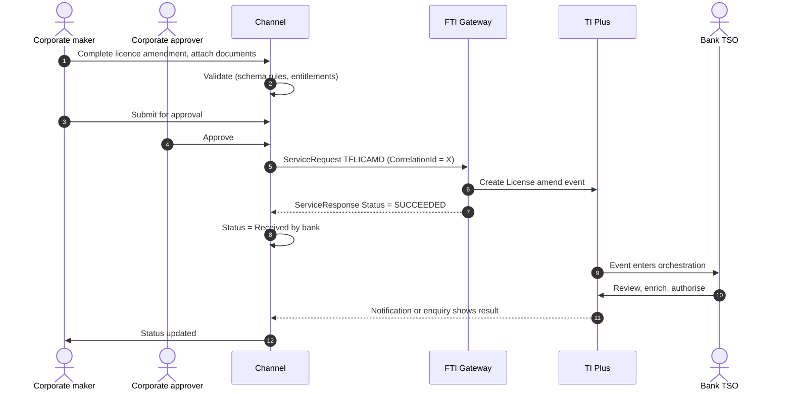

# Licences and Participations

> Part of the product specifications. Index and shared rules: [README](README.md). Shared message bodies: [shared message shapes](shared-message-shapes.md). Catalogue: [01](../01-interface-catalogue.md) · Functional spec: [02](../02-functional-specification.md).

| | |
|---|---|
| Priority | P4 |
| Customer role | Licence holder (customer); participations are bank-side |
| TI product code (`Context.Product`) | `LIC` **[Assumption – confirm in TI]** |
| Messages | 5 |

## 1. Purpose and scope

A **licence** is an import or export permit with an authorised amount and validity. The bank tracks licences and allocates them to transactions (the `LicenseDetails` block in other messages). The customer may ask to amend or cancel a licence record. **Participations** record a bank's share in a syndicated or risk-sharing arrangement and are bank-side.

Out of scope: Regulator communication and licence issuance.

> **Reading guide.** Field names, lengths and enumerations come from `sources/xsd_element_docs/`. Statements marked **[Proposed]** or **[Assumption]** are design decisions or guesses that the interface documents cannot confirm. Names are copied exactly from the schema, including its inconsistencies in capitalisation and spelling.

## 2. Messages

| Message | Kind | Creates in TI | Channel exposure | Phase | Body |
|---|---|---|---|---|---|
| `TFLICAMD` | Amend | License amend event | Customer | 5 | own |
| `TFLICCAN` | Cancel | License cancel event | Customer | 5 | own |
| `TFLICCOR` | Correspondence | License correspondence event | Customer | 5 | [Shape: Correspondence](shared-message-shapes.md#shape-correspondence) |
| `TFPTNCRE` | Create / issue | Participation Create event | Bank-side | - | own |
| `TFPTNAMD` | Amend | Participation Create event | Bank-side | - | own |

**Exposure key.** *Customer* – the corporate starts or answers it in the channel. *Review* – schema description does not make the sender clear; confirm with the TI team before exposing. *Bank-side* – raised by the bank or an interbank counterparty; do not expose to customers.

## 3. Business scenario

A customer updates its import licence: the authority extends validity and increases the amount. The customer enters the new values and attaches the authority's letter; the TSO updates the licence and, if needed, the allocations to LCs.

**Licence amendment**



## 4. Preconditions

1. The licence is registered in TI.
2. The customer can attach the authority's document.

## 5. Screens

A simple form pre-filled from the licence record.

| Step | Section | Fields (schema element) |
|---|---|---|
| 1 | **Licence** | `AuthorityReference`, `RegistrationDate`, `IssueDate`, `LicenseAmount`, `Tolerance` |
| 2 | **Validity** | `ValidFromDate`, `ValidityPeriod`, `ValidToDate`, `LatestPaymentDate` |
| 3 | **Goods** | `GoodsDescription`, `GoodsCode`, `Incoterms`, `IncoPlace`, `CountryOfOrigin`, `CountryOfSupply` |
| 4 | **Notes** | `AdditionalInformation`, `AdditionalAmount`, `AmendmentNarrative` |
| 5 | **Review and submit** |  |

> **[Proposed] Fields hidden from the customer or set by configuration.** `Context.Team`, `Context.Step`, `Context.ExchangeNonAutoComplete`, `Context.BehalfOfBranch*`, `ExternalReview`, `ProvisionalFlags`, `BankCodes`, `ContinueEvent`, `Provisional`, `AutoCreateFollowOnEvent`, `FinalWording`, `TakeonExtra`, `InternalMasterRefSequence`, `OutstandingAmount`, `OutstandingAdditionalAmount`, `OriginalMasterReference`, `PreallocatedNo`. They affect routing, bank processing or data take-on, and should be set by channel configuration or left to TI defaults. Confirm each with the TI team (02, Q10).

## 6. Primary message `TFLICAMD`

Primary instruction of this product. Creates: License amend event.

### 6.1 Context

| Element | Value |
|---|---|
| `Branch` | The booking branch from the corporate configuration. |
| `Customer` | The customer's TI mnemonic (max 20). |
| `Product` | `LIC` **[Assumption]** |
| `Event` | Normally implied by the message name. Leave empty unless the TI team asks for it. **[Assumption]** |
| `TheirReference` | Customer's own reference (max 34). |
| `OurReference` / `MasterRef` | **Required.** `MasterRef` is the licence reference. |

The remaining `Context` elements (`Team`, `Step`, `BehalfOfBranch*`, `TemplateIdentifier`, `EventReference`, `ExchangeNonAutoComplete`, `SubsidiaryMasterPrefixAndSerial`) are set by configuration. See [README](README.md#common-blocks-in-every-message).

### 6.2 Channel-managed elements

| Element | Value |
|---|---|
| `eBankMasterRef` / `EBankMasterRef` (max 20) | The channel's id for the master. Constant for every later event on it. |
| `eBankEvent` / `eBankEventRef` / `EBankEventRef` (max 20) | The channel's id for this event. Unique per instruction; the key for idempotent retries. |
| `EmbeddedItemss` | Inline attachments (`ID`, `AttachType`, `DocType`, `Description`, `FileName`, `DataStream`, `MimeType`, `DocumentFileName`); `IsCustomerAttachedDocument` = `Y`. |
| `DocumentsReceiveds` | References to documents already in the DMS, if the upload-first approach is chosen (02, Q8). |

**Capitalisation differs between messages** (`eBankMasterRef` in some, `EBankMasterRef` in others; `eBankEvent`, `eBankEventRef` and `EBankEventRef`). The channel generates names from the schema catalogue and must never hand-type them.

### 6.3 Field reference

All top-level elements, in schema order, then the nested structures and enumerations.

| Element | Type / length | Description |
|---|---|---|
| `AuthorityReference` | string ≤35 |  |
| `RegistrationDate` | date |  |
| `IssueDate` | date |  |
| `LicenseAmount` | group | Amount Gateway pane. Note that this pane may have the currency included as part of the amount source or the currency may be entered separately. |
| `Tolerance` | group | Further amount specification Gateway pane. |
| `ValidFromDate` | date |  |
| `ValidityPeriod` | group |  |
| `ValidToDate` | date |  |
| `LatestPaymentDate` | date |  |
| `AdditionalInformation` | string ≤6700 |  |
| `AdditionalAmount` | group | Amount Gateway pane. Note that this pane may have the currency included as part of the amount source or the currency may be entered separately. |
| `AdditionalAmountDesc` | string ≤111 |  |
| `Incoterms` | string 1–3 |  |
| `IncoPlace` | string ≤142 |  |
| `GoodsDescription` | string ≤1005 |  |
| `GoodsCode` | string 1–10 |  |
| `CountryOfOrigin` | string 1–2 | Country code. |
| `CountryOfSupply` | string 1–2 | Country code. |
| `eBankMasterRef` | string ≤20 | Unique reference meaningful to the sending system which applies to the master. |
| `eBankEventRef` | string ≤20 | Unique reference meaningful to the sending system which applies to this transaction. |
| `PreferredCcy` | string 1–3 | Preferred charge currency. |
| `AmendmentNarrative` | string ≤6700 | Narrative regarding the amendment. |
| `AdditionalData` | group | Additional data for the event - where customization is not used the bank can attach details to the event which are mapped to the additional data he... |
| `ExtraData` | group |  |

#### Nested structures of `TFLICAMD`

**`LicenseAmount`**

| Path | Type / length | Description |
|---|---|---|
| `LicenseAmount/Amount` | string ≤22 |  |
| `LicenseAmount/Currency` | string 1–3 | Currency. |

**`Tolerance`**

| Path | Type / length | Description |
|---|---|---|
| `Tolerance/Qualifier` | string 1–1 | Tolerance. Available values: 'A'='About', 'E'='Exact', 'M'='Maximum', 'X'='Min/Max', 'N'='Not Exceeding', '... |
| `Tolerance/Min` | string 1–2 | Min percentage tolerance. |
| `Tolerance/Max` | string 1–2 | Max percentage tolerance. |
| `Tolerance/AmountMin` | long | Min amount tolerance. |
| `Tolerance/AmountMax` | long | Min amount tolerance. |

**`ValidityPeriod`**

| Path | Type / length | Description |
|---|---|---|
| `ValidityPeriod/TenorDays` | int | Tenor element of the term. |
| `ValidityPeriod/TenorPeriod` | string | Period. Available values: 'D'='Days', 'M'='Months', 'Q'='Quarters', 'W'='Weeks', 'Y'='Years'. |

**`AdditionalAmount`**

| Path | Type / length | Description |
|---|---|---|
| `AdditionalAmount/Amount` | string ≤22 |  |
| `AdditionalAmount/Currency` | string 1–3 | Currency. |

**`AdditionalData`**

| Path | Type / length | Description |
|---|---|---|
| `AdditionalData/DataItem` | group ×n | Receives "additional data" from Gateway, which are recorded as event notifications. |
| `AdditionalData/DataItem/Name` | string ≤50 |  |
| `AdditionalData/DataItem/Value` | string |  |


#### Enumerated values in `TFLICAMD`

| Path | Allowed values |
|---|---|
| `Tolerance/Qualifier` | `A` About; `E` Exact; `M` Maximum; `X` Min/Max; `N` Not Exceeding; `O` Other; `U` Up to |
| `ValidityPeriod/TenorPeriod` | `D` Days; `M` Months; `Q` Quarters; `W` Weeks; `Y` Years |


## 7. Other messages

### `TFLICCAN` – Cancel licence

| | |
|---|---|
| Creates in TI | License cancel event |
| Purpose (schema) | - |
| Channel exposure | Customer |
| Phase | 5 |

**Body elements** (besides the [common blocks](README.md#common-blocks-in-every-message)):

| Element | Type / length | Description |
|---|---|---|
| `eBankEventRef` | string ≤20 | Unique reference meaningful to the sending system which applies to this transaction. |
| `eBankMasterRef` | string ≤20 | Unique reference meaningful to the sending system which applies to the master. |
| `ReasonsToCancel` | string ≤6700 |  |
| `BookOffDate` | date | Bookoff date. |
| `ExtraData` | group |  |

### `TFLICCOR` – Licence correspondence

| | |
|---|---|
| Creates in TI | License correspondence event |
| Purpose (schema) | - |
| Channel exposure | Customer |
| Phase | 5 |

**Body:** [Shape: Correspondence](shared-message-shapes.md#shape-correspondence).

### `TFPTNCRE` – Create participation

| | |
|---|---|
| Creates in TI | Participation Create event |
| Purpose (schema) | - |
| Channel exposure | Bank-side |
| Phase | - |

Not exposed to customers, so the body is not specified here. Top-level elements, in schema order: `EBankMasterRef`, `EBankEventRef`, `ManualParticipation`, `RestrictToNamedCustomer`, `Revolving`, `UpdateExistingTransactions`, `AgreementDate`, `EffectiveDate`, `ExpiryDate`, `ProductType`, `TotalCommitmentAmount`, `ParticipationCustomer`, `NotesToCustomer`, `ParticipationCustomerDetails`, `Participants`, `MasterSettlementInstructionss`, `InstructionsToParticipants`, `SpecialInstructions`, `AdditionalData`, `ExtraData`. Details: `sources/xsd_element_docs/TI.TFPTNCRE.xsd.txt`.

### `TFPTNAMD` – Amend participation

| | |
|---|---|
| Creates in TI | Participation Create event |
| Purpose (schema) | - |
| Channel exposure | Bank-side |
| Phase | - |

Not exposed to customers, so the body is not specified here. Top-level elements, in schema order: `EBankMasterRef`, `EBankEventRef`, `EBankCorpRef`, `AmendmentDate`, `UpdateExistingTransactions`, `Blocked`, `NewExpiryDate`, `NewTotalCommitmentAmount`, `DecreaseAmount`, `IncreaseAmount`, `NotesToCustomer`, `SpecialInstructions`, `AmendedParticipants`, `MasterSettlementInstructionss`, `InstructionsToParticipants`, `AdditionalData`, `ExtraData`. Details: `sources/xsd_element_docs/TI.TFPTNAMD.xsd.txt`.

## 8. Validation rules

### 8.1 Rules supported directly by the schema

Lengths, data types and the allowed values of coded fields are in the tables in sections 6 and 7 and are the source for the channel's client and server validators. Dates are ISO `xsd:date`. Boolean elements carry `Y` or `N`. Amounts are strings (maximum 22 characters); agree the decimal format with the TI team. 

### 8.2 Business rules to apply in the channel

Normal practice for this product and the checks a TSO would otherwise perform by hand. **[Proposed]**: switch each on or off per bank policy.

| # | Rule |
|---|---|
| V1 | Valid-to date is after valid-from. |
| V2 | Licence amount is not reduced below the amount already allocated. |
| V3 | Cancellation is blocked while allocations exist. **[Proposed]** |

### 8.3 Minimum content for a usable instruction

**[Proposed]** `MasterRef`, changed elements, `AmendmentNarrative`, attachment.

## 9. Illustrative requests

Values are invented. Element names, prefixes and order follow `sources/example_xml/`. Elements not shown are omitted, which the schema allows for optional elements. **Test against the gateway before use.**

**`TFLICAMD`**

```xml
<?xml version="1.0" standalone="yes"?>
<ServiceRequest xmlns:xsi="http://www.w3.org/2001/XMLSchema-instance"
                xmlns:m="urn:messages.service.ti.apps.tiplus2.misys.com"
                xmlns:c="urn:common.service.ti.apps.tiplus2.misys.com"
                xmlns="urn:control.services.tiplus2.misys.com">
  <RequestHeader>
    <Service>TI</Service>
    <Operation>TFLICAMD</Operation>
    <Credentials><Name>CHANNEL_SVC</Name><Password>********</Password></Credentials>
    <TargetSystem>TI</TargetSystem>
    <SourceSystem>CORPCHANNEL</SourceSystem>
    <CorrelationId>9b1f4c2e-5a0d-4c47-9f3e-2c1d7a6b8e10</CorrelationId>
    <CreationDate>2026-10-18</CreationDate>
  </RequestHeader>
  <m:TFLICAMD>
    <m:Context>
      <c:Branch>HOBR</c:Branch>
      <c:Customer>ACMEIMP</c:Customer>
      <c:Product>LIC</c:Product>
      <c:TheirReference>LIC-AMEND-1</c:TheirReference>
    </m:Context>
    <m:MasterRef>LIC2600002</m:MasterRef>
    <m:LicenseAmount>
      <c:Amount>2000000.00</c:Amount>
      <c:Currency>USD</c:Currency>
    </m:LicenseAmount>
    <m:ValidToDate>2027-06-30</m:ValidToDate>
    <m:eBankMasterRef>CH-LIC-000002</m:eBankMasterRef>
    <m:eBankEventRef>CH-LIC-000002-02</m:eBankEventRef>
    <m:AmendmentNarrative>Authority extended validity and increased the amount.</m:AmendmentNarrative>
  </m:TFLICAMD>
</ServiceRequest>
```

## 10. Response handling and tracking

| `Status` | Channel behaviour |
|---|---|
| `SUCCEEDED` | TI accepted the message and created the event. Mark `ReceivedByBank`; keep `Warning` / `Info` texts. |
| `FAILED` | TI rejected the message. Show `Details.Error` to the maker and return the draft. No automatic retry. |
| `UNAVAILABLE` / timeout | Keep in the outbox, retry with back-off, and confirm by enquiry (`eBankEventRef`) before each re-send so no second event is created. |

Rules shared by every product are in [README – Common behaviour](README.md#common-behaviour).

Show the licence with validity and allocated/available amount.

## 11. Exceptions

| Scenario | Handling |
|---|---|
| Allocation exceeds new amount | TI blocks; the channel shows the bank's message. |
| Gateway `FAILED`, `UNAVAILABLE`, timeout, duplicate click | As in [README – Common behaviour](README.md#common-behaviour). |

## 12. Acceptance criteria

1. Licence amendments and cancellations are submitted once per approval.
2. Allocated and available amounts are shown.
3. Every step is in the audit trail with user, time and `CorrelationId`.
4. The stored request validates against the schema rules in 8.1 and matches the structure in section 9.

## 13. Open items

| # | Item |
|---|---|
| LIC-1 | Does the bank manage licences through the channel at all? |
| LIC-2 | Confirm who may create licences. |
