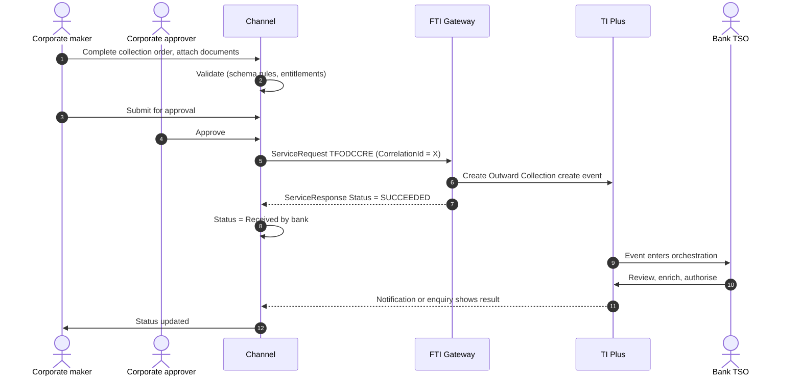

# Outward (Export) Collection

> Part of the product specifications. Index and shared rules: [README](README.md). Shared message bodies: [shared message shapes](shared-message-shapes.md). Catalogue: [01](../01-interface-catalogue.md) · Functional spec: [02](../02-functional-specification.md).

| | |
|---|---|
| Priority | P2 |
| Customer role | Drawer (exporter) |
| TI product code (`Context.Product`) | `ODC` **[Assumption – confirm in TI]** |
| Messages | 11 |

## 1. Purpose and scope

The exporter ships goods and hands the documents to the bank with instructions to collect payment (or acceptance) from the buyer through the buyer's bank. A **documentary collection** carries shipping documents with drafts (documents against payment, D/P, or against acceptance, D/A); a **clean collection** carries only financial documents. The customer creates the collection, can later amend it, discount or advance against it, and answer payment advices.

Out of scope: Inward collections (see [Inward Collection](inward-collection.md)); financing in detail (see [Financing](financing.md)).

> **Reading guide.** Field names, lengths and enumerations come from `sources/xsd_element_docs/`. Statements marked **[Proposed]** or **[Assumption]** are design decisions or guesses that the interface documents cannot confirm. Names are copied exactly from the schema, including its inconsistencies in capitalisation and spelling.

## 2. Messages

| Message | Kind | Creates in TI | Channel exposure | Phase | Body |
|---|---|---|---|---|---|
| `TFODCCRE` | Create / issue | Outward Collection create event (Clean or Documentary according to CollectionType tag) | Customer | 4 | own |
| `TFCOLNEW` | Create / issue | Outward Collection create event (Clean or Documentary according to CollectionType tag) | Customer | 4 | as `TFODCCRE` |
| `TFODCNCAM` | Amend | Outward Collection create event (Clean or Documentary according to CollectionType tag) | Customer | 4 | as `TFODCCRE` |
| `TFCOLAMD` | Amend | Outward Collection create event (Clean or Documentary according to CollectionType tag) | Customer | 4 | as `TFODCNCAM` |
| `TFCOLAMR` | Amend | Outward Collection create event (Clean or Documentary according to CollectionType tag) | Customer | 4 | [Shape: Correspondence](shared-message-shapes.md#shape-correspondence) |
| `TFCOLDSR` | Other | Outward Collection discount event | Customer | 5 | own |
| `TFCOLFNR` | Other | Outward Collection advance event | Customer | 5 | [Shape: Correspondence](shared-message-shapes.md#shape-correspondence) |
| `TFOCOLPAY` | Payment / acceptance | Outward Collection payment event | Review | 4 | [Shape: Collection payment](shared-message-shapes.md#shape-collection-payment) |
| `TFOCOLCON` | Payment / acceptance | Outward Collection Continue payment event | Review | 4 | [Shape: Collection payment](shared-message-shapes.md#shape-collection-payment) |
| `TFODCCOR` | Correspondence | ODC correspondence event | Customer | 4 | [Shape: Correspondence](shared-message-shapes.md#shape-correspondence) |
| `TFCOLCOR` | Correspondence | Collection correspondence event | Customer | 4 | [Shape: Correspondence](shared-message-shapes.md#shape-correspondence) |

**Exposure key.** *Customer* – the corporate starts or answers it in the channel. *Review* – schema description does not make the sender clear; confirm with the TI team before exposing. *Bank-side* – raised by the bank or an interbank counterparty; do not expose to customers.

## 3. Business scenario

The exporter completes a collection order: drawer (itself), drawee (the buyer), the collecting bank, the amount, drafts with tenor, the documents handed over (with counts), delivery terms (documents against payment or acceptance), instructions (protest, acknowledge, advise payment, insurance), charges, and the account to credit. The bank dispatches the documents; the channel tracks acceptance and payment, and the exporter can request a discount or an advance against the collection.

**Collection order**



## 4. Preconditions

1. The customer is enabled for `ODC`.
2. Buyer and collecting bank details are known (address book / SWIFT directory).
3. Physical documents will be delivered to the bank with a coversheet generated by the channel.

## 5. Screens

Multi-step form that mirrors the collection order.

| Step | Section | Fields (schema element) |
|---|---|---|
| 1 | **Collection type** | `CollectionType` (documentary / clean), `DocumentsAgainst` (type, other), `DirectCollection`, `ProductType` |
| 2 | **Parties** | `Drawer`, `Drawee`, `CollectingBank`, `PresentingBank`, `RemittingBank`, `Consignee`, `Payee`, `InCaseOfNeed`, `InCaseOfNeedPower` |
| 3 | **Amount and drafts** | `CollectionAmount`, `CollectionDraftss` (draft amount, tenor, interest, early discount, cut-off), `InvoiceAmount`, `AdvancePaymentAmount` |
| 4 | **Documents** | `Documentss` (document, counts, date, description), attachments, `CollectionDelivery`, `ReturnDelivery` |
| 5 | **Goods** | `GoodsDescription`, `GoodsCode`, `ShipFrom`, `ShipTo`, `Vessel`, `ExpectedDate` |
| 6 | **Instructions** | `URCApply`, `AcknowledgeReceipt`, `AdviseAcceptance`, `AdviseNonAcceptance`, `AdvisePayment`, `AdviseNonPayment`, protest flags, `HoldDocuments`, `InsureGoods`, `AllowPartPayment`, `WarehouseGoods`, trace flags, `ApplicantInstructions`, `SpecialInstructions` |
| 7 | **Charges and accounts** | `BankChargesFor`, `CollectAllCharges`, `CollectOverseasCharges`, `WaiveIfRefused`, `TaxFor`, `OverseasChargesFor`, `ThirdParty*`, `PreferredCcy`, `ChargeAccount`, `PrincipalAccount` |
| 8 | **Cover** | `FxContracts`, `LicenseDetails` |
| 9 | **Review and submit** |  |

> **[Proposed] Fields hidden from the customer or set by configuration.** `Context.Team`, `Context.Step`, `Context.ExchangeNonAutoComplete`, `Context.BehalfOfBranch*`, `ExternalReview`, `ProvisionalFlags`, `BankCodes`, `ContinueEvent`, `Provisional`, `AutoCreateFollowOnEvent`, `FinalWording`, `TakeonExtra`, `InternalMasterRefSequence`, `OutstandingAmount`, `OutstandingAdditionalAmount`, `OriginalMasterReference`, `PreallocatedNo`. They affect routing, bank processing or data take-on, and should be set by channel configuration or left to TI defaults. Confirm each with the TI team (02, Q10). Also `SpecialFields`, `MasterAgreement`, `ReceivedFrom`, `SendTo`.

## 6. Primary message `TFODCCRE`

Sent by the Drawer to the bank providing full details of an Outward (Export) Collection (Clean or Documentary). Creates: Outward Collection create event (Clean or Documentary according to CollectionType tag).

### 6.1 Context

| Element | Value |
|---|---|
| `Branch` | The booking branch from the corporate configuration. |
| `Customer` | The customer's TI mnemonic (max 20). |
| `Product` | `ODC` **[Assumption]** |
| `Event` | Normally implied by the message name. Leave empty unless the TI team asks for it. **[Assumption]** |
| `TheirReference` | Customer's own reference (max 34). |
| `OurReference` / `MasterRef` | Empty for a new collection; `MasterRef` for all later messages. |

The remaining `Context` elements (`Team`, `Step`, `BehalfOfBranch*`, `TemplateIdentifier`, `EventReference`, `ExchangeNonAutoComplete`, `SubsidiaryMasterPrefixAndSerial`) are set by configuration. See [README](README.md#common-blocks-in-every-message).

### 6.2 Channel-managed elements

| Element | Value |
|---|---|
| `eBankMasterRef` / `EBankMasterRef` (max 20) | The channel's **transaction number**. Constant for every later event on it. **Confirmed by the bank (2026-10-23).** |
| `eBankEvent` / `eBankEventRef` / `EBankEventRef` (max 20) | The channel's **event number** for this event (issue, claim, amendment, ...). Unique per instruction; the key for idempotent retries. **Confirmed by the bank (2026-10-23).** |
| `TheirRef` (where the message has it, max 35) | **Message reference: unique for every message delivered**, so a re-send of the same event gets a new `TheirRef` but keeps `eBankEventRef`. With no `ServiceRequest` envelope (Q33) it does the job of `CorrelationId`. **Confirmed by the bank (2026-10-23).** |
| `EmbeddedItemss` | Inline attachments (`ID`, `AttachType`, `DocType`, `Description`, `FileName`, `DataStream`, `MimeType`, `DocumentFileName`); `IsCustomerAttachedDocument` = `Y`. |
| `DocumentsReceiveds` | References to documents already in the DMS, if the upload-first approach is chosen (02, Q8). |

**Capitalisation differs between messages** (`eBankMasterRef` in some, `EBankMasterRef` in others; `eBankEvent`, `eBankEventRef` and `EBankEventRef`). The channel generates names from the schema catalogue and must never hand-type them.

### 6.3 Field reference

All top-level elements, in schema order, then the nested structures and enumerations.

| Element | Type / length | Description |
|---|---|---|
| `CollectionType` | boolean | Type of Collection either: - T = Documentary - F = Clean. Boolean values. |
| `PreallocatedNo` | int | Used only if your bank has pre-allocated a block of reference numbers to the customer for the product as described in the TI Plus System Tailoring... |
| `Drawer` | party | Drawer of the Collection. |
| `Drawee` | party | Drawee in the Collection order. |
| `DocumentsAgainst` | group | Terms of the Collection. |
| `DirectCollection` | boolean | Whether collection has been sent directly to the Collecting bank by drawer - Y = Direct Collection - N = Non direct. Boolean values. |
| `PresentingBank` | party | Details of the Presenting bank. |
| `RemittingBank` | party | Details of the Remitting Bank. |
| `CollectingBank` | party | Details of the Collecting bank. |
| `ReceivedFrom` | string ≤3 | Received from party role. Available values: 'CBK'='Collecting Bank', 'DRW'='Drawer', 'PYE'='Payee', 'PBK'='Presenting Bank', 'RBK'='Remitting Bank'... |
| `SendTo` | string ≤3 | Send to party role. Available values: 'CBK'='Collecting Bank', 'DRE'='Drawee', 'PYE'='Payee', 'PBK'='Presenting Bank', 'RBK'='Remitting Bank', 'TPT... |
| `CollectionAmount` | group | Total Collection amount. |
| `URCApply` | boolean | Whether Uniform Rules for Collections apply. Boolean values. |
| `AcknowledgeReceipt` | string | Whether a receipt of acknowledgement is required from Collecting bank.In the format: ' Y 'or' N' followed by space and  'Advice format' e.g. 'Y 4'... |
| `AdviseAcceptance` | string | Whether an advice of acceptance is required from the Collecting bank. In the format: ' Y 'or' N' followed by space and  'Advice format' e.g. 'Y 4'... |
| `AdviseNonAcceptance` | string | Whether Collecting bank is to advise Non Acceptance In the format: ' Y 'or' N' followed by space and  'Advice format' e.g. 'Y 4'  - means -  Advise... |
| `AdviseNonPayment` | string | Whether Collecting bank is to advise Non Payment In the format: ' Y 'or' N' followed by space and  'Advice format' e.g. 'Y 4'  - means - Advise Non... |
| `AdvisePayment` | string | Whether Collecting bank is to advise Payment. In the format: ' Y 'or' N' followed by space and  'Advice format' e.g. 'Y 4'  - means - Advise Paymen... |
| `CollectionDraftss` | group |  |
| `HoldDocuments` | boolean | Y or N. Boolean values. |
| `InsureGoods` | boolean | Y or N. Boolean values. |
| `ProtestNonAcceptance` | boolean | Y or N. Boolean values. |
| `ProtestNonPayment` | boolean | Y or N. Boolean values. |
| `AllowPartPayment` | boolean | Y or N. Boolean values. |
| `WarehouseGoods` | boolean | Y or N. Boolean values. |
| `InsureFireOnly` | boolean | Y or N. Boolean values. |
| `TraceAcknowledgement` | boolean | Y or N. Boolean values. |
| `TraceAcceptance` | boolean | Y or N. Boolean values. |
| `TracePayments` | boolean | Y or N. Boolean values. |
| `CollectionDelivery` | string 1–20 | Collection delivery details in the format e.g. 2 AM  =  2  Via Airmail Other codes are - FC = First class mail - RD = Recorded delivery, - RM = Reg... |
| `ReturnDelivery` | string 1–20 | As for Collection Delivery. |
| `ApplicantInstructions` | string ≤6700 | Free format instructions from the drawer. |
| `SpecialInstructions` | string ≤6700 | Special instructions regarding the collection. |
| `ShipFrom` | string ≤144 | Shipment from. |
| `ShipTo` | string ≤144 | Shipment to. |
| `Vessel` | string ≤65 | Vessel. |
| `ExpectedDate` | date | Expected date of arrival of goods. |
| `GoodsDescription` | string ≤6700 | Details of goods. |
| `GoodsCode` | string 1–10 | As per Goods codes defined in TI Plus. |
| `CollectAllCharges` | boolean | Y or N. Boolean values. |
| `CollectOverseasCharges` | boolean | Y or N. Boolean values. |
| `Documentss` | group |  |
| `WaiveIfRefused` | boolean | Waive charges if refused - Y = Waive charges if refused - N = Do not waive charges processed. Boolean values. |
| `BankChargesFor` | string 1–1 | Bank's charges for either - D = Drawer - E = Drawee. |
| `TaxFor` | string 1–1 | Who pays tax - C = Customer - P = Charge payer. Tax paid by. Available values: 'P'='Charge payer', 'C'='Customer'. |
| `OverseasChargesFor` | string 1–1 | Who overseas charges are for - D = Drawer - E = Drawee. |
| `ThirdPartyAmount` | group | The amount of collection to be paid to a Third party - Mutually exclusive with ThirdPartyPcnt. |
| `ThirdPartyPct` | decimal(17,2) | Percentage of the Collection amount due to the third party e.g 10.75 (decimal included ) Mutually exclusive with ThirdPartyAmount. Available Values... |
| `ThirdParty` | party | Party to whom any third party payments are due. |
| `PerDraft` | boolean | Whether Third party payment amounts are paid pro rata per draft - Y = Per Draft - N = In full. Boolean values. |
| `MultiplePayments` | boolean | Whether multiple payments. Boolean values. |
| `PreferredCcy` | string 1–3 | Preferred currency for charges to be taken. (if not specified charges will be taken in transaction currency ). |
| `ChargeAccount` | string 1–34 | The account number from which charges should be taken. |
| `PrincipalAccount` | string 1–34 | Principal account. Creates an action item for the user to create master settlement instructions or advise to third parties as required. |
| `FXOptDealRef` | string 1–20 | Reference of any foreign exchange option contract associated with this transaction. |
| `Consignee` | party | Consignee if different to the Drawee. |
| `Payee` | party | Payee if different to the Drawer. |
| `InCaseOfNeed` | party | In Case of Need party. |
| `InCaseOfNeedPower` | string 1–1 | In case of need power - Y = Advisory - N = Act on instructions. |
| `ExpiryDate` | date | Expiry date. |
| `ApplicationDate` | date | Application date. |
| `ProductType` | string ≤3 | TI Product type. |
| `MasterAgreement` | string ≤35 | Master agreement. |
| `BankCodes` | group | Bank defined codes for their own purposes. Defined using 'List value' in TI Plus System tailoring. |
| `SpecialFields` | group | Special gateway fields - ***Reserved***. |
| `eBankMasterRef` | string ≤20 | Unique reference meaningful to the sending system which applies to the master. |
| `eBankEventRef` | string ≤20 | Unique reference meaningful to the sending system which applies to this transaction. |
| `AdditionalParties` | group | This contains the additional parties to a transaction. Only applicable for Issue/Create and Amend events. |
| `FxContracts` | group |  |
| `Provisional` | boolean | Boolean values. |
| `AutoCreateFollowOnEvent` | boolean | Used to specify if the next event should be automatically created when the current event is completed. Boolean values. |
| `LicenseDetails` | group |  |
| `InvoiceAmount` | group | Amount Gateway pane. Note that this pane may have the currency included as part of the amount source or the currency may be entered separately. |
| `AdvancePaymentAmount` | group | Amount Gateway pane. Note that this pane may have the currency included as part of the amount source or the currency may be entered separately. |
| `ExtraData` | group |  |

#### Nested structures of `TFODCCRE`

**`DocumentsAgainst`**

| Path | Type / length | Description |
|---|---|---|
| `DocumentsAgainst/Type` | string ≤1 | Available values: 'A'='D/A', 'P'='D/P', 'O'='Other...', 'V'='Pour aval'. |
| `DocumentsAgainst/Other` | string ≤35 | Text associated with Other... |

**`CollectionAmount`**

| Path | Type / length | Description |
|---|---|---|
| `CollectionAmount/Amount` | string ≤22 |  |
| `CollectionAmount/Currency` | string 1–3 | Currency. |

**`CollectionDraftss`**

| Path | Type / length | Description |
|---|---|---|
| `CollectionDraftss/CollectionDrafts` | group ×n | Details of each Draft(s) under the Collection. The details for each draft cover 1. Amount and tenor of the... |
| `CollectionDraftss/CollectionDrafts/DraftAmount` | string | Draft amount. |
| `CollectionDraftss/CollectionDrafts/DraftCurrency` | string 1–3 | Draft currency. |
| `CollectionDraftss/CollectionDrafts/DraftRelease` | string | Draft release by: - D = Payment - A = Acceptance - V = Acceptance pour aval. |
| `CollectionDraftss/CollectionDrafts/DraftId` | string | Draft identifier. |
| `CollectionDraftss/CollectionDrafts/DraftDetails` | string | Additional description field for draft. |
| `CollectionDraftss/CollectionDrafts/TenorDays` | string | The Draft Tenor consists of 4 parts e.g. '30 days from Sight' This field is used to define the No. of days(... |
| `CollectionDraftss/CollectionDrafts/TenorPeriod` | string 1–1 | Available values: 'D'='Days', 'M'='Months', 'Q'='Quarters', 'W'='Weeks', 'Y'='Years'. |
| `CollectionDraftss/CollectionDrafts/FromAfter` | string 1–1 | Available values: 'A'='After', 'F'='From', 'E'='From (exclusive)'. |
| `CollectionDraftss/CollectionDrafts/TenorFrom` | string 1–222 | If TenorFrom is specified TenorText should be left blank. Available values: 'A'='Air waybill', 'G'='Arrival... |
| `CollectionDraftss/CollectionDrafts/TenorText` | string | The draft tenor details when not covered by the TenorFrom from field. If specified TenorFrom should be left... |
| `CollectionDraftss/CollectionDrafts/TenorBaseDate` | string 1–10 | The base date from which draft maturity can be determined. Mutually exclusive with TenorMaturityDate. |
| `CollectionDraftss/CollectionDrafts/TenorMaturityDate` | string 1–10 | The maturity date of a draft where known Mutually exclusive with TenorBaseDate. |
| `CollectionDraftss/CollectionDrafts/PreAccepted` | string 1–1 | Whether Draft is pre-accepted - Y = Pre-Accepted - N = Not Pre-Accepted. |
| `CollectionDraftss/CollectionDrafts/EarlyDiscountAmt` | string | Discount amount for early payment. |
| `CollectionDraftss/CollectionDrafts/EarlyDiscountCcy` | string 1–3 | Currency of early payment discount amount. |
| `CollectionDraftss/CollectionDrafts/EarlyDiscountPct` | string | Discount percentage - including decimal point e.g 1.15. |
| `CollectionDraftss/CollectionDrafts/CutOffDate` | string 1–10 | Cut off date for early payment discount. |
| `CollectionDraftss/CollectionDrafts/CutOffPeriod` | string | Cut off period for early discount. |
| `CollectionDraftss/CollectionDrafts/InterestRate` | string | Interest rate applicable for late payment e.g 12.75. |
| `CollectionDraftss/CollectionDrafts/InterestDaysBasis` | string 1–1 | Available values: '0'='0 - 365 day', '1'='1 - 360 day', '2'='2 - 365-6 day', '3'='3 - 360 / 30 day month',... |
| `CollectionDraftss/CollectionDrafts/InterestStartDate` | string 1–10 | Start date for late payment interest. |
| `CollectionDraftss/CollectionDrafts/StartFromText` | string 1–35 | Text describing when late payment interest starts. Available values: 'Acceptance date'='Acceptance date', '... |
| `CollectionDraftss/CollectionDrafts/InterestEndDate` | string 1–10 | End date for late interest calculation. |
| `CollectionDraftss/CollectionDrafts/InterestEndText` | string 1–35 | Text describing when late payment interest period ends. |
| `CollectionDraftss/CollectionDrafts/DaysOfGrace` | string | Days of grace before late interest starts 0-999. |
| `CollectionDraftss/CollectionDrafts/GraceIncluded` | string 1–1 | Whether start date is included in grace days. Available values: 'A'='After', 'B'='Before'. |
| `CollectionDraftss/CollectionDrafts/WaiveInterest` | string 1–1 | Whether late interest can be waived. |
| `CollectionDraftss/CollectionDrafts/InternalIdentifier` | string 1–36 |  |

**`Documentss`**

| Path | Type / length | Description |
|---|---|---|
| `Documentss/Documents` | group ×n | Document details - where documents are not included as attachments or embedded items. |
| `Documentss/Documents/Document` | string | The document type code - this must match one of the bank defined document types in TI Plus. e.g. - BOL = Bi... |
| `Documentss/Documents/DocumentFaceReference` | string ≤20 |  |
| `Documentss/Documents/DocumentDate` | date | Date of the document. |
| `Documentss/Documents/DocumentDesc` | string | Document description. |
| `Documentss/Documents/DocumentMailing1` | string ≤20 |  |
| `Documentss/Documents/DocumentMailing2` | string ≤20 |  |
| `Documentss/Documents/DocumentMailingTotal` | string ≤20 |  |
| `Documentss/Documents/IsCustomerAttachedDocument` | boolean | Boolean values. |
| `Documentss/Documents/TransportDocumentReference` | string ≤256 |  |
| `Documentss/Documents/DocumentFileName` | string ≤128 |  |

**`ThirdPartyAmount`**

| Path | Type / length | Description |
|---|---|---|
| `ThirdPartyAmount/Amount` | string ≤22 |  |
| `ThirdPartyAmount/Currency` | string 1–3 | Currency. |

**`BankCodes`**

| Path | Type / length | Description |
|---|---|---|
| `BankCodes/BankCode1` | string ≤4 |  |
| `BankCodes/BankCode2` | string ≤4 |  |
| `BankCodes/BankCode3` | string ≤4 |  |
| `BankCodes/BankCode4` | string ≤4 |  |
| `BankCodes/BankCode5` | string ≤4 |  |

**`SpecialFields`**

| Path | Type / length | Description |
|---|---|---|
| `SpecialFields/GW01` | string |  |
| `SpecialFields/GW02` | string |  |
| `SpecialFields/GW03` | string |  |
| `SpecialFields/GW04` | string |  |
| `SpecialFields/GW05` | string |  |

**`AdditionalParties`**

| Path | Type / length | Description |
|---|---|---|
| `AdditionalParties/AdditionalPartiesToAdd` | party ×n | Receives details of additional parties via the gateway. Mapped to and displayed under the Party list pane i... |

**`FxContracts`**

| Path | Type / length | Description |
|---|---|---|
| `FxContracts/FxContract` | group ×n |  |
| `FxContracts/FxContract/Reference` | string 1–20 |  |
| `FxContracts/FxContract/Branch` | string 1–8 |  |
| `FxContracts/FxContract/DealType` | string 1–3 |  |
| `FxContracts/FxContract/PurchaseCcy` | string 1–3 |  |
| `FxContracts/FxContract/SaleCcy` | string 1–3 |  |
| `FxContracts/FxContract/ExchangeRate` | decimal(28,20) | Available Values: 0 to 99999999 |

**`LicenseDetails`**

| Path | Type / length | Description |
|---|---|---|
| `LicenseDetails/LicenseDetail` | group ×n | Provides the link between a product (LC, Collection etc.) and a License. |
| `LicenseDetails/LicenseDetail/OurReference` | string 1–20 | e.g. Documentary Credit Number, FX contract number. |
| `LicenseDetails/LicenseDetail/EBankMasterRef` | string ≤20 |  |
| `LicenseDetails/LicenseDetail/AuthorityReference` | string ≤35 |  |
| `LicenseDetails/LicenseDetail/Number` | string ≤35 |  |
| `LicenseDetails/LicenseDetail/AllocatedAmount` | string ≤22 |  |
| `LicenseDetails/LicenseDetail/AllocatedCurrency` | string 1–3 |  |

**`InvoiceAmount`**

| Path | Type / length | Description |
|---|---|---|
| `InvoiceAmount/Amount` | string ≤22 |  |
| `InvoiceAmount/Currency` | string 1–3 | Currency. |

**`AdvancePaymentAmount`**

| Path | Type / length | Description |
|---|---|---|
| `AdvancePaymentAmount/Amount` | string ≤22 |  |
| `AdvancePaymentAmount/Currency` | string 1–3 | Currency. |


#### Enumerated values in `TFODCCRE`

| Path | Allowed values |
|---|---|
| `DocumentsAgainst/Type` | `A` D/A; `P` D/P; `O` Other...; `V` Pour aval |
| `ReceivedFrom` | `CBK` Collecting Bank; `DRW` Drawer; `PYE` Payee; `PBK` Presenting Bank; `RBK` Remitting Bank; `TPT` Third Party |
| `SendTo` | `CBK` Collecting Bank; `DRE` Drawee; `PYE` Payee; `PBK` Presenting Bank; `RBK` Remitting Bank; `TPT` Third Party |
| `CollectionDraftss/CollectionDrafts/TenorPeriod` | `D` Days; `M` Months; `Q` Quarters; `W` Weeks; `Y` Years |
| `CollectionDraftss/CollectionDrafts/FromAfter` | `A` After; `F` From; `E` From (exclusive) |
| `CollectionDraftss/CollectionDrafts/TenorFrom` | `A` Air waybill; `G` Arrival of goods; `E` Bill of exchange; `L` Bill of lading; `I` Invoice; `X` Other; `P` Shipment date; `S` Sight |
| `CollectionDraftss/CollectionDrafts/InterestDaysBasis` | `0` 0 - 365 day; `1` 1 - 360 day; `2` 2 - 365-6 day; `3` 3 - 360 / 30 day month; `4` 4 - 365 / 30 day month; `5` 5 - 365-6 / 30 day month |
| `CollectionDraftss/CollectionDrafts/StartFromText` | `Acceptance date` Acceptance date; `Air waybill date` Air waybill date; `Arrival of goods date` Arrival of goods date; `Bill of exchange date` Bill of exchange date; `Bill of lading date` Bill of lading date; `Invoice date` Invoice date; `Maturity date` Maturity date; `Sight` Sight |
| `CollectionDraftss/CollectionDrafts/GraceIncluded` | `A` After; `B` Before |
| `TaxFor` | `P` Charge payer; `C` Customer |


## 7. Other messages

### `TFCOLNEW` – Create collection (generic)

| | |
|---|---|
| Creates in TI | Outward Collection create event (Clean or Documentary according to CollectionType tag) |
| Purpose (schema) | Sent by the Drawer to the bank providing full details of an Outward (Export) or Inward (Import) Collection (Clean or Documentary) |
| Channel exposure | Customer |
| Phase | 4 |

**Body:** same elements as `TFODCCRE` (section 6.3 of this document), with the differences below.

* Adds:

| Element | Type / length | Description |
|---|---|---|
| `AdditionalData` | group | Additional data for the event - where customization is not used the bank can attach details to the event which are mapped to the additional data he... |

**`AdditionalData`**

| Path | Type / length | Description |
|---|---|---|
| `AdditionalData/DataItem` | group ×n | Receives "additional data" from Gateway, which are recorded as event notifications. |
| `AdditionalData/DataItem/Name` | string ≤50 |  |
| `AdditionalData/DataItem/Value` | string |  |


### `TFODCNCAM` – Amend collection

| | |
|---|---|
| Creates in TI | Outward Collection create event (Clean or Documentary according to CollectionType tag) |
| Purpose (schema) | Sent by the Drawer to the bank providing full details of an Outward (Export) Collection (Clean or Documentary) |
| Channel exposure | Customer |
| Phase | 4 |

**Body:** same elements as `TFODCCRE` (section 6.3 of this document), with the differences below.

* Omits: `CollectionType`, `PreallocatedNo`, `PerDraft`, `ProductType`, `SpecialFields`, `eBankMasterRef`, `eBankEventRef`, `Provisional`, `AutoCreateFollowOnEvent`, `InvoiceAmount`, `AdvancePaymentAmount`
* Adds:

| Element | Type / length | Description |
|---|---|---|
| `Sender` | party | The Sender of the message. |
| `AmendmentDate` | date | Amendment date. |
| `InstructionsReceived` | string ≤222 |  |
| `InstructionsToSend` | string ≤32000 |  |
| `AmendmentNarrative` | string ≤32000 |  |
| `ThirdPartyPerDraft` | boolean | Whether Third party payment amounts are paid pro rata per draft - Y = Per Draft - N = In full. Boolean values. |
| `ProductTypeCode` | string ≤3 | TI Product type. |
| `EBankEventRef` | string ≤20 | Unique reference meaningful to the sending system which applies to this transaction. |

### `TFCOLAMD` – Amend collection (generic)

| | |
|---|---|
| Creates in TI | Outward Collection create event (Clean or Documentary according to CollectionType tag) |
| Purpose (schema) | Sent by the Drawer to the bank providing full details of an Outward (Export) Collection (Clean or Documentary) |
| Channel exposure | Customer |
| Phase | 4 |

**Body:** same elements as `TFODCNCAM` (the section above), with the differences below.

* Adds:

| Element | Type / length | Description |
|---|---|---|
| `AdditionalData` | group | Additional data for the event - where customization is not used the bank can attach details to the event which are mapped to the additional data he... |

**`AdditionalData`**

| Path | Type / length | Description |
|---|---|---|
| `AdditionalData/DataItem` | group ×n | Receives "additional data" from Gateway, which are recorded as event notifications. |
| `AdditionalData/DataItem/Name` | string ≤50 |  |
| `AdditionalData/DataItem/Value` | string |  |


### `TFCOLAMR` – Basic amendment request (free text)

| | |
|---|---|
| Creates in TI | Outward Collection create event (Clean or Documentary according to CollectionType tag) |
| Purpose (schema) | Sent by the Drawer to the bank providing full details of an Outward (Export) Collection (Clean or Documentary) |
| Channel exposure | Customer |
| Phase | 4 |

**Body:** [Shape: Correspondence](shared-message-shapes.md#shape-correspondence) with differences.

* Adds: `AmendmentNarrative`

| Element | Type / length | Description |
|---|---|---|
| `AmendmentNarrative` | string | Details of amendments This is to populate the amendment narrative field on a new amend event. |

### `TFCOLDSR` – Request discount

| | |
|---|---|
| Creates in TI | Outward Collection discount event |
| Purpose (schema) | Sent by the Drawer to the Bank to request a discount under the Collection |
| Channel exposure | Customer |
| Phase | 5 |

**Body elements** (besides the [common blocks](README.md#common-blocks-in-every-message)):

| Element | Type / length | Description |
|---|---|---|
| `Sender` | party | The Sender of the message. |
| `Subject` | string ≤35 | Subject of correspondence. |
| `CorresType` | string ≤1 | Correspondence type - G = General - Q = Query - A = Answer - N = Ancillary. |
| `EventFurtherID` | string 1–5 | Used to further define the type of event. The value in this field must be a valid bank defined TF dictionary value beginning EVTxx e.g. EVT01 - Acc... |
| `ExtraInformation` | string ≤35 | Free format extra information for the event. This information will be shown on the Master summary in the WIP and event history, dashboard and Maste... |
| `RelatedRef` | string ≤20 | Related reference. |
| `MessageText` | string ≤10000 | Correspondence. |
| `RelatedInformation` | string ≤1820 | Narrative Description of the Original Message. |
| `eBankMasterRef` | string ≤20 | Unique reference meaningful to the sending system which applies to the master. |
| `eBankEventRef` | string ≤20 | Unique reference meaningful to the sending system which applies to this transaction. |
| `eBankCorpRef` | string ≤20 | Reference of the master in the external system. |
| `FormOfUndertaking` | string ≤4 | Available values: 'DGAR'='Demand guarantee', 'UNDK'='Dependent undertaking', 'DOCR'='Documentary credit', 'STBY'='Standby letter of credit'. |
| `Function` | string ≤8 | MT759 specific. MT759 specific. Available values: 'FRAUDMSG'='Advice of a fraud attempt', 'ISSAMEND'='Amendment of a free-form undertaking such as... |
| `Narrative` | string ≤10050 |  |
| `Financing` | group | SImilar to GWR800, containing fields for creating subsidiary financing event to GWRReceivedDocument. |
| `DateReceived` | date |  |
| `NotesToCreditParty` | string ≤32000 |  |
| `WithRecourse` | boolean | Boolean values. |
| `Reference` | string 1–34 |  |
| `AdditionalData` | group | Additional data for the event - where customization is not used the bank can attach details to the event which are mapped to the additional data he... |
| `ExtraData` | group |  |
| `SubsidiaryExtraData` | group |  |

#### Nested structures of `TFCOLDSR`

**`Financing`**

| Path | Type / length | Description |
|---|---|---|
| `Financing/Amount` | group | Amount Gateway pane. Note that this pane may have the currency included as part of the amount source or the... |
| `Financing/Amount/Amount` | string ≤22 |  |
| `Financing/Amount/Currency` | string 1–3 | Currency. |
| `Financing/AutoMonthlyDebit` | boolean | Boolean values. |
| `Financing/AutoRepay` | boolean | Boolean values. |
| `Financing/DebitParty` | party |  |
| `Financing/EffectiveDate` | date |  |
| `Financing/FinanceAmount` | group | Amount Gateway pane. Note that this pane may have the currency included as part of the amount source or the... |
| `Financing/FinanceAmount/Amount` | string ≤22 |  |
| `Financing/FinanceAmount/Currency` | string 1–3 | Currency. |
| `Financing/FinancePercent` | decimal(17,2) | Percentage. Available Values: 0 to 100 |
| `Financing/FinanceCurrency` | string 1–3 | Currency Code. |
| `Financing/ExchangeRate` | string | Exchange rate. |
| `Financing/FinanceToParty` | party |  |
| `Financing/FinanceInterestDate` | date |  |
| `Financing/InterestRate` | decimal(11,7) | Interest rate - an eleven digit rate with seven decimal places allows rates to be entered in the range 9999... |
| `Financing/InterestSettlementCcy` | string 1–3 | Currency Code. |
| `Financing/MarginRate` | decimal(11,7) | Interest rate - an eleven digit rate with seven decimal places allows rates to be entered in the range 9999... |
| `Financing/MaturityDate` | date |  |
| `Financing/PenaltyPercent` | decimal(11,7) | Interest rate - an eleven digit rate with seven decimal places allows rates to be entered in the range 9999... |
| `Financing/PreferredChargeCcy` | string 1–3 | Currency Code. |
| `Financing/StartDate` | date |  |
| `Financing/TrustReceiptLoan` | boolean | Boolean values. |
| `Financing/UseSchedule` | boolean | Boolean values. |
| `Financing/RelatedMasterRef` | string 1–20 | e.g. Documentary Credit Number, FX contract number. |
| `Financing/InterestType` | string 1–1 | Available values: 'D'='Interest in advance - discount', 'Y'='Interest in advance - discount to yield', 'I'=... |
| `Financing/InterestFromAfter` | string 1–1 | Available values: 'A'='After', 'F'='From', 'E'='From (exclusive)'. |
| `Financing/RateType` | string 1–1 | Available values: 'F'='Fixed', 'S'='Special', 'V'='Variable'. |
| `Financing/BaseCode` | string 2–5 |  |
| `Financing/ActualBaseOrGroupRate` | decimal(11,7) | Interest rate - an eleven digit rate with seven decimal places allows rates to be entered in the range 9999... |
| `Financing/DiffCode` | string 2–2 |  |
| `Financing/NarrativeDetails` | string ≤32000 |  |
| `Financing/InstructionsToFinanceParty` | string ≤32000 |  |
| `Financing/InstructionsToDebitParty` | string ≤32000 |  |
| `Financing/PenaltyRateCode` | string 2–2 |  |
| `Financing/GroupRate` | string 1–6 |  |
| `Financing/MessageToBank` | string ≤32000 |  |
| `Financing/eBankMasterRef` | string ≤20 | Unique reference meaningful to the sending system which applies to the master. |
| `Financing/eBankEventRef` | string ≤20 | Unique reference meaningful to the sending system which applies to this transaction. |
| `Financing/ProductCode` | string ≤4 |  |
| `Financing/RepaymentDetailss` | group |  |
| `Financing/RepaymentDetailss/RepaymentDetails` | group ×n | Irregular repayment details. |
| `Financing/RepaymentDetailss/RepaymentDetails/Amount` | long |  |
| `Financing/RepaymentDetailss/RepaymentDetails/Percent` | decimal(17,2) | The percent figure for the data type. Available Values: 0 to 100 |
| `Financing/RepaymentDetailss/RepaymentDetails/Date` | date |  |
| `Financing/RegularRepaymentDetails` | group | Regular repayment details. |
| `Financing/RegularRepaymentDetails/AmountOrPercent` | group |  |
| `Financing/RegularRepaymentDetails/AmountOrPercent/Amount` | long |  |
| `Financing/RegularRepaymentDetails/AmountOrPercent/Percent` | decimal(17,2) | Percentage. Available Values: 0 to 100 |
| `Financing/RegularRepaymentDetails/Date` | date |  |
| `Financing/RegularRepaymentDetails/Period` | group |  |
| `Financing/RegularRepaymentDetails/Period/Unit` | string 1–1 | Period. Available values: 'D'='Days', 'M'='Months', 'Q'='Quarters', 'W'='Weeks', 'Y'='Years'. |
| `Financing/RegularRepaymentDetails/Period/Number` | int | Number of days (months) etc e.g. 30. |
| `Financing/RegularRepaymentDetails/Period/DayInMonth` | int | Day in month for renewal. |
| `Financing/FinancePeriod` | group |  |
| `Financing/FinancePeriod/TenorDays` | int | Tenor element of the term. |
| `Financing/FinancePeriod/TenorPeriod` | string | Period. Available values: 'D'='Days', 'M'='Months', 'Q'='Quarters', 'W'='Weeks', 'Y'='Years'. |
| `Financing/InterestPeriod` | group |  |
| `Financing/InterestPeriod/Unit` | string 1–1 | Period. Available values: 'D'='Days', 'M'='Months', 'Q'='Quarters', 'W'='Weeks', 'Y'='Years'. |
| `Financing/InterestPeriod/Number` | int | Number of days (months) etc e.g. 30. |
| … | | 210 more paths – see `TI.<message>.xsd.txt` for `Financing` |

**`AdditionalData`**

| Path | Type / length | Description |
|---|---|---|
| `AdditionalData/DataItem` | group ×n | Receives "additional data" from Gateway, which are recorded as event notifications. |
| `AdditionalData/DataItem/Name` | string ≤50 |  |
| `AdditionalData/DataItem/Value` | string |  |


#### Enumerated values in `TFCOLDSR`

| Path | Allowed values |
|---|---|
| `FormOfUndertaking` | `DGAR` Demand guarantee; `UNDK` Dependent undertaking; `DOCR` Documentary credit; `STBY` Standby letter of credit |
| `Function` | `FRAUDMSG` Advice of a fraud attempt; `ISSAMEND` Amendment of a free-form undertaking such as a dependent guarantee; `CLSVCLOS` Closing of client service call by Trade Operations; `REQFINAN` Financing request; `GENINFAD` General information advice; `ISSUANCE` Issue of a free-form undertaking such as a dependent guarantee; `CLSVOPEN` Opening of client service call by Trade Operations; `OTHERFNC` Other request; `PREDENOT` Pre-debit notification; `REIMBURS` Request related to a reimbursement; `REQAMEND` Request to amend an undertaking; `REXTMATU` Request to extend the maturity date; `REQISSUE` Request to issue an undertaking; `TRANSFER` Transfer of an undertaking |
| `Financing/InterestType` | `D` Interest in advance - discount; `Y` Interest in advance - discount to yield; `I` Interest in advance - interest to yield; `S` Interest in advance - standard; `E` Interest in arrears - standard |
| `Financing/InterestFromAfter` | `A` After; `F` From; `E` From (exclusive) |
| `Financing/RateType` | `F` Fixed; `S` Special; `V` Variable |
| `Financing/RegularRepaymentDetails/Period/Unit` | `D` Days; `M` Months; `Q` Quarters; `W` Weeks; `Y` Years |
| `Financing/FinancePeriod/TenorPeriod` | `D` Days; `M` Months; `Q` Quarters; `W` Weeks; `Y` Years |
| `Financing/InterestPeriod/Unit` | `D` Days; `M` Months; `Q` Quarters; `W` Weeks; `Y` Years |
| `Financing/Collateral/CollateralDetail/OtherDetailsType` | `G` General; `S` Specific |
| `Financing/FinanceResponse` | `A` Offer is accepted; `R` Offer is rejected; `G` Offer is renegotiated |
| `Financing/InterestScheduleTiers/InterestScheduleTier/PeriodUnit` | `D` Days; `M` Months; `Q` Quarters; `W` Weeks; `Y` Years |
| `Financing/SettlementInstructionss/SettlementInstructions/PayReceiveFlag` | `P` Pay; `R` Receive |
| `Financing/SettlementInstructionss/SettlementInstructions/MovementType` | `C` Charge; `I` Interest; `P` Principal |
| `Financing/SettlementInstructionss/SettlementInstructions/PayFundsVia` | `T` Account transfer; `A` Acct at nostro/vostro; `B` Beneficiary bank; `C` Beneficiary bank with cover; `X` Clearing ID; `I` Intermediary bank; `P` Intermediary with cover; `O` Other account |
| `Financing/SettlementInstructionss/SettlementInstructions/SettlesBy` | `A` Account; `X` Clearing ID; `N` Nostro; `O` Other account; `V` Vostro |
| `Financing/SettlementInstructionss/SettlementInstructions/SwiftCharges` | `BEN` Beneficiary; `OUR` Our; `SHA` Shared |


### `TFCOLFNR` – Request advance (finance)

| | |
|---|---|
| Creates in TI | Outward Collection advance event |
| Purpose (schema) | Sent by the Drawer to request Financing of a Collection such as an Advance |
| Channel exposure | Customer |
| Phase | 5 |

**Body:** [Shape: Correspondence](shared-message-shapes.md#shape-correspondence) with differences.

* Adds: `Financing`

| Element | Type / length | Description |
|---|---|---|
| `Financing` | group | SImilar to GWR800, containing fields for creating subsidiary financing event to GWRReceivedDocument. |

**`Financing`**

| Path | Type / length | Description |
|---|---|---|
| `Financing/Amount` | group | Amount Gateway pane. Note that this pane may have the currency included as part of the amount source or the... |
| `Financing/Amount/Amount` | string ≤22 |  |
| `Financing/Amount/Currency` | string 1–3 | Currency. |
| `Financing/AutoMonthlyDebit` | boolean | Boolean values. |
| `Financing/AutoRepay` | boolean | Boolean values. |
| `Financing/DebitParty` | party |  |
| `Financing/EffectiveDate` | date |  |
| `Financing/FinanceAmount` | group | Amount Gateway pane. Note that this pane may have the currency included as part of the amount source or the... |
| `Financing/FinanceAmount/Amount` | string ≤22 |  |
| `Financing/FinanceAmount/Currency` | string 1–3 | Currency. |
| `Financing/FinancePercent` | decimal(17,2) | Percentage. Available Values: 0 to 100 |
| `Financing/FinanceCurrency` | string 1–3 | Currency Code. |
| `Financing/ExchangeRate` | string | Exchange rate. |
| `Financing/FinanceToParty` | party |  |
| `Financing/FinanceInterestDate` | date |  |
| `Financing/InterestRate` | decimal(11,7) | Interest rate - an eleven digit rate with seven decimal places allows rates to be entered in the range 9999... |
| `Financing/InterestSettlementCcy` | string 1–3 | Currency Code. |
| `Financing/MarginRate` | decimal(11,7) | Interest rate - an eleven digit rate with seven decimal places allows rates to be entered in the range 9999... |
| `Financing/MaturityDate` | date |  |
| `Financing/PenaltyPercent` | decimal(11,7) | Interest rate - an eleven digit rate with seven decimal places allows rates to be entered in the range 9999... |
| `Financing/PreferredChargeCcy` | string 1–3 | Currency Code. |
| `Financing/StartDate` | date |  |
| `Financing/TrustReceiptLoan` | boolean | Boolean values. |
| `Financing/UseSchedule` | boolean | Boolean values. |
| `Financing/RelatedMasterRef` | string 1–20 | e.g. Documentary Credit Number, FX contract number. |
| `Financing/InterestType` | string 1–1 | Available values: 'D'='Interest in advance - discount', 'Y'='Interest in advance - discount to yield', 'I'=... |
| `Financing/InterestFromAfter` | string 1–1 | Available values: 'A'='After', 'F'='From', 'E'='From (exclusive)'. |
| `Financing/RateType` | string 1–1 | Available values: 'F'='Fixed', 'S'='Special', 'V'='Variable'. |
| `Financing/BaseCode` | string 2–5 |  |
| `Financing/ActualBaseOrGroupRate` | decimal(11,7) | Interest rate - an eleven digit rate with seven decimal places allows rates to be entered in the range 9999... |
| `Financing/DiffCode` | string 2–2 |  |
| `Financing/NarrativeDetails` | string ≤32000 |  |
| `Financing/InstructionsToFinanceParty` | string ≤32000 |  |
| `Financing/InstructionsToDebitParty` | string ≤32000 |  |
| `Financing/PenaltyRateCode` | string 2–2 |  |
| `Financing/GroupRate` | string 1–6 |  |
| `Financing/MessageToBank` | string ≤32000 |  |
| `Financing/eBankMasterRef` | string ≤20 | Unique reference meaningful to the sending system which applies to the master. |
| `Financing/eBankEventRef` | string ≤20 | Unique reference meaningful to the sending system which applies to this transaction. |
| `Financing/ProductCode` | string ≤4 |  |
| `Financing/RepaymentDetailss` | group |  |
| `Financing/RepaymentDetailss/RepaymentDetails` | group ×n | Irregular repayment details. |
| `Financing/RepaymentDetailss/RepaymentDetails/Amount` | long |  |
| `Financing/RepaymentDetailss/RepaymentDetails/Percent` | decimal(17,2) | The percent figure for the data type. Available Values: 0 to 100 |
| `Financing/RepaymentDetailss/RepaymentDetails/Date` | date |  |
| `Financing/RegularRepaymentDetails` | group | Regular repayment details. |
| `Financing/RegularRepaymentDetails/AmountOrPercent` | group |  |
| `Financing/RegularRepaymentDetails/AmountOrPercent/Amount` | long |  |
| `Financing/RegularRepaymentDetails/AmountOrPercent/Percent` | decimal(17,2) | Percentage. Available Values: 0 to 100 |
| `Financing/RegularRepaymentDetails/Date` | date |  |
| `Financing/RegularRepaymentDetails/Period` | group |  |
| `Financing/RegularRepaymentDetails/Period/Unit` | string 1–1 | Period. Available values: 'D'='Days', 'M'='Months', 'Q'='Quarters', 'W'='Weeks', 'Y'='Years'. |
| `Financing/RegularRepaymentDetails/Period/Number` | int | Number of days (months) etc e.g. 30. |
| `Financing/RegularRepaymentDetails/Period/DayInMonth` | int | Day in month for renewal. |
| `Financing/FinancePeriod` | group |  |
| `Financing/FinancePeriod/TenorDays` | int | Tenor element of the term. |
| `Financing/FinancePeriod/TenorPeriod` | string | Period. Available values: 'D'='Days', 'M'='Months', 'Q'='Quarters', 'W'='Weeks', 'Y'='Years'. |
| `Financing/InterestPeriod` | group |  |
| `Financing/InterestPeriod/Unit` | string 1–1 | Period. Available values: 'D'='Days', 'M'='Months', 'Q'='Quarters', 'W'='Weeks', 'Y'='Years'. |
| `Financing/InterestPeriod/Number` | int | Number of days (months) etc e.g. 30. |
| … | | 210 more paths – see `TI.<message>.xsd.txt` for `Financing` |


### `TFOCOLPAY` – Record payment

| | |
|---|---|
| Creates in TI | Outward Collection payment event |
| Purpose (schema) | Sent by the Drawee to the Collecting Bank providing approval and (or) payment details relating to an Inward (Import) Collection |
| Channel exposure | Review |
| Phase | 4 |

Schema description is copied from the inward collection; confirm sender.

**Body:** [Shape: Collection payment](shared-message-shapes.md#shape-collection-payment) with differences.

* Omits: `OriginatingPaymentEvent`

### `TFOCOLCON` – Continue payment

| | |
|---|---|
| Creates in TI | Outward Collection Continue payment event |
| Purpose (schema) | Sent by the Drawee to the Collecting Bank providing approval and (or) payment details relating to an Inward (Import) Collection |
| Channel exposure | Review |
| Phase | 4 |

**Body:** [Shape: Collection payment](shared-message-shapes.md#shape-collection-payment).

### `TFODCCOR` – Correspondence

| | |
|---|---|
| Creates in TI | ODC correspondence event |
| Purpose (schema) | - |
| Channel exposure | Customer |
| Phase | 4 |

**Body:** [Shape: Correspondence](shared-message-shapes.md#shape-correspondence).

### `TFCOLCOR` – Correspondence (generic collection)

| | |
|---|---|
| Creates in TI | Collection correspondence event |
| Purpose (schema) | - |
| Channel exposure | Customer |
| Phase | 4 |

**Body:** [Shape: Correspondence](shared-message-shapes.md#shape-correspondence).

## 8. Validation rules

### 8.1 Rules supported directly by the schema

Lengths, data types and the allowed values of coded fields are in the tables in sections 6 and 7 and are the source for the channel's client and server validators. Dates are ISO `xsd:date`. Boolean elements carry `Y` or `N`. Amounts are strings (maximum 22 characters); agree the decimal format with the TI team. * `CollectionType` is a **boolean**: `T` documentary, `F` clean.
* `BankChargesFor` ∈ {`D` drawer, `E` drawee}.
* Draft tenor fields (`TenorDays`, `TenorPeriod`, `FromAfter`, `TenorFrom`...) use the same codes as LC payment terms; `TenorMaturityDate` replaces the tenor elements.
* `CollectionDraftss` and `Documentss` are repeating groups (one `CollectionDrafts` / `Documents` per instance).

### 8.2 Business rules to apply in the channel

Normal practice for this product and the checks a TSO would otherwise perform by hand. **[Proposed]**: switch each on or off per bank policy.

| # | Rule |
|---|---|
| V1 | `DocumentsAgainst` is present for documentary collections and absent for clean collections. |
| V2 | Sum of draft amounts equals `CollectionAmount`. **[Proposed]** |
| V3 | Tenor elements or `TenorMaturityDate`, not both. |
| V4 | Drawee has a name, address and country; collecting bank is identified by BIC or name and address. |
| V5 | Documents list matches the attachments; counts are positive. |
| V6 | A discount or advance request (`TFCOLDSR`, `TFCOLFNR`) is available only after submission and within the collection's life. |

### 8.3 Minimum content for a usable instruction

**[Proposed]** `CollectionType`, `Drawer`, `Drawee`, `CollectionAmount`, `CollectionDraftss`, `Documentss` for documentary, `DocumentsAgainst`, `CollectingBank` or `PresentingBank`, `ChargeAccount`.

## 9. Illustrative requests

Values are invented. Element names, prefixes and order follow `sources/example_xml/`. Elements not shown are omitted, which the schema allows for optional elements. **Test against the gateway before use.**

**`TFODCCRE`**

```xml
<?xml version="1.0" standalone="yes"?>
<ServiceRequest xmlns:xsi="http://www.w3.org/2001/XMLSchema-instance"
                xmlns:m="urn:messages.service.ti.apps.tiplus2.misys.com"
                xmlns:c="urn:common.service.ti.apps.tiplus2.misys.com"
                xmlns="urn:control.services.tiplus2.misys.com">
  <RequestHeader>
    <Service>TI</Service>
    <Operation>TFODCCRE</Operation>
    <Credentials><Name>CHANNEL_SVC</Name><Password>********</Password></Credentials>
    <TargetSystem>TI</TargetSystem>
    <SourceSystem>CORPCHANNEL</SourceSystem>
    <CorrelationId>9b1f4c2e-5a0d-4c47-9f3e-2c1d7a6b8e10</CorrelationId>
    <CreationDate>2026-10-18</CreationDate>
  </RequestHeader>
  <m:TFODCCRE>
    <m:Context>
      <c:Branch>HOBR</c:Branch>
      <c:Customer>ACMEEXP</c:Customer>
      <c:Product>ODC</c:Product>
      <c:TheirReference>SALES-2026-311</c:TheirReference>
    </m:Context>
    <m:CollectionType>T</m:CollectionType>
    <m:Drawer>
      <c:Customer>ACMEEXP</c:Customer>
    </m:Drawer>
    <m:Drawee>
      <c:NameAddress>PT BUYER INDONESIA
JL SUDIRMAN 10
JAKARTA</c:NameAddress>
      <c:Country>ID</c:Country>
    </m:Drawee>
    <m:DocumentsAgainst>
      <c:Type>A</c:Type>
    </m:DocumentsAgainst>
    <m:CollectionAmount>
      <c:Amount>75000.00</c:Amount>
      <c:Currency>USD</c:Currency>
    </m:CollectionAmount>
    <m:URCApply>Y</m:URCApply>
    <m:AdviseNonPayment>Y</m:AdviseNonPayment>
    <m:AdvisePayment>Y</m:AdvisePayment>
    <m:CollectionDraftss>
      <m:CollectionDrafts>
        <m:DraftAmount>75000.00</m:DraftAmount>
        <m:DraftCurrency>USD</m:DraftCurrency>
        <m:TenorDays>60</m:TenorDays>
        <m:TenorPeriod>D</m:TenorPeriod>
        <m:FromAfter>A</m:FromAfter>
        <m:TenorFrom>S</m:TenorFrom>
      </m:CollectionDrafts>
    </m:CollectionDraftss>
    <m:ShipFrom>SHENZHEN</m:ShipFrom>
    <m:ShipTo>JAKARTA</m:ShipTo>
    <m:GoodsDescription>5000 UNITS MODEL X WIDGETS</m:GoodsDescription>
    <m:Documentss>
      <m:Documents>
        <m:DocumentDesc>COMMERCIAL INVOICE</m:DocumentDesc>
        <m:DocumentMailing1>3</m:DocumentMailing1>
      </m:Documents>
    </m:Documentss>
    <m:BankChargesFor>E</m:BankChargesFor>
    <m:ChargeAccount>9876543210</m:ChargeAccount>
    <m:PrincipalAccount>9876543210</m:PrincipalAccount>
    <m:eBankMasterRef>CH-ODC-000021</m:eBankMasterRef>
    <m:eBankEventRef>CH-ODC-000021-01</m:eBankEventRef>
  </m:TFODCCRE>
</ServiceRequest>
```

## 10. Response handling and tracking

| `Status` | Channel behaviour |
|---|---|
| `SUCCEEDED` | TI accepted the message and created the event. Mark `ReceivedByBank`; keep `Warning` / `Info` texts. |
| `FAILED` | TI rejected the message. Show `Details.Error` to the maker and return the draft. No automatic retry. |
| `UNAVAILABLE` / timeout | Keep in the outbox, retry with back-off, and confirm by enquiry (`eBankEventRef`) before each re-send so no second event is created. |

Rules shared by every product are in [README – Common behaviour](README.md#common-behaviour).

*Sent to collecting bank* → *Presented to drawee* → *Accepted* → *Paid* (or *Protested*). Use the payment advice to show the amount received. Maturity dates are computed from drafts.

## 11. Exceptions

| Scenario | Handling |
|---|---|
| Documents not received at the bank | The channel marks the order *Awaiting documents* and reminds the customer; auto-expire after a bank-set number of days. |
| Drawee refuses | Status *Refused*; the customer can ask for return of documents or re-present via correspondence. |
| Amendment after presentation | Only allowed if the collecting bank can action it; TI decides. |
| Gateway `FAILED`, `UNAVAILABLE`, timeout, duplicate click | As in [README – Common behaviour](README.md#common-behaviour). |

## 12. Acceptance criteria

1. A maker can create a documentary or clean collection and resume a draft.
2. Draft totals and tenor rules are validated.
3. One `TFODCCRE` per approved order, no duplicates.
4. Discount and advance requests are available after submission.
5. Status reflects acceptance and payment.
6. Every step is in the audit trail with user, time and `CorrelationId`.
7. The stored request validates against the schema rules in 8.1 and matches the structure in section 9.

## 13. Open items

| # | Item |
|---|---|
| ODC-1 | Confirm whether `TFODCCRE` or `TFCOLNEW` is the one to use for outward collections. |
| ODC-2 | Confirm whether `TFOCOLPAY` / `TFOCOLCON` are customer or bank messages for outward collections. |
| ODC-3 | Confirm how physical documents are matched to the electronic order. |
| ODC-4 | Confirm how `V` (pour aval) is used in outward collections. |
