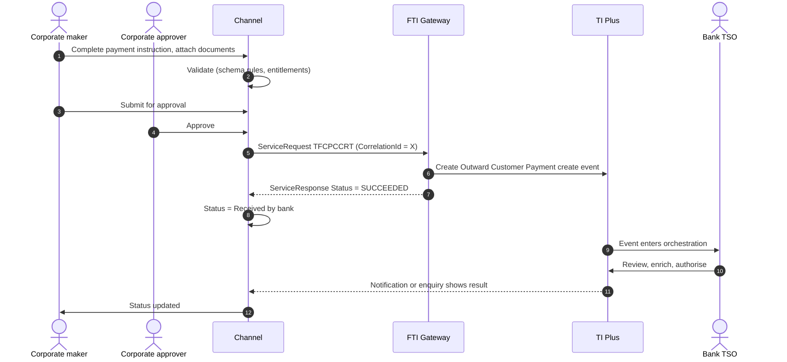

# Clean Payments, Cheques and Standing Orders

> Part of the product specifications. Index and shared rules: [README](README.md). Shared message bodies: [shared message shapes](shared-message-shapes.md). Catalogue: [01](../01-interface-catalogue.md) · Functional spec: [02](../02-functional-specification.md).

| | |
|---|---|
| Priority | P4 |
| Customer role | Ordering customer (remitter) |
| TI product code (`Context.Product`) | `CPC` **[Assumption – confirm in TI]** |
| Messages | 9 |

## 1. Purpose and scope

Trade-related **clean payments** (customer payments, cheques, standing orders) are processed in TI like other trade events. The customer instructs an outward payment or cheque, or sets up a standing order. Inward payment and inward cheque messages record funds received and are bank-side.

Out of scope: Domestic payments handled by the bank's payment hub, and bulk payroll.

> **Reading guide.** Field names, lengths and enumerations come from `sources/xsd_element_docs/`. Statements marked **[Proposed]** or **[Assumption]** are design decisions or guesses that the interface documents cannot confirm. Names are copied exactly from the schema, including its inconsistencies in capitalisation and spelling.

## 2. Messages

| Message | Kind | Creates in TI | Channel exposure | Phase | Body |
|---|---|---|---|---|---|
| `TFCPCCRT` | Create / issue | Outward Customer Payment create event | Customer | 5 | [Shape: Customer payment](shared-message-shapes.md#shape-customer-payment) |
| `TFCPHCRT` | Create / issue | Outward Cheque create event | Customer | 5 | [Shape: Customer payment](shared-message-shapes.md#shape-customer-payment) |
| `TFCPSCRT` | Create / issue | Standing Order create event | Customer | 5 | [Shape: Customer payment](shared-message-shapes.md#shape-customer-payment) (+diff) |
| `TFCPICRT` | Create / issue | Inward Customer Payment create event | Bank-side | - | [Shape: Customer payment](shared-message-shapes.md#shape-customer-payment) |
| `TFCPOCOR` | Correspondence | Outward Customer Payment correspondence event | Customer | 5 | [Shape: Correspondence](shared-message-shapes.md#shape-correspondence) |
| `TFCHOCOR` | Correspondence | Outward Cheque correspondence event | Customer | 5 | [Shape: Correspondence](shared-message-shapes.md#shape-correspondence) |
| `TFCSOCOR` | Correspondence | Standing Order correspondence event | Customer | 5 | [Shape: Correspondence](shared-message-shapes.md#shape-correspondence) |
| `TFCPICOR` | Correspondence | Inward Customer Payment correspondence event | Bank-side | - | [Shape: Correspondence](shared-message-shapes.md#shape-correspondence) |
| `TFCHICOR` | Correspondence | Inward Cheque correspondence event | Bank-side | - | [Shape: Correspondence](shared-message-shapes.md#shape-correspondence) |

**Exposure key.** *Customer* – the corporate starts or answers it in the channel. *Review* – schema description does not make the sender clear; confirm with the TI team before exposing. *Bank-side* – raised by the bank or an interbank counterparty; do not expose to customers.

## 3. Business scenario

The customer pays a foreign supplier USD 15,000: ordering party and account, amount (in the remitter's or beneficiary's currency, `AmountBasis`), value date, beneficiary and bank (BIC or clearing ID), intermediary bank, charges (`OurChargesFor`, `BenChargesFor`), payment method, instruction codes, and purpose. The TSO checks sanctions and FX and sends the payment.

**Outward payment**



## 4. Preconditions

1. Customer enabled for `CPC` and has a remitter account.
2. Beneficiary is in the address book or entered with bank details.
3. Sanctions screening may delay execution (bank-side).

## 5. Screens

A single-page payment form with a beneficiary picker.

| Step | Section | Fields (schema element) |
|---|---|---|
| 1 | **Remitter** | `OrderingParty`, `Remitter`, `RemitterAccount`, `RemitterOtherAccNo`, charges account `RemitterChargeAcc` |
| 2 | **Amount** | `RemitterAmount`, `BeneficiaryAmount`, `InstructedAmount`, `AmountBasis`, `ExchangeRate` (display), `PaymentDate`, `ReceiveDate`, `FXContractNo` |
| 3 | **Beneficiary** | `Beneficiary`, `BenAccountNo`, `BeneficiaryAccount`, `BenPaymentDetails` |
| 4 | **Banks** | `BeneficiaryBank`, `BeneficiaryBankId`, `IntermediaryBank`, `IntermediaryBankId`, `Nostro` |
| 5 | **Method and charges** | `PaymentMethod`, `SettlesBy`, `InstructionCode1..4`, `OurChargesFor`, `BenChargesFor`, `PreferredChargeCcy` |
| 6 | **Instructions** | `Instructions` |
| 7 | **Standing order (only)** | `NumberOfPayments`, `Freq`, `DayInMonth`, `NextPaymentDate`, `FinalPayment`, `StOrderAmtFlag` |
| 8 | **Review and submit** |  |

> **[Proposed] Fields hidden from the customer or set by configuration.** `Context.Team`, `Context.Step`, `Context.ExchangeNonAutoComplete`, `Context.BehalfOfBranch*`, `ExternalReview`, `ProvisionalFlags`, `BankCodes`, `ContinueEvent`, `Provisional`, `AutoCreateFollowOnEvent`, `FinalWording`, `TakeonExtra`, `InternalMasterRefSequence`, `OutstandingAmount`, `OutstandingAdditionalAmount`, `OriginalMasterReference`, `PreallocatedNo`. They affect routing, bank processing or data take-on, and should be set by channel configuration or left to TI defaults. Confirm each with the TI team (02, Q10). Also `Nostro` (bank-selected) and `SpecialFields`.

## 6. Primary message `TFCPCCRT`

Primary instruction of this product. Creates: Outward Customer Payment create event.

### 6.1 Context

| Element | Value |
|---|---|
| `Branch` | The booking branch from the corporate configuration. |
| `Customer` | The customer's TI mnemonic (max 20). |
| `Product` | `CPC` **[Assumption]** |
| `Event` | Normally implied by the message name. Leave empty unless the TI team asks for it. **[Assumption]** |
| `TheirReference` | Customer's own reference (max 34). |
| `OurReference` / `MasterRef` | Empty: TI creates a payment master for each instruction. |

The remaining `Context` elements (`Team`, `Step`, `BehalfOfBranch*`, `TemplateIdentifier`, `EventReference`, `ExchangeNonAutoComplete`, `SubsidiaryMasterPrefixAndSerial`) are set by configuration. See [README](README.md#common-blocks-in-every-message).

### 6.2 Channel-managed elements

| Element | Value |
|---|---|
| `eBankMasterRef` / `EBankMasterRef` (max 20) | The channel's id for the master. Constant for every later event on it. |
| `eBankEvent` / `eBankEventRef` / `EBankEventRef` (max 20) | The channel's id for this event. Unique per instruction; the key for idempotent retries. |
| `EmbeddedItemss` | Inline attachments (`ID`, `AttachType`, `DocType`, `Description`, `FileName`, `DataStream`, `MimeType`, `DocumentFileName`); `IsCustomerAttachedDocument` = `Y`. |
| `DocumentsReceiveds` | References to documents already in the DMS, if the upload-first approach is chosen (02, Q8). |

**Capitalisation differs between messages** (`eBankMasterRef` in some, `EBankMasterRef` in others; `eBankEvent`, `eBankEventRef` and `EBankEventRef`). The channel generates names from the schema catalogue and must never hand-type them.

### 6.3 Field reference

All top-level elements, in schema order, then the nested structures and enumerations.

| Element | Type / length | Description |
|---|---|---|
| `Sender` | party |  |
| `OrderingParty` | party |  |
| `Remitter` | party |  |
| `RemitterAccount` | string 1–34 |  |
| `RemitterOtherAccNo` | string 1–34 | A 34 character field used to identify a specific account within SWIFT Party details. |
| `RemitterChargeAcc` | string 1–34 |  |
| `RemitterChargeOtherAcc` | string 1–34 |  |
| `Instructions` | string ≤222 |  |
| `RemitterAmount` | group | Amount Gateway pane. Note that this pane may have the currency included as part of the amount source or the currency may be entered separately. |
| `BeneficiaryAmount` | group | Amount Gateway pane. Note that this pane may have the currency included as part of the amount source or the currency may be entered separately. |
| `OurChargesFor` | string 1–1 | Our charges for. Available values: 'B'='Buyer', 'S'='Seller'. |
| `BenChargesFor` | string 1–1 | Beneficiary charges for. Available values: 'B'='Buyer', 'S'='Seller'. |
| `ReceiveDate` | date |  |
| `PaymentDate` | date |  |
| `PreferredChargeCcy` | string 1–3 | Currency Code. |
| `Beneficiary` | party |  |
| `BenAccountNo` | string 1–34 | A 34 character field used to identify a specific account within SWIFT Party details. |
| `BeneficiaryAccount` | string 1–34 |  |
| `BenPaymentDetails` | string ≤148 |  |
| `BeneficiaryBank` | party |  |
| `BeneficiaryBankId` | string 1–34 | A 34 character field used to identify a specific account within SWIFT Party details. |
| `IntermediaryBank` | party |  |
| `IntermediaryBankId` | string 1–34 | A 34 character field used to identify a specific account within SWIFT Party details. |
| `PaymentMethod` | string 2–2 | Transfer method. |
| `SettlesBy` | string 1–1 | Settles by. Available values: 'T'='Account transfer', 'A'='Acct at nostro/vostro', 'B'='Beneficiary bank', 'C'='Beneficiary bank with cover', 'X'='... |
| `InstructionCode1` | group | Instruction code 1. |
| `InstructionCode2` | group | Instruction code 2. |
| `InstructionCode3` | group | Instruction code 3. |
| `InstructionCode4` | group | Instruction code 4. |
| `InstructedAmount` | group | Amount Gateway pane. Note that this pane may have the currency included as part of the amount source or the currency may be entered separately. |
| `AmountBasis` | string 1–1 | starting point when working out amounts when FX deal involved. Either Remitter or Beneficiary. starting point when working out amounts when FX deal... |
| `ExchangeRate` | string | Exchange rate. |
| `BankCodes` | group |  |
| `eBankMasterRef` | string ≤20 | Unique reference meaningful to the sending system which applies to the master. |
| `eBankEventRef` | string ≤20 | Unique reference meaningful to the sending system which applies to this transaction. |
| `ProductType` | string ≤3 | TI Product type. |
| `SpecialFields` | group |  |
| `FXContractNo` | string 1–20 | e.g. Documentary Credit Number, FX contract number. |
| `AdditionalParties` | group | This contains the additional parties to a transaction. Only applicable for Issue/Create and Amend events. |
| `LicenseDetails` | group |  |
| `Nostro` | group |  |
| `AdditionalData` | group | Additional data for the event - where customization is not used the bank can attach details to the event which are mapped to the additional data he... |
| `ExtraData` | group |  |

#### Nested structures of `TFCPCCRT`

**`RemitterAmount`**

| Path | Type / length | Description |
|---|---|---|
| `RemitterAmount/Amount` | string ≤22 |  |
| `RemitterAmount/Currency` | string 1–3 | Currency. |

**`BeneficiaryAmount`**

| Path | Type / length | Description |
|---|---|---|
| `BeneficiaryAmount/Amount` | string ≤22 |  |
| `BeneficiaryAmount/Currency` | string 1–3 | Currency. |

**`InstructionCode1`**

| Path | Type / length | Description |
|---|---|---|
| `InstructionCode1/Code` | string ≤4 | Code. Available values: 'CHQB'='CHQB', 'CORT'='CORT', 'HOLD'='HOLD', 'INTC'='INTC', 'PHOB'='PHOB', 'PHOI'='... |
| `InstructionCode1/Text` | string ≤30 | Text. |

**`InstructionCode2`**

| Path | Type / length | Description |
|---|---|---|
| `InstructionCode2/Code` | string ≤4 | Code. Available values: 'CHQB'='CHQB', 'CORT'='CORT', 'HOLD'='HOLD', 'INTC'='INTC', 'PHOB'='PHOB', 'PHOI'='... |
| `InstructionCode2/Text` | string ≤30 | Text. |

**`InstructionCode3`**

| Path | Type / length | Description |
|---|---|---|
| `InstructionCode3/Code` | string ≤4 | Code. Available values: 'CHQB'='CHQB', 'CORT'='CORT', 'HOLD'='HOLD', 'INTC'='INTC', 'PHOB'='PHOB', 'PHOI'='... |
| `InstructionCode3/Text` | string ≤30 | Text. |

**`InstructionCode4`**

| Path | Type / length | Description |
|---|---|---|
| `InstructionCode4/Code` | string ≤4 | Code. Available values: 'CHQB'='CHQB', 'CORT'='CORT', 'HOLD'='HOLD', 'INTC'='INTC', 'PHOB'='PHOB', 'PHOI'='... |
| `InstructionCode4/Text` | string ≤30 | Text. |

**`InstructedAmount`**

| Path | Type / length | Description |
|---|---|---|
| `InstructedAmount/Amount` | string ≤22 |  |
| `InstructedAmount/Currency` | string 1–3 | Currency. |

**`BankCodes`**

| Path | Type / length | Description |
|---|---|---|
| `BankCodes/BankCode1` | string ≤4 |  |
| `BankCodes/BankCode2` | string ≤4 |  |
| `BankCodes/BankCode3` | string ≤4 |  |
| `BankCodes/BankCode4` | string ≤4 |  |
| `BankCodes/BankCode5` | string ≤4 |  |

**`SpecialFields`**

| Path | Type / length | Description |
|---|---|---|
| `SpecialFields/GW01` | string |  |
| `SpecialFields/GW02` | string |  |
| `SpecialFields/GW03` | string |  |
| `SpecialFields/GW04` | string |  |
| `SpecialFields/GW05` | string |  |

**`AdditionalParties`**

| Path | Type / length | Description |
|---|---|---|
| `AdditionalParties/AdditionalPartiesToAdd` | party ×n | Receives details of additional parties via the gateway. Mapped to and displayed under the Party list pane i... |

**`LicenseDetails`**

| Path | Type / length | Description |
|---|---|---|
| `LicenseDetails/LicenseDetail` | group ×n | Provides the link between a product (LC, Collection etc.) and a License. |
| `LicenseDetails/LicenseDetail/OurReference` | string 1–20 | e.g. Documentary Credit Number, FX contract number. |
| `LicenseDetails/LicenseDetail/EBankMasterRef` | string ≤20 |  |
| `LicenseDetails/LicenseDetail/AuthorityReference` | string ≤35 |  |
| `LicenseDetails/LicenseDetail/Number` | string ≤35 |  |
| `LicenseDetails/LicenseDetail/AllocatedAmount` | string ≤22 |  |
| `LicenseDetails/LicenseDetail/AllocatedCurrency` | string 1–3 |  |

**`Nostro`**

| Path | Type / length | Description |
|---|---|---|
| `Nostro/Branch` | string 1–8 | Code of the Main banking entity. |
| `Nostro/NostroCode` | string 1–6 | Nostro Code. |
| `Nostro/Customer` | string 1–20 | Customer mnemonic. |
| `Nostro/BOAccountNumber` | string 1–34 | Account number. |
| `Nostro/SwiftAddress` | string ≤14 | Swift Address. |

**`AdditionalData`**

| Path | Type / length | Description |
|---|---|---|
| `AdditionalData/DataItem` | group ×n | Receives "additional data" from Gateway, which are recorded as event notifications. |
| `AdditionalData/DataItem/Name` | string ≤50 |  |
| `AdditionalData/DataItem/Value` | string |  |


#### Enumerated values in `TFCPCCRT`

| Path | Allowed values |
|---|---|
| `OurChargesFor` | `B` Buyer; `S` Seller |
| `BenChargesFor` | `B` Buyer; `S` Seller |
| `SettlesBy` | `T` Account transfer; `A` Acct at nostro/vostro; `B` Beneficiary bank; `C` Beneficiary bank with cover; `X` Clearing ID; `I` Intermediary bank; `P` Intermediary with cover; `O` Other account |
| `InstructionCode1/Code` | `CHQB` CHQB; `CORT` CORT; `HOLD` HOLD; `INTC` INTC; `PHOB` PHOB; `PHOI` PHOI; `PHON` PHON; `REPA` REPA; `SDVA` SDVA; `TELB` TELB; `TELE` TELE; `TELI` TELI |
| `InstructionCode2/Code` | `CHQB` CHQB; `CORT` CORT; `HOLD` HOLD; `INTC` INTC; `PHOB` PHOB; `PHOI` PHOI; `PHON` PHON; `REPA` REPA; `SDVA` SDVA; `TELB` TELB; `TELE` TELE; `TELI` TELI |
| `InstructionCode3/Code` | `CHQB` CHQB; `CORT` CORT; `HOLD` HOLD; `INTC` INTC; `PHOB` PHOB; `PHOI` PHOI; `PHON` PHON; `REPA` REPA; `SDVA` SDVA; `TELB` TELB; `TELE` TELE; `TELI` TELI |
| `InstructionCode4/Code` | `CHQB` CHQB; `CORT` CORT; `HOLD` HOLD; `INTC` INTC; `PHOB` PHOB; `PHOI` PHOI; `PHON` PHON; `REPA` REPA; `SDVA` SDVA; `TELB` TELB; `TELE` TELE; `TELI` TELI |
| `AmountBasis` | `B` Beneficiary; `R` Remitter |


## 7. Other messages

### `TFCPHCRT` – Create outward cheque

| | |
|---|---|
| Creates in TI | Outward Cheque create event |
| Purpose (schema) | - |
| Channel exposure | Customer |
| Phase | 5 |

**Body:** [Shape: Customer payment](shared-message-shapes.md#shape-customer-payment).

### `TFCPSCRT` – Create standing order

| | |
|---|---|
| Creates in TI | Standing Order create event |
| Purpose (schema) | - |
| Channel exposure | Customer |
| Phase | 5 |

**Body:** [Shape: Customer payment](shared-message-shapes.md#shape-customer-payment) with differences.

* Adds: `NumberOfPayments`, `Freq`, `DayInMonth`, `NextPaymentDate`, `FinalPayment`, `StOrderAmtFlag`

| Element | Type / length | Description |
|---|---|---|
| `NumberOfPayments` | int | Integer with no domain restrictions. |
| `Freq` | group |  |
| `DayInMonth` | int | Integer with no domain restrictions. |
| `NextPaymentDate` | date |  |
| `FinalPayment` | date |  |
| `StOrderAmtFlag` | string 1–1 | the side used to work out payment amount in the case of an FX deal being present. either R- Remitter or B - Beneficiary. starting point when workin... |

**`Freq`**

| Path | Type / length | Description |
|---|---|---|
| `Freq/TenorDays` | int | Tenor element of the term. |
| `Freq/TenorPeriod` | string | Period. Available values: 'D'='Days', 'M'='Months', 'Q'='Quarters', 'W'='Weeks', 'Y'='Years'. |


### `TFCPICRT` – Create inward customer payment

| | |
|---|---|
| Creates in TI | Inward Customer Payment create event |
| Purpose (schema) | - |
| Channel exposure | Bank-side |
| Phase | - |

**Body:** [Shape: Customer payment](shared-message-shapes.md#shape-customer-payment).

### `TFCPOCOR` – Outward payment correspondence

| | |
|---|---|
| Creates in TI | Outward Customer Payment correspondence event |
| Purpose (schema) | - |
| Channel exposure | Customer |
| Phase | 5 |

**Body:** [Shape: Correspondence](shared-message-shapes.md#shape-correspondence).

### `TFCHOCOR` – Outward cheque correspondence

| | |
|---|---|
| Creates in TI | Outward Cheque correspondence event |
| Purpose (schema) | - |
| Channel exposure | Customer |
| Phase | 5 |

**Body:** [Shape: Correspondence](shared-message-shapes.md#shape-correspondence).

### `TFCSOCOR` – Standing order correspondence

| | |
|---|---|
| Creates in TI | Standing Order correspondence event |
| Purpose (schema) | - |
| Channel exposure | Customer |
| Phase | 5 |

**Body:** [Shape: Correspondence](shared-message-shapes.md#shape-correspondence).

### `TFCPICOR` – Inward payment correspondence

| | |
|---|---|
| Creates in TI | Inward Customer Payment correspondence event |
| Purpose (schema) | - |
| Channel exposure | Bank-side |
| Phase | - |

**Body:** [Shape: Correspondence](shared-message-shapes.md#shape-correspondence).

### `TFCHICOR` – Inward cheque correspondence

| | |
|---|---|
| Creates in TI | Inward Cheque correspondence event |
| Purpose (schema) | - |
| Channel exposure | Bank-side |
| Phase | - |

**Body:** [Shape: Correspondence](shared-message-shapes.md#shape-correspondence).

## 8. Validation rules

### 8.1 Rules supported directly by the schema

Lengths, data types and the allowed values of coded fields are in the tables in sections 6 and 7 and are the source for the channel's client and server validators. Dates are ISO `xsd:date`. Boolean elements carry `Y` or `N`. Amounts are strings (maximum 22 characters); agree the decimal format with the TI team. * `OurChargesFor` and `BenChargesFor` ∈ {`B` buyer, `S` seller} in the schema; map to the usual SHA/OUR/BEN choice with the TI team. **[Assumption]**
* `SettlesBy` ∈ {`T` account transfer, `A` account at nostro/vostro, `B` beneficiary bank, `C` beneficiary bank with cover, `X` clearing ID, `I` intermediary bank}.
* `AmountBasis` ∈ {`B` beneficiary, `R` remitter}.

### 8.2 Business rules to apply in the channel

Normal practice for this product and the checks a TSO would otherwise perform by hand. **[Proposed]**: switch each on or off per bank policy.

| # | Rule |
|---|---|
| V1 | Remitter account belongs to the customer and has funds (TI checks). |
| V2 | Value date is a business day for both currencies; cut-off times apply. |
| V3 | Beneficiary bank is identified by BIC or clearing ID; IBAN validated where the country uses it. |
| V4 | Payments above the customer's limit go to additional approval. |
| V5 | Beneficiary name and country are checked against the sanctions list by the bank, not the channel. |
| V6 | A standing order has a number of payments or an end date, and a frequency. |

### 8.3 Minimum content for a usable instruction

**[Proposed]** `OrderingParty`, `RemitterAccount`, amount and currency, `PaymentDate`, `Beneficiary`, `BenAccountNo`, `BeneficiaryBank`, charges.

## 9. Illustrative requests

Values are invented. Element names, prefixes and order follow `sources/example_xml/`. Elements not shown are omitted, which the schema allows for optional elements. **Test against the gateway before use.**

**`TFCPCCRT`**

```xml
<?xml version="1.0" standalone="yes"?>
<ServiceRequest xmlns:xsi="http://www.w3.org/2001/XMLSchema-instance"
                xmlns:m="urn:messages.service.ti.apps.tiplus2.misys.com"
                xmlns:c="urn:common.service.ti.apps.tiplus2.misys.com"
                xmlns="urn:control.services.tiplus2.misys.com">
  <RequestHeader>
    <Service>TI</Service>
    <Operation>TFCPCCRT</Operation>
    <Credentials><Name>CHANNEL_SVC</Name><Password>********</Password></Credentials>
    <SourceSystem>CORPCHANNEL</SourceSystem>
    <TargetSystem>TI</TargetSystem>
    <CorrelationId>9b1f4c2e-5a0d-4c47-9f3e-2c1d7a6b8e10</CorrelationId>
    <CreationDate>2026-10-18T09:30:00Z</CreationDate>
  </RequestHeader>
  <m:TFCPCCRT>
    <m:Context>
      <c:Branch>HOBR</c:Branch>
      <c:Customer>ACMEIMP</c:Customer>
      <c:Product>CPC</c:Product>
      <c:TheirReference>INV-77120</c:TheirReference>
    </m:Context>
    <m:OrderingParty>
      <c:Customer>ACMEIMP</c:Customer>
    </m:OrderingParty>
    <m:Remitter>
      <c:Customer>ACMEIMP</c:Customer>
    </m:Remitter>
    <m:RemitterAccount>1234567890</m:RemitterAccount>
    <m:RemitterAmount>
      <c:Amount>15000.00</c:Amount>
      <c:Currency>USD</c:Currency>
    </m:RemitterAmount>
    <m:BeneficiaryAmount>
      <c:Currency>USD</c:Currency>
    </m:BeneficiaryAmount>
    <m:OurChargesFor>B</m:OurChargesFor>
    <m:BenChargesFor>S</m:BenChargesFor>
    <m:PaymentDate>2026-10-20</m:PaymentDate>
    <m:Beneficiary>
      <c:NameAddress>SHENZHEN WIDGETS CO LTD
88 NANSHAN AVENUE
SHENZHEN</c:NameAddress>
      <c:Country>CN</c:Country>
    </m:Beneficiary>
    <m:BenAccountNo>6222000011112222</m:BenAccountNo>
    <m:BeneficiaryBank>
      <c:SwiftAddress>ICBKCNBJXXX</c:SwiftAddress>
    </m:BeneficiaryBank>
    <m:eBankMasterRef>CH-CPC-000301</m:eBankMasterRef>
    <m:eBankEventRef>CH-CPC-000301-01</m:eBankEventRef>
  </m:TFCPCCRT>
</ServiceRequest>
```

## 10. Response handling and tracking

| `Status` | Channel behaviour |
|---|---|
| `SUCCEEDED` | TI accepted the message and created the event. Mark `ReceivedByBank`; keep `Warning` / `Info` texts. |
| `FAILED` | TI rejected the message. Show `Details.Error` to the maker and return the draft. No automatic retry. |
| `UNAVAILABLE` / timeout | Keep in the outbox, retry with back-off, and confirm by enquiry (`eBankEventRef`) before each re-send so no second event is created. |

Rules shared by every product are in [README – Common behaviour](README.md#common-behaviour).

*Submitted* → *Under review* → *Sent* → *Credited* (if confirmation is available). Show the payment reference and value date.

## 11. Exceptions

| Scenario | Handling |
|---|---|
| Sanctions hit | The bank holds the payment; the channel shows *Under review* without detail. |
| Beneficiary bank rejects | Return reason appears as a bank message. |
| Cut-off passed | Warn before submission and show the next value date. |
| Gateway `FAILED`, `UNAVAILABLE`, timeout, duplicate click | As in [README – Common behaviour](README.md#common-behaviour). |

## 12. Acceptance criteria

1. A payment, cheque or standing order can be created and one message is sent per approval.
2. Beneficiary and bank data validate.
3. Status updates to *Sent*.
4. Every step is in the audit trail with user, time and `CorrelationId`.
5. The stored request validates against the schema rules in 8.1 and matches the structure in section 9.

## 13. Open items

| # | Item |
|---|---|
| PAY-1 | Is the channel used for clean payments, or only the bank's payment hub? |
| PAY-2 | Confirm charge-bearer code mapping. |
| PAY-3 | Confirm whether cheque and standing-order products are used in TI. |
