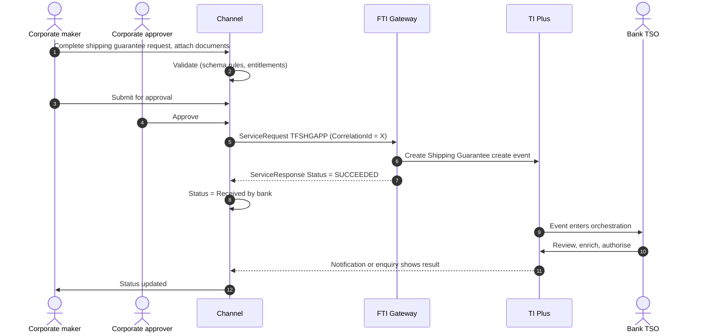

# Shipping Guarantee

> Part of the product specifications. Index and shared rules: [README](README.md). Shared message bodies: [shared message shapes](shared-message-shapes.md). Catalogue: [01](../01-interface-catalogue.md) · Functional spec: [02](../02-functional-specification.md).

| | |
|---|---|
| Priority | P1, wave 3 |
| Customer role | Importer (applicant under an LC, or drawee under a collection) |
| TI product code (`Context.Product`) | `SHG` **[Assumption – confirm in TI]** |
| Messages | 2 |

## 1. Purpose and scope

When goods reach the port before the original shipping documents, the importer cannot take delivery. A **shipping guarantee** is the bank's undertaking to the shipping company that it will deliver the original bill of lading when it arrives, so the carrier can release the goods. It is requested against an existing LC or collection.

Out of scope: LC or collection set-up (see their documents) and release of original documents.

> **Reading guide.** Field names, lengths and enumerations come from `sources/xsd_element_docs/`. Statements marked **[Proposed]** or **[Assumption]** are design decisions or guesses that the interface documents cannot confirm. Names are copied exactly from the schema, including its inconsistencies in capitalisation and spelling.

## 2. Messages

| Message | Kind | Creates in TI | Channel exposure | Phase | Body |
|---|---|---|---|---|---|
| `TFSHGAPP` | Create / issue | Shipping Guarantee create event | Customer | 3 | own |
| `TFSHGCOR` | Correspondence | Shipping Guarantee correspondence event | Customer | 3 | [Shape: Correspondence](shared-message-shapes.md#shape-correspondence) |

**Exposure key.** *Customer* – the corporate starts or answers it in the channel. *Review* – schema description does not make the sender clear; confirm with the TI team before exposing. *Bank-side* – raised by the bank or an interbank counterparty; do not expose to customers.

## 3. Business scenario

The importer sees that the vessel has arrived but the documents have not. From the LC or collection screen it chooses *Request shipping guarantee*, enters the amount (normally the invoice value), the goods documents of title (bill of lading number, vessel, shipper), notes for the consignee and the shipping company, and the fee account. TI creates the shipping guarantee master linked to the originating transaction; the TSO issues it, and the bank hands the guarantee to the importer or the carrier.

**Request**



## 4. Preconditions

1. An LC (`ILC`) or inward collection (`IDC`) exists and is live. The channel knows its reference as `OriginatingTransaction`.
2. The customer is entitled to `SHG`.
3. The charge/fee account is the customer's.

## 5. Screens

Single-page form launched from the originating transaction.

| Step | Section | Fields (schema element) |
|---|---|---|
| 1 | **Originating transaction** | `OriginatingTransaction` (read-only, pre-filled); applicant/importer `Importer` |
| 2 | **Guarantee** | `GuaranteeAmount` (amount, currency); dates `ApplicationDate`, `IssueDate`, `ExpiryDate`; advice method `AdviceMethod`; `MultipleDocs` |
| 3 | **Goods and carrier** | `DocumentOfTitles` (repeating: bill of lading or airway bill details); `ShippingParty`; `NotesToConsignee`; `NotesToShippingCo` |
| 4 | **Conditions** | `AdditionalConditions` |
| 5 | **Fees and cover** | `FeeAccountNumber`, `ChargeAccount`, `PrincipalAccount`, `PrincipalAccountNumber`, `MarginDeposit`, `Collateral` |
| 6 | **Attachments and submit** | Copy of bill of lading, invoice; review and submit |

> **[Proposed] Fields hidden from the customer or set by configuration.** `Context.Team`, `Context.Step`, `Context.ExchangeNonAutoComplete`, `Context.BehalfOfBranch*`, `ExternalReview`, `ProvisionalFlags`, `BankCodes`, `ContinueEvent`, `Provisional`, `AutoCreateFollowOnEvent`, `FinalWording`, `TakeonExtra`, `InternalMasterRefSequence`, `OutstandingAmount`, `OutstandingAdditionalAmount`, `OriginalMasterReference`, `PreallocatedNo`. They affect routing, bank processing or data take-on, and should be set by channel configuration or left to TI defaults. Confirm each with the TI team (02, Q10). Also `SpecialFields`, `AdditionalParties` (unless the bank asks for named parties).

## 6. Primary message `TFSHGAPP`

Sent by the importer such as Applicant under an ILC or Drawee under a Collection to the Bank requesting the issuance of a Shipping Guarantee. Creates: Shipping Guarantee create event.

### 6.1 Context

| Element | Value |
|---|---|
| `Branch` | The booking branch from the corporate configuration. |
| `Customer` | The customer's TI mnemonic (max 20). |
| `Product` | `SHG` **[Assumption]** |
| `Event` | Normally implied by the message name. Leave empty unless the TI team asks for it. **[Assumption]** |
| `TheirReference` | Customer's own reference (max 34). |
| `OurReference` / `MasterRef` | Empty: TI creates a new shipping guarantee master and links it through `OriginatingTransaction`. |

The remaining `Context` elements (`Team`, `Step`, `BehalfOfBranch*`, `TemplateIdentifier`, `EventReference`, `ExchangeNonAutoComplete`, `SubsidiaryMasterPrefixAndSerial`) are set by configuration. See [README](README.md#common-blocks-in-every-message).

### 6.2 Channel-managed elements

| Element | Value |
|---|---|
| `eBankMasterRef` / `EBankMasterRef` (max 20) | The channel's id for the master. Constant for every later event on it. |
| `eBankEvent` / `eBankEventRef` / `EBankEventRef` (max 20) | The channel's id for this event. Unique per instruction; the key for idempotent retries. |
| `EmbeddedItemss` | Inline attachments (`ID`, `AttachType`, `DocType`, `Description`, `FileName`, `DataStream`, `MimeType`, `DocumentFileName`); `IsCustomerAttachedDocument` = `Y`. |
| `DocumentsReceiveds` | References to documents already in the DMS, if the upload-first approach is chosen (02, Q8). |

**Capitalisation differs between messages** (`eBankMasterRef` in some, `EBankMasterRef` in others; `eBankEvent`, `eBankEventRef` and `EBankEventRef`). The channel generates names from the schema catalogue and must never hand-type them.

### 6.3 Field reference

All top-level elements, in schema order, then the nested structures and enumerations.

| Element | Type / length | Description |
|---|---|---|
| `ApplicationDate` | date | Application date of the shipping guarantee. |
| `IssueDate` | date | Issue date of shipping guarantee. |
| `ExpiryDate` | date | Issue date of shipping guarantee. |
| `MultipleDocs` | boolean | Multiple shipping documents - Y = Multiple documents - N = Single document. Boolean values. |
| `AdviceMethod` | string 1–1 | Code for transfer method format, defined by its domain list. Code for transfer method format, defined by its domain list. Available values: 'e'='E-... |
| `Importer` | party | The importer e.g the applicant or drawee requesting the shipping guarantee. |
| `ShippingParty` | party | The shipping agent. |
| `GuaranteeAmount` | group | Amount of the shipping guarantee. |
| `OriginatingTransaction` | string 1–20 | The Master to which this shipping guarantee relates. |
| `DocumentOfTitles` | group |  |
| `AdditionalConditions` | string ≤10000 | Additional conditions. |
| `NotesToConsignee` | string ≤10000 | Notes for the consignee. |
| `NotesToShippingCo` | string ≤10000 | Notes for Shipping company. |
| `eBankMasterRef` | string ≤20 | Unique reference meaningful to the sending system which applies to the master. |
| `eBankEventRef` | string ≤20 | Unique reference meaningful to the sending system which applies to this transaction. |
| `SpecialFields` | group | Special gateway fields - ***Reserved***. |
| `PrincipalAccountNumber` | string 1–34 |  |
| `FeeAccountNumber` | string 1–34 |  |
| `ChargeAccount` | string 1–34 | The account number from which charges should be taken. |
| `PrincipalAccount` | string 1–34 | Principal account. Creates an action item for the user to create master settlement instructions or advise to third parties as required. |
| `AdditionalParties` | group | This contains the additional parties to a transaction. Only applicable for Issue/Create and Amend events. |
| `MarginDeposit` | group |  |
| `Collateral` | group |  |
| `AdditionalData` | group | Additional data for the event - where customization is not used the bank can attach details to the event which are mapped to the additional data he... |
| `ExtraData` | group |  |

#### Nested structures of `TFSHGAPP`

**`GuaranteeAmount`**

| Path | Type / length | Description |
|---|---|---|
| `GuaranteeAmount/Amount` | string ≤22 |  |
| `GuaranteeAmount/Currency` | string 1–3 | Currency. |

**`DocumentOfTitles`**

| Path | Type / length | Description |
|---|---|---|
| `DocumentOfTitles/DocumentOfTitle` | group ×n | Details of each Document of Title associated with the shipping guarantee. The bank is able to define the da... |
| `DocumentOfTitles/DocumentOfTitle/DoTType` | string ≤3 | Document type code defined for the Document of title - e.g. BOL - Bill of lading. |
| `DocumentOfTitles/DocumentOfTitle/DoTShipAmt` | string | Shipment amount. |
| `DocumentOfTitles/DocumentOfTitle/DoTShipCcy` | string ≤3 | Currency. |
| `DocumentOfTitles/DocumentOfTitle/DoTReference` | string 1–35 | Reference. |
| `DocumentOfTitles/DocumentOfTitle/DoTField1` | string ≤52000 | Document of Title details - Field 1. |
| `DocumentOfTitles/DocumentOfTitle/DoTField2` | string ≤52000 | Document of Title details - Field 2. |
| `DocumentOfTitles/DocumentOfTitle/DoTField3` | string ≤52000 | Document of Title details - Field 3. |
| `DocumentOfTitles/DocumentOfTitle/DoTField4` | string ≤52000 | Document of Title details - Field 4. |
| `DocumentOfTitles/DocumentOfTitle/DoTField5` | string ≤52000 | Document of Title details - Field 5. |
| `DocumentOfTitles/DocumentOfTitle/DoTField6` | string ≤52000 | Document of Title details - Field 6. |
| `DocumentOfTitles/DocumentOfTitle/DoTField7` | string ≤52000 | Document of Title details - Field 7. |
| `DocumentOfTitles/DocumentOfTitle/DoTField8` | string ≤52000 | Document of Title details - Field 8. |
| `DocumentOfTitles/DocumentOfTitle/DoTField9` | string ≤52000 | Document of Title details - Field 9. |
| `DocumentOfTitles/DocumentOfTitle/DoTField110` | string ≤52000 | Document of Title details - Field 10. |

**`SpecialFields`**

| Path | Type / length | Description |
|---|---|---|
| `SpecialFields/GW01` | string |  |
| `SpecialFields/GW02` | string |  |
| `SpecialFields/GW03` | string |  |
| `SpecialFields/GW04` | string |  |
| `SpecialFields/GW05` | string |  |

**`AdditionalParties`**

| Path | Type / length | Description |
|---|---|---|
| `AdditionalParties/AdditionalPartiesToAdd` | party ×n | Receives details of additional parties via the gateway. Mapped to and displayed under the Party list pane i... |

**`MarginDeposit`**

| Path | Type / length | Description |
|---|---|---|
| `MarginDeposit/AmountFieldCode` | string 3–10 | Code for a field (real or calculated) in an event (used in postings rules). |
| `MarginDeposit/Account` | string 1–34 | Account number. |
| `MarginDeposit/Code` | string 1–8 |  |
| `MarginDeposit/Description` | string ≤140 |  |
| `MarginDeposit/MarginAmount` | group | Amount Gateway pane. Note that this pane may have the currency included as part of the amount source or the... |
| `MarginDeposit/MarginAmount/Amount` | string ≤22 |  |
| `MarginDeposit/MarginAmount/Currency` | string 1–3 | Currency. |
| `MarginDeposit/Percentage` | decimal(17,2) | Percentage. |

**`Collateral`**

| Path | Type / length | Description |
|---|---|---|
| `Collateral/CollateralDetail` | group ×n |  |
| `Collateral/CollateralDetail/Code` | string 1–8 |  |
| `Collateral/CollateralDetail/Description` | string ≤25 |  |
| `Collateral/CollateralDetail/Amount` | long | Amount. |
| `Collateral/CollateralDetail/Currency` | string 1–3 | Currency mnemonic. |
| `Collateral/CollateralDetail/OtherDetailsType` | string | Available values: 'G'='General', 'S'='Specific'. |
| `Collateral/CollateralDetail/CustomerDDA` | string ≤25 |  |
| `Collateral/CollateralDetail/OtherPledge` | string ≤50 |  |
| `Collateral/CollateralDetail/Surety` | string ≤50 |  |

**`AdditionalData`**

| Path | Type / length | Description |
|---|---|---|
| `AdditionalData/DataItem` | group ×n | Receives "additional data" from Gateway, which are recorded as event notifications. |
| `AdditionalData/DataItem/Name` | string ≤50 |  |
| `AdditionalData/DataItem/Value` | string |  |


#### Enumerated values in `TFSHGAPP`

| Path | Allowed values |
|---|---|
| `AdviceMethod` | `e` E-mail; `o` E-mail Account Officer; `5` Fax; `a` Gateway; `i` Internal; `1` Mail; `6` No doc required; `4` SWIFT; `2` Telex; `3` Telex via SWIFT |
| `Collateral/CollateralDetail/OtherDetailsType` | `G` General; `S` Specific |


## 7. Other messages

### `TFSHGCOR` – Correspondence

| | |
|---|---|
| Creates in TI | Shipping Guarantee correspondence event |
| Purpose (schema) | - |
| Channel exposure | Customer |
| Phase | 3 |

**Body:** [Shape: Correspondence](shared-message-shapes.md#shape-correspondence).

## 8. Validation rules

### 8.1 Rules supported directly by the schema

Lengths, data types and the allowed values of coded fields are in the tables in sections 6 and 7 and are the source for the channel's client and server validators. Dates are ISO `xsd:date`. Boolean elements carry `Y` or `N`. Amounts are strings (maximum 22 characters); agree the decimal format with the TI team. * `AdviceMethod` ∈ {`e` e-mail, `o` e-mail account officer, `5` fax, `a` gateway, `i` internal, `1` mail, `6` no document required, `4` SWIFT, `2` telex, `3` telex via SWIFT}. For a customer-requested shipping guarantee `i` or `6` is typical. **[Assumption]**
* `NotesToConsignee`, `NotesToShippingCo` and `AdditionalConditions` are each ≤ 10,000 characters.

### 8.2 Business rules to apply in the channel

Normal practice for this product and the checks a TSO would otherwise perform by hand. **[Proposed]**: switch each on or off per bank policy.

| # | Rule |
|---|---|
| V1 | `OriginatingTransaction` exists, is live, belongs to the customer, and its product is `ILC` or `IDC`. |
| V2 | `GuaranteeAmount` ≤ the outstanding value of the originating transaction (usually 100–110%). **[Proposed]** |
| V3 | `ExpiryDate` is after `IssueDate` and not later than the bank's maximum validity (configuration). |
| V4 | At least one `DocumentOfTitle` with a document number and carrier. |
| V5 | No second active shipping guarantee for the same bill of lading unless `MultipleDocs` = `Y`. **[Proposed]** |
| V6 | Fee and principal accounts belong to the customer. |

### 8.3 Minimum content for a usable instruction

**[Proposed]** `Importer`, `OriginatingTransaction`, `GuaranteeAmount`, `DocumentOfTitles` (at least one), `ShippingParty`, `FeeAccountNumber` or `ChargeAccount`.

## 9. Illustrative requests

Values are invented. Element names, prefixes and order follow `sources/example_xml/`. Elements not shown are omitted, which the schema allows for optional elements. **Test against the gateway before use.**

**`TFSHGAPP`**

```xml
<?xml version="1.0" standalone="yes"?>
<ServiceRequest xmlns:xsi="http://www.w3.org/2001/XMLSchema-instance"
                xmlns:m="urn:messages.service.ti.apps.tiplus2.misys.com"
                xmlns:c="urn:common.service.ti.apps.tiplus2.misys.com"
                xmlns="urn:control.services.tiplus2.misys.com">
  <RequestHeader>
    <Service>TI</Service>
    <Operation>TFSHGAPP</Operation>
    <Credentials><Name>CHANNEL_SVC</Name><Password>********</Password></Credentials>
    <SourceSystem>CORPCHANNEL</SourceSystem>
    <TargetSystem>TI</TargetSystem>
    <CorrelationId>9b1f4c2e-5a0d-4c47-9f3e-2c1d7a6b8e10</CorrelationId>
    <CreationDate>2026-10-18T09:30:00Z</CreationDate>
  </RequestHeader>
  <m:TFSHGAPP>
    <m:Context>
      <c:Branch>HOBR</c:Branch>
      <c:Customer>ACMEIMP</c:Customer>
      <c:Product>SHG</c:Product>
      <c:TheirReference>SHG-REQ-2026-04</c:TheirReference>
    </m:Context>
    <m:ApplicationDate>2026-10-18</m:ApplicationDate>
    <m:ExpiryDate>2027-01-18</m:ExpiryDate>
    <m:MultipleDocs>N</m:MultipleDocs>
    <m:AdviceMethod>i</m:AdviceMethod>
    <m:Importer>
      <c:Customer>ACMEIMP</c:Customer>
    </m:Importer>
    <m:ShippingParty>
      <c:NameAddress>OCEAN LINE AGENCIES
TANJUNG PRIOK
JAKARTA</c:NameAddress>
    </m:ShippingParty>
    <m:GuaranteeAmount>
      <c:Amount>250000.00</c:Amount>
      <c:Currency>USD</c:Currency>
    </m:GuaranteeAmount>
    <m:OriginatingTransaction>ILC2600123</m:OriginatingTransaction>
    <m:NotesToShippingCo>Please release 5000 units ex MV OCEAN STAR against this guarantee.</m:NotesToShippingCo>
    <m:eBankMasterRef>CH-SHG-000004</m:eBankMasterRef>
    <m:eBankEventRef>CH-SHG-000004-01</m:eBankEventRef>
    <m:FeeAccountNumber>1234567890</m:FeeAccountNumber>
  </m:TFSHGAPP>
</ServiceRequest>
```

## 10. Response handling and tracking

| `Status` | Channel behaviour |
|---|---|
| `SUCCEEDED` | TI accepted the message and created the event. Mark `ReceivedByBank`; keep `Warning` / `Info` texts. |
| `FAILED` | TI rejected the message. Show `Details.Error` to the maker and return the draft. No automatic retry. |
| `UNAVAILABLE` / timeout | Keep in the outbox, retry with back-off, and confirm by enquiry (`eBankEventRef`) before each re-send so no second event is created. |

Rules shared by every product are in [README – Common behaviour](README.md#common-behaviour).

Status follows the shipping guarantee master. Show the link to the originating LC or collection and the expiry. The channel should also remind the importer to settle the guarantee once the original documents arrive (documents presented under the LC).

## 11. Exceptions

| Scenario | Handling |
|---|---|
| Documents arrive before the guarantee is issued | Allow the customer to cancel the draft; if already submitted, send `TFSHGCOR` to request withdrawal. |
| Guarantee amount exceeds LC balance | Block submission with a clear message. |
| Shipping company rejects the guarantee wording | Handled by the bank; the customer answers a bank query via correspondence. |
| Gateway `FAILED`, `UNAVAILABLE`, timeout, duplicate click | As in [README – Common behaviour](README.md#common-behaviour). |

## 12. Acceptance criteria

1. Request is possible only from a live LC or collection belonging to the customer.
2. Document-of-title data is captured and sent in `DocumentOfTitles`.
3. One `TFSHGAPP` per approved request, no duplicates.
4. Customer sees the shipping guarantee master linked to the LC.
5. Every step is in the audit trail with user, time and `CorrelationId`.
6. The stored request validates against the schema rules in 8.1 and matches the structure in section 9.

## 13. Open items

| # | Item |
|---|---|
| SHG-1 | Confirm that `Product` code `SHG` and the master link behaviour match TI. |
| SHG-2 | Confirm default `AdviceMethod`, and whether the guarantee is released to the customer or the carrier. |
| SHG-3 | Confirm structure of `DocumentOfTitles` (see schema) and what the TSO expects in `SpecialFields`. |
