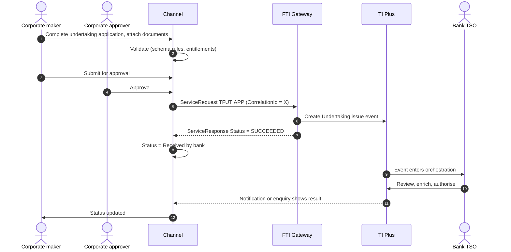
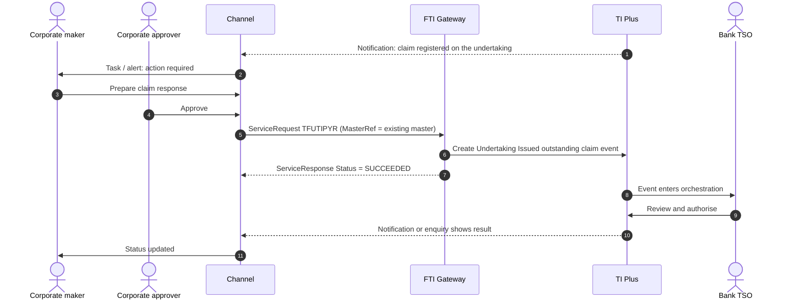

# Undertaking Issued (Guarantee / Standby, new model)

> Part of the product specifications. Index and shared rules: [README](README.md). Shared message bodies: [shared message shapes](shared-message-shapes.md). Catalogue: [01](../01-interface-catalogue.md) · Functional spec: [02](../02-functional-specification.md).

| | |
|---|---|
| Priority | P1, wave 2 (decide IGT/ISB vs UTI first) |
| Customer role | Applicant (principal) |
| TI product code (`Context.Product`) | `UTI` **[Assumption – confirm in TI]** |
| Messages | 6 |

## 1. Purpose and scope

`UTI` is the **ISO 20022-style undertaking model** in TI: one product for demand guarantees, standby LCs, dependent undertakings and counter-undertakings, with the terms held in a structured `UndertakingDetails` block (including a counter-undertaking received and one to send) instead of the Import LC field set. It is the strategic model for new guarantee business. This specification covers the customer-facing messages. If the bank offers both IGT/ISB and UTI, the channel should expose one of them per instrument type to avoid duplicated screens.

Out of scope: data take-on, and the older Import Guarantee / Standby messages (see their documents).

> **Reading guide.** Field names, lengths and enumerations come from `sources/xsd_element_docs/`. Statements marked **[Proposed]** or **[Assumption]** are design decisions or guesses that the interface documents cannot confirm. Names are copied exactly from the schema, including its inconsistencies in capitalisation and spelling.

## 2. Messages

| Message | Kind | Creates in TI | Channel exposure | Phase | Body |
|---|---|---|---|---|---|
| `TFUTIAPP` | Create / issue | Undertaking issue event | Customer | 2 | own |
| `TFUTIAMN` | Amend | Undertaking Issued amend event | Customer | 2 | as `TFUTIAPP` |
| `TFUTICAN` | Cancel | Undertaking Issued cancel event | Customer | 2 | own |
| `TFUTIPYR` | Claim response | Undertaking Issued outstanding claim event | Customer | 2 | [Shape: Claim response](shared-message-shapes.md#shape-claim-response) |
| `TFUTICLM` | Claim / presentation | Undertaking Issued claim received event | Bank-side | 2 | own |
| `TFUTICOR` | Correspondence | Undertaking Issued correspondence event | Customer | 2 | [Shape: Correspondence](shared-message-shapes.md#shape-correspondence) |

**Exposure key.** *Customer* – the corporate starts or answers it in the channel. *Review* – schema description does not make the sender clear; confirm with the TI team before exposing. *Bank-side* – raised by the bank or an interbank counterparty; do not expose to customers.

## 3. Business scenario

The customer requests a demand guarantee in structured form: undertaking type, rules (URDG 758), amount, expiry type and date, claim period, drawing options, governing law, text wording, delivery. For a local guarantee backed by an overseas bank the customer also supplies the counter-undertaking to send. The TSO issues the undertaking; later claims reach the customer as alerts.

**Issuance**



**Claim received**



## 4. Preconditions

1. Corporate enabled for `UTI`; entitlements and limits.
2. Facility available.
3. Reference data for undertaking forms (`DGAR`, `DEPU`, `DOCR`, `STBY`), rules codes, wording types, languages, delivery methods.

## 5. Screens

The wizard mirrors the structure of `UndertakingDetails`.

| Step | Section | Fields (schema element) |
|---|---|---|
| 1 | **Parties** | `PartyDetails`: applicant, beneficiary, beneficiary account, issuing/advising/advise-through banks, principal-not-applicant, reimbursing bank, `AdviseDirect` |
| 2 | **Undertaking** | `UndertakingDetails/Undertaking`: form `FormOfUndertaking`, `ProductType`, rules `ApplicableRulesUndertaking`, issue date |
| 3 | **Amount** | `UndertakingAmount/Amount`, `AmountSpecification`, `AdditionalAmountsCoveredUndertaking` |
| 4 | **Validity** | `Expiry` (type, date, condition, automatic release), `ClaimPeriodExpiry`, `RenewalDetails` |
| 5 | **Drawing** | `DrawingDetails` (not payable before, partial, multiple), `AvailableWith`, `TransferDetails` |
| 6 | **Wording** | `TextOfUndertaking` (wording type, standard wording request, language), `DocumentAndPresentationInstructions`, `TermsAndConditions`, `UnderlyingTransactionDetails` |
| 7 | **Law and delivery** | `GoverningLaw`, `DeliveryDetails` |
| 8 | **Counter-undertaking** | `CounterReceived`, `CounterToSend` (same structure as `Undertaking`) |
| 9 | **Contract and shipment** | `ContractDetails`, `ShipmentDetails`, `HSCode` |
| 10 | **Confirmation** | `RequestedConfirmationDetails` |
| 11 | **Charges, cover** | `ChargeDetails`, `MarginDeposit`, `CollateralDetails`, `FXContracts`, `LicenseDetails` |
| 12 | **Instructions** | `PartyInstructions` (notes to bank), attachments |
| 13 | **Review and submit** |  |

> **[Proposed] Fields hidden from the customer or set by configuration.** `Context.Team`, `Context.Step`, `Context.ExchangeNonAutoComplete`, `Context.BehalfOfBranch*`, `ExternalReview`, `ProvisionalFlags`, `BankCodes`, `ContinueEvent`, `Provisional`, `AutoCreateFollowOnEvent`, `FinalWording`, `TakeonExtra`, `InternalMasterRefSequence`, `OutstandingAmount`, `OutstandingAdditionalAmount`, `OriginalMasterReference`, `PreallocatedNo`. They affect routing, bank processing or data take-on, and should be set by channel configuration or left to TI defaults. Confirm each with the TI team (02, Q10). Also `InstructionsReceived`, `RequestType`, `TypeOfLocalUndertaking`, `PartyInstructions/NotesToNonPrincipal`.

## 6. Primary message `TFUTIAPP`

Primary instruction of this product. Creates: Undertaking issue event.

### 6.1 Context

| Element | Value |
|---|---|
| `Branch` | The booking branch from the corporate configuration. |
| `Customer` | The customer's TI mnemonic (max 20). |
| `Product` | `UTI` **[Assumption]** |
| `Event` | Normally implied by the message name. Leave empty unless the TI team asks for it. **[Assumption]** |
| `TheirReference` | Customer's own reference (max 34). |
| `OurReference` / `MasterRef` | Empty for a new undertaking; `MasterRef` / `RelatedMasterRef` for later messages and for linked undertakings. |

The remaining `Context` elements (`Team`, `Step`, `BehalfOfBranch*`, `TemplateIdentifier`, `EventReference`, `ExchangeNonAutoComplete`, `SubsidiaryMasterPrefixAndSerial`) are set by configuration. See [README](README.md#common-blocks-in-every-message).

### 6.2 Channel-managed elements

| Element | Value |
|---|---|
| `eBankMasterRef` / `EBankMasterRef` (max 20) | The channel's id for the master. Constant for every later event on it. |
| `eBankEvent` / `eBankEventRef` / `EBankEventRef` (max 20) | The channel's id for this event. Unique per instruction; the key for idempotent retries. |
| `EmbeddedItemss` | Inline attachments (`ID`, `AttachType`, `DocType`, `Description`, `FileName`, `DataStream`, `MimeType`, `DocumentFileName`); `IsCustomerAttachedDocument` = `Y`. |
| `DocumentsReceiveds` | References to documents already in the DMS, if the upload-first approach is chosen (02, Q8). |

**Capitalisation differs between messages** (`eBankMasterRef` in some, `EBankMasterRef` in others; `eBankEvent`, `eBankEventRef` and `EBankEventRef`). The channel generates names from the schema catalogue and must never hand-type them.

### 6.3 Field reference

All top-level elements, in schema order, then the nested structures and enumerations.

| Element | Type / length | Description |
|---|---|---|
| `RelatedMasterRef` | string 1–20 | e.g. Documentary Credit Number, FX contract number. |
| `EBankMasterRef` | string ≤20 | EBankMasterRef. |
| `EBankEventRef` | string ≤20 | EBankEventRef. |
| `Operative` | boolean | Boolean values. |
| `MarginDeposit` | group |  |
| `CollateralDetails` | group |  |
| `LicenseDetails` | group |  |
| `FXContracts` | group |  |
| `ChargeDetails` | group |  |
| `AdditionalParties` | group | This contains the additional parties to a transaction. Only applicable for Issue/Create and Amend events. |
| `RequestType` | string ≤4 |  |
| `PartyInstructions` | group |  |
| `ContractDetails` | group |  |
| `ShipmentDetails` | group |  |
| `RequestedConfirmationDetails` | group |  |
| `PreallocatedNo` | int | Available Values: 0 to 99999999 |
| `FinalWording` | boolean | Boolean values. |
| `InstructionsReceived` | group |  |
| `TypeOfLocalUndertaking` | group | Type of local undertaking to be issued to the beneficiary. Only required when our request type is ISCO or ICCO. Note - Undertaking ProductType shou... |
| `UndertakingDetails` | group |  |
| `PartyDetails` | group |  |
| `HSCode` | string ≤1000 |  |
| `AdditionalData` | group | Additional data for the event - where customization is not used the bank can attach details to the event which are mapped to the additional data he... |
| `ExtraData` | group |  |

#### Nested structures of `TFUTIAPP`

**`MarginDeposit`**

| Path | Type / length | Description |
|---|---|---|
| `MarginDeposit/AmountFieldCode` | string 3–10 | Code for a field (real or calculated) in an event (used in postings rules). |
| `MarginDeposit/Account` | string 1–34 | Account number. |
| `MarginDeposit/Code` | string 1–8 |  |
| `MarginDeposit/Description` | string ≤140 | Description. |
| `MarginDeposit/MarginAmount` | group | Amount Gateway pane. Note that this pane may have the currency included as part of the amount source or the... |
| `MarginDeposit/MarginAmount/Amount` | string ≤22 |  |
| `MarginDeposit/MarginAmount/Currency` | string 1–3 | Currency. |
| `MarginDeposit/Percentage` | decimal(17,2) | Percentage. |

**`CollateralDetails`**

| Path | Type / length | Description |
|---|---|---|
| `CollateralDetails/CollateralDetail` | group ×n |  |
| `CollateralDetails/CollateralDetail/Code` | string 1–8 |  |
| `CollateralDetails/CollateralDetail/Description` | string ≤25 |  |
| `CollateralDetails/CollateralDetail/Amount` | long | Amount. |
| `CollateralDetails/CollateralDetail/Currency` | string 1–3 | Currency mnemonic. |
| `CollateralDetails/CollateralDetail/OtherDetailsType` | string | Available values: 'G'='General', 'S'='Specific'. |
| `CollateralDetails/CollateralDetail/CustomerDDA` | string ≤25 |  |
| `CollateralDetails/CollateralDetail/OtherPledge` | string ≤50 |  |
| `CollateralDetails/CollateralDetail/OwnPledge` | string ≤50 |  |
| `CollateralDetails/CollateralDetail/Surety` | string ≤50 |  |

**`LicenseDetails`**

| Path | Type / length | Description |
|---|---|---|
| `LicenseDetails/LicenseDetail` | group ×n | Provides the link between a product (LC, Collection etc.) and a License. |
| `LicenseDetails/LicenseDetail/OurReference` | string 1–20 | e.g. Documentary Credit Number, FX contract number. |
| `LicenseDetails/LicenseDetail/EBankMasterRef` | string ≤20 |  |
| `LicenseDetails/LicenseDetail/AuthorityReference` | string ≤35 |  |
| `LicenseDetails/LicenseDetail/Number` | string ≤35 |  |
| `LicenseDetails/LicenseDetail/AllocatedAmount` | string ≤22 |  |
| `LicenseDetails/LicenseDetail/AllocatedCurrency` | string 1–3 |  |

**`FXContracts`**

| Path | Type / length | Description |
|---|---|---|
| `FXContracts/FXContract` | group ×n |  |
| `FXContracts/FXContract/Reference` | string 1–20 |  |
| `FXContracts/FXContract/Branch` | string 1–8 |  |
| `FXContracts/FXContract/DealType` | string 1–3 |  |
| `FXContracts/FXContract/PurchaseCcy` | string 1–3 |  |
| `FXContracts/FXContract/SaleCcy` | string 1–3 |  |
| `FXContracts/FXContract/ExchangeRate` | decimal(28,20) | Available Values: 0 to 99999999 |

**`ChargeDetails`**

| Path | Type / length | Description |
|---|---|---|
| `ChargeDetails/IssuanceChgsFor` | string 1–1 | Available values: 'A'='Applicant', 'B'='Beneficiary'. |
| `ChargeDetails/DeferChgs` | boolean | Boolean values. |
| `ChargeDetails/OverseasChgsFor` | string 1–1 | Available values: 'A'='Applicant', 'B'='Beneficiary'. |
| `ChargeDetails/ChargeText` | string ≤222 |  |
| `ChargeDetails/PreferredCcy` | string 1–3 | Currency Code. |
| `ChargeDetails/TaxFor` | string 1–1 | Tax paid by. Tax paid by. Available values: 'P'='Charge payer', 'C'='Customer'. |
| `ChargeDetails/ChargeAccount` | string 1–34 | Beneficiary account number at overseas bank. |
| `ChargeDetails/BillingAutomatedInvoices` | boolean | Boolean values. |
| `ChargeDetails/DebitCustomerAddress` | group |  |
| `ChargeDetails/DebitCustomerAddress/AddressType` | string ≤10 |  |
| `ChargeDetails/DebitCustomerAddress/AddressSequence` | int | Integer with no domain restrictions. |
| `ChargeDetails/PrincipalAccount` | string 1–34 | Beneficiary account number at overseas bank. |
| `ChargeDetails/FXOptionDeal` | string 1–20 | e.g. Documentary Credit Number, FX contract number. |
| `ChargeDetails/BankCodes` | group |  |
| `ChargeDetails/BankCodes/BankCode1` | string ≤4 |  |
| `ChargeDetails/BankCodes/BankCode2` | string ≤4 |  |
| `ChargeDetails/BankCodes/BankCode3` | string ≤4 |  |
| `ChargeDetails/BankCodes/BankCode4` | string ≤4 |  |
| `ChargeDetails/BankCodes/BankCode5` | string ≤4 |  |
| `ChargeDetails/PeriodicChargeCalculateToNextRenewal` | boolean | Boolean values. |

**`AdditionalParties`**

| Path | Type / length | Description |
|---|---|---|
| `AdditionalParties/AdditionalParty` | party ×n | Details of additional parties. Mapped to and displayed under the Party list pane in TI transactions. |

**`PartyInstructions`**

| Path | Type / length | Description |
|---|---|---|
| `PartyInstructions/NotesFromInstructingParty` | string ≤32000 |  |
| `PartyInstructions/NotesToInstructingParty` | string ≤1820 |  |
| `PartyInstructions/NotesToNonPrincipal` | string ≤32000 |  |

**`ContractDetails`**

| Path | Type / length | Description |
|---|---|---|
| `ContractDetails/ReferenceCode` | string 1–4 | Available values: 'CONT'='CONTRACT', 'DELV'='DELIVERY', 'OFFR'='OFFER', 'ORDR'='ORDER', 'PINV'='PROFORMA IN... |
| `ContractDetails/ReferenceNarrative` | string 1–35 |  |
| `ContractDetails/ReferenceDate` | date |  |
| `ContractDetails/TenderClosingDate` | date |  |
| `ContractDetails/TotalOrderAmount` | group | Amount Gateway pane. Note that this pane may have the currency included as part of the amount source or the... |
| `ContractDetails/TotalOrderAmount/Amount` | string ≤22 |  |
| `ContractDetails/TotalOrderAmount/Currency` | string 1–3 | Currency. |
| `ContractDetails/GuaranteeValuePercent` | decimal(15,12) |  |

**`ShipmentDetails`**

| Path | Type / length | Description |
|---|---|---|
| `ShipmentDetails/ShipmentFrom` | string ≤144 |  |
| `ShipmentDetails/ShipmentTo` | string ≤144 |  |
| `ShipmentDetails/ShipmentDate` | date |  |
| `ShipmentDetails/ShipmentPeriod` | string ≤402 |  |
| `ShipmentDetails/BillNumber` | string ≤35 |  |
| `ShipmentDetails/VesselName` | string ≤35 | Vessel name. |
| `ShipmentDetails/DocumentsToBeSentBy` | string ≤2 | Available values: 'AM'='Air mail', 'CL'='Collect', 'CO'='Courier', 'FC'='First class mail', 'HD'='Hand deli... |
| `ShipmentDetails/DeliveryNumber` | int | Allows control against an integer in range 1 - 3  TSDS-264 (PG). Available Values: 1 to 3 |
| `ShipmentDetails/ShippingCompany` | string ≤65 | Shipping company. |
| `ShipmentDetails/FlightDetails` | string ≤35 | Flight no Details. |
| `ShipmentDetails/PresentationDays` | int | Integer with no domain restrictions. |
| `ShipmentDetails/PresentationPeriod` | string ≤148 |  |
| `ShipmentDetails/LetterOfIndemnity` | boolean | Boolean values. |
| `ShipmentDetails/PortOfLoading` | string ≤144 |  |
| `ShipmentDetails/PortOfDischarge` | string ≤144 |  |
| `ShipmentDetails/Transhipment` | string 1–35 | Transhipment. Available values: 'A'='Allowed', 'C'='Conditional (See additional conditions)', 'N'='None', '... |
| `ShipmentDetails/PartialShipment` | string 1–35 | Partialshipment. Available values: 'A'='Allowed', 'C'='Conditional (See additional conditions)', 'N'='None'... |
| `ShipmentDetails/IncoTerm` | string 1–3 |  |
| `ShipmentDetails/Incoplace` | string ≤142 |  |
| `ShipmentDetails/InsuranceForBuyer` | boolean | Boolean values. |
| `ShipmentDetails/FreightPrepaid` | string 1–1 | Freight charges pre-paid or collect. Freight charges pre-paid or collect. Available values: 'C'='Collect',... |
| `ShipmentDetails/ShipmentAdditionalInformation` | string ≤222 | Additional details relating to shipment. |
| `ShipmentDetails/GoodsCode` | string 1–10 |  |
| `ShipmentDetails/GoodsDescription` | string |  |

**`RequestedConfirmationDetails`**

| Path | Type / length | Description |
|---|---|---|
| `RequestedConfirmationDetails/ConfirmationInstructions` | string 1–1 | Confirmation Instructions as entered by the Issuing Bank. Available values: 'C'='Confirmed', 'M'='May Add',... |
| `RequestedConfirmationDetails/ConfirmedBy` | string 1–3 | APP for applicant, ISS for issuing bank etc, etc, depending on product. |
| `RequestedConfirmationDetails/RequestedConfirmationParty` | party |  |
| `RequestedConfirmationDetails/ConfirmationChargesFor` | string 1–1 | Available values: 'A'='Applicant', 'B'='Beneficiary'. |

**`InstructionsReceived`**

| Path | Type / length | Description |
|---|---|---|
| `InstructionsReceived/InstructingParty` | string ≤3 |  |
| `InstructionsReceived/ReceivedRequestType` | string ≤4 |  |
| `InstructionsReceived/ReceivedDate` | date |  |
| `InstructionsReceived/IssueBy` | string 1–1 | Code for transfer method format, defined by its domain list. Code for transfer method format, defined by it... |

**`TypeOfLocalUndertaking`**

| Path | Type / length | Description |
|---|---|---|
| `TypeOfLocalUndertaking/Code` | string 1–4 | Available values: 'APAY'='Advance payment', 'BILL'='Bill of lading', 'CUST'='Customs', 'DPAY'='Direct pay',... |
| `TypeOfLocalUndertaking/Narrative` | string ≤35 | Only required for type of OTHR. |

**`UndertakingDetails`**

| Path | Type / length | Description |
|---|---|---|
| `UndertakingDetails/Undertaking` | group |  |
| `UndertakingDetails/Undertaking/FormOfUndertaking` | string ≤4 | Available values: 'DGAR'='Demand guarantee', 'DEPU'='Dependent undertaking', 'DOCR'='Documentary credit', '... |
| `UndertakingDetails/Undertaking/ProductType` | string ≤3 | Product type code. |
| `UndertakingDetails/Undertaking/ApplicableRulesUndertaking` | group |  |
| `UndertakingDetails/Undertaking/ApplicableRulesUndertaking/Code` | string 4–4 | Available values: 'ISPR'='ISPR LATEST VERSION', 'NONE'='NONE', 'OTHR'='OTHER', 'UCPR'='UCPR LATEST VERSION'... |
| `UndertakingDetails/Undertaking/ApplicableRulesUndertaking/Narrative` | string ≤35 |  |
| `UndertakingDetails/Undertaking/IssueDate` | date |  |
| `UndertakingDetails/Undertaking/Expiry` | group | Expiry details. |
| `UndertakingDetails/Undertaking/Expiry/ExpiryType` | string ≤1 | Available values: 'C'='Conditional', 'N'='Specific date', 'Y'='Unlimited'. |
| `UndertakingDetails/Undertaking/Expiry/Date` | date |  |
| `UndertakingDetails/Undertaking/Expiry/ApproximateExpiryDate` | date |  |
| `UndertakingDetails/Undertaking/Expiry/Condition` | string ≤804 |  |
| `UndertakingDetails/Undertaking/Expiry/DomesticExpiry` | boolean | Whether domestic expiry. Boolean values. |
| `UndertakingDetails/Undertaking/Expiry/AutomaticRelease` | boolean | Whether the undertaking is to have expiry event created automatically. Boolean values. |
| `UndertakingDetails/Undertaking/ClaimPeriodExpiry` | group |  |
| `UndertakingDetails/Undertaking/ClaimPeriodExpiry/ClaimPeriod` | int | Integer with no domain restrictions. |
| `UndertakingDetails/Undertaking/ClaimPeriodExpiry/ClaimPeriodUnit` | string | Available values: 'D'='Days', 'M'='Months', 'Q'='Quarters', 'W'='Weeks', 'Y'='Years'. |
| `UndertakingDetails/Undertaking/DrawingDetails` | group |  |
| `UndertakingDetails/Undertaking/DrawingDetails/NotPayableBefore` | date |  |
| `UndertakingDetails/Undertaking/DrawingDetails/PartialDrawings` | boolean | Boolean values. |
| `UndertakingDetails/Undertaking/DrawingDetails/MultipleDrawings` | boolean | Boolean values. |
| `UndertakingDetails/Undertaking/GoverningLaw` | group |  |
| `UndertakingDetails/Undertaking/GoverningLaw/GoverningLawCountry` | string 1–2 | Country code. |
| `UndertakingDetails/Undertaking/GoverningLaw/PlaceOfJurisdiction` | string ≤65 |  |
| `UndertakingDetails/Undertaking/GoverningLaw/CountrySubDivision` | string ≤35 |  |
| `UndertakingDetails/Undertaking/UndertakingAmount` | group |  |
| `UndertakingDetails/Undertaking/UndertakingAmount/Amount` | group |  |
| `UndertakingDetails/Undertaking/UndertakingAmount/AmountSpecification` | group |  |
| `UndertakingDetails/Undertaking/AdditionalAmountsCoveredUndertaking` | group |  |
| `UndertakingDetails/Undertaking/AdditionalAmountsCoveredUndertaking/AdditionalAmount` | group |  |
| `UndertakingDetails/Undertaking/AdditionalAmountsCoveredUndertaking/Description` | string ≤804 |  |
| `UndertakingDetails/Undertaking/AvailableWith` | group |  |
| `UndertakingDetails/Undertaking/AvailableWith/Type` | string 1–1 | The Available with type values differ according to the undertaking details and request type as follows:- Re... |
| `UndertakingDetails/Undertaking/AvailableWith/Party` | party | Available With party. |
| `UndertakingDetails/Undertaking/AvailableWith/Country` | string 1–2 | Available With country. |
| `UndertakingDetails/Undertaking/AvailableWith/City` | string 1–35 | Available With city. |
| `UndertakingDetails/Undertaking/DocumentAndPresentationInstructions` | string ≤6700 |  |
| `UndertakingDetails/Undertaking/TermsAndConditions` | string ≤80400 |  |
| `UndertakingDetails/Undertaking/RenewalDetails` | group |  |
| `UndertakingDetails/Undertaking/RenewalDetails/Renewal` | group |  |
| `UndertakingDetails/Undertaking/RenewalDetails/Reduction` | group |  |
| `UndertakingDetails/Undertaking/RenewalDetails/RegularRenewal` | group |  |
| `UndertakingDetails/Undertaking/FinancialTrade` | string 1–1 | Available values: 'F'='Financial', 'T'='Trade'. |
| `UndertakingDetails/Undertaking/TextOfUndertaking` | group |  |
| `UndertakingDetails/Undertaking/TextOfUndertaking/WordingType` | string 1–1 | Available values: 'A'='Applicant wording', 'B'='Beneficiary wording', 'C'='Counter Received From Bank wordi... |
| `UndertakingDetails/Undertaking/TextOfUndertaking/RequestStandardWording` | boolean | Local issuing bank wording required  !. cotgrad1 - [SW21-UTI-S01]/[TSDS-41671] :: Updated. Boolean values. |
| `UndertakingDetails/Undertaking/TextOfUndertaking/RequestLanguage` | string 1–2 | The language in which the local undertaking should be issued. Available values: 'ab'='Abkhazian', 'aa'='Afa... |
| `UndertakingDetails/Undertaking/TextOfUndertaking/WordingLanguage` | string 1–2 | Language code. |
| `UndertakingDetails/Undertaking/UnderlyingTransactionDetails` | string ≤3350 |  |
| `UndertakingDetails/Undertaking/TransferDetails` | group |  |
| `UndertakingDetails/Undertaking/TransferDetails/Transferable` | boolean | Boolean values. |
| `UndertakingDetails/Undertaking/TransferDetails/TransferableConditions` | string ≤804 |  |
| `UndertakingDetails/Undertaking/DeliveryDetails` | group |  |
| `UndertakingDetails/Undertaking/DeliveryDetails/DeliveryByMethod` | string 1–4 | Available values: 'COLL'='Collection', 'COUR'='Courier', 'MAIL'='Mail', 'MESS'='Messenger - Hand-deliver',... |
| `UndertakingDetails/Undertaking/DeliveryDetails/AdditionalInformation` | string ≤35 | Specified when Courier or Other delivery method is used. |
| `UndertakingDetails/Undertaking/DeliveryDetails/DeliveryToCode` | string 1–4 | Available values: 'BENE'='Beneficiary', 'OTHR'='Other addressee'. |
| `UndertakingDetails/Undertaking/DeliveryDetails/DeliveryToParty` | party | Starting SWIFT version 2023, use DeliveryDetails - DeliveryToNarrative instead. |
| `UndertakingDetails/Undertaking/DeliveryDetails/DeliveryToNarrative` | string ≤804 | Starting SWIFT version 2023, use this field instead of DeliveryDetails - DeliveryToParty. |
| `UndertakingDetails/CounterReceived` | group |  |
| `UndertakingDetails/CounterReceived/FormOfUndertaking` | string ≤4 | Available values: 'DGAR'='Demand guarantee', 'DEPU'='Dependent undertaking', 'DOCR'='Documentary credit', '... |
| … | | 84 more paths – see `TI.<message>.xsd.txt` for `UndertakingDetails` |

**`PartyDetails`**

| Path | Type / length | Description |
|---|---|---|
| `PartyDetails/Applicant` | party |  |
| `PartyDetails/Beneficiary` | party |  |
| `PartyDetails/BeneficiaryAccountIdentifier` | string 1–34 | Account number. |
| `PartyDetails/AdviseDirect` | boolean | Boolean values. |
| `PartyDetails/IssuingBank` | party |  |
| `PartyDetails/AdvisingBank` | party |  |
| `PartyDetails/AdviseThroughBank` | party |  |
| `PartyDetails/AdviseThroughBankAccountIdentifier` | string ≤35 |  |
| `PartyDetails/CounterReceivedFromBank` | party |  |
| `PartyDetails/PrincipalNotApplicant` | party |  |
| `PartyDetails/FinalIssuingBank` | party |  |
| `PartyDetails/ReimbursingBank` | party |  |

**`AdditionalData`**

| Path | Type / length | Description |
|---|---|---|
| `AdditionalData/DataItem` | group ×n | Receives "additional data" from Gateway, which are recorded as event notifications. |
| `AdditionalData/DataItem/Name` | string ≤50 |  |
| `AdditionalData/DataItem/Value` | string |  |


#### Enumerated values in `TFUTIAPP`

| Path | Allowed values |
|---|---|
| `CollateralDetails/CollateralDetail/OtherDetailsType` | `G` General; `S` Specific |
| `ChargeDetails/IssuanceChgsFor` | `A` Applicant; `B` Beneficiary |
| `ChargeDetails/OverseasChgsFor` | `A` Applicant; `B` Beneficiary |
| `ChargeDetails/TaxFor` | `P` Charge payer; `C` Customer |
| `ContractDetails/ReferenceCode` | `CONT` CONTRACT; `DELV` DELIVERY; `OFFR` OFFER; `ORDR` ORDER; `PINV` PROFORMA INVOICE; `PROJ` PROJECT; `TEND` TENDER |
| `ShipmentDetails/DocumentsToBeSentBy` | `AM` Air mail; `CL` Collect; `CO` Courier; `FC` First class mail; `HD` Hand delivery; `RD` Recorded delivery; `RA` Registered air mail; `RM` Registered mail |
| `ShipmentDetails/Transhipment` | `A` Allowed; `C` Conditional (See additional conditions); `N` None; `NA` Not Allowed; `O` Other |
| `ShipmentDetails/PartialShipment` | `A` Allowed; `C` Conditional (See additional conditions); `N` None; `NA` Not Allowed; `O` Other |
| `ShipmentDetails/FreightPrepaid` | `C` Collect; `P` Pre-paid |
| `RequestedConfirmationDetails/ConfirmationInstructions` | `C` Confirmed; `M` May Add; `W` Unconfirmed |
| `RequestedConfirmationDetails/ConfirmationChargesFor` | `A` Applicant; `B` Beneficiary |
| `InstructionsReceived/IssueBy` | `e` E-mail; `o` E-mail Account Officer; `5` Fax; `a` Gateway; `i` Internal; `1` Mail; `6` No doc required; `4` SWIFT; `2` Telex; `3` Telex via SWIFT |
| `TypeOfLocalUndertaking/Code` | `APAY` Advance payment; `BILL` Bill of lading; `CUST` Customs; `DPAY` Direct pay; `INSU` Insurance; `JUDI` Judicial; `LEAS` Lease; `OTHR` Other; `PAYM` Payment; `PERF` Performance; `RETN` Retention; `SHIP` Shipping; `TEND` Tender or bid; `WARR` Warranty/maintenance |
| `UndertakingDetails/Undertaking/FormOfUndertaking` | `DGAR` Demand guarantee; `DEPU` Dependent undertaking; `DOCR` Documentary credit; `STBY` Standby letter of credit |
| `UndertakingDetails/Undertaking/ApplicableRulesUndertaking/Code` | `ISPR` ISPR LATEST VERSION; `NONE` NONE; `OTHR` OTHER; `UCPR` UCPR LATEST VERSION; `URDG` URDG LATEST VERSION |
| `UndertakingDetails/Undertaking/Expiry/ExpiryType` | `C` Conditional; `N` Specific date; `Y` Unlimited |
| `UndertakingDetails/Undertaking/ClaimPeriodExpiry/ClaimPeriodUnit` | `D` Days; `M` Months; `Q` Quarters; `W` Weeks; `Y` Years |
| `UndertakingDetails/Undertaking/UndertakingAmount/AmountSpecification/Qualifier` | `A` About; `E` Exact; `M` Maximum; `X` Min/Max; `N` Not Exceeding; `O` Other; `U` Up to |
| `UndertakingDetails/Undertaking/AvailableWith/Type` | `O` (named bank); `H` Advise through bank; `A` Advising bank; `W` Any bank; `T` Any bank in (city); `U` Any bank in (country); `C` Counter received from bank; `F` Final issuing bank; `I` Issuing Bank; `N` Next advising bank; `S` Ourselves; `R` Received from bank |
| `UndertakingDetails/Undertaking/RenewalDetails/Renewal/RenewForPeriod/PeriodUnit` | `D` Days; `M` Months; `Q` Quarters; `W` Weeks; `Y` Years |
| `UndertakingDetails/Undertaking/RenewalDetails/Renewal/RenewalWhen` | `C` On calendar; `E` On expiry |
| `UndertakingDetails/Undertaking/RenewalDetails/Renewal/RollingRenewal/EveryPeriod/PeriodUnit` | `D` Days; `M` Months; `Q` Quarters; `W` Weeks; `Y` Years |
| `UndertakingDetails/Undertaking/RenewalDetails/Renewal/RollingRenewal/RenewOn` | `V` Every; `X` Expiry |
| `UndertakingDetails/Undertaking/RenewalDetails/Renewal/UseAmount` | `C` Current; `O` Original |
| `UndertakingDetails/Undertaking/RenewalDetails/Reduction/Period/PeriodUnit` | `D` Days; `M` Months; `Q` Quarters; `W` Weeks; `Y` Years |
| `UndertakingDetails/Undertaking/RenewalDetails/RegularRenewal/EveryPeriod/PeriodUnit` | `D` Days; `M` Months; `Q` Quarters; `W` Weeks; `Y` Years |
| `UndertakingDetails/Undertaking/RenewalDetails/RegularRenewal/RenewFor` | `C` Calendar days; `S` One year same day; `O` Other |
| `UndertakingDetails/Undertaking/RenewalDetails/RegularRenewal/UseAmount` | `C` Current; `O` Original |
| `UndertakingDetails/Undertaking/FinancialTrade` | `F` Financial; `T` Trade |
| `UndertakingDetails/Undertaking/TextOfUndertaking/WordingType` | `A` Applicant wording; `B` Beneficiary wording; `C` Counter Received From Bank wording; `I` Issuing bank wording; `O` Other; `S` Our standard wording |
| `UndertakingDetails/Undertaking/TextOfUndertaking/RequestLanguage` | `ab` Abkhazian; `aa` Afar; `af` Afrikaans; `ak` Akan; `sq` Albanian; `am` Amharic; `ar` Arabic; `an` Aragonese; `hy` Armenian; `as` Assamese; `av` Avaric; `ae` Avestan; `ay` Aymara; `az` Azerbaijani; `bm` Bambara; `ba` Bashkir; `eu` Basque; `be` Belarusian; `bn` Bengali; `bh` Bihari languages; `bi` Bislama; `bs` Bosnian; `br` Breton; `bg` Bulgarian; `my` Burmese; `ca` Catalan, Valencian; `km` Central Khmer; `ch` Chamorro; `ce` Chechen; `ny` Chichewa, Chewa, Nyanja; `zh` Chinese; `cu` Church Slavic, Old Slavonic, Church Slavonic, Old Bulgarian, Old Church Slavonic; `cv` Chuvash; `kw` Cornish; `co` Corsican; `cr` Cree; `hr` Croatian; `cs` Czech; `da` Danish; `dv` Divehi, Dhivehi, Maldivian; `nl` Dutch, Flemish; `dz` Dzongkha; `en` English; `eo` Esperanto; `et` Estonian; `ee` Ewe; `fo` Faroese; `fj` Fijian; `fi` Finnish; `fr` French; `ff` Fulah; `gd` Gaelic, Scottish Gaelic; `gl` Galician; `lg` Ganda; `ka` Georgian; `de` German; `el` Greek, Modern (1453-); `gn` Guarani; `gu` Gujarati; `ht` Haitian, Haitian Creole; `ha` Hausa; `he` Hebrew; `hz` Herero; `hi` Hindi; `ho` Hiri Motu; `hu` Hungarian; `is` Icelandic; `io` Ido; `ig` Igbo; `id` Indonesian; `ia` Interlingua (International Auxiliary Language Association); `ie` Interlingue, Occidental; `iu` Inuktitut; `ik` Inupiaq; `ga` Irish; `it` Italian; `ja` Japanese; `jv` Javanese; `kl` Kalaallisut, Greenlandic; `kn` Kannada; `kr` Kanuri; `ks` Kashmiri; `kk` Kazakh; `ki` Kikuyu, Gikuyu; `rw` Kinyarwanda; `ky` Kirghiz, Kyrgyz; `kv` Komi; `kg` Kongo; `ko` Korean; `kj` Kuanyama, Kwanyama; `ku` Kurdish; `lo` Lao; `la` Latin; `lv` Latvian; `li` Limburgan, Limburger, Limburgish; `ln` Lingala; `lt` Lithuanian; `lu` Luba-Katanga; `lb` Luxembourgish, Letzeburgesch; `mk` Macedonian; `mg` Malagasy; `ms` Malay; `ml` Malayalam; `mt` Maltese; `gv` Manx; `mi` Maori; `mr` Marathi; `mh` Marshallese; `mn` Mongolian; `na` Nauru; `nv` Navajo, Navaho; `ng` Ndonga; `ne` Nepali; `nd` North Ndebele; `se` Northern Sami; `no` Norwegian; `nb` Norwegian Bokm???l; `nn` Norwegian Nynorsk; `oc` Occitan; `oj` Ojibwa; `or` Oriya; `om` Oromo; `os` Ossetian, Ossetic; `pi` Pali; `pa` Panjabi, Punjabi; `ps` Pashto, Pushto; `fa` Persian; `pl` Polish; `pt` Portuguese; `qu` Quechua; `ro` Romanian, Moldavian, Moldovan; `rm` Romansh; `rn` Rundi; `ru` Russian; `sm` Samoan; `sg` Sango; `sa` Sanskrit; `sc` Sardinian; `sr` Serbian; `sn` Shona; `ii` Sichuan Yi, Nuosu; `sd` Sindhi; `si` Sinhala, Sinhalese; `sk` Slovak; `sl` Slovenian; `so` Somali; `nr` South Ndebele; `st` Southern Sotho; `es` Spanish, Castilian; `su` Sundanese; `sw` Swahili; `ss` Swati; `sv` Swedish; `tl` Tagalog; `ty` Tahitian; `tg` Tajik; `ta` Tamil; `tt` Tatar; `te` Telugu; `th` Thai; `bo` Tibetan; `ti` Tigrinya; `to` Tonga (Tonga Islands); `ts` Tsonga; `tn` Tswana; `tr` Turkish; `tk` Turkmen; `tw` Twi; `ug` Uighur, Uyghur; `uk` Ukrainian; `ur` Urdu; `uz` Uzbek; `ve` Venda; `vi` Vietnamese; `vo` Volap???k; `wa` Walloon; `cy` Welsh; `fy` Western Frisian; `wo` Wolof; `xh` Xhosa; `yi` Yiddish; `yo` Yoruba; `za` Zhuang, Chuang; `zu` Zulu |
| `UndertakingDetails/Undertaking/DeliveryDetails/DeliveryByMethod` | `COLL` Collection; `COUR` Courier; `MAIL` Mail; `MESS` Messenger - Hand-deliver; `OTHR` Other method; `REGM` Registered Mail or Airmail |
| `UndertakingDetails/Undertaking/DeliveryDetails/DeliveryToCode` | `BENE` Beneficiary; `OTHR` Other addressee |
| `UndertakingDetails/CounterReceived/FormOfUndertaking` | `DGAR` Demand guarantee; `DEPU` Dependent undertaking; `DOCR` Documentary credit; `STBY` Standby letter of credit |
| `UndertakingDetails/CounterReceived/ApplicableRulesUndertaking/Code` | `ISPR` ISPR LATEST VERSION; `NONE` NONE; `OTHR` OTHER; `UCPR` UCPR LATEST VERSION; `URDG` URDG LATEST VERSION |
| `UndertakingDetails/CounterReceived/Expiry/ExpiryType` | `C` Conditional; `N` Specific date; `Y` Unlimited |
| `UndertakingDetails/CounterReceived/ClaimPeriodExpiry/ClaimPeriodUnit` | `D` Days; `M` Months; `Q` Quarters; `W` Weeks; `Y` Years |
| `UndertakingDetails/CounterReceived/UndertakingAmount/AmountSpecification/Qualifier` | `A` About; `E` Exact; `M` Maximum; `X` Min/Max; `N` Not Exceeding; `O` Other; `U` Up to |
| `UndertakingDetails/CounterReceived/AvailableWith/Type` | `O` (named bank); `H` Advise through bank; `A` Advising bank; `W` Any bank; `T` Any bank in (city); `U` Any bank in (country); `C` Counter received from bank; `F` Final issuing bank; `I` Issuing Bank; `N` Next advising bank; `S` Ourselves; `R` Received from bank |
| `UndertakingDetails/CounterReceived/RenewalDetails/Renewal/RenewForPeriod/PeriodUnit` | `D` Days; `M` Months; `Q` Quarters; `W` Weeks; `Y` Years |
| `UndertakingDetails/CounterReceived/RenewalDetails/Renewal/RenewalWhen` | `C` On calendar; `E` On expiry |
| `UndertakingDetails/CounterReceived/RenewalDetails/Renewal/RollingRenewal/EveryPeriod/PeriodUnit` | `D` Days; `M` Months; `Q` Quarters; `W` Weeks; `Y` Years |
| `UndertakingDetails/CounterReceived/RenewalDetails/Renewal/RollingRenewal/RenewOn` | `V` Every; `X` Expiry |
| `UndertakingDetails/CounterReceived/RenewalDetails/Renewal/UseAmount` | `C` Current; `O` Original |
| `UndertakingDetails/CounterReceived/RenewalDetails/Reduction/Period/PeriodUnit` | `D` Days; `M` Months; `Q` Quarters; `W` Weeks; `Y` Years |
| `UndertakingDetails/CounterReceived/RenewalDetails/RegularRenewal/EveryPeriod/PeriodUnit` | `D` Days; `M` Months; `Q` Quarters; `W` Weeks; `Y` Years |
| `UndertakingDetails/CounterReceived/RenewalDetails/RegularRenewal/RenewFor` | `C` Calendar days; `S` One year same day; `O` Other |
| `UndertakingDetails/CounterReceived/RenewalDetails/RegularRenewal/UseAmount` | `C` Current; `O` Original |
| `UndertakingDetails/CounterToSend/FormOfUndertaking` | `DGAR` Demand guarantee; `DEPU` Dependent undertaking; `DOCR` Documentary credit; `STBY` Standby letter of credit |
| `UndertakingDetails/CounterToSend/ApplicableRulesUndertaking/Code` | `ISPR` ISPR LATEST VERSION; `NONE` NONE; `OTHR` OTHER; `UCPR` UCPR LATEST VERSION; `URDG` URDG LATEST VERSION |
| `UndertakingDetails/CounterToSend/Expiry/ExpiryType` | `C` Conditional; `N` Specific date; `Y` Unlimited |
| `UndertakingDetails/CounterToSend/ClaimPeriodExpiry/ClaimPeriodUnit` | `D` Days; `M` Months; `Q` Quarters; `W` Weeks; `Y` Years |
| `UndertakingDetails/CounterToSend/UndertakingAmount/AmountSpecification/Qualifier` | `A` About; `E` Exact; `M` Maximum; `X` Min/Max; `N` Not Exceeding; `O` Other; `U` Up to |
| `UndertakingDetails/CounterToSend/AvailableWith/Type` | `O` (named bank); `H` Advise through bank; `A` Advising bank; `W` Any bank; `T` Any bank in (city); `U` Any bank in (country); `C` Counter received from bank; `F` Final issuing bank; `I` Issuing Bank; `N` Next advising bank; `S` Ourselves; `R` Received from bank |
| `UndertakingDetails/CounterToSend/RenewalDetails/Renewal/RenewForPeriod/PeriodUnit` | `D` Days; `M` Months; `Q` Quarters; `W` Weeks; `Y` Years |
| `UndertakingDetails/CounterToSend/RenewalDetails/Renewal/RenewalWhen` | `C` On calendar; `E` On expiry |
| `UndertakingDetails/CounterToSend/RenewalDetails/Renewal/RollingRenewal/EveryPeriod/PeriodUnit` | `D` Days; `M` Months; `Q` Quarters; `W` Weeks; `Y` Years |
| `UndertakingDetails/CounterToSend/RenewalDetails/Renewal/RollingRenewal/RenewOn` | `V` Every; `X` Expiry |
| `UndertakingDetails/CounterToSend/RenewalDetails/Renewal/UseAmount` | `C` Current; `O` Original |
| `UndertakingDetails/CounterToSend/RenewalDetails/Reduction/Period/PeriodUnit` | `D` Days; `M` Months; `Q` Quarters; `W` Weeks; `Y` Years |
| `UndertakingDetails/CounterToSend/RenewalDetails/RegularRenewal/EveryPeriod/PeriodUnit` | `D` Days; `M` Months; `Q` Quarters; `W` Weeks; `Y` Years |
| `UndertakingDetails/CounterToSend/RenewalDetails/RegularRenewal/RenewFor` | `C` Calendar days; `S` One year same day; `O` Other |
| `UndertakingDetails/CounterToSend/RenewalDetails/RegularRenewal/UseAmount` | `C` Current; `O` Original |


## 7. Other messages

### `TFUTIAMN` – Amend undertaking

| | |
|---|---|
| Creates in TI | Undertaking Issued amend event |
| Purpose (schema) | - |
| Channel exposure | Customer |
| Phase | 2 |

**Body:** same elements as `TFUTIAPP` (section 6.3 of this document), with the differences below.

* Omits: `PreallocatedNo`, `FinalWording`
* Adds:

| Element | Type / length | Description |
|---|---|---|
| `AmendmentDetails` | group |  |

**`AmendmentDetails`**

| Path | Type / length | Description |
|---|---|---|
| `AmendmentDetails/AmendmentNumber` | int | Amendment number. |
| `AmendmentDetails/BeneficiaryApprovalRequired` | boolean | Whether the amendment requires beneficiary approval - Y = Beneficiary approval required - N = Not required.... |
| `AmendmentDetails/AmendmentNarrative` | string ≤15860 | General narrative regarding the amendment. |
| `AmendmentDetails/AmendmentChargesPayableBy` | group | The party that Amendment charges are payable by. |
| `AmendmentDetails/AmendmentChargesPayableBy/Code` | string 1–1 | Available values: 'A'='Applicant', 'B'='Beneficiary', 'O'='Other arrangement'. |
| `AmendmentDetails/AmendmentChargesPayableBy/OtherText` | string ≤222 | Narrative regarding Other party. |
| `AmendmentDetails/NonExtension` | boolean | Used to indicate the amendment is a non-extension only. Boolean values. |


| Path | Allowed values |
|---|---|
| `AmendmentDetails/AmendmentChargesPayableBy/Code` | `A` Applicant; `B` Beneficiary; `O` Other arrangement |

### `TFUTICAN` – Cancel undertaking

| | |
|---|---|
| Creates in TI | Undertaking Issued cancel event |
| Purpose (schema) | Sent by the Applicant to the Issuing bank to request the cancellation of a Undertaking Issued |
| Channel exposure | Customer |
| Phase | 2 |

**Body elements** (besides the [common blocks](README.md#common-blocks-in-every-message)):

| Element | Type / length | Description |
|---|---|---|
| `eBankMasterRef` | string ≤20 | Unique reference meaningful to the sending system which applies to the master. |
| `eBankEventRef` | string ≤20 | Unique reference meaningful to the sending system which applies to this transaction. |
| `CancellationDetails` | group | Cancellation details covering the bank's amendment number and whether approval required etc. |
| `UndertakingCancellationInstructions` | string | The cancellation instructions to the next party - normally based on the received cancellation instructions. |
| `InstructionsReceived` | group | Instructions received - basic details of the cancellation request received. |
| `PartyInstructions` | group | Cancellation instructions to be sent to the next party and reimbursing bank. |
| `CounterReceivedCancellationInstructions` | string | Instructions received relating to the cancellation of a previously received counter undertaking. |
| `CounterToSendCancellationInstructions` | string | Our instructions to the next party regarding the cancellation of our counter (where we previously sent an ISCO/ICCO). |
| `AdditionalData` | group | Additional data for the event - where customization is not used the bank can attach details to the event which are mapped to the additional data he... |
| `ExtraData` | group |  |

#### Nested structures of `TFUTICAN`

**`CancellationDetails`**

| Path | Type / length | Description |
|---|---|---|
| `CancellationDetails/AmendmentNumber` | int | Our amendment number. |
| `CancellationDetails/BeneficiaryApprovalRequired` | boolean | Whether beneficiary approval is required for the cancellation - Y = Required - N = Not required. Boolean va... |
| `CancellationDetails/InstructionsReceived` | string | General notes from the Instructing party relating to the cancellation. |
| `CancellationDetails/NotesToInstructingParty` | string | Response narrative to the instructing party. |

**`InstructionsReceived`**

| Path | Type / length | Description |
|---|---|---|
| `InstructionsReceived/CancellationReference` | string 1–34 | Reference for the cancellation. |
| `InstructionsReceived/DateReceived` | date | Date received of cancellation request. |
| `InstructionsReceived/AmendmentNumber` | int | Received amendment number. |
| `InstructionsReceived/AdviseBy` | string 1–1 | Transfer Method. Code for transfer method format, defined by its domain list. Transfer Method. Available va... |
| `InstructionsReceived/CancellationDate` | date | Date of the cancellation. |

**`PartyInstructions`**

| Path | Type / length | Description |
|---|---|---|
| `PartyInstructions/InstructionsToNextParty` | string | General notes regarding the cancellation to the next party. E.g. Advising bank or Next issuing bank. |
| `PartyInstructions/InstructionsToReimbursingBank` | string | Instructions regarding the cancellation to the reimbursing bank. |

**`AdditionalData`**

| Path | Type / length | Description |
|---|---|---|
| `AdditionalData/DataItem` | group ×n | Receives "additional data" from Gateway, which are recorded as event notifications. |
| `AdditionalData/DataItem/Name` | string ≤50 |  |
| `AdditionalData/DataItem/Value` | string |  |


#### Enumerated values in `TFUTICAN`

| Path | Allowed values |
|---|---|
| `InstructionsReceived/AdviseBy` | `e` E-mail; `5` Fax; `a` Gateway; `i` Internal; `1` Mail; `4` SWIFT; `2` Telex; `3` Telex via SWIFT |


### `TFUTIPYR` – Respond to a claim

| | |
|---|---|
| Creates in TI | Undertaking Issued outstanding claim event |
| Purpose (schema) | - |
| Channel exposure | Customer |
| Phase | 2 |

**Body:** [Shape: Claim response](shared-message-shapes.md#shape-claim-response).

### `TFUTICLM` – Claim received

| | |
|---|---|
| Creates in TI | Undertaking Issued claim received event |
| Purpose (schema) | - |
| Channel exposure | Bank-side |
| Phase | 2 |

Presenter-side message: it records a claim that the beneficiary presented. Do not expose to customers. Listed so the channel can show the resulting claim.

Not exposed to customers, so the body is not specified here. Top-level elements, in schema order: `Sender`, `PresentersAction`, `RequestType`, `NotesFromPresenter`, `eBankMasterRef`, `eBankEventRef`, `PresentationDetails`, `AdditionalAmount`, `DemandDetails`, `ChargesAdded`, `ChargesDeducted`, `DiscrepancyDetails`, `DocumentDiscrepancies`, `RequestedNewExpiryDateLocal`, `AdditionalData`, `ExtraData`. Details: `sources/xsd_element_docs/TI.TFUTICLM.xsd.txt`.

### `TFUTICOR` – Correspondence

| | |
|---|---|
| Creates in TI | Undertaking Issued correspondence event |
| Purpose (schema) | A general purpose message that is sent by the Applicant to the Issuing Bank in the form of an Ancillary message, General correspondence, Queries or Answers |
| Channel exposure | Customer |
| Phase | 2 |

**Body:** [Shape: Correspondence](shared-message-shapes.md#shape-correspondence).

## 8. Validation rules

### 8.1 Rules supported directly by the schema

Lengths, data types and the allowed values of coded fields are in the tables in sections 6 and 7 and are the source for the channel's client and server validators. Dates are ISO `xsd:date`. Boolean elements carry `Y` or `N`. Amounts are strings (maximum 22 characters); agree the decimal format with the TI team. Undertaking points to watch:

* `FormOfUndertaking` ∈ {`DGAR` demand guarantee, `DEPU` dependent undertaking, `DOCR` documentary credit, `STBY` standby}.
* `Expiry.ExpiryType` ∈ {`C` conditional, `N` specific date, `Y` unlimited}.
* `ApplicableRulesUndertaking.Code` ∈ {`ISPR`, `NONE`, `OTHR`, `UCPR`, `URDG`}; `Narrative` ≤ 35 only for `OTHR`.
* `DeliveryDetails.DeliveryByMethod` ∈ {`COLL`, `COUR`, `MAIL`, `MESS`, `OTHR`, `REGM`}; `DeliveryToCode` ∈ {`BENE`, `OTHR`}.
* `FinancialTrade` ∈ {`F`, `T`}; `TextOfUndertaking.WordingType` ∈ {`A`, `B`, `C`, `I`, `O`, `S`}; language codes are ISO 639-1.
* `DocumentAndPresentationInstructions` ≤ 6,700 and `TermsAndConditions` ≤ 80,400 characters.

### 8.2 Business rules to apply in the channel

Normal practice for this product and the checks a TSO would otherwise perform by hand. **[Proposed]**: switch each on or off per bank policy.

| # | Rule |
|---|---|
| V1 | Same expiry logic as the standby; `ClaimPeriodExpiry` is optional and adds to the expiry. |
| V2 | `Undertaking/UndertakingAmount/Amount` > 0 and in a valid currency. |
| V3 | If `TextOfUndertaking.RequestStandardWording` = `Y`, `WordingType` and `RequestLanguage` are required. |
| V4 | `CounterToSend` is allowed only when the bank offers counter-undertakings for the customer. **[Proposed]** |
| V5 | `PartyDetails/Beneficiary` has a name, address and country. |
| V6 | Do not allow edits to `CounterReceived` by customers; it records what the bank received. **[Proposed]** |

### 8.3 Minimum content for a usable instruction

**[Proposed]** `PartyDetails/Applicant`, `PartyDetails/Beneficiary`, `UndertakingDetails/Undertaking` with form, rules, amount and expiry, `ChargeDetails/ChargeAccount`.

## 9. Illustrative requests

Values are invented. Element names, prefixes and order follow `sources/example_xml/`. Elements not shown are omitted, which the schema allows for optional elements. **Test against the gateway before use.**

**`TFUTIAPP`**

```xml
<?xml version="1.0" standalone="yes"?>
<ServiceRequest xmlns:xsi="http://www.w3.org/2001/XMLSchema-instance"
                xmlns:m="urn:messages.service.ti.apps.tiplus2.misys.com"
                xmlns:c="urn:common.service.ti.apps.tiplus2.misys.com"
                xmlns="urn:control.services.tiplus2.misys.com">
  <RequestHeader>
    <Service>TI</Service>
    <Operation>TFUTIAPP</Operation>
    <Credentials><Name>CHANNEL_SVC</Name><Password>********</Password></Credentials>
    <SourceSystem>CORPCHANNEL</SourceSystem>
    <TargetSystem>TI</TargetSystem>
    <CorrelationId>9b1f4c2e-5a0d-4c47-9f3e-2c1d7a6b8e10</CorrelationId>
    <CreationDate>2026-10-18T09:30:00Z</CreationDate>
  </RequestHeader>
  <m:TFUTIAPP>
    <m:Context>
      <c:Branch>HOBR</c:Branch>
      <c:Customer>ACMEIMP</c:Customer>
      <c:Product>UTI</c:Product>
      <c:TheirReference>TENDER-2026-044</c:TheirReference>
    </m:Context>
    <m:EBankMasterRef>CH-UTI-000003</m:EBankMasterRef>
    <m:EBankEventRef>CH-UTI-000003-01</m:EBankEventRef>
    <m:ChargeDetails>
      <c:IssuanceChgsFor>A</c:IssuanceChgsFor>
      <c:ChargeAccount>1234567890</c:ChargeAccount>
    </m:ChargeDetails>
    <m:UndertakingDetails>
      <c:Undertaking>
        <c:FormOfUndertaking>DGAR</c:FormOfUndertaking>
        <c:ApplicableRulesUndertaking>
          <c:Code>URDG</c:Code>
        </c:ApplicableRulesUndertaking>
        <c:Expiry>
          <c:ExpiryType>N</c:ExpiryType>
          <c:Date>2027-12-31</c:Date>
        </c:Expiry>
        <c:GoverningLaw>
          <c:GoverningLawCountry>ID</c:GoverningLawCountry>
        </c:GoverningLaw>
        <c:FinancialTrade>T</c:FinancialTrade>
      </c:Undertaking>
    </m:UndertakingDetails>
    <m:PartyDetails>
      <c:Applicant>
        <c:Customer>ACMEIMP</c:Customer>
      </c:Applicant>
      <c:Beneficiary>
        <c:NameAddress>MINISTRY OF PUBLIC WORKS
JALAN MERDEKA 1
JAKARTA</c:NameAddress>
        <c:Country>ID</c:Country>
      </c:Beneficiary>
    </m:PartyDetails>
  </m:TFUTIAPP>
</ServiceRequest>
```

## 10. Response handling and tracking

| `Status` | Channel behaviour |
|---|---|
| `SUCCEEDED` | TI accepted the message and created the event. Mark `ReceivedByBank`; keep `Warning` / `Info` texts. |
| `FAILED` | TI rejected the message. Show `Details.Error` to the maker and return the draft. No automatic retry. |
| `UNAVAILABLE` / timeout | Keep in the outbox, retry with back-off, and confirm by enquiry (`eBankEventRef`) before each re-send so no second event is created. |

Rules shared by every product are in [README – Common behaviour](README.md#common-behaviour).

As for the guarantee. The amount and expiry live inside `UndertakingDetails`, so the enquiry `DefinitionID` for UTI must return those paths (02, Q3).

## 11. Exceptions

| Scenario | Handling |
|---|---|
| Amend changes only one block | The message carries all blocks; the channel resends unchanged values from the current master so TI does not read missing blocks as deletions. Confirm with the TI team whether partial amendments are supported. |
| Claim for a counter-undertaking | Appears as a claim on the linked master; show both. |
| Gateway `FAILED`, `UNAVAILABLE`, timeout, duplicate click | As in [README – Common behaviour](README.md#common-behaviour). |

## 12. Acceptance criteria

1. Maker can complete all `UndertakingDetails` sections and resume drafts.
2. Element names and nesting match the schema for each message.
3. One `TFUTIAPP` per approved instruction, no duplicates.
4. Claims reach the customer and can be answered with `TFUTIPYR`.
5. `TFUTICLM` is never offered to customers.
6. Every step is in the audit trail with user, time and `CorrelationId`.
7. The stored request validates against the schema rules in 8.1 and matches the structure in section 9.

## 13. Open items

| # | Item |
|---|---|
| UTI-1 | Decide which of IGT, ISB and UTI the bank uses for new guarantees and standbys. |
| UTI-2 | Confirm partial-amendment semantics for `TFUTIAMN`. |
| UTI-3 | Confirm `Product` code and `ProductType` list. |
| UTI-4 | Confirm the `DefinitionID` for UTI enquiries. |
