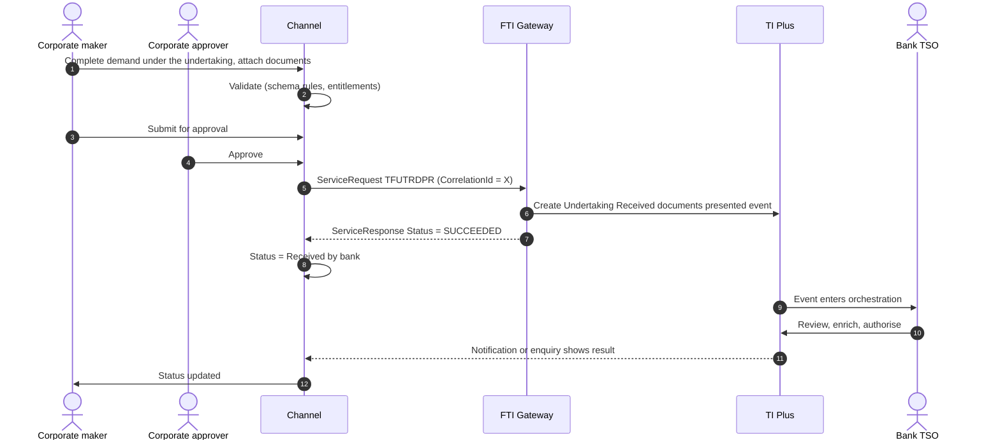

# Undertaking Received (Beneficiary side, new model)

> Part of the product specifications. Index and shared rules: [README](README.md). Shared message bodies: [shared message shapes](shared-message-shapes.md). Catalogue: [01](../01-interface-catalogue.md) · Functional spec: [02](../02-functional-specification.md).

| | |
|---|---|
| Priority | P2 |
| Customer role | Beneficiary |
| TI product code (`Context.Product`) | `UTR` **[Assumption – confirm in TI]** |
| Messages | 7 |

## 1. Purpose and scope

The beneficiary-side counterpart of [Undertaking Issued](undertaking-issued.md): a guarantee, standby or similar undertaking issued by another bank in favour of our customer, held in the structured `UndertakingDetails` model. The `*NEW` and `*AMD` messages of the export products record an instrument **received** from the issuing bank. They are raised by the bank (or by a scanning/advising process), not by the beneficiary customer. They are documented as reference for the data the channel will read, and marked *Bank-side* or *Review*.

Out of scope: Advising work.

> **Reading guide.** Field names, lengths and enumerations come from `sources/xsd_element_docs/`. Statements marked **[Proposed]** or **[Assumption]** are design decisions or guesses that the interface documents cannot confirm. Names are copied exactly from the schema, including its inconsistencies in capitalisation and spelling.

## 2. Messages

| Message | Kind | Creates in TI | Channel exposure | Phase | Body |
|---|---|---|---|---|---|
| `TFUTRDPR` | Claim / presentation | Undertaking Received documents presented event | Customer | 4 | own |
| `TFUTRPYR` | Claim response | Undertaking Received outstanding presentation event | Review | 4 | [Shape: Claim response](shared-message-shapes.md#shape-claim-response) (+diff) |
| `TFUTRBMR` | Response / request | Undertaking Received - Beneficiary Response to Amend event | Customer | 4 | [Shape: Undertaking beneficiary response](shared-message-shapes.md#shape-undertaking-beneficiary-response) |
| `TFUTRBCR` | Response / request | Undertaking Received - Beneficiary Response to Cancel event | Customer | 4 | [Shape: Undertaking beneficiary response](shared-message-shapes.md#shape-undertaking-beneficiary-response) |
| `TFUTRCOR` | Correspondence | Undertaking Received correspondence event | Customer | 4 | [Shape: Correspondence](shared-message-shapes.md#shape-correspondence) |
| `TFUTRNEW` | Create / issue | Undertaking advise event | Bank-side | - | own |
| `TFUTRAMD` | Amend | Undertaking Received amend event | Bank-side | - | own |

**Exposure key.** *Customer* – the corporate starts or answers it in the channel. *Review* – schema description does not make the sender clear; confirm with the TI team before exposing. *Bank-side* – raised by the bank or an interbank counterparty; do not expose to customers.

## 3. Business scenario

As for the guarantee received: the beneficiary makes a demand, with amounts and charges, and the bank examines it and forwards it.

**Demand**



## 4. Preconditions

1. The undertaking is advised and matched to the beneficiary.
2. The undertaking is live.

## 5. Screens

Short demand form on top of the undertaking summary.

| Step | Section | Fields (schema element) |
|---|---|---|
| 1 | **Undertaking summary** | Read-only |
| 2 | **Demand** | `PresentationDetails`, `AdditionalAmount`, `DemandDetails`, `PresentersAction`, `RequestType`, `NotesFromPresenter` |
| 3 | **Charges** | `ChargesAdded`, `ChargesDeducted` |
| 4 | **Documents** | Demand letter, statements |
| 5 | **Review and submit** |  |

> **[Proposed] Fields hidden from the customer or set by configuration.** `Context.Team`, `Context.Step`, `Context.ExchangeNonAutoComplete`, `Context.BehalfOfBranch*`, `ExternalReview`, `ProvisionalFlags`, `BankCodes`, `ContinueEvent`, `Provisional`, `AutoCreateFollowOnEvent`, `FinalWording`, `TakeonExtra`, `InternalMasterRefSequence`, `OutstandingAmount`, `OutstandingAdditionalAmount`, `OriginalMasterReference`, `PreallocatedNo`. They affect routing, bank processing or data take-on, and should be set by channel configuration or left to TI defaults. Confirm each with the TI team (02, Q10). Also `DiscrepancyDetails` (set by the bank).

## 6. Primary message `TFUTRDPR`

Primary instruction of this product. Creates: Undertaking Received documents presented event.

### 6.1 Context

| Element | Value |
|---|---|
| `Branch` | The booking branch from the corporate configuration. |
| `Customer` | The customer's TI mnemonic (max 20). |
| `Product` | `UTR` **[Assumption]** |
| `Event` | Normally implied by the message name. Leave empty unless the TI team asks for it. **[Assumption]** |
| `TheirReference` | Customer's own reference (max 34). |
| `OurReference` / `MasterRef` | **Required.** `MasterRef`. |

The remaining `Context` elements (`Team`, `Step`, `BehalfOfBranch*`, `TemplateIdentifier`, `EventReference`, `ExchangeNonAutoComplete`, `SubsidiaryMasterPrefixAndSerial`) are set by configuration. See [README](README.md#common-blocks-in-every-message).

### 6.2 Channel-managed elements

| Element | Value |
|---|---|
| `eBankMasterRef` / `EBankMasterRef` (max 20) | The channel's id for the master. Constant for every later event on it. |
| `eBankEvent` / `eBankEventRef` / `EBankEventRef` (max 20) | The channel's id for this event. Unique per instruction; the key for idempotent retries. |
| `EmbeddedItemss` | Inline attachments (`ID`, `AttachType`, `DocType`, `Description`, `FileName`, `DataStream`, `MimeType`, `DocumentFileName`); `IsCustomerAttachedDocument` = `Y`. |
| `DocumentsReceiveds` | References to documents already in the DMS, if the upload-first approach is chosen (02, Q8). |

**Capitalisation differs between messages** (`eBankMasterRef` in some, `EBankMasterRef` in others; `eBankEvent`, `eBankEventRef` and `EBankEventRef`). The channel generates names from the schema catalogue and must never hand-type them.

### 6.3 Field reference

All top-level elements, in schema order, then the nested structures and enumerations.

| Element | Type / length | Description |
|---|---|---|
| `Sender` | party | The sender of the message. |
| `PresentersAction` | string ≤3 | Presenter's action as defined by payment actions in system tailoring. |
| `RequestType` | string 1–1 | Underlying behaviour for presenter's action. This is used to find the default presenter's action for the underlying behaviour if the PresentersActi... |
| `NotesFromPresenter` | string ≤3350 | Notes from presenter. |
| `eBankMasterRef` | string ≤20 | Unique reference meaningful to the sending system which applies to the master. |
| `eBankEventRef` | string ≤20 | Unique reference meaningful to the sending system which applies to this transaction. |
| `PresentationDetails` | group | Presentation details. |
| `AdditionalAmount` | group | Additional amount. |
| `DemandDetails` | group | Demand details. |
| `ChargesAdded` | group | Charges added. |
| `ChargesDeducted` | group | Charges deducted. |
| `DiscrepancyDetails` | string ≤16120 | Discrepancy details. |
| `AdditionalData` | group | Additional data for the event - where customization is not used the bank can attach details to the event which are mapped to the additional data he... |
| `ExtraData` | group |  |

#### Nested structures of `TFUTRDPR`

**`PresentationDetails`**

| Path | Type / length | Description |
|---|---|---|
| `PresentationDetails/PresentationAmount` | group | Amount Gateway pane. Note that this pane may have the currency included as part of the amount source or the... |
| `PresentationDetails/PresentationAmount/Amount` | string ≤22 |  |
| `PresentationDetails/PresentationAmount/Currency` | string 1–3 | Currency. |
| `PresentationDetails/PresentationDate` | date | Presentation date. |
| `PresentationDetails/PresentersReference` | string 1–34 | Transaction reference number - Customer reference number. |

**`AdditionalAmount`**

| Path | Type / length | Description |
|---|---|---|
| `AdditionalAmount/Amount` | string ≤22 |  |
| `AdditionalAmount/Currency` | string 1–3 | Currency. |

**`DemandDetails`**

| Path | Type / length | Description |
|---|---|---|
| `DemandDetails/AdditionalAmountInformation` | string ≤804 | Additional amount information. |
| `DemandDetails/RequestedNewExpiryDate` | date | Requested new expiry date. |
| `DemandDetails/DemandStatementCode` | string ≤1 | Available values: 'C'='Complete demand', 'I'='Incomplete demand'. |
| `DemandDetails/DemandNarrative` | string ≤3350 | Narrative covering details of the Demand. |
| `DemandDetails/PresentationCompletionDetails` | string ≤740 | Details of how an incomplete presentation of documents will be completed. |

**`ChargesAdded`**

| Path | Type / length | Description |
|---|---|---|
| `ChargesAdded/Amount` | string ≤22 |  |
| `ChargesAdded/Currency` | string 1–3 | Currency. |

**`ChargesDeducted`**

| Path | Type / length | Description |
|---|---|---|
| `ChargesDeducted/Amount` | string ≤22 |  |
| `ChargesDeducted/Currency` | string 1–3 | Currency. |

**`AdditionalData`**

| Path | Type / length | Description |
|---|---|---|
| `AdditionalData/DataItem` | group ×n | Receives "additional data" from Gateway, which are recorded as event notifications. |
| `AdditionalData/DataItem/Name` | string ≤50 |  |
| `AdditionalData/DataItem/Value` | string |  |


#### Enumerated values in `TFUTRDPR`

| Path | Allowed values |
|---|---|
| `RequestType` | `S` Documents sent on approval; `O` Other; `R` Pay and claim reimbursement; `F` Request acceptance; `A` Request authorisation to pay; `q` Request pay or extend; `P` Request payment; `D` Sender has debited our account |
| `DemandDetails/DemandStatementCode` | `C` Complete demand; `I` Incomplete demand |


## 7. Other messages

### `TFUTRPYR` – Respond to an outstanding presentation

| | |
|---|---|
| Creates in TI | Undertaking Received outstanding presentation event |
| Purpose (schema) | - |
| Channel exposure | Review |
| Phase | 4 |

**Body:** [Shape: Claim response](shared-message-shapes.md#shape-claim-response) with differences.

* Adds: `ResponseNarrative`
* Omits: `RequestedNewExpiryDateLocal`

| Element | Type / length | Description |
|---|---|---|
| `ResponseNarrative` | string ≤1820 |  |

### `TFUTRBMR` – Respond to an amendment

| | |
|---|---|
| Creates in TI | Undertaking Received - Beneficiary Response to Amend event |
| Purpose (schema) | - |
| Channel exposure | Customer |
| Phase | 4 |

**Body:** [Shape: Undertaking beneficiary response](shared-message-shapes.md#shape-undertaking-beneficiary-response).

### `TFUTRBCR` – Respond to a cancellation

| | |
|---|---|
| Creates in TI | Undertaking Received - Beneficiary Response to Cancel event |
| Purpose (schema) | - |
| Channel exposure | Customer |
| Phase | 4 |

**Body:** [Shape: Undertaking beneficiary response](shared-message-shapes.md#shape-undertaking-beneficiary-response).

### `TFUTRCOR` – Correspondence

| | |
|---|---|
| Creates in TI | Undertaking Received correspondence event |
| Purpose (schema) | A general purpose message that is sent by the Beneficiary to the Advising Bank in the form of an Ancillary message, General correspondence, Queries or Answers |
| Channel exposure | Customer |
| Phase | 4 |

**Body:** [Shape: Correspondence](shared-message-shapes.md#shape-correspondence).

### `TFUTRNEW` – Undertaking advised (received)

| | |
|---|---|
| Creates in TI | Undertaking advise event |
| Purpose (schema) | - |
| Channel exposure | Bank-side |
| Phase | - |

Not exposed to customers, so the body is not specified here. Top-level elements, in schema order: `RelatedMasterRef`, `EBankMasterRef`, `EBankEventRef`, `Operative`, `MarginDeposit`, `CollateralDetails`, `LicenseDetails`, `FXContracts`, `ChargeDetails`, `AdditionalParties`, `RequestType`, `PartyInstructions`, `ContractDetails`, `ShipmentDetails`, `RequestedConfirmationDetails`, `PreallocatedNo`, `FinalWording`, `InstructionsReceived`, `UndertakingDetails`, `OurConfirmationDetails`, `PartyDetails`, `HSCode`, `AdditionalData`, `ExtraData`. Details: `sources/xsd_element_docs/TI.TFUTRNEW.xsd.txt`.

### `TFUTRAMD` – Amendment received

| | |
|---|---|
| Creates in TI | Undertaking Received amend event |
| Purpose (schema) | - |
| Channel exposure | Bank-side |
| Phase | - |

Not exposed to customers, so the body is not specified here. Top-level elements, in schema order: `RelatedMasterRef`, `EBankMasterRef`, `EBankEventRef`, `Operative`, `MarginDeposit`, `CollateralDetails`, `LicenseDetails`, `FXContracts`, `ChargeDetails`, `AdditionalParties`, `RequestType`, `PartyInstructions`, `ContractDetails`, `ShipmentDetails`, `RequestedConfirmationDetails`, `InstructionsReceived`, `AmendmentDetails`, `UndertakingDetails`, `OurConfirmationDetails`, `PartyDetails`, `HSCode`, `AdditionalData`, `ExtraData`. Details: `sources/xsd_element_docs/TI.TFUTRAMD.xsd.txt`.

## 8. Validation rules

### 8.1 Rules supported directly by the schema

Lengths, data types and the allowed values of coded fields are in the tables in sections 6 and 7 and are the source for the channel's client and server validators. Dates are ISO `xsd:date`. Boolean elements carry `Y` or `N`. Amounts are strings (maximum 22 characters); agree the decimal format with the TI team. 

### 8.2 Business rules to apply in the channel

Normal practice for this product and the checks a TSO would otherwise perform by hand. **[Proposed]**: switch each on or off per bank policy.

| # | Rule |
|---|---|
| V1 | Same demand rules as the export standby. |
| V2 | Charges added or deducted are shown separately from the demand amount. |

### 8.3 Minimum content for a usable instruction

**[Proposed]** `MasterRef`, `Sender`, `PresentationDetails`, `DemandDetails`.

## 9. Illustrative requests

Values are invented. Element names, prefixes and order follow `sources/example_xml/`. Elements not shown are omitted, which the schema allows for optional elements. **Test against the gateway before use.**

**`TFUTRDPR`**

```xml
<?xml version="1.0" standalone="yes"?>
<ServiceRequest xmlns:xsi="http://www.w3.org/2001/XMLSchema-instance"
                xmlns:m="urn:messages.service.ti.apps.tiplus2.misys.com"
                xmlns:c="urn:common.service.ti.apps.tiplus2.misys.com"
                xmlns="urn:control.services.tiplus2.misys.com">
  <RequestHeader>
    <Service>TI</Service>
    <Operation>TFUTRDPR</Operation>
    <Credentials><Name>CHANNEL_SVC</Name><Password>********</Password></Credentials>
    <TargetSystem>TI</TargetSystem>
    <SourceSystem>CORPCHANNEL</SourceSystem>
    <CorrelationId>9b1f4c2e-5a0d-4c47-9f3e-2c1d7a6b8e10</CorrelationId>
    <CreationDate>2026-10-18</CreationDate>
  </RequestHeader>
  <m:TFUTRDPR>
    <m:Context>
      <c:Branch>HOBR</c:Branch>
      <c:Customer>ACMEEXP</c:Customer>
      <c:Product>UTR</c:Product>
      <c:TheirReference>CLAIM-2026-02</c:TheirReference>
    </m:Context>
    <m:MasterRef>UTR2600003</m:MasterRef>
    <m:Sender>
      <c:Customer>ACMEEXP</c:Customer>
    </m:Sender>
    <m:PresentersAction>Sam</m:PresentersAction>
    <m:NotesFromPresenter>Demand under undertaking UTR2600003.</m:NotesFromPresenter>
    <m:eBankMasterRef>CH-UTR-000003</m:eBankMasterRef>
    <m:eBankEventRef>CH-UTR-000003-03</m:eBankEventRef>
  </m:TFUTRDPR>
</ServiceRequest>
```

## 10. Response handling and tracking

| `Status` | Channel behaviour |
|---|---|
| `SUCCEEDED` | TI accepted the message and created the event. Mark `ReceivedByBank`; keep `Warning` / `Info` texts. |
| `FAILED` | TI rejected the message. Show `Details.Error` to the maker and return the draft. No automatic retry. |
| `UNAVAILABLE` / timeout | Keep in the outbox, retry with back-off, and confirm by enquiry (`eBankEventRef`) before each re-send so no second event is created. |

Rules shared by every product are in [README – Common behaviour](README.md#common-behaviour).

As for the guarantee received.

## 11. Exceptions

| Scenario | Handling |
|---|---|
| Counter-undertaking linked | Show both masters and the claim path. |
| Gateway `FAILED`, `UNAVAILABLE`, timeout, duplicate click | As in [README – Common behaviour](README.md#common-behaviour). |

## 12. Acceptance criteria

1. A demand produces one `TFUTRDPR`.
2. Responses reference the original event.
3. Bank-side messages are never offered.
4. Every step is in the audit trail with user, time and `CorrelationId`.
5. The stored request validates against the schema rules in 8.1 and matches the structure in section 9.

## 13. Open items

| # | Item |
|---|---|
| UTR-1 | Confirm UTR is used by the bank in place of EGT/ESB for new business. |
| UTR-2 | Confirm `DemandDetails` structure. |
