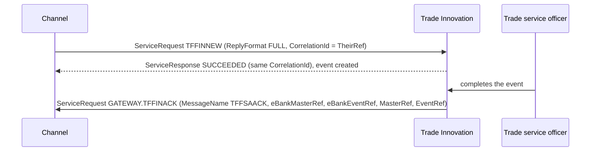

# Working messages from the bank's test environment

> Hand-written. Messages here were **accepted by the bank's TI test environment**. They are stronger evidence than the gateway documentation or the SDK guides. Customer data has been replaced with invented values before committing (ground rule 9); structure, element order, codes and reference formats are kept exactly.

## 1. `TFFINNEW` – Finance Standalone create (received 2026-10-23)

```xml
<?xml version="1.0" encoding="UTF-8"?>
<ns2:TFFINNEW xmlns="urn:control.services.tiplus2.misys.com" xmlns:ns2="urn:messages.service.ti.apps.tiplus2.misys.com" xmlns:ns4="urn:custom.service.ti.apps.tiplus2.misys.com" xmlns:ns3="urn:common.service.ti.apps.tiplus2.misys.com">
  <ns2:Context>
    <ns3:Customer>0009990001</ns3:Customer>
    <ns3:TheirReference>TESTING_20260813_2</ns3:TheirReference>
    <ns3:BehalfOfBranch>001</ns3:BehalfOfBranch>
  </ns2:Context>
  <ns2:EventNotificationss>
    <ns2:EventNotifications>
      <ns2:MessageData>TESTING2</ns2:MessageData>
      <ns2:MessageDescription>Description of Goods</ns2:MessageDescription>
      <ns2:MessageInfo>Additional information</ns2:MessageInfo>
      <ns2:Actioned>N</ns2:Actioned>
    </ns2:EventNotifications>
  </ns2:EventNotificationss>
  <ns2:Amount>
    <ns3:Amount>111.01</ns3:Amount>
    <ns3:Currency>USD</ns3:Currency>
  </ns2:Amount>
  <ns2:DebitParty>
    <ns3:Customer>0009990001</ns3:Customer>
    <ns3:NameAddress>POC TEST CUSTOMER</ns3:NameAddress>
    <ns3:Reference>TESTING_20260813_2</ns3:Reference>
  </ns2:DebitParty>
  <ns2:EffectiveDate>2025-11-13</ns2:EffectiveDate>
  <ns2:FinanceAmount>
    <ns3:Amount>111.01</ns3:Amount>
    <ns3:Currency>USD</ns3:Currency>
  </ns2:FinanceAmount>
  <ns2:InterestSettlementCcy>USD</ns2:InterestSettlementCcy>
  <ns2:MaturityDate>2026-01-12</ns2:MaturityDate>
  <ns2:StartDate>2025-11-13</ns2:StartDate>
  <ns2:TrustReceiptLoan>N</ns2:TrustReceiptLoan>
  <ns2:InterestFromAfter>A</ns2:InterestFromAfter>
  <ns2:eBankMasterRef>TF2607130000XX03</ns2:eBankMasterRef>
  <ns2:eBankEventRef>2607130000XX03</ns2:eBankEventRef>
  <ns2:ProductCode>FSA</ns2:ProductCode>
  <ns2:FinancePeriod>
    <ns3:TenorDays>60</ns3:TenorDays>
    <ns3:TenorPeriod>D</ns3:TenorPeriod>
  </ns2:FinancePeriod>
  <ns2:TheirRef>TESTING_20260813_2</ns2:TheirRef>
  <ns2:ProductType>PSF</ns2:ProductType>
</ns2:TFFINNEW>
```

It is valid against TI's XSD jar (`python3 -I tools/xsdcheck/check_samples.py` checks the POC copy of it).

### What it tells us

| Observation | Consequence | Where recorded |
|---|---|---|
| No `ServiceRequest` / `RequestHeader` envelope. | **Superseded by section 2:** the message actually sent to TI had the envelope; this sample was the body only. | Q33 (answered) |
| Namespace prefixes `ns2`, `ns3`, `ns4` and the default control namespace on the root: the typical output of a JAXB marshaller built from the XSD jar. | Prefixes do not matter; the namespaces do. Generating from the jar (ADR 0004) is consistent with what works. | – |
| Valid against the **2.10.3.1 bank build** in the jar. | Supports the working assumption of Q32 (the jar wins). | Q32 |
| `Context` has only `Customer`, `TheirReference`, `BehalfOfBranch`: **no `Branch`, no `Product`, no `Event`.** | `Context/Product` is not needed for `TFFINNEW`; the product is given in the body. Our specs filled `Branch` and `Product` in every sample. | Financing spec |
| Product **`FSA`** (Finance Standalone) in `ProductCode`, product type `PSF` in `ProductType`. | The financing spec assumed `FIN`; corrected for `TFFINNEW`. Other products may also carry the code in the body; check per message. | `docs/products/financing.md` |
| The same value appears **three times**: `Context/TheirReference`, `DebitParty/Reference`, `TheirRef`. | **The bank defines `TheirRef` as the message reference, unique for each message delivered** (2026-10-23); in a test with one message per transaction the values coincide. The channel generates `TheirRef` per delivery and keeps the customer's reference in `Context/TheirReference` and `DebitParty/Reference` (Q34). | POC; financing sample; Q34 |
| `eBankMasterRef` = `"TF"` + `eBankEventRef` (16 and 14 characters). **Section 2 shows they are independent numbers.** | **Bank definitions (2026-10-23):** `eBankMasterRef` is the channel's transaction number, `eBankEventRef` the channel's event number (issue, claim, ...). For a first event the numbers coincide; later events on the same transaction get new event numbers. Both allow at least 20 characters. | POC; Q34 |
| `EventNotifications` carries free text (`MessageData`, `MessageDescription`, `MessageInfo`, `Actioned` = `N`). | A way to pass a note to the trade service officer with the event. | – |
| `EffectiveDate` = `StartDate`; `MaturityDate` = `StartDate` + `TenorDays` (60). | Dates must be consistent; the POC computes them from today. | POC |

## 2. `TFFINNEW` round trip, sent by hand (2026-10-23)

The bank put `TFFINNEW` on TI's incoming queue. TI created the transaction automatically and answered at once with a `ServiceResponse`. After a trade service officer completed the event in TI, TI put an outward message `TFFINACK` on the queue. Customer data, the middleware name, references and the attached PDF have been replaced; everything else is as received. The three messages are kept, ready to use, in [docs/samples](../samples/README.md#finance-standalone) (also the application's test fixtures).



### 2.1 Sent: `TFFINNEW` with envelope

```xml
<?xml version="1.0" standalone="yes"?><ServiceRequest xmlns:xsi='http://www.w3.org/2001/XMLSchema-instance' xmlns:m='urn:messages.service.ti.apps.tiplus2.misys.com' xmlns:c='urn:common.service.ti.apps.tiplus2.misys.com' xmlns='urn:control.services.tiplus2.misys.com'>
	<RequestHeader>
		<Service>TI</Service>
		<Operation>TFFINNEW</Operation>
		<Credentials>
            <Name>SUPERVISOR</Name>
        </Credentials>
        <ReplyFormat>FULL</ReplyFormat>
        <TargetSystem>ZONE1</TargetSystem>
        <SourceSystem>TRADECHANNEL</SourceSystem>
        <NoRepair>Y</NoRepair>
        <NoOverride>Y</NoOverride>
        <CorrelationId>MSG-20261023093000-0A1B2C3D</CorrelationId>
        <TransactionControl>NONE</TransactionControl>
	</RequestHeader>
	<m:TFFINNEW>
	  <m:Context>
		<c:Customer>0009990001</c:Customer>
		<c:TheirReference>MSG-20261023093000-0A1B2C3D</c:TheirReference>
		<c:BehalfOfBranch>001</c:BehalfOfBranch>
	  </m:Context>
	  <m:EventNotificationss>
		<m:EventNotifications>
		  <m:MessageData>MSG-20261023093000-0A1B2C3D</m:MessageData>
		  <m:MessageDescription>Description of Goods</m:MessageDescription>
		  <m:MessageInfo>Additional information</m:MessageInfo>
		  <m:Actioned>N</m:Actioned>
		</m:EventNotifications>
	  </m:EventNotificationss>
	  <m:Amount>
		<c:Amount>101.00</c:Amount>
		<c:Currency>USD</c:Currency>
	  </m:Amount>
	  <m:DebitParty>
		<c:Customer>0009990001</c:Customer>
		<c:NameAddress>POC TEST CUSTOMER</c:NameAddress>
		<c:Reference>MSG-20261023093000-0A1B2C3D</c:Reference>
	  </m:DebitParty>
	  <m:EffectiveDate>2025-06-01</m:EffectiveDate>
	  <m:FinanceAmount>
		<c:Amount>102.00</c:Amount>
		<c:Currency>USD</c:Currency>
	  </m:FinanceAmount>
	  <m:InterestSettlementCcy>USD</m:InterestSettlementCcy>
	  <m:MaturityDate>2026-01-12</m:MaturityDate>
	  <m:StartDate>2025-06-01</m:StartDate>
	  <m:TrustReceiptLoan>N</m:TrustReceiptLoan>
	  <m:InterestFromAfter>A</m:InterestFromAfter>
	  <m:eBankMasterRef>TF2610230930001A</m:eBankMasterRef>
	  <m:eBankEventRef>26102309300077</m:eBankEventRef>
	  <m:ProductCode>FSA</m:ProductCode>
	  <m:FinancePeriod>
		<c:TenorDays>60</c:TenorDays>
		<c:TenorPeriod>D</c:TenorPeriod>
	  </m:FinancePeriod>
	  <m:TheirRef>MSG-20261023093000-0A1B2C3D</m:TheirRef>
	  <m:ProductType>PSF</m:ProductType>
	</m:TFFINNEW>
</ServiceRequest>
```

### 2.2 Immediate reply: `ServiceResponse`

```xml
<?xml version="1.0" encoding="UTF-8"?><ServiceResponse xmlns="urn:control.services.tiplus2.misys.com" xmlns:ns2="urn:messages.service.ti.apps.tiplus2.misys.com" xmlns:ns4="urn:custom.service.ti.apps.tiplus2.misys.com" xmlns:ns3="urn:common.service.ti.apps.tiplus2.misys.com"><ResponseHeader><Service>TI</Service><Operation>TFFINNEW</Operation><Status>SUCCEEDED</Status><Details><Warning>Request for service: 'TI' operation: 'TFFINNEW' does not return any response data</Warning></Details><CorrelationId>MSG-20261023093000-0A1B2C3D</CorrelationId><TargetSystem>TRADECHANNEL</TargetSystem><SourceSystem>ZONE1</SourceSystem></ResponseHeader></ServiceResponse>
```

### 2.3 On completion: `TFFINACK` (outward; empty structured-address fields of the two parties removed, PDF shortened)

```xml
<?xml version="1.0" encoding="UTF-8"?><ServiceRequest xmlns="urn:control.services.tiplus2.misys.com" xmlns:ns2="urn:messages.service.ti.apps.tiplus2.misys.com" xmlns:ns4="urn:custom.service.ti.apps.tiplus2.misys.com" xmlns:ns3="urn:common.service.ti.apps.tiplus2.misys.com"><RequestHeader><Service>GATEWAY</Service><Operation>TFFINACK</Operation><Credentials><Name>SUPERVISOR</Name></Credentials><ReplyFormat>FULL</ReplyFormat><SourceSystem>ZONE1</SourceSystem><NoRepair>Y</NoRepair><NoOverride>Y</NoOverride><CorrelationId>74497</CorrelationId><TransactionControl>NONE</TransactionControl><CreationDate>2025-06-30</CreationDate></RequestHeader><tffindet xmlns:xsi="http://www.w3.org/2001/XMLSchema-instance">
<MessageName>TFFSAACK</MessageName>
<eBankMasterRef>TF2610230930001A</eBankMasterRef>
<eBankEventRef>26102309300077</eBankEventRef>
<MasterRef>C001PSF0000001ID</MasterRef>
<EventRef>CRE001</EventRef>
<OriginalTxn>Y</OriginalTxn>
<ReceivedDate>2025-06-30</ReceivedDate>
<EventCode>CSA</EventCode>
<ProductTypeCode>PSF</ProductTypeCode>
<ProductSubTypeCode xsi:nil="true"/>
<BankComment>We accept this financing request</BankComment>
<RelatedRef xsi:nil="true"/>
<Provisional>N</Provisional>
<Sequence>1</Sequence>
<FinancingRef><![CDATA[MSG-20261023093000-0A1B2C3D]]></FinancingRef>
<TFAmount>10200</TFAmount>
<TFCurrency>USD</TFCurrency>
<LiabAmount>10200</LiabAmount>
<LiabCurrency>USD</LiabCurrency>
<TnxAmount>10200</TnxAmount>
<TnxCurrency>USD</TnxCurrency>
<OutstandingAmt>10200</OutstandingAmt>
<OutstandingCcy>USD</OutstandingCcy>
<StartDate>2025-06-01</StartDate>
<EffectiveDate>2025-06-01</EffectiveDate>
<Tenor>60</Tenor>
<MaturityDate>2025-07-31</MaturityDate>
<InterestRate>1.0</InterestRate>
<DebitPartyId>0009990001</DebitPartyId>
<DebitPartyName>POC TEST CUSTOMER</DebitPartyName>
<DebitPartyAdr2 xsi:nil="true"/>
<DebitPartyAdr3 xsi:nil="true"/>
<DebitPartyAdr4 xsi:nil="true"/>
<DebitPartyAdr5 xsi:nil="true"/>
<DebitPartyLEI xsi:nil="true"/>
<DebitPartyMXAddr1>POC TEST CUSTOMER</DebitPartyMXAddr1>
<DebitPartyMXAddr2>POC TEST CUSTOMER</DebitPartyMXAddr2>
<FinanceToPartyId xsi:nil="true"/>
<FinanceToPartyLEI xsi:nil="true"/>
<BehalfOfBranch>001</BehalfOfBranch>
<MBE>MBE01</MBE>
<FinanceToPartyName>asd</FinanceToPartyName>
<FinanceToPartyAdr2 xsi:nil="true"/>
<FinanceToPartyAdr3 xsi:nil="true"/>
<FinanceToPartyAdr4 xsi:nil="true"/>
<FinanceToPartyAdr5 xsi:nil="true"/>
<FinancingDetails xsi:nil="true"/>
<InstructionsToFinanceParty>asd</InstructionsToFinanceParty>
<InstructionsToDebitParty xsi:nil="true"/>
<AttachedDocuments ><DocumentId>OCFCCREDR</DocumentId><DocumentDesc><![CDATA[Debit/Credit Advice]]></DocumentDesc><Mime><![CDATA[application/pdf]]></Mime><DocDetails><![CDATA[JVBERi0xLjQKJSVFT0YK]]></DocDetails><DocumentReference><![CDATA[0000000000000000:00000000:000000000:-0000]]></DocumentReference></AttachedDocuments >
<CompanyName xsi:nil="true"/>
<Status>LIV</Status>
<TrustReceiptLoan>N</TrustReceiptLoan>
</tffindet></ServiceRequest>
```

### 2.4 What it tells us

| Observation | Consequence | Where recorded |
|---|---|---|
| The message sent **has** the `ServiceRequest` envelope: `Service` = `TI`, `Operation` = `TFFINNEW`, `Credentials/Name` = a TI user, `ReplyFormat` = `FULL`, `TargetSystem` = TI zone id (`ZONE1` in test), `SourceSystem` = the sender's id, `NoRepair` = `Y`, `NoOverride` = `Y`, `CorrelationId`, `TransactionControl` = `NONE`, no `CreationDate`. | The envelope design of ADR 0005 stands and the header values are known (Q2). The sample of section 1 was the body only. | Q2, Q33; ADR 0005 |
| `CorrelationId` = `TheirRef` = `Context/TheirReference` = `DebitParty/Reference` in the test. | `TheirRef` (message reference, unique per delivery) doubles as `CorrelationId`. | Q34; POC |
| `eBankMasterRef` `TF2606000000XX02`, `eBankEventRef` `2606100000XX02`: **not** derived from each other. | Transaction and event numbers are generated independently. | Q34 |
| **Immediate `ServiceResponse`**: `SUCCEEDED`, a warning that `TFFINNEW` "does not return any response data", our `CorrelationId`, `TargetSystem` = our `SourceSystem`, `SourceSystem` = TI zone. TI had already created the event. | State `ReceivedByBank` is set by this reply, matched by `CorrelationId`. `SUCCEEDED` with only that warning is normal. | ADR 0008; Q13 |
| **Outward message on completion**: `ServiceRequest`, `Service` = `GATEWAY`, `Operation` = **`TFFINACK`** (routed by message name), but `MessageName` = **`TFFSAACK`**. No `TargetSystem`; `CorrelationId` is TI's own number; `CreationDate` is TI's business date. | Outward messages are recognised by `Operation` or `MessageName` and matched by `eBankMasterRef` + `eBankEventRef`, never by `CorrelationId`. Ask for the `TFFINACK` mapping and its refusal counterpart. | Q21, Q22 |
| Payload root `tffindet` in the control namespace, **one flat element per mapping field**, like the `TFUTI…` mappings: references, `EventCode` `CSA`, product type, amounts, dates, parties (with structured-address parts), `BankComment` "We accept this financing request", `Status` `LIV`, `AttachedDocuments` with a base64 PDF (the debit/credit advice). Empty values are `xsi:nil="true"`; text may be in `CDATA`. | Confirms POC assumption POC-2. The receiver must handle nil, CDATA and large base64 documents (here a 24 KB PDF). | POC; ADR 0005 |
| `FinancingRef` returns our `TheirRef`. | A third way to match. | POC |
| **Amounts in minor units**: sent `FinanceAmount` 102.00 USD, TI returns `TFAmount` `10200`. | Divide by the currency's decimal places (2 for USD, 0 for JPY, 3 for KWD) when reading outward messages. | Q35 |
| **TI recalculated the maturity**: sent `MaturityDate` 2026-01-12 with a 60-day tenor from 2025-06-01; TI booked `MaturityDate` 2025-07-31 (start + 60). | Tenor wins over a conflicting maturity date; the channel must send consistent values and show TI's. | Q36; financing spec |
| `Amount` (101.00) and `FinanceAmount` (102.00) differed in the test; TI booked 102.00. | `FinanceAmount` is the financed amount. | Financing spec |
